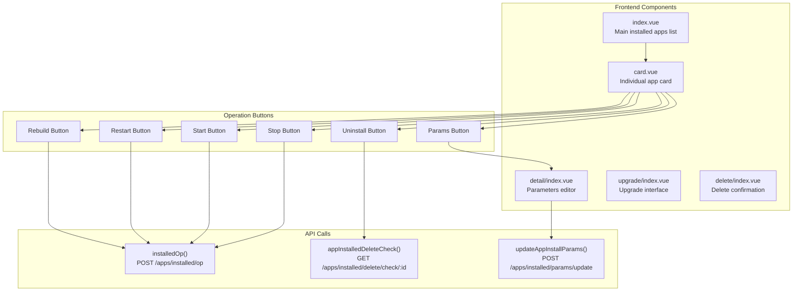
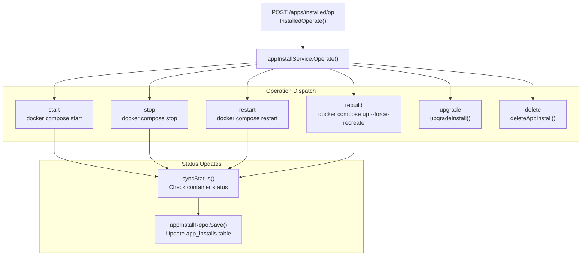
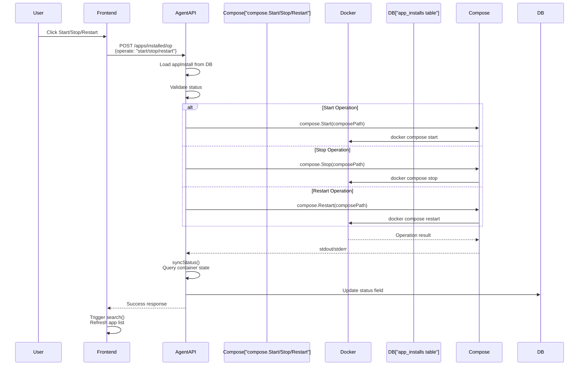
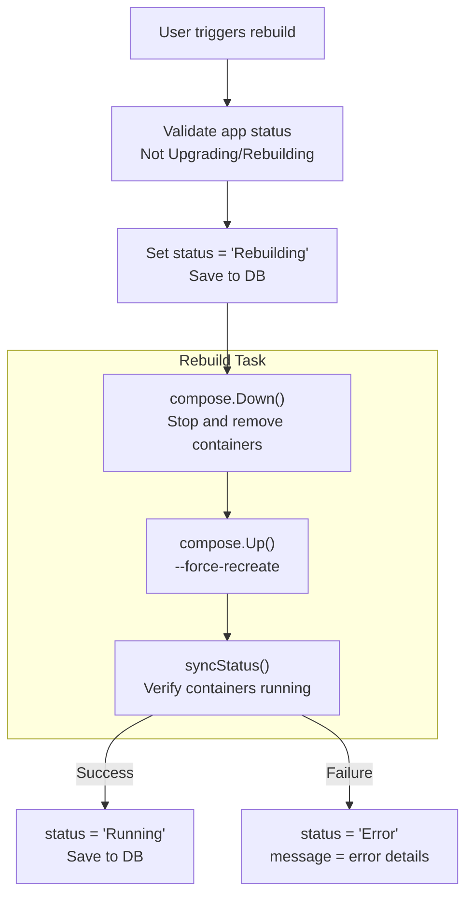
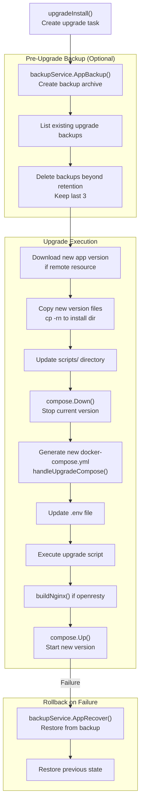
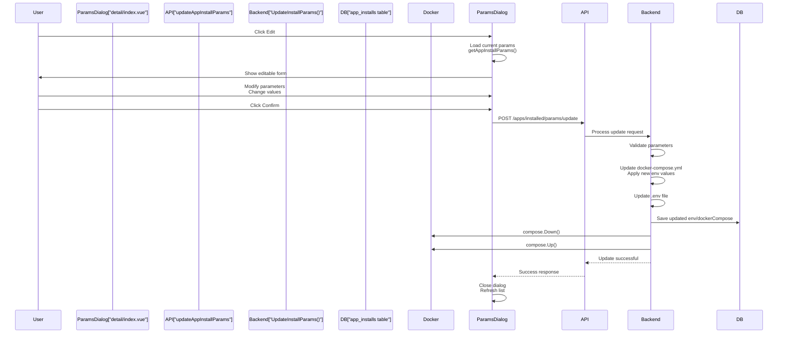
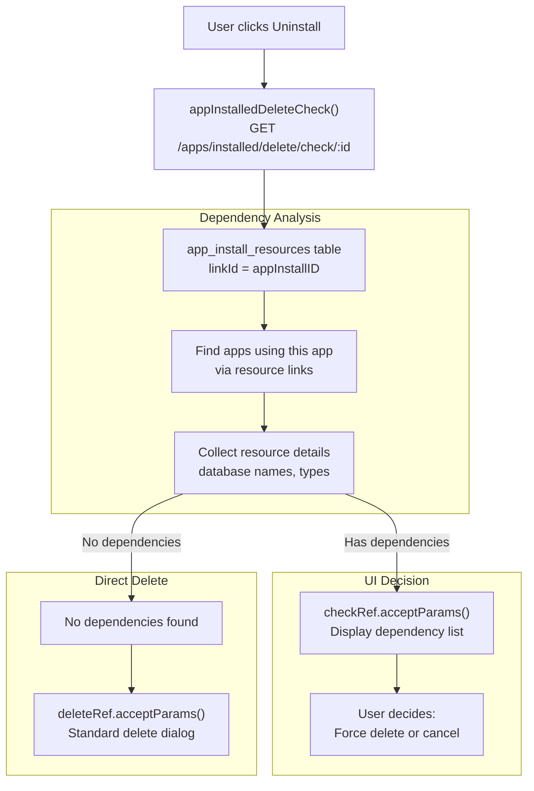
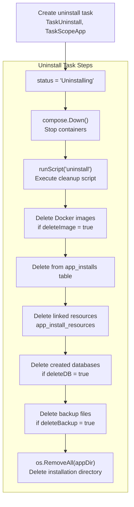
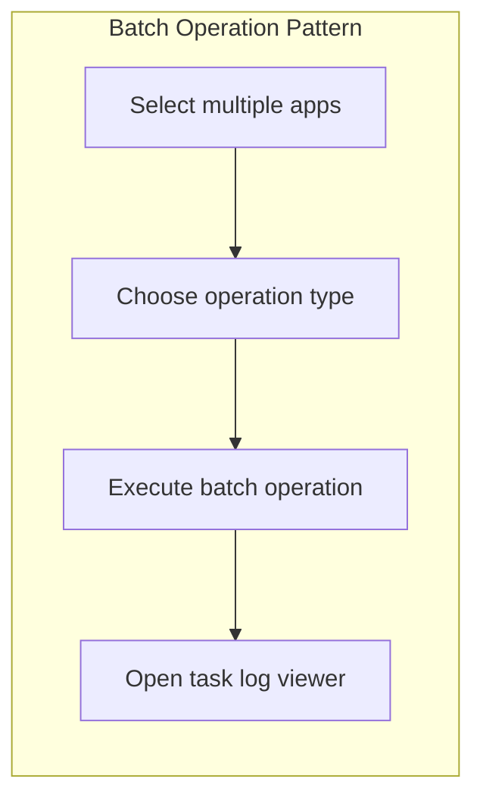
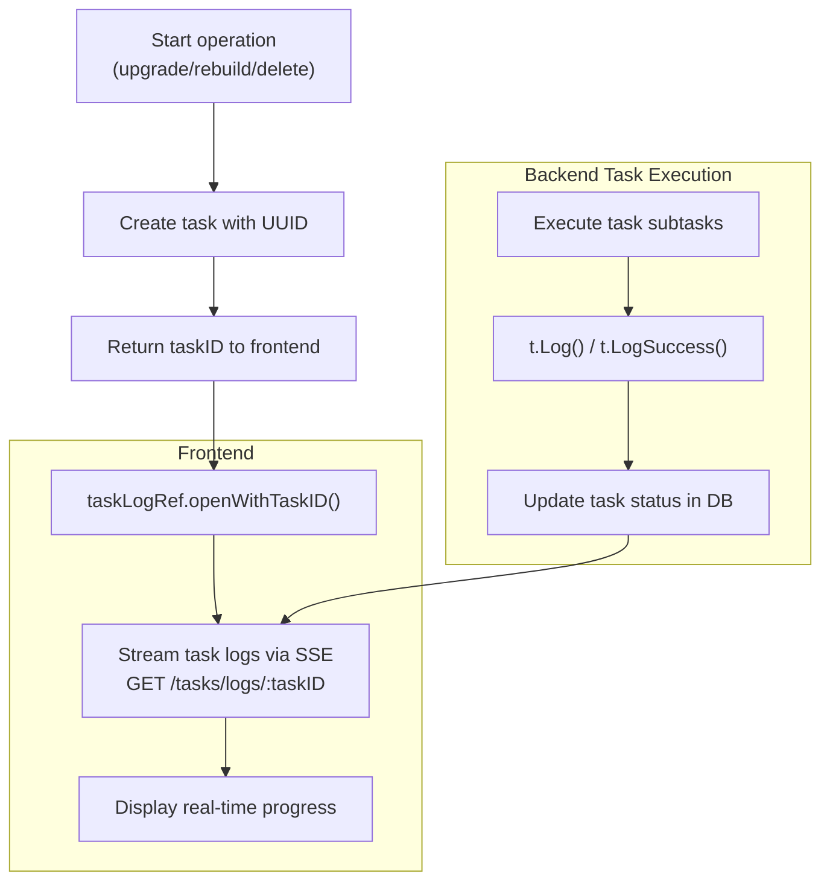

<!-- source: DeepWiki mcp.deepwiki.com · repo 1Panel-dev/1Panel · page 6.3 Installed App Operations · fetched 2026-10-29 -->

# Installed App Operations

<details>
<summary>Relevant source files</summary>

The following files were used as context for generating this wiki page:

- [agent/app/api/v2/app.go](agent/app/api/v2/app.go)
- [agent/app/dto/file.go](agent/app/dto/file.go)
- [agent/app/dto/request/app.go](agent/app/dto/request/app.go)
- [agent/app/dto/response/app.go](agent/app/dto/response/app.go)
- [agent/app/repo/app.go](agent/app/repo/app.go)
- [agent/app/service/app.go](agent/app/service/app.go)
- [agent/app/service/app_install.go](agent/app/service/app_install.go)
- [agent/app/service/app_sync_task.go](agent/app/service/app_sync_task.go)
- [agent/app/service/app_utils.go](agent/app/service/app_utils.go)
- [agent/global/config.go](agent/global/config.go)
- [agent/init/business/business.go](agent/init/business/business.go)
- [agent/init/dir/dir.go](agent/init/dir/dir.go)
- [agent/router/ro_app.go](agent/router/ro_app.go)
- [agent/utils/appicon/appicon.go](agent/utils/appicon/appicon.go)
- [agent/utils/files/utils.go](agent/utils/files/utils.go)
- [agent/utils/req_helper/request.go](agent/utils/req_helper/request.go)
- [core/init/cron/cron.go](core/init/cron/cron.go)
- [frontend/src/api/interface/app.ts](frontend/src/api/interface/app.ts)
- [frontend/src/api/modules/app.ts](frontend/src/api/modules/app.ts)
- [frontend/src/components/app-status/index.vue](frontend/src/components/app-status/index.vue)
- [frontend/src/global/form-rules.ts](frontend/src/global/form-rules.ts)
- [frontend/src/styles/common.scss](frontend/src/styles/common.scss)
- [frontend/src/views/app-store/apps/index.vue](frontend/src/views/app-store/apps/index.vue)
- [frontend/src/views/app-store/detail/index.vue](frontend/src/views/app-store/detail/index.vue)
- [frontend/src/views/app-store/detail/install/index.vue](frontend/src/views/app-store/detail/install/index.vue)
- [frontend/src/views/app-store/detail/params/index.vue](frontend/src/views/app-store/detail/params/index.vue)
- [frontend/src/views/app-store/installed/detail/index.vue](frontend/src/views/app-store/installed/detail/index.vue)
- [frontend/src/views/app-store/installed/index.vue](frontend/src/views/app-store/installed/index.vue)
- [frontend/src/views/app-store/installed/upgrade/index.vue](frontend/src/views/app-store/installed/upgrade/index.vue)
- [frontend/src/views/website/website/create/index.vue](frontend/src/views/website/website/create/index.vue)
- [frontend/src/views/website/website/index.vue](frontend/src/views/website/website/index.vue)

</details>


## Purpose and Scope

This document describes the operations that can be performed on apps after they have been installed in 1Panel. For information about the initial installation process, see [App Installation and Deployment](#6.2). For details about the app store and catalog, see [App Store and Catalog](#6.1).

Installed app operations encompass lifecycle management (start, stop, restart, rebuild), upgrades with rollback support, parameter modification, and uninstallation with dependency checking. All operations are executed through asynchronous task systems with real-time progress logging.

---

## Operation Overview

The installed apps interface provides a comprehensive set of operations accessible through both the UI and API. Operations are executed asynchronously with task tracking and support automatic status synchronization.

### Available Operations

| Operation | Description | Status Requirements | Rollback Support |
|-----------|-------------|---------------------|------------------|
| `start` | Start stopped containers | Not Running | No |
| `stop` | Stop running containers | Running | No |
| `restart` | Restart containers | Any (except transitional) | No |
| `rebuild` | Rebuild containers from docker-compose | Not in transition | No |
| `upgrade` | Upgrade to a new version | Not in transition | Yes (with backup) |
| `delete` | Uninstall the app | Any | No |
| `params` | Update app parameters | Not in transition | No |
| `favorite` | Toggle favorite status | Any | No |

**Sources:**
- [frontend/src/views/app-store/installed/index.vue:296-376]()
- [agent/app/service/app_install.go:42-58]()

---

## Frontend Interface and User Interaction

### Main Installed Apps View

The installed apps are displayed in a card-based grid layout with real-time status indicators. Each app card provides quick access to common operations through action buttons.



**Sources:**
- [frontend/src/views/app-store/installed/index.vue:1-469]()
- [frontend/src/api/modules/app.ts:79-82]()

### Operation State Management

The frontend manages operation states including disabled states during transitions and automatic search refresh after operations complete:

```typescript
// Operation disabled during transitional states
disabled: (row: any) => {
    return (
        row.status === 'DownloadErr' ||
        row.status === 'Upgrading' ||
        row.status === 'Rebuilding' ||
        row.status === 'Uninstalling'
    );
}
```

After successful operations, the view automatically refreshes at intervals (3s, 15s) to reflect status changes from asynchronous task execution.

**Sources:**
- [frontend/src/views/app-store/installed/index.vue:296-376]()
- [frontend/src/views/app-store/installed/index.vue:259-280]()

---

## Backend Operation Handler

### Operation Request Processing

All operations are handled through a unified endpoint that dispatches to specific operation handlers based on the `operate` field.



**Sources:**
- [agent/app/api/v2/app_installed.go:1-300]()
- [agent/app/service/app_install.go:224-366]()

### Operation Implementation

The `Operate` function in the backend validates the operation and app state before executing:

**Sources:**
- [agent/app/service/app_install.go:224-366]()

---

## Basic Lifecycle Operations

### Start, Stop, and Restart

These operations directly interact with Docker Compose to control container states. They are synchronous and provide immediate status updates.



The operations use the docker-compose CLI wrapper functions defined in `agent/utils/compose`:
- `compose.Start()` executes `docker compose -f [path] start`
- `compose.Stop()` executes `docker compose -f [path] stop`
- `compose.Restart()` executes `docker compose -f [path] restart`

After execution, `syncStatus()` queries Docker for the actual container state and updates the database.

**Sources:**
- [agent/app/service/app_install.go:253-283]()
- [agent/utils/compose/compose.go:1-200]()

---

## Rebuild Operation

Rebuild recreates containers from the stored docker-compose configuration, useful for applying configuration changes or recovering from container corruption.

### Rebuild Process Flow



The rebuild operation forcefully recreates containers even if the image and configuration haven't changed, which is useful for:
- Recovering from corrupted container state
- Applying changes to volumes or networks
- Testing container initialization scripts

**Sources:**
- [agent/app/service/app_install.go:285-324]()

---

## Upgrade Operation

The upgrade operation is the most complex, supporting version changes with automatic backup, rollback capability, and multi-step task execution.

### Upgrade Task Structure



**Sources:**
- [agent/app/service/app_utils.go:674-898]()

### Upgrade Compose Handling

During upgrades, the docker-compose file must be updated to use the new version's service definitions while preserving custom user settings:

The `handleUpgradeCompose()` function:
1. Parses the new version's docker-compose YAML
2. Renames the service to match the installed service name if needed
3. Preserves `deploy` and `restart` settings from the old compose file
4. Merges with common parameters (CPU, memory limits, container name)

**Sources:**
- [agent/app/service/app_utils.go:513-602]()

### Version Selection and Update Checking

The frontend provides a version selector that fetches available upgrade versions:

**Sources:**
- [frontend/src/views/app-store/installed/upgrade/index.vue:1-250]()
- [agent/app/service/app_install.go:522-589]()

---

## Parameter Updates

Installed apps can have their parameters (environment variables and compose settings) updated without reinstallation.

### Parameter Update Flow



### Advanced Configuration Options

The parameter editor supports advanced Docker configuration options:

| Setting | Purpose | Impact |
|---------|---------|--------|
| `cpuQuota` | CPU core limit | Constrains container CPU usage |
| `memoryLimit` | Memory limit (MB/GB) | Constrains container memory |
| `containerName` | Custom container name | Changes container identifier |
| `allowPort` | Expose ports to host | Publishes container ports |
| `specifyIP` | Bind to specific IP | Restricts port binding |
| `restartPolicy` | Restart behavior | no/always/on-failure/unless-stopped |
| `editCompose` | Direct compose editing | Allows raw YAML modification |

When `editCompose` is enabled, users can directly modify the docker-compose YAML, with a diff viewer to compare against the original:

**Sources:**
- [frontend/src/views/app-store/installed/detail/index.vue:1-350]()
- [agent/app/service/app_install.go:591-676]()

---

## Uninstallation with Dependency Checking

Uninstalling an app involves checking for dependent resources, stopping containers, cleaning up linked databases, and removing files.

### Dependency Check System

Before allowing uninstallation, the system checks if other apps depend on the app being deleted:



The dependency check identifies resources created by this app that are used by other apps:
- Databases (MySQL, PostgreSQL)
- Runtime environments (PHP, Node.js, etc.)
- Shared volumes or networks

**Sources:**
- [frontend/src/views/app-store/installed/index.vue:229-246]()
- [agent/app/service/app_install.go:678-731]()

### Uninstallation Task Execution

The actual deletion is performed through an asynchronous task with multiple sub-steps:



Key deletion behaviors:
- `deleteImage`: If true, removes Docker images used by the app (with validation)
- `deleteDB`: If true, deletes created databases and their backups
- `deleteBackup`: If true, removes all backup files from local storage
- `forceDelete`: If true, continues deletion even if errors occur

The task logs all operations for auditing and troubleshooting.

**Sources:**
- [agent/app/service/app_utils.go:333-468]()

### Database Resource Cleanup

When deleting linked databases, the system calls the respective service delete methods:

**Sources:**
- [agent/app/service/app_utils.go:470-511]()

---

## Status Synchronization

### Container Status Monitoring

Apps have multiple status values that reflect their operational state:

| Status | Description | Source |
|--------|-------------|--------|
| `Installing` | Initial installation in progress | Set during installation task |
| `Running` | All containers are running | Synced from Docker |
| `Stopped` | All containers are stopped | Synced from Docker |
| `Error` | Containers in error state | Synced from Docker |
| `Upgrading` | Upgrade operation in progress | Set during upgrade task |
| `Rebuilding` | Rebuild operation in progress | Set during rebuild task |
| `Uninstalling` | Deletion in progress | Set during uninstall task |
| `UpgradeErr` | Upgrade failed | Set on upgrade error |
| `InstallErr` | Installation failed | Set on install error |

### Status Sync Implementation

The `syncStatus()` function queries Docker for the actual container states and updates the database:

```go
func (a *AppInstallService) syncStatus(installId uint) error {
    install, err := appInstallRepo.GetFirst(repo.WithByID(installId))
    
    // Get container names from docker-compose
    containerNames, err := getContainerNames(install)
    
    // Query Docker for container status
    client, _ := docker.NewClient()
    for _, containerName := range containerNames {
        status, _ := client.ContainerStatus(containerName)
        // Aggregate status
    }
    
    install.Status = aggregatedStatus
    return appInstallRepo.Save(context.Background(), &install)
}
```

### Automatic Background Synchronization

The frontend automatically polls the installed apps list to detect status changes:

- Initial load on mount
- Refresh after 1 second (for quick status updates)
- Continuous polling every 30 seconds

This ensures the UI reflects the current state even when operations complete asynchronously.

**Sources:**
- [frontend/src/views/app-store/installed/index.vue:445-468]()
- [agent/app/service/app_install.go:925-1010]()

---

## Favorite and UI Organization

### Favorite Toggle

Apps can be marked as favorites for quick access, persisted in the database:

The favorite operation is handled as a quick toggle without confirmation:

**Sources:**
- [frontend/src/views/app-store/installed/index.vue:248-253]()
- [agent/app/service/app_install.go:48-76]()

### Search and Filtering

The installed apps view supports filtering by:
- Name search (partial match)
- Tag filtering (from app tags)
- Update availability (show only apps with updates)
- Favorite status (sorted first by default)

The default sort order is `favorite DESC` to show favorited apps first.

**Sources:**
- [frontend/src/views/app-store/installed/index.vue:175-227]()
- [agent/app/service/app_install.go:78-153]()

---

## Batch Operations

The website management system demonstrates batch operation patterns that could be applied to app operations in the future:



While not currently implemented for apps, the infrastructure exists for batch operations on installed apps.

**Sources:**
- [frontend/src/views/website/website/index.vue:655-683]()

---

## Task-Based Progress Tracking

### Task Log Viewer Integration

Most operations (except simple start/stop) open a task log viewer that streams progress in real-time:



The task system provides:
- Structured logging with success/failure indicators
- Real-time streaming of progress to frontend
- Persistent task history in the database
- Subtask organization for complex operations

**Sources:**
- [frontend/src/components/log/task/index.vue:1-200]()
- [agent/app/task/task.go:1-300]()

---

## Error Handling and Recovery

### Operation Error Patterns

Different operations have different error handling strategies:

| Operation | Error Handling | Recovery Action |
|-----------|----------------|-----------------|
| Start/Stop/Restart | Immediate failure | Manual retry |
| Rebuild | Status = Error | Manual rebuild or restart |
| Upgrade | Automatic rollback | Restore from backup |
| Delete | Force delete option | Continue despite errors |
| Params | Validation errors | Fix params and retry |

### Upgrade Rollback Mechanism

The upgrade operation implements automatic rollback on failure:

```go
rollBackApp := func(t *task.Task) {
    if req.Backup {
        t.Log("Recovering app...")
        backupService.AppRecover(dto.CommonRecover{
            Name: install.App.Key,
            DetailName: install.Name,
            Type: "app",
            File: backupFile,
        })
    }
}

upgradeTask.AddSubTaskWithOps(
    "upgrade",
    upgradeApp,
    rollBackApp,  // Called on failure
    0,
    1*time.Hour,
)
```

The rollback function restores the app from the pre-upgrade backup if the upgrade fails.

**Sources:**
- [agent/app/service/app_utils.go:871-883]()

---

## Integration with Other Systems

### Container Management Integration

All app operations ultimately interact with the container management system:

- Operations use Docker Compose commands via `agent/utils/compose`
- Container status is queried via Docker API
- Container logs are accessible through the container management UI
- Network and volume management are handled by Docker

Users can navigate from an installed app to its containers using the "To Container" button, which filters the container list by compose project name.

**Sources:**
- [frontend/src/views/app-store/installed/index.vue:382-387]()

### Backup System Integration

Apps integrate with the centralized backup system:

- Backup dialog accessible from app card
- Backups identified by app key and installation name
- Automatic backup creation during upgrades
- Backup retention policies (keep last 3 upgrade backups)

**Sources:**
- [frontend/src/views/app-store/installed/index.vue:389-398]()
- [agent/app/service/app_utils.go:697-716]()

### File Management Integration

Apps provide direct access to their installation directories:

- "To Folder" button opens file manager at app path
- Path format: `/opt/1panel/apps/{appKey}/{appName}`
- File uploads supported for app-specific resources

**Sources:**
- [frontend/src/views/app-store/installed/index.vue:400-407]()

---

## Summary

Installed app operations in 1Panel provide comprehensive lifecycle management through a task-based asynchronous execution system. Key characteristics include:

1. **Unified Operation Handler**: All operations flow through `installedOp` API with operation type dispatch
2. **Task-Based Execution**: Complex operations use the task system for progress tracking and logging
3. **Status Synchronization**: Container states are continuously synced from Docker to the database
4. **Dependency Awareness**: Uninstallation checks and displays dependent resources
5. **Upgrade Rollback**: Automatic backup and recovery on upgrade failures
6. **Parameter Flexibility**: Full control over environment variables and Docker configuration
7. **Integration Points**: Seamless navigation to containers, backups, files, and logs

The architecture separates concerns cleanly between frontend UI state management, backend operation orchestration, and Docker container management, enabling reliable and auditable app operations.

---

