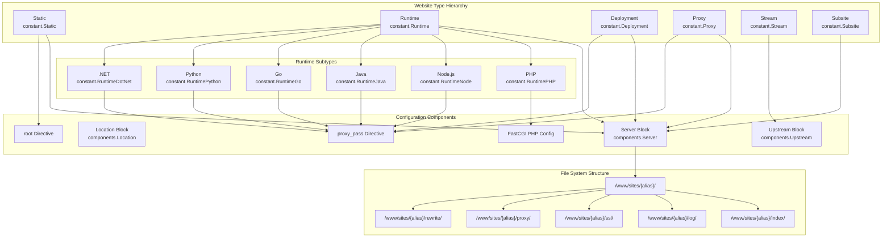
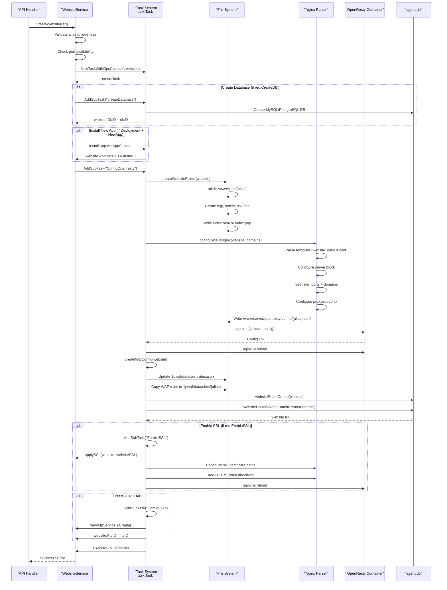
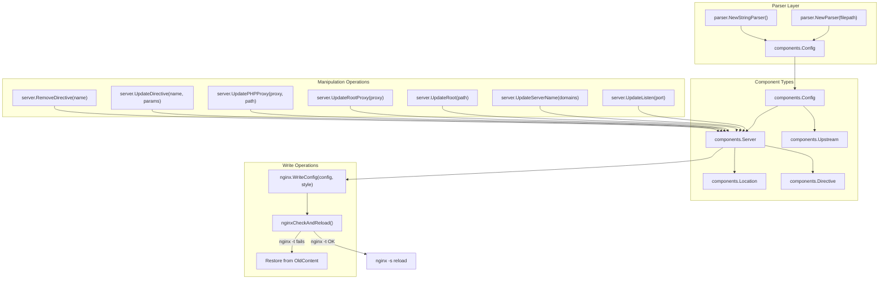
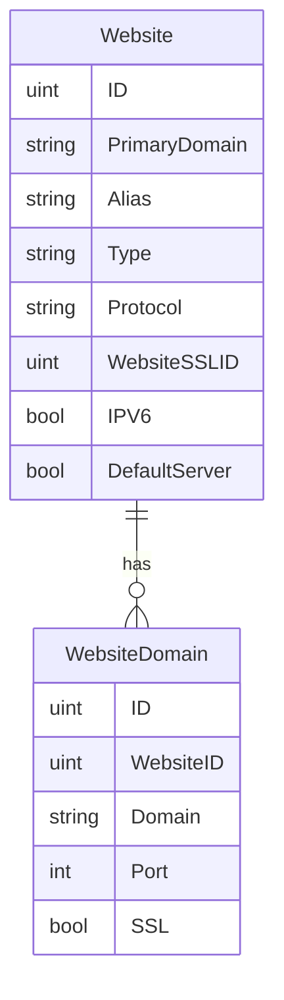
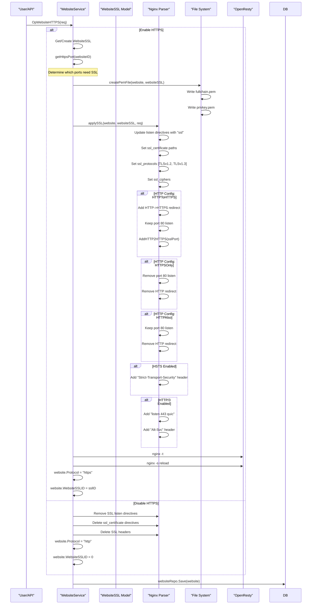
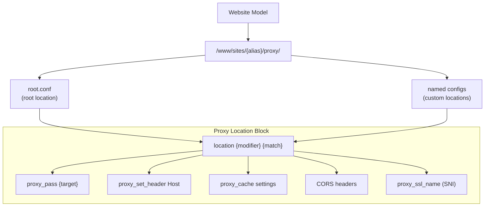
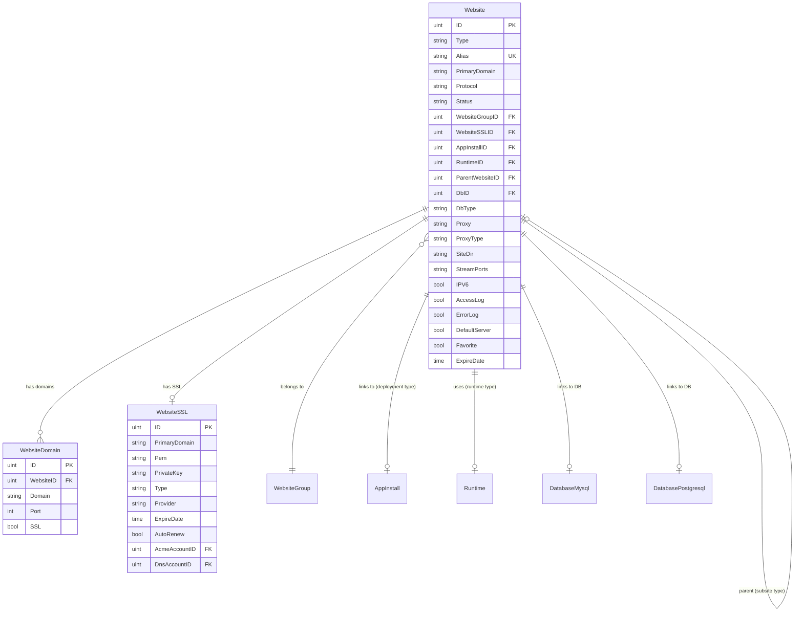
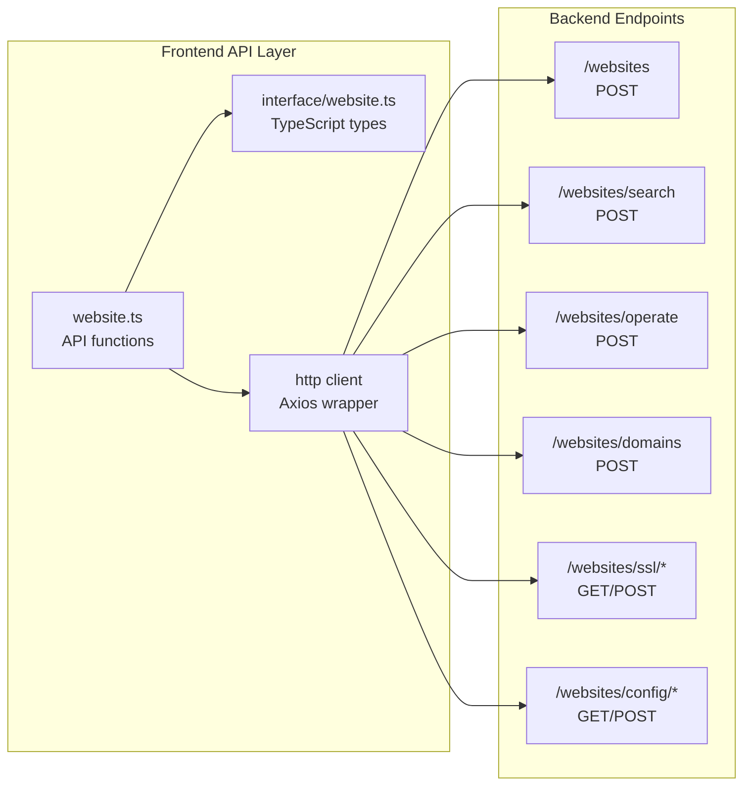

<!-- source: DeepWiki mcp.deepwiki.com · repo 1Panel-dev/1Panel · page 7 Website Management System · fetched 2026-10-29 -->

# Website Management System

<details>
<summary>Relevant source files</summary>

The following files were used as context for generating this wiki page:

- [agent/app/dto/request/website.go](agent/app/dto/request/website.go)
- [agent/app/dto/response/website.go](agent/app/dto/response/website.go)
- [agent/app/service/website.go](agent/app/service/website.go)
- [agent/app/service/website_utils.go](agent/app/service/website_utils.go)
- [frontend/src/api/interface/website.ts](frontend/src/api/interface/website.ts)
- [frontend/src/api/modules/website.ts](frontend/src/api/modules/website.ts)

</details>


The Website Management System is the core web server management component of 1Panel, providing comprehensive Nginx/OpenResty-based website hosting capabilities. This system handles website creation, configuration, domain management, SSL certificates, reverse proxy setup, and various advanced features like load balancing, anti-leech protection, and authentication.

This document covers website operations and Nginx configuration. For SSL certificate lifecycle management details, see the SSL subsections within this page. For application deployment that creates websites automatically, see [Application Management System](#6).

---

## System Overview

The Website Management System is implemented in the Agent backend service and operates as a high-level abstraction over Nginx/OpenResty. It supports six website types, each with distinct configurations and use cases.

### Core Components

The system is built around three primary service interfaces:

- **`IWebsiteService`** [agent/app/service/website.go:49-132]() - Main website operations interface with 40+ methods
- **Nginx Parser System** - Custom configuration parser for manipulating Nginx config files programmatically
- **WAF Integration** - Web Application Firewall configuration synchronized with website changes
- **Task Execution System** - Asynchronous operations for complex website creation workflows

**Website Types:**

| Type | Constant | Description | Primary Use Case |
|------|----------|-------------|------------------|
| Static | `constant.Static` | Pure HTML/CSS/JS hosting | Static websites, SPAs |
| Runtime | `constant.Runtime` | Language runtime integration | PHP, Node.js, Python, Java, Go, .NET applications |
| Deployment | `constant.Deployment` | App Store application linking | WordPress, Halo, GitLab, etc. |
| Proxy | `constant.Proxy` | Reverse proxy configuration | Microservices, API gateways |
| Stream | `constant.Stream` | TCP/UDP load balancing | Database proxies, game servers |
| Subsite | `constant.Subsite` | Subdirectory within parent site | Multi-tenant hosting |

Sources: [agent/app/service/website.go:49-132](), [agent/app/dto/request/website.go:16-42](), [frontend/src/api/interface/website.ts:3-32]()

---

## Website Type Architecture



**Type-Specific Configurations:**

- **Static**: Uses `server.UpdateRoot()` to point to `/www/sites/{alias}/index` [agent/app/service/website_utils.go:262-264]()
- **Runtime (PHP)**: Configures FastCGI with `server.UpdatePHPProxy()` supporting Unix socket or TCP [agent/app/service/website_utils.go:271-280]()
- **Runtime (Others)**: Reverse proxy to runtime port with `server.UpdateRootProxy()` [agent/app/service/website_utils.go:281-283]()
- **Deployment**: Proxies to app install's `HttpPort` [agent/app/service/website_utils.go:260-261]()
- **Stream**: Creates TCP/UDP upstream blocks without HTTP server context [agent/app/service/website_utils.go:194-232]()
- **Subsite**: Inherits parent website's proxy/runtime configuration [agent/app/service/website_utils.go:285-312]()

Sources: [agent/app/service/website_utils.go:182-325](), [agent/app/service/website.go:241-536]()

---

## Website Creation Workflow

The website creation process uses a task-based system with subtasks for different operations, enabling atomic rollback on failure.



**Key Functions:**

- `CreateWebsite()` [agent/app/service/website.go:241-536]() - Main orchestration function
- `configDefaultNginx()` [agent/app/service/website_utils.go:182-325]() - Generates initial Nginx configuration
- `createWebsiteFolder()` [agent/app/service/website_utils.go:133-180]() - Creates directory structure
- `createWafConfig()` [agent/app/service/website_utils.go:410-480]() - Synchronizes WAF settings
- `createIndexFile()` [agent/app/service/website_utils.go:50-98]() - Creates default index.html/index.php

**Rollback Mechanism:**

Each subtask can define a rollback function. If any step fails, `deleteWebsite()` is called to clean up:
```go
deleteWebsite := func(t *task.Task) {
    _ = deleteWebsiteFolder(website)
}
createTask.AddSubTask(i18n.GetMsgByKey("ConfigOpenresty"), configNginx, deleteWebsite)
```

Sources: [agent/app/service/website.go:241-536](), [agent/app/service/website_utils.go:133-325](), [agent/app/service/website_utils.go:410-480]()

---

## Nginx Configuration Management System

1Panel uses a custom Nginx parser that provides programmatic manipulation of Nginx configuration files while preserving formatting and comments.

### Configuration Parser Architecture



**Key Components:**

| Component | Purpose | File Reference |
|-----------|---------|----------------|
| `parser.NewParser()` | Parse existing Nginx config file | [agent/app/service/website_utils.go:619]() |
| `components.Server` | Represents server {} block | [agent/app/service/website_utils.go:244-312]() |
| `components.Location` | Represents location {} block | [agent/app/service/website_utils.go:120-129]() |
| `components.Upstream` | Represents upstream {} block | [agent/app/service/website_utils.go:224-231]() |
| `nginx.WriteConfig()` | Serialize config to file | [agent/app/service/website_utils.go:315-316]() |

### Configuration Scopes and Updates

The system organizes configuration by "scopes" that map to Nginx contexts:

```go
// Example scope-based update
func UpdateNginxConfigByScope(req request.NginxConfigUpdate) error {
    keys := dto.ScopeKeyMap[req.Scope]  // e.g., "gzip" -> ["gzip", "gzip_comp_level"]
    website := websiteRepo.GetFirst(repo.WithByID(req.WebsiteID))
    
    if req.Operate == constant.ConfigDel {
        return deleteNginxConfig(constant.NginxScopeServer, nginxParams, &website)
    }
    
    params := getNginxParams(req.Params, keys)
    return updateNginxConfig(constant.NginxScopeServer, params, &website)
}
```

**Scope Constants:**

- `constant.NginxScopeServer` - Server block directives
- `constant.NginxScopeLocation` - Location block directives
- `constant.NginxScopeUpstream` - Upstream block directives

**Validation with Rollback:**

Every configuration change follows this pattern [agent/app/service/website_utils.go:1061-1076]():

1. Save original config content to `nginxConfig.OldContent`
2. Modify configuration objects in memory
3. Write new config with `nginx.WriteConfig()`
4. Test with `nginx -t` via `nginxCheckAndReload()`
5. On failure: restore original content and reload
6. On success: reload with `nginx -s reload`

Sources: [agent/app/service/website.go:774-820](), [agent/app/service/website_utils.go:182-325](), [agent/app/service/website_utils.go:1061-1076]()

---

## Domain Management

Websites support multiple domains with independent port and SSL configurations per domain.

### Domain Data Model



**Domain Operations:**

| Operation | Method | Description |
|-----------|--------|-------------|
| Create | `CreateWebsiteDomain()` [agent/app/service/website_domain.go:11-90]() | Add domains with port/SSL flags |
| Delete | `DeleteWebsiteDomain()` [agent/app/service/website_domain.go:92-141]() | Remove domain and Nginx listen |
| Update | `UpdateWebsiteDomain()` [agent/app/service/website.go:742-772]() | Toggle SSL on specific domain |
| List | `GetWebsiteDomain()` [agent/app/service/website_domain.go:143-148]() | Retrieve all domains for website |

### Domain-Specific SSL Configuration

Each domain can have independent SSL settings. When updating domain SSL status [agent/app/service/website.go:742-772]():

```go
func UpdateWebsiteDomain(req request.WebsiteDomainUpdate) error {
    domain := websiteDomainRepo.GetFirst(repo.WithByID(req.ID))
    domain.SSL = req.SSL
    
    // Update Nginx listen directives
    server := config.FindServers()[0]
    server.DeleteListen(strconv.Itoa(domain.Port))
    
    http3 := isHttp3(server)
    setListen(server, strconv.Itoa(domain.Port), website.IPV6, http3, 
              website.DefaultServer, domain.SSL && website.Protocol == constant.ProtocolHTTPS)
    
    nginx.WriteConfig(config, nginx.IndentedStyle)
    nginxCheckAndReload(...)
}
```

**Listen Directive Generation:**

The `setListen()` function [agent/app/service/website_utils.go:638-654]() creates Nginx listen directives based on:
- Port number
- IPv6 support (`listen [::]:443 ssl`)
- HTTP/3 support (`listen 443 quic`)
- Default server flag (`listen 443 default_server ssl`)
- SSL status (`listen 443 ssl`)

### Multi-Domain Examples

**Scenario 1: Multiple domains, same port, shared SSL**
```
Domain: example.com, Port: 80, SSL: false
Domain: www.example.com, Port: 80, SSL: false
```
Generates:
```nginx
listen 80;
server_name example.com www.example.com;
```

**Scenario 2: Different ports per domain**
```
Domain: api.example.com, Port: 8080, SSL: false
Domain: admin.example.com, Port: 8081, SSL: true
```
Generates:
```nginx
listen 8080;
listen 8081 ssl;
server_name api.example.com admin.example.com;
```

Sources: [agent/app/service/website_domain.go:11-148](), [agent/app/service/website.go:742-772](), [agent/app/service/website_utils.go:588-654]()

---

## SSL Certificate Management

The system integrates ACME protocol support for automated certificate issuance via Let's Encrypt and ZeroSSL, with DNS validation through 50+ providers.

### SSL Configuration Flow



**SSL/HTTPS Components:**

| Component | Purpose | Storage Location |
|-----------|---------|------------------|
| `fullchain.pem` | Certificate + intermediate chain | `/www/sites/{alias}/ssl/fullchain.pem` |
| `privkey.pem` | Private key | `/www/sites/{alias}/ssl/privkey.pem` |
| `WebsiteSSL` model | Certificate metadata in database | `agent.db` `website_ssl` table |
| SSL configuration | Nginx directives | Within server block in site config |

### HTTPS Configuration Modes

**HttpConfig Options** [agent/app/service/website_utils.go:788-809]():

1. **`HTTPToHTTPS`**: Redirect all HTTP to HTTPS
   ```nginx
   if ($scheme = http) {
       return 301 https://$host:443$request_uri;
   }
   ```

2. **`HTTPSOnly`**: Disable HTTP entirely (remove port 80 listen)

3. **`HTTPAlso`**: Allow both HTTP and HTTPS without redirect

### SSL Protocol Configuration

The system supports configurable SSL protocols and cipher suites [agent/app/service/website_utils.go:832-863]():

**Default SSL Protocols:** `TLSv1.3`, `TLSv1.2`

**Default Cipher Suite:**
```
ECDHE-ECDSA-AES256-GCM-SHA384:ECDHE-RSA-AES256-GCM-SHA384:
ECDHE-ECDSA-CHACHA20-POLY1305:ECDHE-RSA-CHACHA20-POLY1305:
ECDHE-ECDSA-AES128-GCM-SHA256:ECDHE-RSA-AES128-GCM-SHA256:
DHE-RSA-AES256-GCM-SHA384:DHE-RSA-AES128-GCM-SHA256:
ECDHE-RSA-AES256-SHA384:ECDHE-RSA-AES128-SHA256:
!aNULL:!eNULL:!EXPORT:!DSS:!DES:!RC4:!3DES:!MD5:!PSK:!KRB5:!SRP:!CAMELLIA:!SEED
```

### HSTS Configuration

HTTP Strict Transport Security can be enabled with subdomain support [agent/app/service/website_utils.go:864-875]():

```go
if req.Hsts {
    var hstsValue string
    if req.HstsIncludeSubDomains {
        hstsValue = "\"max-age=31536000; includeSubDomains\""
    } else {
        hstsValue = "\"max-age=31536000\""
    }
    nginxParams = append(nginxParams, dto.NginxParam{
        Name:   "add_header",
        Params: []string{"Strict-Transport-Security", hstsValue},
    })
}
```

### HTTP/3 Support

When HTTP/3 is enabled [agent/app/service/website_utils.go:876-881]():
- Adds `listen 443 quic` directive
- Adds `Alt-Svc: 'h3=":443"; ma=2592000'` header
- Requires OpenResty with QUIC support

Sources: [agent/app/service/website.go:842-1013](), [agent/app/service/website_utils.go:678-887](), [agent/app/service/website_ssl.go]()

---

## Advanced Features

### Reverse Proxy Configuration

The Proxy website type and proxy configuration feature support flexible reverse proxy setups with caching, header manipulation, and CORS.

**Proxy Configuration Structure:**



**Proxy Operations** [agent/app/service/website_proxy.go]():

| Method | Purpose | File Reference |
|--------|---------|----------------|
| `OperateProxy()` | Create/update/enable/disable proxy config | Line 16-200 |
| `GetProxies()` | List all proxy configurations | Line 202-281 |
| `UpdateProxyFile()` | Direct file edit | Line 283-324 |
| `DeleteProxy()` | Remove proxy configuration | Line 412-460 |
| `GetProxyCache()` | Get cache settings | Line 326-365 |
| `UpdateProxyCache()` | Update cache settings | Line 367-410 |

**CORS Configuration:**

Proxy locations can enable CORS with configurable origins, methods, and headers [agent/app/dto/request/website.go:275-282]():

```go
type CorsConfig struct {
    Cors             bool   `json:"cors"`
    AllowOrigins     string `json:"allowOrigins"`     // e.g., "https://example.com"
    AllowMethods     string `json:"allowMethods"`     // e.g., "GET,POST,PUT"
    AllowHeaders     string `json:"allowHeaders"`     // e.g., "Content-Type,Authorization"
    AllowCredentials bool   `json:"allowCredentials"`
    Preflight        bool   `json:"preflight"`        // Handle OPTIONS requests
}
```

### Load Balancing (Upstream)

Websites can configure Nginx upstream blocks for load balancing across multiple backend servers.

**Upstream Configuration:**

```go
type NginxUpstream struct {
    Name      string                    // Upstream block name
    Algorithm string                    // "default", "ip_hash", "least_conn", "random"
    Servers   []NginxUpstreamServer
}

type NginxUpstreamServer struct {
    Server          string  // "192.168.1.10:8080"
    Weight          int     // Load balancing weight
    MaxFails        int     // Max failed attempts before marking down
    FailTimeout     int     // Time to mark server as down
    FailTimeoutUnit string  // "s", "m", "h"
    MaxConns        int     // Max concurrent connections
    Flag            string  // "down", "backup"
}
```

**Load Balancing Methods** [agent/app/service/website_load_balance.go:13-166]():

- **default** (round-robin): Distribute evenly
- **ip_hash**: Client IP-based sticky sessions
- **least_conn**: Route to server with fewest connections
- **random**: Random distribution

### Anti-Leech Protection

Prevents hotlinking by validating referrer headers [agent/app/service/website_anti_leech.go:11-120]():

```go
type LeechConfig struct {
    Enable      bool
    Cache       bool
    CacheTime   int
    CacheUnit   string
    Extends     string      // File extensions: "jpg|png|gif"
    Return      string      // Return code or redirect URL
    ServerNames []string    // Allowed referrer domains
    NoneRef     bool        // Block empty referrer
    LogEnable   bool
    Blocked     bool        // Block or allow listed domains
}
```

Generates Nginx configuration:
```nginx
location ~* \.(jpg|png|gif)$ {
    valid_referers none blocked example.com *.example.com;
    if ($invalid_referer) {
        return 403;
    }
}
```

### Basic Authentication

HTTP Basic Auth at server or path level [agent/app/service/website_auth.go:11-200]():

**Server-Level Auth:**
```nginx
auth_basic "Restricted Area";
auth_basic_user_file /www/sites/{alias}/auth/.htpasswd;
```

**Path-Level Auth:**
```nginx
location /admin {
    auth_basic "Admin Area";
    auth_basic_user_file /www/sites/{alias}/auth/admin/.htpasswd;
}
```

Operations:
- `GetAuthBasics()` - Retrieve auth users for website
- `UpdateAuthBasic()` - Create/update/delete users
- `GetPathAuthBasics()` - List path-specific auth configs
- `UpdatePathAuthBasic()` - Manage path auth

### Rewrite Rules

URL rewriting using Nginx rewrite directives [agent/app/service/website_rewrite.go:10-130]():

The system provides predefined rewrite templates for common CMSes:
- WordPress
- Laravel
- ThinkPHP
- Discuz
- And custom rewrites

Custom rewrite files stored in `/www/sites/{alias}/rewrite/{alias}.conf`

### Redirect Configuration

Manages 301/302 redirects with domain and path matching [agent/app/service/website_redirect.go:13-315]():

**Redirect Types:**
- **Domain**: Redirect entire domain to another
- **Path**: Redirect specific paths
- **Path with regex**: Pattern-based redirects

Example configuration:
```go
type RedirectConfig struct {
    Enable       bool
    Name         string
    Type         string    // "domain", "path"
    Redirect     string    // "301", "302"
    Domains      []string  // Source domains
    Path         string    // Source path
    Target       string    // Destination URL
    KeepPath     bool      // Preserve original path
    RedirectRoot bool      // Apply to root location
}
```

Sources: [agent/app/service/website_proxy.go:16-460](), [agent/app/service/website_load_balance.go:13-166](), [agent/app/service/website_anti_leech.go:11-120](), [agent/app/service/website_auth.go:11-200](), [agent/app/service/website_rewrite.go:10-130](), [agent/app/service/website_redirect.go:13-315]()

---

## Website Operation Lifecycle

### Start/Stop Operations

Websites can be started or stopped without deletion [agent/app/service/website_utils.go:964-1059]():

**Stop Website:**
```go
if operate == constant.StopWeb {
    // Remove proxy includes
    server.RemoveDirective("include", []string{proxyInclude})
    server.RemoveDirective("include", []string{rewriteInclude})
    server.RemoveDirective("include", []string{redirectInclude})
    
    // Remove application location blocks
    server.RemoveDirective("location", []string{"/"})
    
    // Point to stop page
    server.UpdateRoot("/usr/share/nginx/html/stop")
    website.Status = constant.WebStopped
}
```

**Start Website:**
```go
if operate == constant.StartWeb {
    // Restore includes
    server.UpdateDirective("include", []string{proxyInclude})
    server.UpdateDirective("include", []string{rewriteInclude})
    
    // Restore root/proxy configuration based on type
    switch website.Type {
    case constant.Deployment:
        server.UpdateRootProxy([]string{proxy})
    case constant.Static:
        server.UpdateRoot(rootIndex)
    case constant.Runtime:
        server.UpdatePHPProxy([]string{website.Proxy}, localPath)
    }
    
    website.Status = constant.WebRunning
}
```

### Log Management

Each website maintains separate access and error logs [agent/app/service/website.go:1078-1160]():

**Log Operations:**
- `GetLog`: Read log file with pagination
- `EnableLog`: Re-enable logging (writes path to nginx config)
- `DisableLog`: Disable logging (access_log off / error_log /dev/null)
- `DeleteLog`: Truncate log file

Log files located at:
- Access: `/www/sites/{alias}/log/access.log`
- Error: `/www/sites/{alias}/log/error.log`

### Batch Operations

Multiple websites can be operated simultaneously using tasks [agent/app/service/website_op.go:10-165]():

**Supported Batch Operations:**
- Start: `batchOpWebsite("start")`
- Stop: `batchOpWebsite("stop")`
- Restart: `batchOpWebsite("restart")`
- Set Group: `BatchSetGroup()`
- Set HTTPS: `BatchSetHttps()`

Each operation creates a task with subtasks for each website, enabling parallel execution and individual error handling.

Sources: [agent/app/service/website_utils.go:964-1059](), [agent/app/service/website.go:1078-1160](), [agent/app/service/website_op.go:10-165]()

---

## Data Models and Storage

### Core Database Schema



### File System Structure

Each website creates a dedicated directory structure:

```
/www/
├── sites/
│   └── {alias}/                    # Website root (SiteDir)
│       ├── index/                  # Document root (SiteIndexDir)
│       │   ├── index.html          # Default index
│       │   ├── 404.html            # Error page
│       │   └── .user.ini           # PHP open_basedir (if PHP)
│       ├── log/                    # Logs (SiteLogDir)
│       │   ├── access.log
│       │   └── error.log
│       ├── ssl/                    # SSL certificates (SiteSSLDir)
│       │   ├── fullchain.pem
│       │   └── privkey.pem
│       ├── proxy/                  # Proxy configs (SiteProxyDir)
│       │   ├── root.conf
│       │   └── {name}.conf
│       ├── rewrite/                # Rewrite rules (SiteReWriteDir)
│       │   └── {alias}.conf
│       ├── redirect/               # Redirect rules (SiteRedirectDir)
│       │   └── {alias}.conf
│       └── php-pool/               # PHP-FPM socket (if local PHP)
│           └── php-fpm.sock
│
└── server/
    └── openresty/
        └── conf.d/
            ├── {alias}.conf        # Main site config (SiteConf)
            └── stream/
                └── {alias}.conf    # Stream config (StreamConf)
```

**Path Resolution Functions** [agent/app/service/path.go:16-82]():

```go
const (
    SiteDir           = "siteDir"
    SiteIndexDir      = "siteIndexDir"
    SiteLogDir        = "siteLogDir"
    SiteSSLDir        = "siteSSLDir"
    SiteProxyDir      = "siteProxyDir"
    SiteReWriteDir    = "siteRewriteDir"
    SiteRedirectDir   = "siteRedirectDir"
    SiteConf          = "siteConf"
    StreamConf        = "streamConf"
    // ... and more
)

func GetSitePath(website model.Website, pathType string) string {
    // Returns absolute path for requested path type
}
```

### WAF Integration

Web Application Firewall configuration synchronized with website changes [agent/app/service/website_utils.go:352-480]():

**WAF Directory Structure:**
```
/www/server/openresty/1pwaf/
└── data/
    ├── conf/
    │   ├── sites.json          # All websites registry
    │   └── siteConfig.json     # Default rules
    ├── rules/                  # Global rule templates
    │   ├── acl.json
    │   ├── args.json
    │   ├── cookie.json
    │   └── ...
    ├── sites/                  # Per-site configs
    │   └── {alias}/
    │       ├── config.json
    │       └── rules/
    │           ├── acl.json
    │           └── ...
    └── db/                     # Runtime data
        └── sites/
            └── {alias}/
```

**WAF Sync Operations:**
- `createWafConfig()` - Initialize WAF for new website
- `delWafConfig()` - Clean up WAF when deleting website
- `createAllWebsitesWAFConfig()` - Rebuild WAF for all websites

Sources: [agent/app/model/website.go](), [agent/app/service/path.go:16-82](), [agent/app/service/website_utils.go:327-480]()

---

## Frontend API Integration

The frontend communicates with the Website Management System through a comprehensive TypeScript API client.

### API Client Structure



### Key API Functions

**Website CRUD** [frontend/src/api/modules/website.ts:9-53]():
```typescript
searchWebsites(req: Website.WebSiteSearch)
createWebsite(req: Website.WebSiteCreateReq)
updateWebsite(req: Website.WebSiteUpdateReq)
deleteWebsite(req: Website.WebSiteDel)
getWebsite(id: number)
opWebsite(req: Website.WebSiteOp)  // start/stop/restart
```

**Domain Management** [frontend/src/api/modules/website.ts:55-69]():
```typescript
listDomains(id: number)
createDomain(req: Website.DomainCreate)
updateDomain(req: Website.DomainUpdate)
deleteDomain(req: Website.DomainDelete)
```

**SSL/HTTPS** [frontend/src/api/modules/website.ts:111-153]():
```typescript
searchSSL(req: ReqPage)
createSSL(req: Website.SSLCreate)
getHTTPSConfig(id: number)
updateHTTPSConfig(req: Website.HTTPSReq)
getDnsResolve(req: Website.DNSResolveReq)  // For DNS validation
```

**Configuration** [frontend/src/api/modules/website.ts:71-77]():
```typescript
getNginxConfig(req: Website.NginxScopeReq)
updateNginxConfig(req: Website.NginxConfigReq)
updateNginxFile(req: Website.NginxUpdate)  // Direct file edit
```

**Advanced Features** [frontend/src/api/modules/website.ts:183-233]():
```typescript
// Proxy
getProxyConfig(req: Website.ProxyReq)
operateProxyConfig(req: Website.ProxyReq)
updateProxyConfigFile(req: Website.ProxyFileUpdate)

// Load Balancing
getLoadBalances(id: number)
createLoadBalance(req: Website.LoadBalanceReq)
updateLoadBalance(req: Website.LoadBalanceReq)

// Authentication
getAuthConfig(req: Website.AuthReq)
operateAuthConfig(req: Website.NginxAuthConfig)

// Redirects
getRedirectConfig(req: Website.WebsiteReq)
operateRedirectConfig(req: Website.WebsiteReq)
```

### Request/Response Types

**Create Request** [frontend/src/api/interface/website.ts:87-112]():
```typescript
interface WebSiteCreateReq {
    type: string                    // Website type
    alias: string                   // Unique identifier
    webSiteGroupId: number
    domains: SubDomain[]
    
    // App deployment
    appType: string                 // "new" | "installed"
    appInstallId: number
    
    // Runtime
    runtimeID: number
    proxyType: string
    
    // Database
    createDB?: boolean
    dbName?: string
    dbPassword?: string
    dbHost?: string
    
    // SSL
    enableSSL: boolean
    SSLID?: number
    
    // Stream
    streamPorts?: string
    algorithm: string
    servers: NginxUpstreamServer[]
}
```

**Website Response** [frontend/src/api/interface/website.ts:34-44]():
```typescript
interface WebsiteDTO extends Website {
    errorLogPath: string
    accessLogPath: string
    sitePath: string
    appName: string
    runtimeName: string
    runtimeType: string
    openBaseDir: boolean
    algorithm: string
    servers: NginxUpstreamServer[]
}
```

### Multi-Node Support

API functions support cross-node operations via `operateNode` parameter [frontend/src/api/modules/website.ts:9-11]():

```typescript
export const searchWebsites = (req: Website.WebSiteSearch, node?: string) => {
    const params = node ? `?operateNode=${node}` : '';
    return http.post<ResPage<Website.WebsiteRes>>(`/websites/search${params}`, req);
};
```

This enables managing websites on remote agent nodes from the master node's UI.

Sources: [frontend/src/api/modules/website.ts:1-384](), [frontend/src/api/interface/website.ts:1-738]()

---

## Summary

The Website Management System provides a comprehensive abstraction layer over Nginx/OpenResty with:

- **6 website types** supporting static hosting, language runtimes, app deployments, reverse proxy, TCP/UDP load balancing, and subsites
- **Custom Nginx parser** enabling programmatic configuration manipulation with automatic validation and rollback
- **Multi-domain support** with per-domain SSL configuration
- **Automated SSL** via ACME protocol with 50+ DNS providers
- **Advanced features** including load balancing, proxy caching, CORS, authentication, anti-leech, redirects, and rewrites
- **Task-based creation** with atomic rollback on failure
- **WAF integration** for web application firewall protection
- **Multi-node operation** for distributed deployments
- **Comprehensive API** with TypeScript type safety

The system manages the complete lifecycle from creation through operation to deletion, handling all Nginx configuration, file system setup, certificate management, and runtime integration automatically.

---

