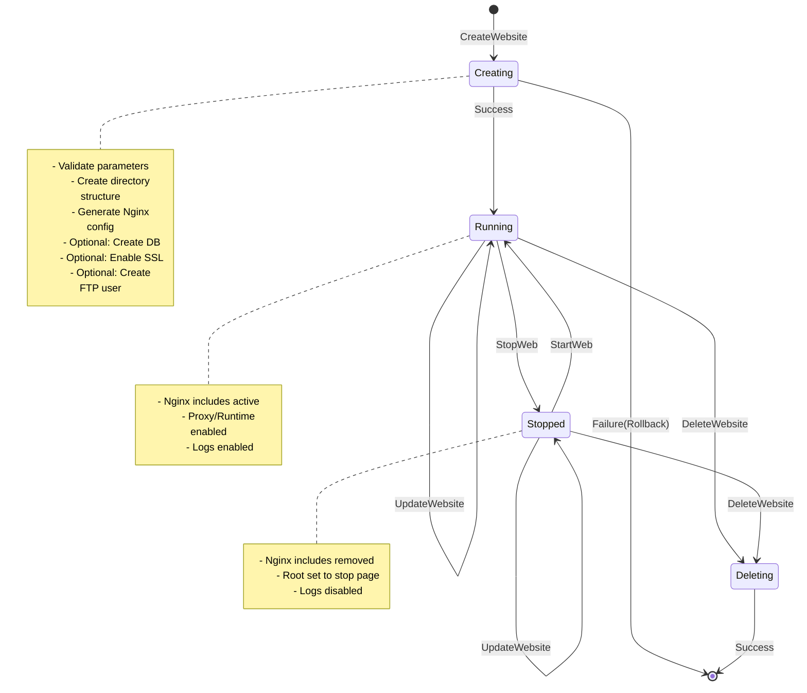
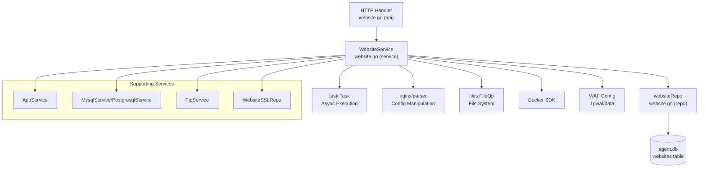
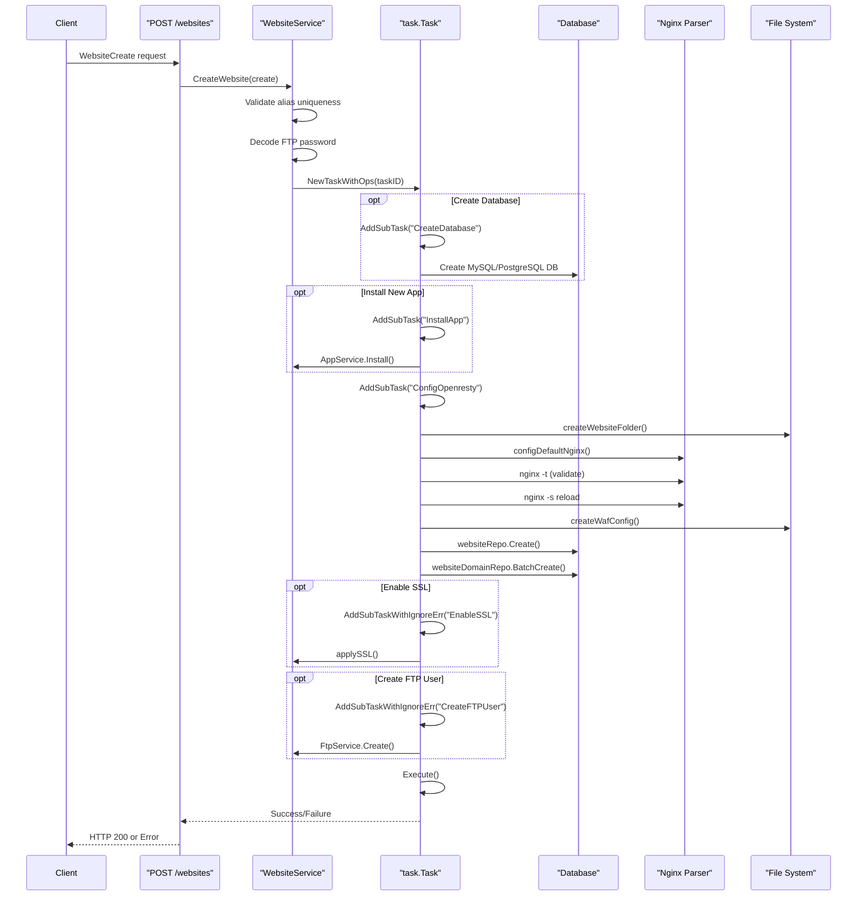
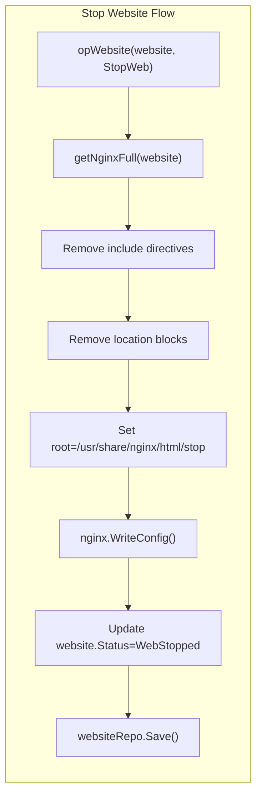
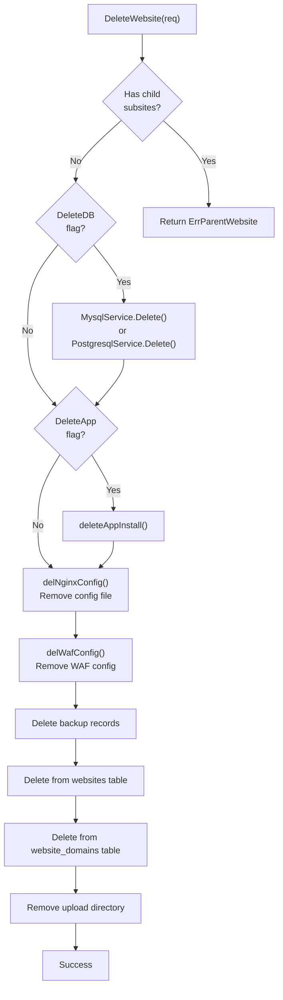
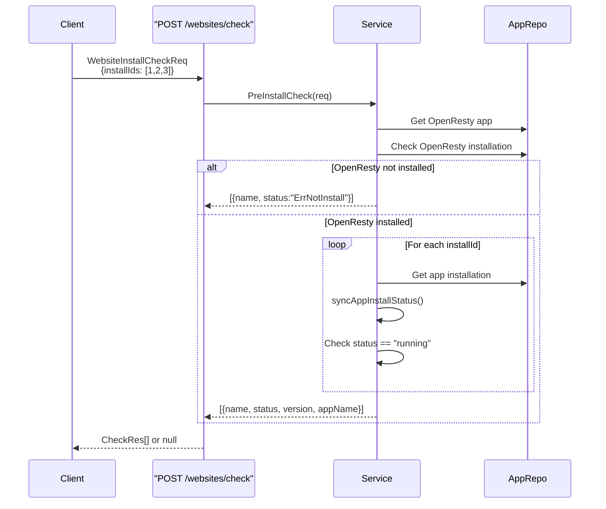

<!-- source: DeepWiki mcp.deepwiki.com · repo 1Panel-dev/1Panel · page 7.1 Website Core Operations · fetched 2026-10-29 -->

# Website Core Operations

<details>
<summary>Relevant source files</summary>

The following files were used as context for generating this wiki page:

- [agent/app/dto/request/website.go](agent/app/dto/request/website.go)
- [agent/app/dto/response/website.go](agent/app/dto/response/website.go)
- [agent/app/service/website.go](agent/app/service/website.go)
- [agent/app/service/website_utils.go](agent/app/service/website_utils.go)
- [frontend/src/api/interface/website.ts](frontend/src/api/interface/website.ts)
- [frontend/src/api/modules/website.ts](frontend/src/api/modules/website.ts)

</details>


## Purpose and Scope

This document describes the fundamental lifecycle operations for websites in the 1Panel system, including creation, deletion, start/stop operations, and the task-based execution framework. For details about specific website types (static, runtime, deployment, proxy, stream, subsite), see [Website Types and Features](#7.2). For Nginx configuration management, see [Nginx Configuration Management](#7.3). For SSL certificate operations, see [SSL Certificate Management](#7.4). For domain operations, see [Domain Management](#7.5).

Website core operations are implemented in the Agent backend service and orchestrate multiple subsystems including Nginx configuration, file system management, database provisioning, and WAF integration.

---

## Website Lifecycle Overview

The website lifecycle consists of four primary operations: creation, operation (start/stop), update, and deletion. All operations interact with the Nginx web server and maintain consistency across configuration files, database records, and file system structures.



**Sources:** [agent/app/service/website.go:241-536](), [agent/app/service/website.go:538-547](), [agent/app/service/website.go:650-740](), [agent/app/service/website_utils.go:964-1062]()

---

## Service Architecture

The website service follows a repository pattern with clear separation between HTTP handlers, service logic, and data access.



**Sources:** [agent/app/service/website.go:46-136](), [agent/app/api/v2/helper/helper.go]()

---

## Website Creation

### Request Structure

Website creation accepts a comprehensive configuration covering all aspects of the site:

| Field | Type | Purpose | Required |
|-------|------|---------|----------|
| `Type` | string | Website type (static, runtime, deployment, proxy, stream, subsite) | Yes |
| `Alias` | string | Unique identifier for the website | Yes |
| `WebsiteGroupID` | uint | Group assignment for organization | Yes |
| `Domains` | []WebsiteDomain | Domain and port configurations | Yes (except stream) |
| `RuntimeID` | uint | PHP/Node/Java runtime reference | Type-dependent |
| `AppInstallID` | uint | Linked application installation | Type-dependent |
| `EnableSSL` | bool | Auto-enable HTTPS after creation | No |
| `CreateDb` | bool | Auto-create database | No |
| `FtpUser` / `FtpPassword` | string | Auto-create FTP account | No |
| `TaskID` | string | Client-provided task tracking ID | No |

**Sources:** [agent/app/dto/request/website.go:16-42](), [frontend/src/api/interface/website.ts:87-112]()

### Task-Based Execution

Website creation uses an asynchronous task system that breaks the operation into multiple subtasks, each with its own rollback handler. This ensures partial failures can be cleanly recovered.



**Sources:** [agent/app/service/website.go:241-536](), [agent/app/task/task.go]()

### Subtask Breakdown

The task system creates a structured execution plan:

1. **Database Creation** (optional): [agent/app/service/website.go:323-372]()
   - Checks for existing database
   - Creates MySQL/MariaDB or PostgreSQL database
   - Stores `DbID` and `DbType` in website model

2. **App Configuration** (for deployment type): [agent/app/service/website.go:376-406]()
   - Installs new app via `AppService.Install()` if `AppType == "new"`
   - Links existing app if `AppType == "installed"`
   - Sets `website.Proxy` to app's HTTP port

3. **Nginx Configuration**: [agent/app/service/website.go:448-484]()
   - Creates site directory structure via `createWebsiteFolder()`
   - Generates Nginx config via `configDefaultNginx()`
   - Creates WAF configuration via `createWafConfig()`
   - Validates config with `nginx -t`
   - Reloads Nginx with `nginx -s reload`
   - Persists website and domain records to database

4. **SSL Enablement** (optional): [agent/app/service/website.go:492-520]()
   - Uses `AddSubTaskWithIgnoreErr()` so failure doesn't rollback entire operation
   - Applies SSL certificate via `applySSL()`
   - Configures HTTPS redirects

5. **FTP User Creation** (optional): [agent/app/service/website.go:522-533]()
   - Creates FTP user with access to site index directory
   - Uses `AddSubTaskWithIgnoreErr()` for non-critical operation

**Rollback Mechanism**: If the ConfigOpenresty subtask fails after database creation, the rollback handler `deleteWebsite()` removes created directories: [agent/app/service/website.go:486-489]()

**Sources:** [agent/app/service/website.go:317-536](), [agent/app/task/task.go]()

### File System Structure

Each website gets a dedicated directory structure under `/www/sites/<alias>/`:

```
/www/sites/<alias>/
├── index/              # Document root
│   ├── index.html     # Default index (static sites)
│   ├── index.php      # Default index (PHP runtime)
│   └── 404.html       # Error page
├── log/               # Nginx logs
│   ├── access.log
│   └── error.log
├── ssl/               # SSL certificates
│   ├── fullchain.pem
│   └── privkey.pem
├── php-pool/          # PHP-FPM socket (local PHP runtime)
│   └── php-fpm.sock
├── proxy/             # Proxy configurations
│   └── root.conf
├── rewrite/           # Rewrite rules
└── redirect/          # Redirect rules
```

Nginx configuration files are stored separately:
- HTTP sites: `/www/sites/<alias>/nginx/<alias>.conf`
- Stream sites: `/www/sites/<alias>/stream/<alias>.conf`

**Sources:** [agent/app/service/website_utils.go:133-180](), [agent/app/service/website.go:15-44]()

---

## Website Operations (Start/Stop)

The `OpWebsite` function handles start and stop operations by modifying Nginx configuration and database state.

### Stop Operation

When stopping a website, the system:

1. Removes all include directives (proxy, rewrite, redirect)
2. Removes location blocks based on website type
3. Changes root directory to `/usr/share/nginx/html/stop`
4. Updates database status to `constant.WebStopped`



**Sources:** [agent/app/service/website_utils.go:975-999]()

### Start Operation

When starting a website, the system:

1. Restores include directives if corresponding files exist
2. Recreates location blocks based on website type
3. Updates root directory to actual site path
4. Resets expiration date if expired
5. Updates database status to `constant.WebRunning`

**Type-Specific Start Logic:**

| Website Type | Start Behavior |
|--------------|----------------|
| `Deployment` | Updates proxy location to app's `HttpPort` |
| `Static` | Sets root to index directory, updates root location |
| `Proxy` | Removes root directive (uses proxy includes) |
| `Runtime` | Sets root, updates PHP proxy or runtime proxy |

**Sources:** [agent/app/service/website_utils.go:1000-1058](), [agent/app/service/website.go:538-547]()

---

## Website Deletion

Website deletion is a multi-phase operation that cleans up all associated resources.



### Deletion Options

The `WebsiteDelete` request provides several flags:

| Flag | Purpose | Default |
|------|---------|---------|
| `ForceDelete` | Continue even if operations fail | false |
| `DeleteApp` | Delete linked application installation | false |
| `DeleteBackup` | Remove backup records | false |
| `DeleteDB` | Drop associated database | false |

**Parent Website Protection**: Websites with child subsites cannot be deleted until the children are removed first. The error `ErrParentWebsite` returns the list of blocking child sites: [agent/app/service/website.go:655-663]()

**Sources:** [agent/app/service/website.go:650-740](), [agent/app/dto/request/website.go:109-115]()

### Nginx Configuration Cleanup

The `delNginxConfig` function removes the Nginx configuration file and site directory:

1. Removes `/www/sites/<alias>/nginx/<alias>.conf` or stream config
2. Removes `/www/sites/<alias>/` directory
3. Calls `xpack.RemoveTamper(alias)` for tamper protection cleanup
4. Reloads Nginx (with `ForceDelete` flag to ignore reload errors)

**Sources:** [agent/app/service/website_utils.go:482-522]()

### WAF Configuration Cleanup

For websites with WAF enabled (OpenResty >= 1.21.4.3-2-0):

1. Removes website entry from `/www/openresty/1pwaf/data/conf/sites.json`
2. Deletes monitoring database directory `/www/openresty/1pwaf/data/db/sites/<alias>`
3. Removes site-specific rules directory `/www/openresty/1pwaf/data/sites/<alias>`
4. Reloads Nginx

**Sources:** [agent/app/service/website_utils.go:524-575]()

---

## Data Models

### Website Model

The `model.Website` entity stores core website metadata:

```go
type Website struct {
    ID              uint
    Protocol        string  // "http" or "https"
    PrimaryDomain   string
    Type            string  // "static", "runtime", "deployment", "proxy", "stream", "subsite"
    Alias           string  // Unique identifier
    Remark          string
    Status          string  // "running" or "stopped"
    
    // Relationships
    WebsiteGroupID    uint
    AppInstallID      uint
    RuntimeID         uint
    WebsiteSSLID      uint
    ParentWebsiteID   uint
    DbID              uint
    DbType            string
    FtpID             uint
    
    // Configuration
    Proxy             string  // Proxy target (IP:port or unix socket)
    ProxyType         string  // "tcp" or "unix"
    SiteDir           string  // Subdirectory within index/
    DefaultServer     bool
    StreamPorts       string  // For stream type
    
    // Flags
    AccessLog         bool
    ErrorLog          bool
    IPV6              bool
    Favorite          bool
    
    // Dates
    ExpireDate        time.Time
    CreatedAt         time.Time
    UpdatedAt         time.Time
}
```

**Sources:** [agent/app/model/website.go]()

### API Request/Response Types

Key request structures:

- `WebsiteCreate`: Creation parameters [agent/app/dto/request/website.go:16-42]()
- `WebsiteUpdate`: Update parameters [agent/app/dto/request/website.go:99-107]()
- `WebsiteDelete`: Deletion options [agent/app/dto/request/website.go:109-115]()
- `WebsiteOp`: Operation command [agent/app/dto/request/website.go:117-120]()

Key response structures:

- `WebsiteDTO`: Full website details [agent/app/dto/response/website.go:10-24]()
- `WebsiteRes`: List/search result [agent/app/dto/response/website.go:26-47]()
- `WebsitePreInstallCheck`: Pre-creation validation [agent/app/dto/response/website.go:55-60]()

**Sources:** [agent/app/dto/request/website.go](), [agent/app/dto/response/website.go]()

---

## API Endpoints

### Core Operations

| Method | Endpoint | Function | Purpose |
|--------|----------|----------|---------|
| POST | `/websites/search` | `PageWebsite` | Paginated website list with filters |
| POST | `/websites` | `CreateWebsite` | Create new website |
| POST | `/websites/operate` | `OpWebsite` | Start/stop website |
| POST | `/websites/update` | `UpdateWebsite` | Update metadata |
| POST | `/websites/del` | `DeleteWebsite` | Delete website |
| GET | `/websites/{id}` | `GetWebsite` | Get website details |
| GET | `/websites/list` | `GetWebsites` | Simple list for dropdowns |

**Multi-Node Routing**: Endpoints support `?operateNode=<node>` query parameter to route operations to specific agent nodes: [frontend/src/api/modules/website.ts:9-11](), [frontend/src/api/modules/website.ts:26-28]()

**Sources:** [frontend/src/api/modules/website.ts:9-53](), [agent/app/api/v2/website.go]()

### Operation Commands

The `operate` field in `WebsiteOp` accepts:

- `"start"` → `constant.StartWeb`: Start website
- `"stop"` → `constant.StopWeb`: Stop website

These constants map to Nginx configuration changes handled by `opWebsite()`: [agent/app/service/website_utils.go:964-1062]()

**Sources:** [agent/app/service/website.go:538-547](), [agent/app/constant/website.go]()

---

## Pre-Installation Validation

Before creating a website, clients can validate that required services are running:



The validation checks:
1. OpenResty (Nginx) is installed
2. All referenced app installations exist and are running
3. Returns detailed status for troubleshooting

If any service is not running, the frontend displays a warning before allowing website creation.

**Sources:** [agent/app/service/website.go:1015-1059](), [frontend/src/api/modules/website.ts:155-157]()

---

## Batch Operations

The system supports batch operations for multiple websites via task-based execution:

### Batch Start/Stop

```typescript
// Frontend API
batchOpreate(req: {
    ids: number[],
    operate: "start" | "stop",
    taskID: string
})
```

The backend creates a parent task with subtasks for each website, allowing parallel execution with individual success/failure tracking.

**Sources:** [frontend/src/api/modules/website.ts:361-363](), [agent/app/service/website.go:129]()

### Batch Group Assignment

```typescript
batchSetGroup(req: {
    ids: number[],
    groupID: number
})
```

Updates the `WebsiteGroupID` for multiple websites in a single transaction.

**Sources:** [frontend/src/api/modules/website.ts:373-375](), [agent/app/dto/request/website.go:128-131]()

---

## Error Handling

Common error scenarios and their handling:

| Error Code | Condition | Resolution |
|------------|-----------|------------|
| `ErrDefaultAlias` | Alias is "default" | Choose different alias |
| `ErrAliasIsExist` | Alias already exists | Choose unique alias |
| `ErrDbUserNotValid` | Database name collision | Choose different database name |
| `ErrNotInstall` | OpenResty not installed | Install OpenResty first |
| `ErrParentWebsite` | Has child subsites | Delete children first |
| `ErrTypePortRange` | Invalid stream ports | Provide valid port range |

Nginx validation failures automatically rollback configuration changes by restoring the old content: [agent/app/service/website_utils.go:1065-1085]()

**Sources:** [agent/app/service/website.go:243-266](), [agent/app/service/website.go:655-663](), [agent/buserr/errors.go]()

---

