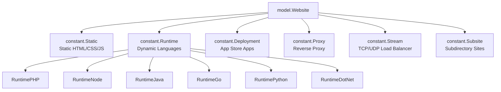
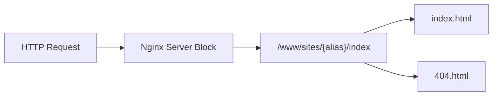
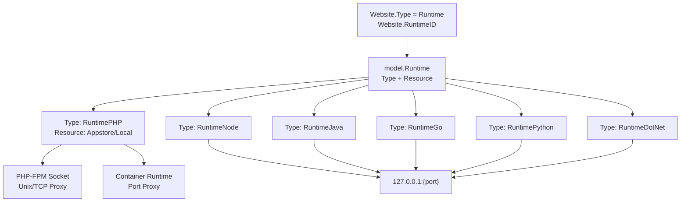
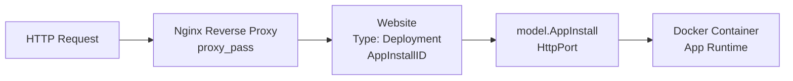
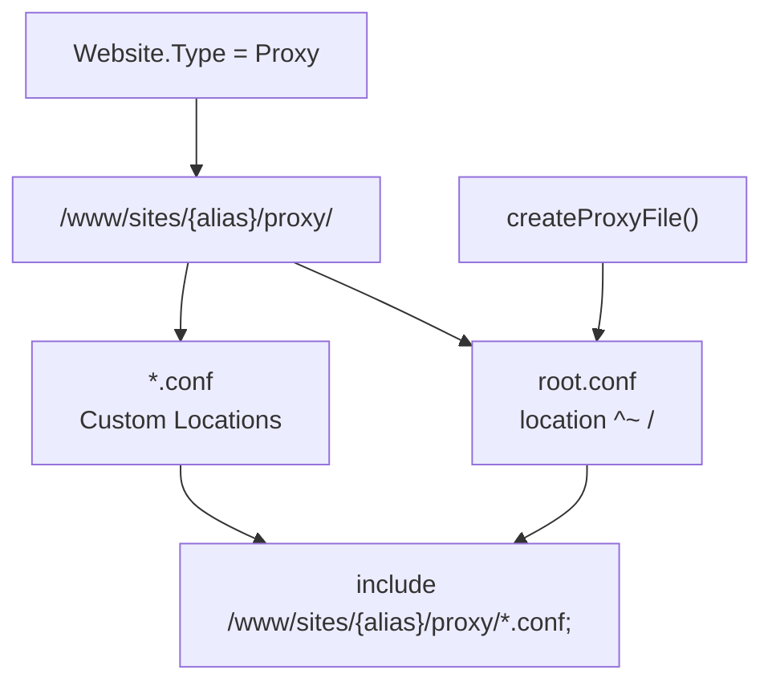
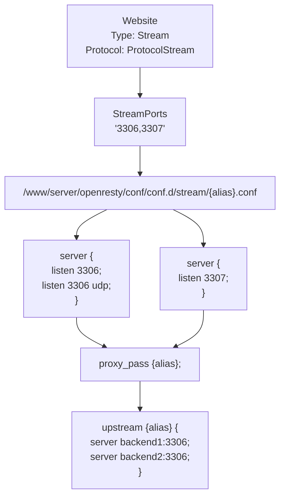
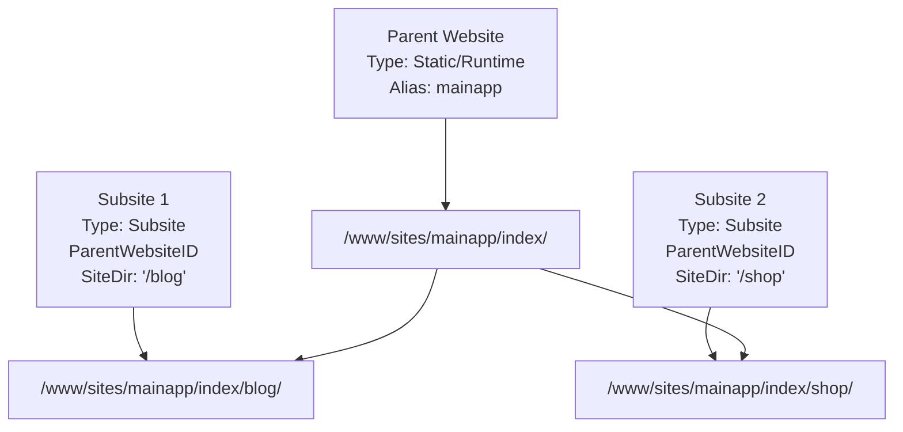
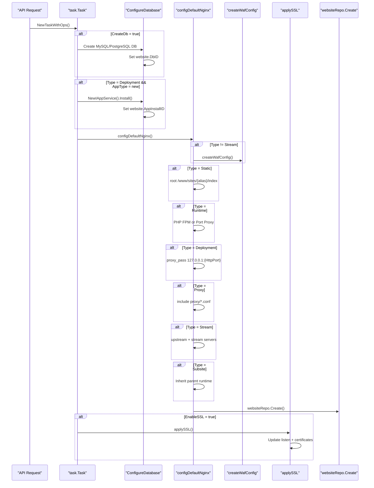
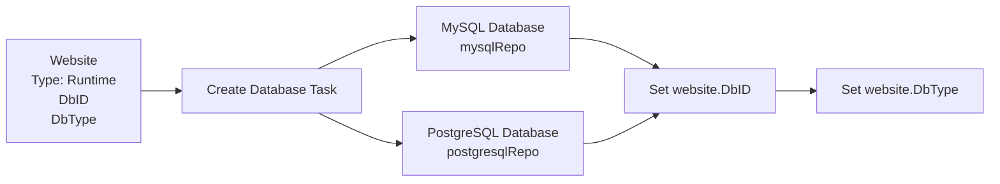

<!-- source: DeepWiki mcp.deepwiki.com · repo 1Panel-dev/1Panel · page 7.2 Website Types and Features · fetched 2026-10-29 -->

# Website Types and Features

<details>
<summary>Relevant source files</summary>

The following files were used as context for generating this wiki page:

- [agent/app/dto/request/website.go](agent/app/dto/request/website.go)
- [agent/app/dto/response/website.go](agent/app/dto/response/website.go)
- [agent/app/service/website.go](agent/app/service/website.go)
- [agent/app/service/website_utils.go](agent/app/service/website_utils.go)
- [frontend/src/api/interface/website.ts](frontend/src/api/interface/website.ts)
- [frontend/src/api/modules/website.ts](frontend/src/api/modules/website.ts)

</details>


## Purpose and Scope

This document describes the six website types supported by 1Panel's website management system and their specific features and configurations. Each website type has distinct characteristics, Nginx configuration patterns, and operational requirements.

For information about website creation and lifecycle operations, see [Website Core Operations](#7.1). For Nginx configuration management details, see [Nginx Configuration Management](#7.3). For SSL certificate setup, see [SSL Certificate Management](#7.4).

---

## Website Type Overview

1Panel supports six distinct website types, each designed for specific use cases. The `type` field in the `model.Website` determines which configuration logic applies.



**Website Type Constants and Usage**

| Type | Constant | Primary Purpose | Protocol |
|------|----------|----------------|----------|
| Static | `constant.Static` | HTML/CSS/JS files | HTTP/HTTPS |
| Runtime | `constant.Runtime` | Dynamic language apps | HTTP/HTTPS |
| Deployment | `constant.Deployment` | App Store applications | HTTP/HTTPS |
| Proxy | `constant.Proxy` | Reverse proxy gateway | HTTP/HTTPS |
| Stream | `constant.Stream` | TCP/UDP load balancing | TCP/UDP |
| Subsite | `constant.Subsite` | Child site under parent | HTTP/HTTPS |

Sources: [agent/app/service/website.go:173-187](), [agent/app/constant/constant.go](), [agent/app/dto/request/website.go:16-42]()

---

## Static Websites

Static websites serve pre-rendered HTML, CSS, JavaScript, and other static assets directly through Nginx without application server processing.

### Configuration Pattern

Static sites use a simple Nginx `root` directive pointing to the index directory. The system creates default `index.html` and `404.html` files.



### Creation Logic

When creating a static website, the system:

1. Creates site directory structure: `/www/sites/{alias}/index/`
2. Generates default `index.html` from template
3. Generates `404.html` error page
4. Configures Nginx with `root` directive and `error_page 404 /404.html`

**Nginx Configuration Structure:**

```
server {
    listen 80;
    server_name example.com;
    root /www/sites/example/index;
    error_page 404 /404.html;
    location / {
        # Static file serving
    }
}
```

Sources: [agent/app/service/website_utils.go:58-63](), [agent/app/service/website_utils.go:262-264](), [agent/app/service/website.go:241-264]()

---

## Runtime Websites

Runtime websites execute dynamic code through language-specific runtime environments. The `RuntimeID` field links to a `model.Runtime` that defines the interpreter/compiler.

### Supported Runtime Types



### PHP Runtime Configuration

PHP runtimes support two proxy modes determined by `ProxyType`:

**Local PHP (Resource: ResourceLocal)**

- `constant.RuntimeProxyUnix`: Unix socket at `/www/sites/{alias}/php-pool/php-fpm.sock`
- `constant.RuntimeProxyTcp`: TCP connection to `127.0.0.1:{port}`

The system creates a `location ~ [^/]\.php(/|$)` block that passes requests to PHP-FPM via `fastcgi_pass`.

**App Store PHP (Resource: ResourceAppstore)**

- Proxy to containerized PHP-FPM at `127.0.0.1:{runtime.Port}`
- Creates `.user.ini` with `open_basedir` restrictions for security

### Non-PHP Runtime Configuration

Node.js, Java, Go, Python, and .NET runtimes all use HTTP proxy mode:

- Website proxies to `127.0.0.1:{port}` where the runtime listens
- Nginx acts as reverse proxy with `proxy_pass http://127.0.0.1:{port}`
- Application manages its own HTTP server

**Runtime Port Selection:**

The `port` field in `request.WebsiteCreate` specifies the listening port for the runtime application.

Sources: [agent/app/service/website.go:408-438](), [agent/app/service/website_utils.go:269-283](), [agent/app/service/website_utils.go:157-166](), [agent/app/service/website_utils.go:403-408]()

---

## Deployment Websites

Deployment websites link to applications installed from the App Store. The `AppInstallID` field references a `model.AppInstall`.

### Architecture



### Creation Modes

**New App Installation (`AppType: "new"`)**

When `create.AppType == constant.NewApp`:

1. Install application via `NewIAppService().Install()`
2. Obtain `AppInstall.HttpPort` from installation result
3. Set `website.Proxy = "127.0.0.1:{HttpPort}"`
4. Configure Nginx with `location / { proxy_pass http://127.0.0.1:{HttpPort}; }`

**Existing App Attachment (`AppType: "installed"`)**

When attaching to existing `AppInstallID`:

1. Retrieve existing `model.AppInstall`
2. Extract `HttpPort` from app install
3. Configure identical proxy pattern

### Nginx Configuration

The server block contains:

```
location / {
    proxy_pass http://127.0.0.1:{HttpPort};
    proxy_set_header Host $host;
    proxy_set_header X-Real-IP $remote_addr;
    proxy_set_header X-Forwarded-For $proxy_add_x_forwarded_for;
    proxy_set_header X-Forwarded-Proto $scheme;
}
```

Sources: [agent/app/service/website.go:375-406](), [agent/app/service/website_utils.go:259-261](), [agent/app/service/website.go:173-181]()

---

## Proxy Websites

Proxy websites function as reverse proxy gateways, forwarding requests to multiple upstream targets through configuration files.

### Directory Structure

Proxy websites maintain configuration files in `/www/sites/{alias}/proxy/`:

```
/www/sites/{alias}/
├── proxy/
│   ├── root.conf       # Default "/" location proxy
│   ├── api.conf        # Custom location proxies
│   └── admin.conf
└── index/              # Optional static fallback
```

### Proxy Configuration System



### Default Proxy Configuration

The system generates `root.conf` with:

```
location ^~ / {
    proxy_pass {website.Proxy};
    proxy_set_header Host $host;
}
```

The `website.Proxy` field stores the default upstream (e.g., `http://127.0.0.1:8080`).

### Custom Proxy Locations

Users can create additional proxy configurations through the API (see [Website Core Operations](#7.1)). Each location config file supports:

- Path matching (prefix, regex)
- Upstream URL
- Header manipulation
- Caching configuration
- CORS settings

Sources: [agent/app/service/website_utils.go:100-131](), [agent/app/service/website.go:173-177](), [agent/app/service/website_utils.go:265-268]()

---

## Stream Websites

Stream websites implement TCP/UDP load balancing at Layer 4, distinct from HTTP/HTTPS sites. They use Nginx's stream module with upstream definitions.

### Protocol and Port Configuration

Stream sites are identified by:

- `Protocol: constant.ProtocolStream`
- `StreamPorts`: Comma-separated port list (e.g., "3306,3307,6379")
- `UDP`: Boolean flag for UDP protocol support



### Load Balancing Algorithms

Stream websites support standard Nginx upstream algorithms via the `Algorithm` field:

| Algorithm | Nginx Directive | Description |
|-----------|----------------|-------------|
| default | (none) | Round-robin |
| least_conn | `least_conn;` | Least connections |
| ip_hash | `ip_hash;` | Client IP hash |
| hash | `hash $remote_addr;` | Generic hash |

### Upstream Server Configuration

Each server in the upstream supports:

```typescript
interface NginxUpstreamServer {
    server: string;           // "192.168.1.10:3306"
    weight: number;           // Load balancing weight
    maxFails: number;         // Health check failures
    failTimeout: number;      // Timeout duration
    failTimeoutUnit: string;  // "s", "m", "h"
    maxConns: number;         // Max concurrent connections
    flag: string;             // "down", "backup"
}
```

### Stream Configuration Example

```
stream {
    upstream myapp {
        least_conn;
        server 192.168.1.10:3306 weight=3 max_fails=3 fail_timeout=30s;
        server 192.168.1.11:3306 weight=2 max_fails=3 fail_timeout=30s;
        server 192.168.1.12:3306 backup;
    }
    
    server {
        listen 3306;
        listen [::]:3306;       # IPv6 if enabled
        listen 3306 udp;        # If UDP flag set
        
        proxy_pass myapp;
        access_log /www/sites/myapp/log/access.log streamlog;
        error_log /www/sites/myapp/log/error.log;
    }
}
```

### Configuration Flow

1. Parse `StreamPorts` into individual port numbers
2. Validate each port isn't conflicting with Nginx HTTPS port
3. Create `upstream {alias}` block with algorithm and servers
4. Generate `server` blocks for each port with UDP flag if needed
5. Write configuration to stream configuration directory

Sources: [agent/app/service/website.go:290-304](), [agent/app/service/website_utils.go:194-232](), [agent/app/service/website.go:607-646](), [agent/app/dto/request/website.go:44-51]()

---

## Subsite Websites

Subsites are websites that exist as subdirectories of a parent website, sharing the parent's runtime environment and Nginx server block.

### Parent-Child Relationship



### Subsite Characteristics

**Key Fields:**

- `ParentWebsiteID`: References parent `model.Website.ID`
- `SiteDir`: Subdirectory path relative to parent index (e.g., "/blog", "/shop/admin")
- `RuntimeID`: Inherited from parent if parent is runtime type

**Domain Configuration:**

Subsites have their own domain names and can be accessed via:
- Parent domain with path: `https://mainapp.com/blog`
- Dedicated subsite domain: `https://blog.mainapp.com`

### Nginx Root Configuration

For subsites, Nginx `root` directive points to:

```
root /www/sites/{parent.Alias}/index{subsite.SiteDir};
```

Example: If parent alias is "mainapp" and subsite SiteDir is "/blog":

```
root /www/sites/mainapp/index/blog;
```

### Runtime Inheritance

**PHP Subsites:**

If parent is PHP runtime:

1. Inherits parent's `website.Proxy` (FPM socket or port)
2. Uses same PHP-FPM configuration
3. Creates `location ~ [^/]\.php(/|$)` block with inherited proxy

**Static Parent:**

If parent is static type:

1. Subsite serves static files from subdirectory
2. No runtime proxy configuration needed

### Deletion Protection

Parent websites cannot be deleted while child subsites exist. The system checks:

```go
parentWebsites, _ := websiteRepo.List(websiteRepo.WithParentID(website.ID))
if len(parentWebsites) > 0 {
    return buserr.WithName("ErrParentWebsite", strings.Join(names, ","))
}
```

Sources: [agent/app/service/website.go:439-446](), [agent/app/service/website_utils.go:284-312](), [agent/app/service/website.go:655-664](), [agent/app/service/website.go:211-216]()

---

## Type-Specific Features Matrix

The following table summarizes feature availability per website type:

| Feature | Static | Runtime | Deployment | Proxy | Stream | Subsite |
|---------|--------|---------|------------|-------|--------|---------|
| SSL/HTTPS | ✓ | ✓ | ✓ | ✓ | ✗ | ✓ |
| Multiple Domains | ✓ | ✓ | ✓ | ✓ | ✓ | ✓ |
| IPv6 Support | ✓ | ✓ | ✓ | ✓ | ✓ | ✓ |
| Rewrite Rules | ✓ | ✓ | ✓ | ✓ | ✗ | ✓ |
| Access Logs | ✓ | ✓ | ✓ | ✓ | ✓ | ✓ |
| Error Logs | ✓ | ✓ | ✓ | ✓ | ✓ | ✓ |
| PHP Support | ✗ | ✓ | ✗ | ✗ | ✗ | ✓ (inherited) |
| Proxy Config | ✗ | ✗ | ✗ | ✓ | ✗ | ✗ |
| Load Balance | ✗ | ✗ | ✗ | ✗ | ✓ | ✗ |
| WAF Integration | ✓ | ✓ | ✓ | ✓ | ✗ | ✓ |
| Database Link | ✗ | ✓ | ✗ | ✗ | ✗ | ✗ |
| FTP Account | ✓ | ✓ | ✓ | ✓ | ✗ | ✓ |
| Parent Site | N/A | N/A | N/A | N/A | N/A | Required |

Sources: [agent/app/service/website.go:290-536](), [agent/app/service/website_utils.go:182-325]()

---

## Configuration Flow by Type

### Website Creation Configuration Sequence



### Type-Specific Validation

**Static Websites:**
- Domain validation
- Port availability

**Runtime Websites:**
- Runtime existence check via `runtimeRepo.GetFirst()`
- For PHP local: Unix socket or TCP port availability
- For PHP appstore: Container image existence
- For non-PHP: Port specification required

**Deployment Websites:**
- App install existence (if attaching to existing)
- App detail validity (if new installation)
- Docker availability

**Proxy Websites:**
- Valid upstream URL
- Proxy directory creation

**Stream Websites:**
- Port range validation
- No conflict with Nginx HTTPS port
- Upstream server format validation

**Subsite Websites:**
- Parent website existence
- Parent is not itself a subsite
- SiteDir format validation
- Parent directory accessibility

Sources: [agent/app/service/website.go:241-536](), [agent/app/service/website_utils.go:182-325](), [agent/app/service/website.go:1015-1059]()

---

## Database Integration

Websites of type `Runtime` can optionally link to MySQL/MariaDB or PostgreSQL databases. During creation, if `CreateDb: true`:



**Database Creation Parameters:**

From `request.DataBaseConfig`:

- `DbName`: Database name
- `DbUser`: Database user
- `DbPassword`: User password
- `DbHost`: Database server (from `model.Database.Name`)
- `DBFormat`: Character set/collation

The created database credentials are not automatically injected into the runtime environment. Users must manually configure their application to use the database.

Sources: [agent/app/service/website.go:322-372](), [agent/app/dto/request/website.go:73-80]()

---

## Summary

1Panel's website management system supports six distinct types optimized for different deployment scenarios:

- **Static**: Direct file serving for HTML/CSS/JS
- **Runtime**: Dynamic applications in PHP, Node.js, Java, Go, Python, .NET
- **Deployment**: App Store applications with automatic Docker container linking
- **Proxy**: Reverse proxy gateway with multiple upstream configurations
- **Stream**: TCP/UDP load balancing without HTTP parsing
- **Subsite**: Child sites sharing parent runtime and directory structure

Each type has specific Nginx configuration patterns, directory structures, and operational requirements documented in their respective sections above.

Sources: [agent/app/service/website.go](), [agent/app/service/website_utils.go](), [agent/app/dto/request/website.go](), [frontend/src/api/interface/website.ts]()

---

