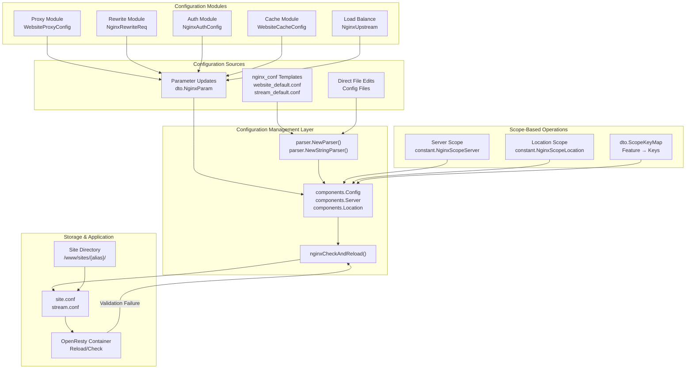
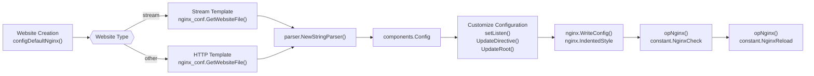
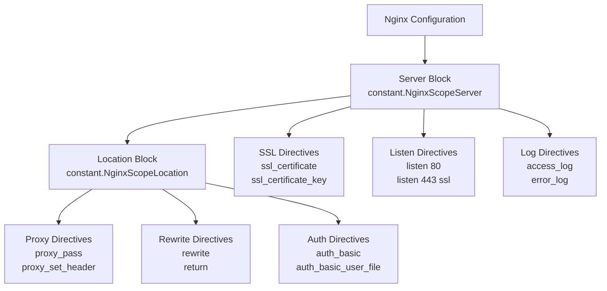
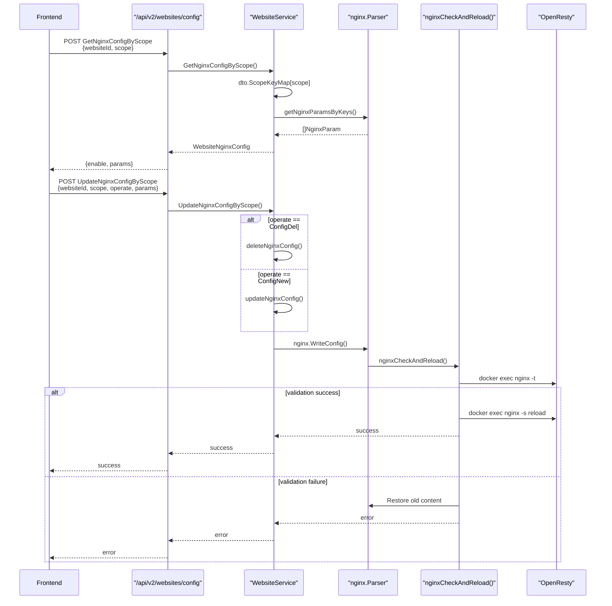
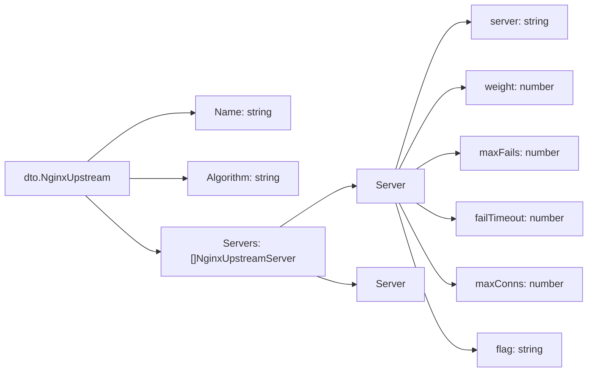
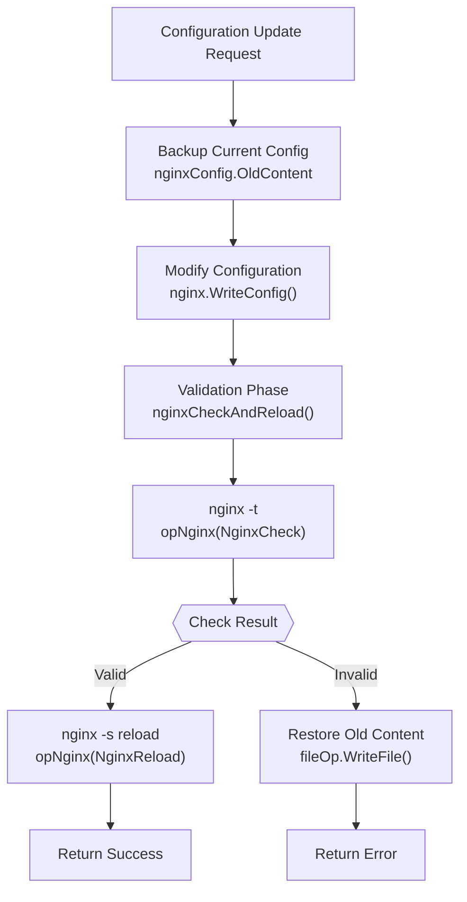
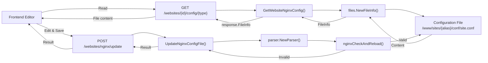
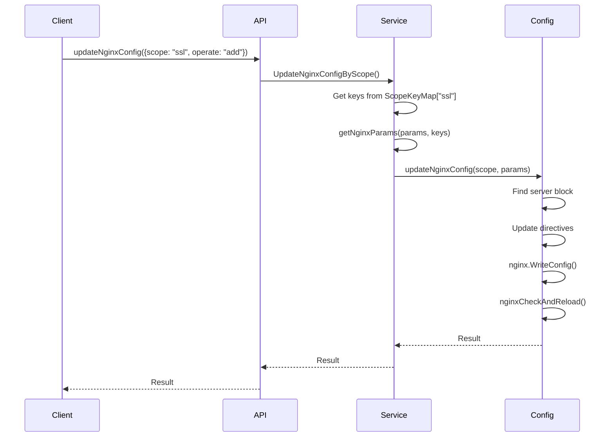
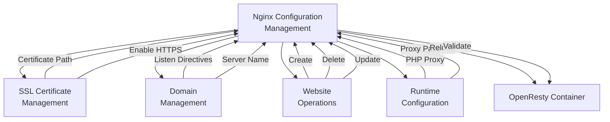

<!-- source: DeepWiki mcp.deepwiki.com · repo 1Panel-dev/1Panel · page 7.3 Nginx Configuration Management · fetched 2026-10-29 -->

# Nginx Configuration Management

<details>
<summary>Relevant source files</summary>

The following files were used as context for generating this wiki page:

- [agent/app/dto/request/website.go](agent/app/dto/request/website.go)
- [agent/app/dto/response/website.go](agent/app/dto/response/website.go)
- [agent/app/service/website.go](agent/app/service/website.go)
- [agent/app/service/website_utils.go](agent/app/service/website_utils.go)
- [frontend/src/api/interface/website.ts](frontend/src/api/interface/website.ts)
- [frontend/src/api/modules/website.ts](frontend/src/api/modules/website.ts)

</details>


This document describes the Nginx configuration management system within the 1Panel website management platform. It covers template-based configuration generation, scope-based parameter management, modular configuration features (proxy, rewrite, auth, cache), validation mechanisms, and file-level configuration editing.

For information about SSL certificate configuration, see [SSL Certificate Management](#5.4). For domain-level configuration, see [Domain Management](#5.5). For overall website operations, see [Website Core Operations](#5.1).

---

## Configuration Architecture

The Nginx configuration system operates through a multi-layered architecture that separates configuration generation, parameter management, validation, and application phases.



**Sources:** [agent/app/service/website.go:774-820](), [agent/app/service/website_utils.go:182-325]()

---

## Template-Based Configuration Generation

During website creation, Nginx configuration files are generated from embedded templates. The system uses the `nginx_conf` package to provide base configurations that are then customized based on website type and parameters.

### Template Selection and Initialization

| Website Type | Template File | Configuration Path |
|-------------|---------------|-------------------|
| `constant.Stream` | `stream_default.conf` | `/www/sites/{alias}/stream.conf` |
| All other types | `website_default.conf` | `/www/sites/{alias}/conf/site.conf` |



**Key Operations:**

1. **Template Loading**: `nginx_conf.GetWebsiteFile()` returns embedded template content [agent/app/service/website_utils.go:198-236]()
2. **Parser Initialization**: `parser.NewStringParser()` creates a parser from template string [agent/app/service/website_utils.go:199,236]()
3. **Configuration Customization**: Template is modified based on website type and parameters [agent/app/service/website_utils.go:244-312]()
4. **File Writing**: `nginx.WriteConfig()` writes the configuration with indented style [agent/app/service/website_utils.go:315]()

**Sources:** [agent/app/service/website_utils.go:182-325](), [agent/app/service/website.go:448-451]()

---

## Scope-Based Parameter Management

The configuration system organizes parameters into scopes, allowing granular control over specific Nginx directives without manual file editing.

### Scope Hierarchy



**Sources:** [agent/app/service/website.go:774-820]()

### Parameter Structure

The `dto.NginxParam` structure represents a single configuration directive with its parameters:

```
NginxParam {
    Name: string           // Directive name (e.g., "proxy_pass", "listen")
    Params: []string       // Directive parameters (e.g., ["http://127.0.0.1:8080"])
}
```

**API Flow for Scope-Based Configuration:**



**Sources:** [agent/app/service/website.go:774-820](), [frontend/src/api/modules/website.ts:71-77]()

### Scope-to-Keys Mapping

The `dto.ScopeKeyMap` maps feature names to their associated Nginx directive keys. This allows the system to retrieve and update related directives as a group:

```
ScopeKeyMap = {
    "ssl": ["ssl_certificate", "ssl_certificate_key", "ssl_protocols", "ssl_ciphers"],
    "cache": ["proxy_cache", "proxy_cache_valid", "proxy_cache_key"],
    "gzip": ["gzip", "gzip_types", "gzip_min_length"],
    // ... more mappings
}
```

**Sources:** [agent/app/service/website.go:775-776,806-808]()

---

## Configuration Modules

The Nginx configuration system provides specialized modules for different features. Each module has its own configuration structure and update logic.

### Proxy Configuration Module

Manages reverse proxy settings including cache, CORS, and upstream configuration.

**Data Structures:**
- `request.WebsiteProxyConfig` [agent/app/dto/request/website.go:253-273]()
- Frontend: `Website.ProxyConfig` [frontend/src/api/interface/website.ts:421-449]()

**Key Directives:**
- `proxy_pass`: Upstream target
- `proxy_set_header`: Header forwarding
- `proxy_cache`: Caching configuration
- CORS headers: `add_header Access-Control-*`

**API Endpoints:**
- GET: `/websites/proxies` via `getProxyConfig()` [frontend/src/api/modules/website.ts:183-185]()
- POST: `/websites/proxies/update` via `operateProxyConfig()` [frontend/src/api/modules/website.ts:187-189]()
- POST: `/websites/proxies/file` via `updateProxyConfigFile()` [frontend/src/api/modules/website.ts:191-193]()

**Sources:** [agent/app/service/website.go:106-112](), [agent/app/dto/request/website.go:253-273]()

### Rewrite Configuration Module

Manages URL rewriting rules using Nginx rewrite directives.

**Data Structures:**
- `request.NginxRewriteReq` [agent/app/dto/request/website.go:385-388]()
- `response.NginxRewriteRes` [agent/app/dto/response/website.go:94-96]()

**API Endpoints:**
- POST: `/websites/rewrite` via `getRewriteConfig()` [frontend/src/api/modules/website.ts:167-169]()
- POST: `/websites/rewrite/update` via `updateRewriteConfig()` [frontend/src/api/modules/website.ts:171-173]()
- POST: `/websites/rewrite/custom` via `operateCustomRewrite()` [frontend/src/api/modules/website.ts:345-347]()

**Sources:** [agent/app/service/website.go:119-122](), [frontend/src/api/modules/website.ts:167-173]()

### Authentication Module

Manages HTTP Basic Authentication at both server and location levels.

**Configuration Levels:**

| Scope | Use Case | Data Structure |
|-------|----------|----------------|
| Server-wide | Protect entire website | `NginxAuthConfig` |
| Path-specific | Protect specific locations | `NginxPathAuthConfig` |

**Data Structures:**
- `request.NginxAuthConfig` [agent/app/dto/request/website.go:475-484]()
- `request.NginxPathAuthConfig` [agent/app/dto/request/website.go:486-493]()

**API Endpoints:**
- POST: `/websites/auths` via `getAuthConfig()` [frontend/src/api/modules/website.ts:199-201]()
- POST: `/websites/auths/update` via `operateAuthConfig()` [frontend/src/api/modules/website.ts:203-205]()
- POST: `/websites/auths/path` via `getPathAuthConfig()` [frontend/src/api/modules/website.ts:207-209]()
- POST: `/websites/auths/path/update` via `operatePathAuthConfig()` [frontend/src/api/modules/website.ts:211-213]()

**Sources:** [agent/app/service/website.go:124-127](), [agent/app/dto/request/website.go:475-493]()

### Redirect Configuration Module

Manages HTTP redirects including domain redirects, path redirects, and redirect types (301, 302).

**Data Structures:**
- `request.RedirectConfig` [frontend/src/api/interface/website.ts:517-531]()

**Redirect Types:**
- Domain redirect: Redirect all traffic from one domain to another
- Path redirect: Redirect specific paths
- Root redirect: Redirect root path only

**API Endpoints:**
- POST: `/websites/redirect` via `getRedirectConfig()` [frontend/src/api/modules/website.ts:223-225]()
- POST: `/websites/redirect/update` via `operateRedirectConfig()` [frontend/src/api/modules/website.ts:227-229]()
- POST: `/websites/redirect/file` via `updateRedirectConfigFile()` [frontend/src/api/modules/website.ts:231-233]()

**Sources:** [agent/app/service/website.go:86-88](), [frontend/src/api/modules/website.ts:223-233]()

### Load Balance Configuration Module

Manages Nginx upstream configuration for load balancing across multiple backend servers.

**Data Structure:**



**Supported Algorithms:**
- `default`: Round-robin (no directive)
- `ip_hash`: Client IP-based distribution
- `least_conn`: Least connections
- `hash`: Generic hash-based

**API Endpoints:**
- GET: `/websites/{id}/lbs` via `getLoadBalances()` [frontend/src/api/modules/website.ts:297-299]()
- POST: `/websites/lbs/create` via `createLoadBalance()` [frontend/src/api/modules/website.ts:301-303]()
- POST: `/websites/lbs/update` via `updateLoadBalance()` [frontend/src/api/modules/website.ts:309-311]()
- POST: `/websites/lbs/del` via `deleteLoadBalance()` [frontend/src/api/modules/website.ts:305-307]()
- POST: `/websites/lbs/file` via `updateLoadBalanceFile()` [frontend/src/api/modules/website.ts:313-315]()

**Sources:** [agent/app/service/website.go:100-105](), [frontend/src/api/modules/website.ts:297-315]()

---

## Validation and Reload Mechanism

All configuration changes go through a validation process before being applied to prevent Nginx from entering an invalid state.

### Validation Workflow



**Sources:** [agent/app/service/website_utils.go:755-781]()

### Validation Function: nginxCheckAndReload()

The `nginxCheckAndReload()` function implements a safe configuration update process:

**Parameters:**
- `oldContent []byte`: Original configuration for rollback
- `filePath string`: Configuration file path
- `containerName string`: OpenResty container name

**Process:**

1. **Configuration Check** [agent/app/service/website_utils.go:761-765]()
   - Executes: `docker exec {container} nginx -t`
   - Validates syntax and directive correctness
   - Returns error if validation fails

2. **Configuration Reload** [agent/app/service/website_utils.go:766-770]()
   - Executes: `docker exec {container} nginx -s reload`
   - Applies new configuration
   - Returns error if reload fails

3. **Rollback on Failure** [agent/app/service/website_utils.go:771-779]()
   - Restores `oldContent` to `filePath`
   - Prevents Nginx from running with invalid configuration
   - Returns descriptive error message

**Sources:** [agent/app/service/website_utils.go:755-781]()

### Container Operation: opNginx()

The `opNginx()` function executes Nginx control commands within the OpenResty container:

**Supported Operations:**
- `constant.NginxCheck`: Validate configuration (`nginx -t`)
- `constant.NginxReload`: Reload configuration (`nginx -s reload`)
- `constant.NginxStop`: Stop Nginx (`nginx -s stop`)
- `constant.NginxStart`: Start Nginx (via Docker API)
- `constant.NginxRestart`: Restart container

**Implementation:**
- Uses Docker exec API for check/reload operations
- Uses Docker container API for start/stop/restart operations
- Returns error with command output on failure

**Sources:** [agent/app/service/website_utils.go:1066-1103]()

---

## File-Based Configuration Management

In addition to scope-based parameter updates, the system supports direct editing of Nginx configuration files through the frontend.

### Configuration File Access



**Sources:** [agent/app/service/website.go:822-840](), [frontend/src/api/modules/website.ts:47-49,159-161]()

### File Reading Process

**API Endpoint:** `GET /websites/{id}/config/{type}`

**Backend Implementation:** [agent/app/service/website.go:822-840]()

1. Retrieve website record by ID
2. Determine configuration path based on `configType`:
   - `constant.AppOpenresty`: Returns `GetWebsiteConfigPath(website)`
3. Create `files.FileInfo` with `Expand: true` to read content
4. Return `response.FileInfo` containing file metadata and content

**Sources:** [agent/app/service/website.go:822-840]()

### File Update Process

**API Endpoint:** `POST /websites/nginx/update`

**Request Structure:**
```typescript
NginxUpdate {
    id: number          // Website ID
    content: string     // New configuration content
}
```

**Backend Processing Flow:**

1. **Retrieve Website**: Get website record to obtain configuration path
2. **Parse Configuration**: Validate syntax using `parser.NewParser()`
3. **Backup Content**: Store current configuration for rollback
4. **Write New Config**: Save new content to file
5. **Validate**: Run `nginxCheckAndReload()` with backup content
6. **Return Result**: Success or error with rollback

**Sources:** [frontend/src/api/modules/website.ts:159-161](), [agent/app/service/website.go:822-840]()

---

## Configuration Update Patterns

The system employs different patterns for configuration updates depending on the complexity and scope of changes.

### Pattern 1: Scope-Based Parameter Update

Used for modular features with predefined directive sets (SSL, cache, gzip, etc.).

**Characteristics:**
- Uses `dto.ScopeKeyMap` to identify related directives
- Updates multiple related parameters atomically
- Supports enable/disable toggle via `operate` parameter

**Example Flow:**



**Sources:** [agent/app/service/website.go:795-820]()

### Pattern 2: Feature-Specific Configuration

Used for complex features with custom configuration structures (proxy, rewrite, auth).

**Characteristics:**
- Custom configuration parsing and generation logic
- Feature-specific validation rules
- May involve multiple configuration files

**Example: Proxy Configuration:**

1. Frontend sends `WebsiteProxyConfig` with all proxy settings
2. Backend validates proxy target and settings
3. Generates location block with proxy directives
4. Optionally generates proxy cache configuration
5. Writes configuration and validates

**Sources:** [agent/app/service/website.go:106-112](), [agent/app/dto/request/website.go:253-273]()

### Pattern 3: Direct File Edit

Used when scope-based or feature-specific patterns don't apply, or when users need full control.

**Characteristics:**
- Complete configuration file provided by user
- Full syntax validation via `parser.NewParser()`
- High flexibility, high risk (requires manual correctness)

**Sources:** [agent/app/service/website.go:822-840](), [frontend/src/api/modules/website.ts:159-161]()

---

## Configuration Path Resolution

The system uses consistent path conventions for storing website configurations.

### Path Structure

```
/www/sites/{alias}/
├── conf/
│   └── site.conf          # HTTP/HTTPS site configuration
├── stream.conf            # Stream (TCP/UDP) configuration
├── proxy/
│   └── *.conf            # Proxy configuration files
├── ssl/
│   ├── certificate.pem   # SSL certificate
│   └── private.key       # SSL private key
├── index/                # Website root directory
└── log/
    ├── access.log        # Access log
    └── error.log         # Error log
```

**Path Helper Functions:**

| Function | Purpose | Returns |
|----------|---------|---------|
| `GetSiteDir(alias)` | Base site directory | `/www/sites/{alias}` |
| `GetSitePath(website, SiteConf)` | HTTP config path | `/www/sites/{alias}/conf/site.conf` |
| `GetSitePath(website, StreamConf)` | Stream config path | `/www/sites/{alias}/stream.conf` |
| `GetWebsiteConfigPath(website)` | Config path by type | Type-specific path |

**Sources:** [agent/app/service/website_utils.go:1139-1173]()

---

## Integration with Configuration System

The Nginx configuration management integrates with other website management subsystems:



**Cross-System Operations:**

1. **Website Creation**: Generates initial Nginx configuration from template [agent/app/service/website.go:448-451]()
2. **SSL Enablement**: Updates server block with SSL directives [agent/app/service/website.go:492-519]()
3. **Domain Addition**: Adds listen and server_name directives [agent/app/service/website_utils.go:588-614]()
4. **Runtime Change**: Updates proxy_pass directives for PHP runtime [agent/app/service/website.go:59]()

**Sources:** [agent/app/service/website.go:241-536](), [agent/app/service/website_utils.go:182-325]()

---

