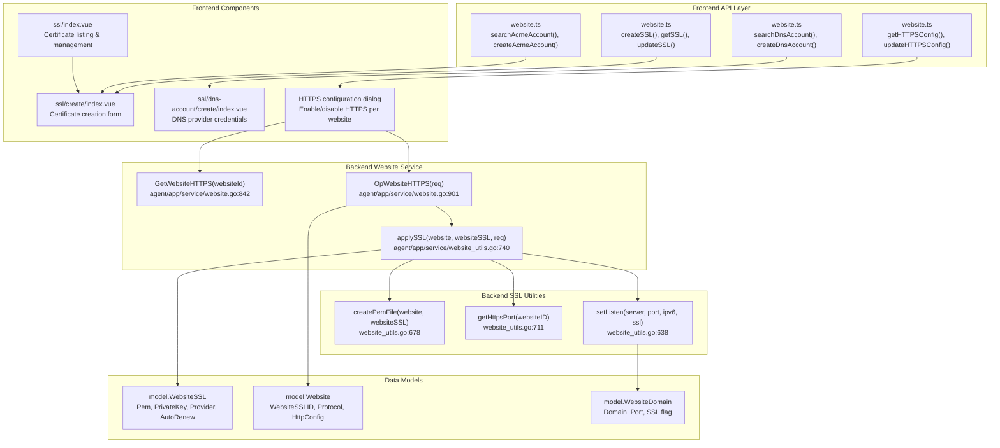
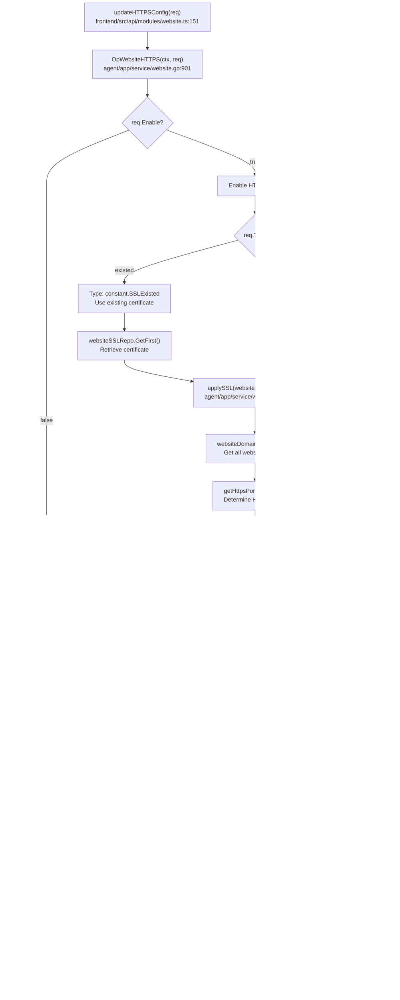
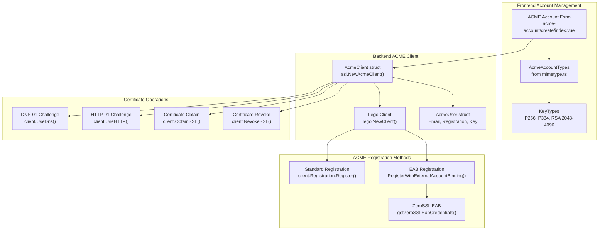
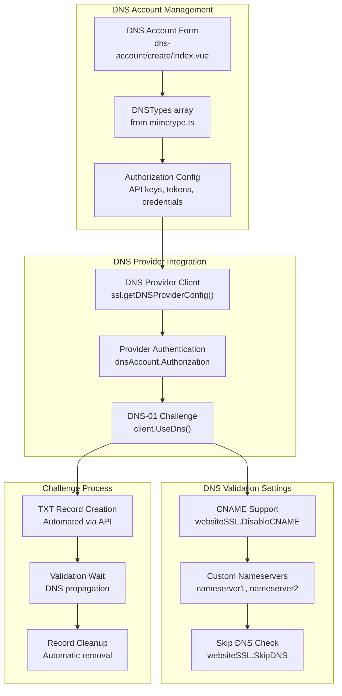
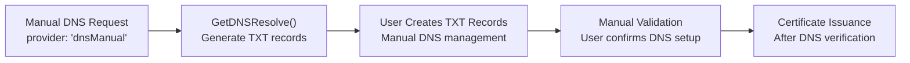
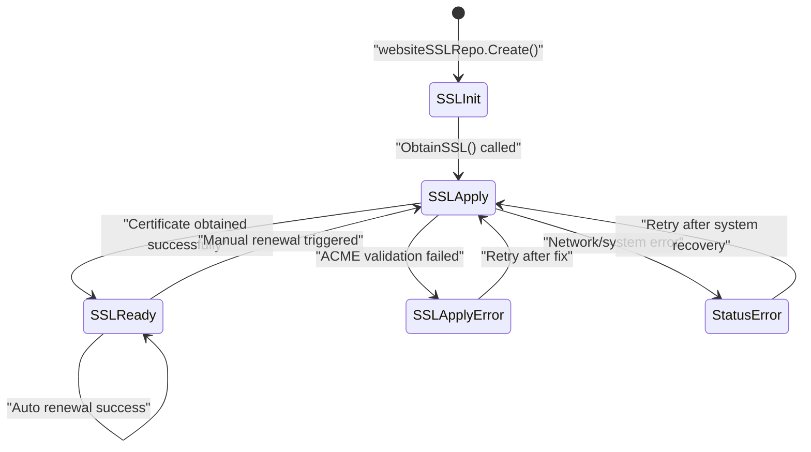
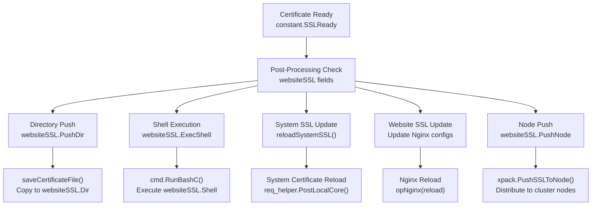

<!-- source: DeepWiki mcp.deepwiki.com · repo 1Panel-dev/1Panel · page 7.4 SSL Certificate Management · fetched 2026-10-29 -->

# SSL Certificate Management

Relevant source files

The following files were used as context for generating this wiki page:

- [agent/app/dto/request/website.go](agent/app/dto/request/website.go)
- [agent/app/dto/response/website.go](agent/app/dto/response/website.go)
- [agent/app/service/website.go](agent/app/service/website.go)
- [agent/app/service/website_utils.go](agent/app/service/website_utils.go)
- [agent/go.mod](agent/go.mod)
- [agent/go.sum](agent/go.sum)
- [agent/utils/ssl/dns_provider.go](agent/utils/ssl/dns_provider.go)
- [core/go.mod](core/go.mod)
- [core/go.sum](core/go.sum)
- [frontend/src/api/interface/website.ts](frontend/src/api/interface/website.ts)
- [frontend/src/api/modules/website.ts](frontend/src/api/modules/website.ts)
- [frontend/src/global/mimetype.ts](frontend/src/global/mimetype.ts)
- [frontend/src/views/website/ssl/dns-account/create/index.vue](frontend/src/views/website/ssl/dns-account/create/index.vue)

This document covers the SSL certificate management system within 1Panel, including certificate creation, ACME integration, DNS validation methods, and automated certificate lifecycle management. The system provides comprehensive SSL certificate management capabilities through both manual and automated processes.

For website configuration and Nginx integration, see [Website Management System](#4.2). For runtime environment management, see [Runtime Management](#4.3).

## Core System Architecture

The SSL certificate management system integrates frontend Vue.js components with backend Go services to provide automated certificate lifecycle management. The system manages both standalone SSL certificates and their application to websites through Nginx configuration.

### SSL Management Components

Sources: [frontend/src/api/modules/website.ts:111-153](), [agent/app/service/website.go:842-1013](), [agent/app/service/website_utils.go:638-831]()

## SSL Application to Websites

The system applies SSL certificates to websites through the `OpWebsiteHTTPS` operation, which modifies Nginx configuration and updates website protocol settings.

### HTTPS Operation Workflow

### HTTP/HTTPS Configuration Modes

The system supports three modes for handling HTTP/HTTPS traffic, defined as constants in the backend:

| Mode Constant | Frontend Value | Behavior |
|--------------|----------------|----------|
| `constant.HTTPSOnly` | `"HTTPSOnly"` | Only HTTPS listen, remove all HTTP listens |
| `constant.HTTPToHTTPS` | `"HTTPToHTTPS"` | Both HTTP and HTTPS listen, redirect HTTP to HTTPS via `if ($scheme = http)` |
| `constant.HTTPAlso` | `"HTTPAlso"` | Both HTTP and HTTPS listen, no redirect |

Sources: [agent/app/service/website.go:901-1013](), [agent/app/service/website_utils.go:740-831](), [agent/app/service/website_utils.go:678-709](), [frontend/src/api/modules/website.ts:147-153]()

## ACME Integration System

The system integrates with multiple ACME Certificate Authorities through the `AcmeClient` implementation and supports various authentication methods:

### Supported ACME Providers

| Provider | Type Value | Authentication Method |
|----------|-----------|----------------------|
| Let's Encrypt | `letsencrypt` | Standard ACME registration |
| ZeroSSL | `zerossl` | EAB (External Account Binding) |
| Buypass | `buypass` | Standard ACME registration |
| Google Public CA | `google` | EAB (External Account Binding) |
| Custom ACME Server | `custom` | Custom CA directory URL |

### ACME Client Architecture

### Key Type Support

The system supports multiple cryptographic key types defined in `KeyTypes`:

| Label | Value | Key Type |
|-------|--------|----------|
| EC 256 | `P256` | ECDSA P-256 |
| EC 384 | `P384` | ECDSA P-384 |
| RSA 2048 | `2048` | RSA 2048-bit |
| RSA 3072 | `3072` | RSA 3072-bit |
| RSA 4096 | `4096` | RSA 4096-bit |

Sources: [agent/utils/ssl/acme.go:28-178](), [agent/utils/ssl/client.go:28-38](), [frontend/src/global/mimetype.ts:158-172](), [frontend/src/views/website/ssl/create/index.vue:29-49]()

## DNS Validation Methods

The system supports automated DNS record management through integrated DNS providers and manual DNS validation for unsupported providers:

### Supported DNS Providers

The system supports 25+ DNS providers defined in `DNSTypes`:

| Provider Category | DNS Types | Authentication Method |
|------------------|-----------|----------------------|
| **Chinese Cloud** | AliYun, TencentCloud, HuaweiCloud, BaiduCloud | Access Key + Secret Key |
| **International Cloud** | CloudFlare, Vercel, CloudDNS | API Token/Key |
| **Domain Registrars** | GoDaddy, NameCheap, NameSilo, NameCom | API Key + Secret |
| **Specialized DNS** | Dynu, ClouDNS, Spaceship, RegRu | Various auth methods |

### DNS Account Configuration Architecture

### DNS Provider Authentication Examples

Different DNS providers require different authentication methods:

| Provider | Required Fields | Example Configuration |
|----------|----------------|----------------------|
| CloudFlare | `email`, `apiKey` | Email + API Token |
| AliYun | `accessKey`, `secretKey` | Access Key + Secret Key |
| GoDaddy | `apiKey`, `apiSecret` | API Key + API Secret |
| NameCheap | `apiKey`, `apiUser` | API Key + Username |

### Manual DNS Validation

For unsupported providers or custom DNS setups, manual validation is available:

Sources: [frontend/src/global/mimetype.ts:174-255](), [frontend/src/views/website/ssl/dns-account/create/index.vue:1-255](), [agent/app/service/website_ssl.go:424-451](), [agent/utils/ssl/client.go:40-65]()

## Certificate Lifecycle Management

The SSL management system provides automated lifecycle management through status tracking, automatic renewal, and post-processing operations:

### Certificate Status Constants

The backend uses specific status constants defined in the `constant` package:

| Status Constant | Frontend Display | Description |
|----------------|------------------|-------------|
| `constant.SSLInit` | `init` | Initial certificate creation |
| `constant.SSLApply` | `applying` | Certificate request in progress |
| `constant.SSLReady` | `success` | Certificate successfully issued |
| `constant.SSLApplyError` | `applyError` | Certificate application failed |
| `constant.StatusError` | `error` | General error state |

### SSL Certificate Types

The system distinguishes between certificate types using the `Type` field:

| Type Constant | Value | Description |
|--------------|--------|-------------|
| `constant.SSLExisted` | `"existed"` | Use existing certificate from certificate list |
| `constant.SSLManual` | `"manual"` | Manually uploaded certificate |
| `constant.SSLAuto` | `"auto"` | Automatically obtained via ACME |

### Certificate Lifecycle State Machine

### Post-Processing Operations

The system executes post-processing operations after successful certificate issuance:

### Automatic Renewal System

The system supports automatic certificate renewal based on expiration dates:

| Configuration | Backend Field | Purpose |
|---------------|---------------|---------|
| Auto Renewal | `websiteSSL.AutoRenew` | Enable/disable automatic renewal |
| Directory Push | `websiteSSL.PushDir` + `websiteSSL.Dir` | Copy certificates to custom directory |
| Shell Execution | `websiteSSL.ExecShell` + `websiteSSL.Shell` | Run custom post-renewal scripts |
| Node Distribution | `websiteSSL.PushNode` + `websiteSSL.Nodes` | Distribute to cluster nodes |

Sources: [agent/app/service/website_ssl.go:245-411](), [agent/app/service/website_ssl.go:413-422](), [agent/app/service/website_ssl.go:219-243](), [frontend/src/views/website/ssl/index.vue:76-97]()

## User Interface Components

### Main SSL Management Interface

The primary SSL management interface (`frontend/src/views/website/ssl/index.vue`) provides:

- **Certificate Listing**: Displays all SSL certificates with status, domains, and expiration
- **Bulk Operations**: Multi-select deletion and management
- **Quick Actions**: Create, upload, self-signed certificate generation
- **Account Management**: ACME and DNS account configuration access

Key UI operations:

| Button/Action | Function | Component Reference |
|---------------|----------|-------------------|
| Create | `openSSL()` | `sslCreateRef` |
| Upload | `openUpload()` | `sslUploadRef` |
| Self-Signed | `openCA()` | `caRef` |
| ACME Account | `openAcmeAccount()` | `acmeAccountRef` |
| DNS Account | `openDnsAccount()` | `dnsAccountRef` |

### Certificate Creation Form

The creation form (`frontend/src/views/website/ssl/create/index.vue`) supports:

- **Domain Configuration**: Primary domain and alternative names
- **Provider Selection**: DNS account, manual DNS, HTTP, or self-signed
- **Advanced Options**: Custom nameservers, CNAME handling, DNS skip options
- **Post-Processing**: Directory push and shell execution configuration

### Certificate Detail View

The detail view (`frontend/src/views/website/ssl/detail/index.vue`) provides:

- **Certificate Information**: Domain, organization, validity dates
- **Certificate Content**: PEM-formatted certificate and private key display
- **Copy Functionality**: Easy copying of certificate data

Sources: [frontend/src/views/website/ssl/index.vue:5-24](), [frontend/src/views/website/ssl/index.vue:336-362](), [frontend/src/views/website/ssl/detail/index.vue:1-67]()

---

