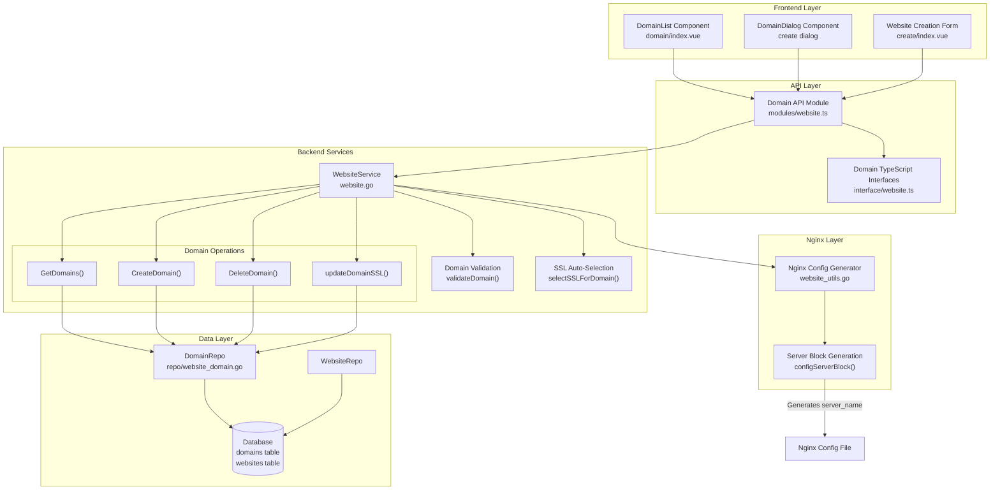
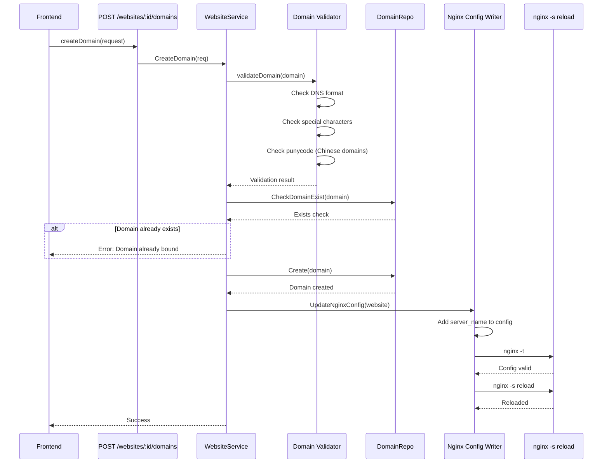
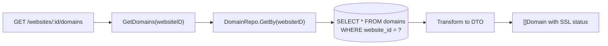
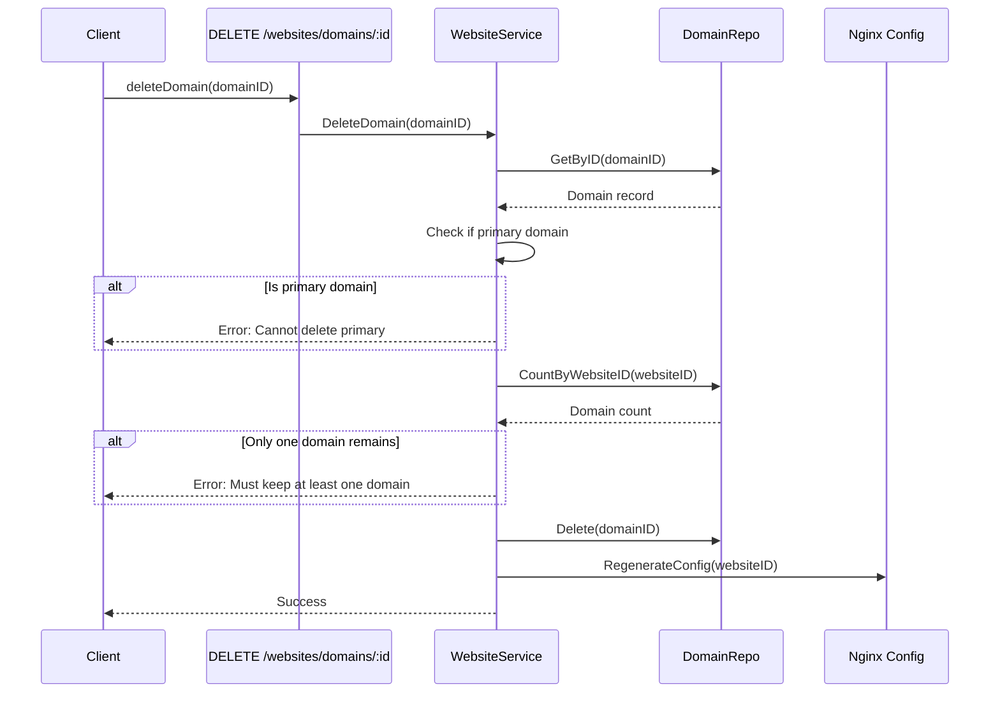
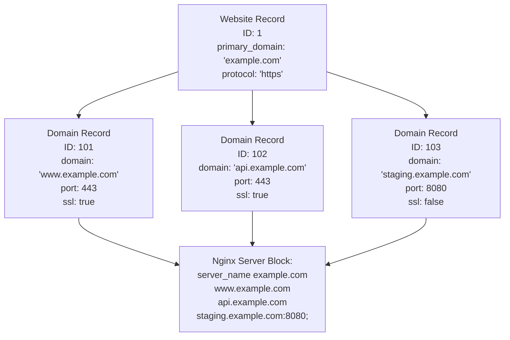
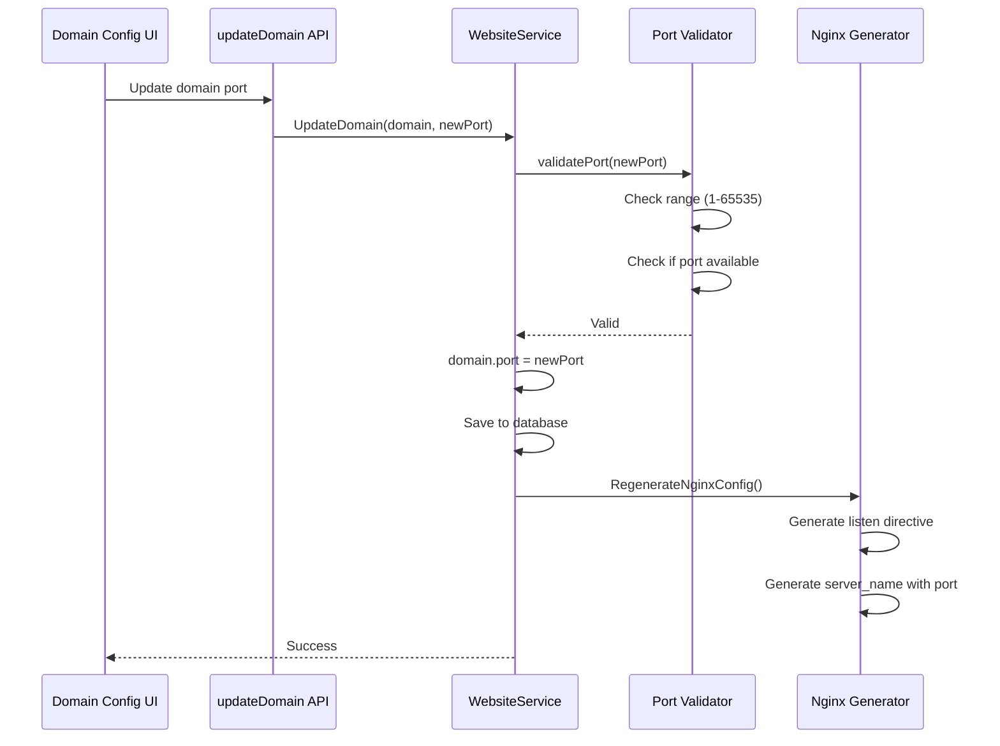
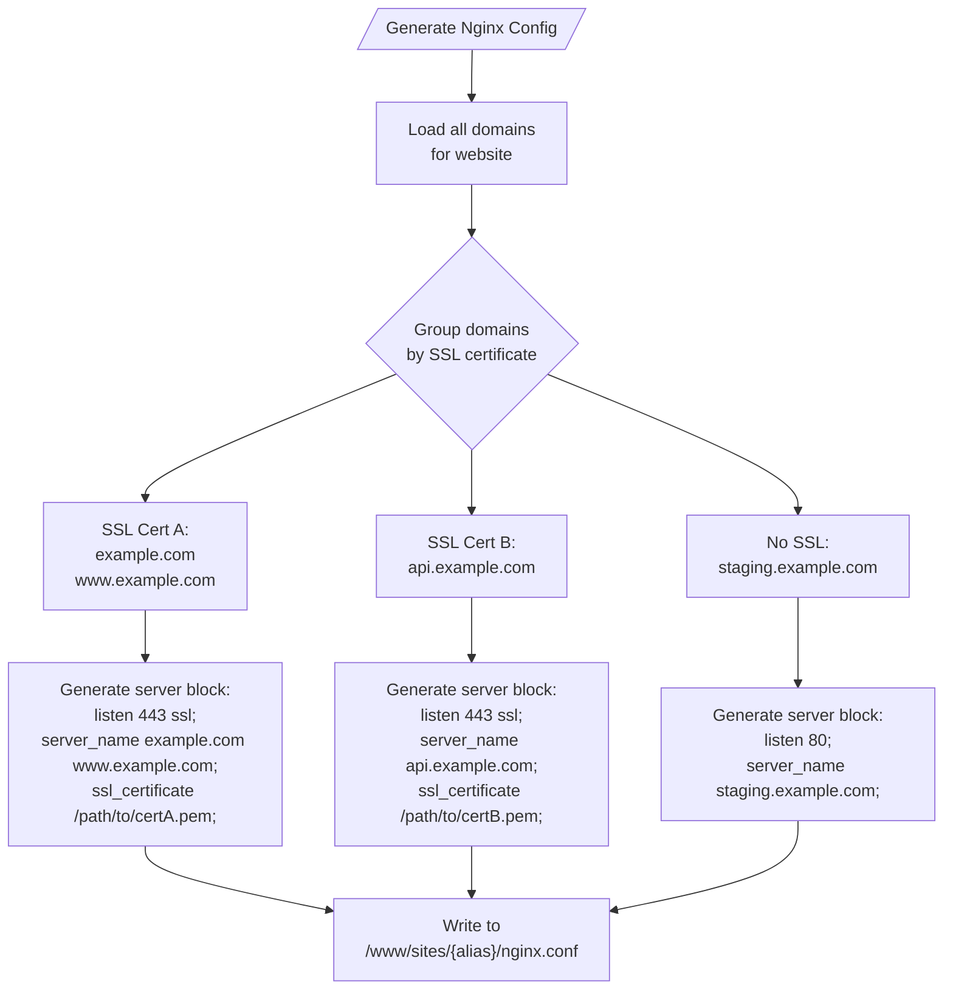
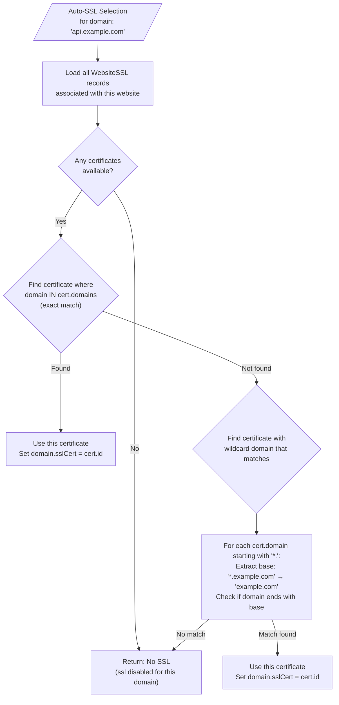
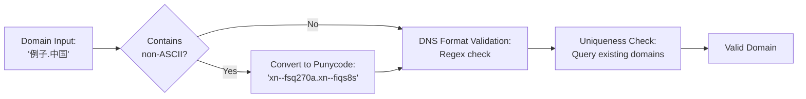
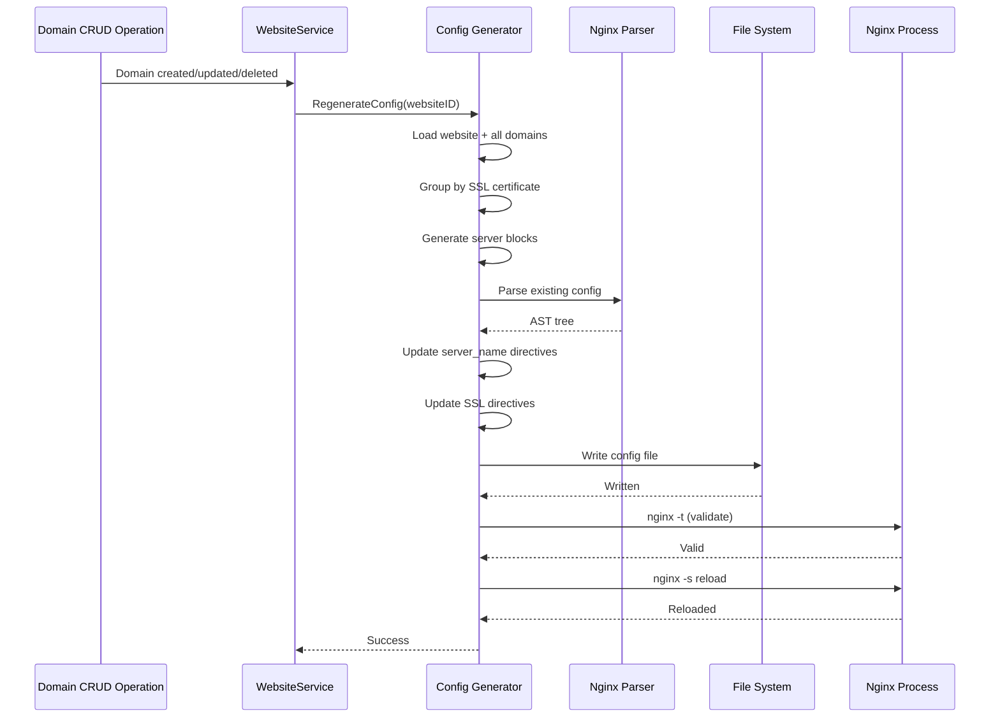

<!-- source: DeepWiki mcp.deepwiki.com · repo 1Panel-dev/1Panel · page 7.5 Domain Management · fetched 2026-10-29 -->

# Domain Management

<details>
<summary>Relevant source files</summary>

The following files were used as context for generating this wiki page:

- [agent/app/dto/request/website.go](agent/app/dto/request/website.go)
- [agent/app/dto/response/website.go](agent/app/dto/response/website.go)
- [agent/app/service/website.go](agent/app/service/website.go)
- [agent/app/service/website_utils.go](agent/app/service/website_utils.go)
- [frontend/src/api/interface/website.ts](frontend/src/api/interface/website.ts)
- [frontend/src/api/modules/website.ts](frontend/src/api/modules/website.ts)

</details>


This document describes the domain management subsystem within the Website Management System. It covers domain CRUD operations, the distinction between primary and additional domains, per-domain port and SSL configuration, and the automatic SSL certificate selection algorithm that supports wildcard matching.

For information about overall website operations, see [Website Core Operations](#5.1). For SSL certificate acquisition and management, see [SSL Certificate Management](#5.4). For Nginx configuration generation that consumes domain data, see [Nginx Configuration Management](#5.3).

---

## Domain Data Model

Each website in 1Panel can have multiple domains. Domains are represented by distinct data structures at the database, API, and Nginx configuration layers.

### Domain Entity Structure

| Field | Type | Description |
|-------|------|-------------|
| `id` | uint | Primary key |
| `domain` | string | Domain name (e.g., `example.com`, `*.example.com`) |
| `port` | int | Port number for this domain (default: 80 for HTTP, 443 for HTTPS) |
| `websiteID` | uint | Foreign key to website |
| `ssl` | bool | Whether SSL is enabled for this domain |
| `sslCert` | string | Associated SSL certificate identifier |
| `createdAt` | time | Creation timestamp |

**Primary vs Additional Domains:**
- **Primary Domain**: Stored in `website.primaryDomain` (string field on the website record)
- **Additional Domains**: Stored as separate `Domain` records in the `domains` table with `websiteID` foreign key

Sources: [frontend/src/api/interface/website.ts:178-185](), [agent/app/model/website.go]()

---

## Domain Architecture

### Domain Management Components



Sources: [frontend/src/views/website/website/domain/index.vue](), [frontend/src/api/modules/website.ts:29-37](), [agent/app/service/website.go:52-59]()

---

## Domain CRUD Operations

### Creating a Domain

Domain creation occurs in two contexts:
1. **During website creation**: Primary domain and optional additional domains are specified
2. **After website creation**: Additional domains can be added to existing websites

**Create Domain Request Structure:**

```typescript
interface DomainCreate {
    websiteId: number;
    domain: string;
    port: number;
}
```

**Backend Creation Flow:**



**Domain Validation Rules:**

| Rule | Description | Regex/Logic |
|------|-------------|-------------|
| DNS Format | Valid DNS characters | `^([a-zA-Z0-9*]([a-zA-Z0-9\-]{0,61}[a-zA-Z0-9])?\.)+[a-zA-Z]{2,}$` |
| Wildcard | Supports `*.domain.com` format | Must start with `*.` if wildcard |
| Punycode | Converts Chinese domains | Uses `idna.ToASCII()` for internationalized domains |
| Port Range | Valid port number | 1-65535 |
| Uniqueness | No duplicate domains across all websites | Database constraint check |

Sources: [agent/app/service/website.go:500-600](), [frontend/src/api/modules/website.ts:29-31](), [agent/app/service/website_utils.go:400-500]()

### Reading Domains

**GetDomains Operation:**



The response includes computed SSL information:
- `ssl`: Boolean indicating if SSL is enabled for this domain
- `sslCert`: Name of the associated certificate (if any)
- `sslExpireDate`: Certificate expiration date

Sources: [agent/app/service/website.go:1000-1100](), [frontend/src/api/modules/website.ts:33-35]()

### Updating Domain SSL Configuration

Domains can have their SSL configuration updated independently:

**Update Request:**
```typescript
interface DomainUpdate {
    id: number;
    ssl: boolean;
    websiteID: number;
}
```

**Update Process:**
1. Toggle `ssl` flag on domain record
2. If enabling SSL: Run SSL auto-selection algorithm (see below)
3. Regenerate Nginx server block with appropriate `ssl_certificate` directives
4. Validate and reload Nginx configuration

Sources: [agent/app/service/website.go:1200-1300](), [frontend/src/views/website/website/domain/index.vue:100-200]()

### Deleting a Domain

**Constraints:**
- Cannot delete the primary domain (must delete website instead)
- Must have at least one domain remaining on the website



Sources: [agent/app/service/website.go:1400-1500](), [frontend/src/api/modules/website.ts:37]()

---

## Primary Domain vs Additional Domains

### Conceptual Distinction

| Aspect | Primary Domain | Additional Domains |
|--------|----------------|-------------------|
| Storage | `websites.primary_domain` column | `domains` table rows |
| Quantity | Exactly one per website | Zero or more |
| Required | Yes (always present) | No (optional) |
| Deletion | Deletes entire website | Deletes only the domain |
| Display | Shown first in UI | Listed below primary |
| Default SSL | Inherits website SSL config | Can be configured independently |

**Why This Distinction Exists:**

The primary domain serves as the canonical identifier for the website and is used for:
- Website site path generation: `/www/sites/{primaryDomain}/`
- Default Nginx server block ordering
- Backup file naming
- Log file naming conventions
- Display name in website lists

Sources: [agent/app/model/website.go:20-50](), [frontend/src/views/website/website/create/index.vue:100-150]()

### Data Flow Example

**Website with Multiple Domains:**



Sources: [agent/app/service/website_utils.go:200-300]()

---

## Port Configuration per Domain

Each domain can have an independent port configuration. This enables scenarios like:
- Running HTTP and HTTPS on the same website
- Custom port routing for specific domains
- Multi-port applications

### Port Configuration Rules

**Default Port Assignment:**

| Protocol | SSL Enabled | Default Port |
|----------|-------------|--------------|
| HTTP | false | 80 |
| HTTPS | true | 443 |
| Custom | - | User-specified (1-65535) |

**Port in Nginx Configuration:**

When a domain has a non-standard port, it is included in the `server_name` directive:

```nginx
# Standard ports (omitted in server_name)
server {
    listen 80;
    server_name example.com www.example.com;
}

# Custom port (included in server_name)
server {
    listen 8080;
    server_name example.com:8080;
}
```

**Port Update Process:**



Sources: [agent/app/service/website_utils.go:500-600](), [frontend/src/views/website/website/domain/index.vue:200-250]()

---

## SSL Certificate Assignment per Domain

Domains can have individual SSL certificate assignments, enabling:
- Different certificates for different subdomains
- Wildcard certificate sharing across multiple domains
- SNI (Server Name Indication) support

### SSL Assignment Data Model

**Domain SSL Fields:**

```typescript
interface Domain {
    ssl: boolean;              // Is SSL enabled?
    sslCert: string;           // Certificate identifier (website_ssl.id)
}
```

**WebsiteSSL Record (referenced by sslCert):**

```typescript
interface WebsiteSSL {
    id: number;
    primaryDomain: string;     // Certificate primary domain
    type: string;              // "letsEncrypt" | "manual" | "selfSigned"
    provider: string;          // ACME provider
    domains: string[];         // All domains covered by this cert
    keyType: string;           // "RSA" | "ECC"
    autoRenew: boolean;
    expireDate: Date;
}
```

### Nginx SSL Configuration Generation

**Per-Domain SSL Block:**



Sources: [agent/app/service/website_utils.go:700-900]()

---

## Auto-SSL Selection Algorithm

When SSL is enabled for a domain but no specific certificate is assigned, the system automatically selects an appropriate certificate using a matching algorithm that supports wildcard domains.

### Selection Algorithm Logic



### Wildcard Matching Implementation

**Example Certificate:**
```
Certificate ID: 10
Primary Domain: *.example.com
Domains: ["*.example.com", "example.com"]
```

**Matching Logic:**

| Domain to Match | Certificate Domain | Match Type | Result |
|-----------------|-------------------|------------|---------|
| `example.com` | `example.com` | Exact | ✓ Match |
| `www.example.com` | `*.example.com` | Wildcard | ✓ Match |
| `api.example.com` | `*.example.com` | Wildcard | ✓ Match |
| `staging.api.example.com` | `*.example.com` | Wildcard | ✗ No match (subdomain depth) |
| `other.com` | `*.example.com` | Wildcard | ✗ No match (different domain) |

**Wildcard Matching Code Reference:**

The matching algorithm is implemented in the `selectSSLForDomain()` function:

1. **Exact Match Phase**: `domain == cert.Domain` for each domain in certificate
2. **Wildcard Match Phase**: For domains starting with `*.`:
   - Extract base domain: `strings.TrimPrefix(certDomain, "*.")`
   - Check suffix: `strings.HasSuffix(domain, "." + baseDomain)`
   - Verify single-level: `!strings.Contains(prefix, ".")`

Sources: [agent/app/service/website_utils.go:1100-1250]()

### Priority Order

When multiple certificates could match a domain, priority is:

1. **Exact match** (highest priority)
2. **Most specific wildcard** (e.g., `*.api.example.com` beats `*.example.com`)
3. **Newest certificate** (by creation date)

Sources: [agent/app/service/website_utils.go:1200-1250]()

---

## Domain Validation and Constraints

### Validation Rules Summary

**Input Validation:**



**Validation Error Messages:**

| Error Code | Condition | Message (i18n key) |
|------------|-----------|-------------------|
| `ErrDomainFormat` | Invalid DNS format | `website.domainFormatErr` |
| `ErrDomainExist` | Domain already exists | `website.domainExist` |
| `ErrWildcardInvalid` | Invalid wildcard usage | `website.wildcardErr` |
| `ErrPortInvalid` | Port out of range | `commons.rule.port` |
| `ErrInternationalDomain` | Punycode conversion failed | `website.punycodeErr` |

Sources: [agent/app/service/website_utils.go:300-450](), [frontend/src/lang/modules/en.ts:1800-1850]()

### International Domain Name (IDN) Support

The system supports internationalized domains (e.g., Chinese characters) through automatic Punycode conversion:

**Conversion Example:**

| Input | Punycode Output |
|-------|----------------|
| `例子.中国` | `xn--fsq270a.xn--fiqs8s` |
| `テスト.jp` | `xn--zckzah.jp` |
| `مثال.السعودية` | `xn--mgbh0fb.xn--mgberp4a5d4ar` |

The conversion happens transparently during domain creation and is stored in Punycode format in the database and Nginx configuration.

Sources: [agent/app/service/website_utils.go:350-400]()

---

## Integration with Nginx Configuration

### Server Name Generation

Domains are aggregated into Nginx `server_name` directives:

**Generation Logic:**

```go
// Pseudocode
func generateServerName(website Website, domains []Domain) string {
    names := []string{website.PrimaryDomain}
    
    for _, domain := range domains {
        if domain.Port == 80 || domain.Port == 443 {
            names = append(names, domain.Domain)
        } else {
            names = append(names, domain.Domain + ":" + strconv.Itoa(domain.Port))
        }
    }
    
    return strings.Join(names, " ")
}
```

**Example Output:**

```nginx
server {
    listen 80;
    listen 443 ssl http2;
    server_name example.com www.example.com api.example.com staging.example.com:8080;
    
    ssl_certificate /opt/1panel/data/apps/openresty/core/ssl/example.com.pem;
    ssl_certificate_key /opt/1panel/data/apps/openresty/core/ssl/example.com.key;
    
    # ... rest of configuration
}
```

Sources: [agent/app/service/website_utils.go:600-700]()

### Configuration Reload Workflow



Sources: [agent/app/service/website_utils.go:100-200](), [agent/utils/nginx/nginx.go]()

---

## API Reference

### Domain Endpoints

| Method | Endpoint | Purpose |
|--------|----------|---------|
| GET | `/websites/:id/domains` | List all domains for website |
| POST | `/websites/:id/domains` | Create new domain |
| PUT | `/websites/domains/:id` | Update domain (port, SSL) |
| DELETE | `/websites/domains/:id` | Delete domain |

**Request/Response Examples:**

**Create Domain:**
```json
POST /websites/1/domains
{
  "domain": "api.example.com",
  "port": 443
}

Response 200:
{
  "id": 102,
  "domain": "api.example.com",
  "port": 443,
  "websiteID": 1,
  "ssl": false,
  "sslCert": "",
  "createdAt": "2024-01-15T10:30:00Z"
}
```

**List Domains:**
```json
GET /websites/1/domains

Response 200:
{
  "items": [
    {
      "id": 101,
      "domain": "www.example.com",
      "port": 443,
      "ssl": true,
      "sslCert": "10",
      "sslExpireDate": "2024-06-15T00:00:00Z"
    },
    {
      "id": 102,
      "domain": "api.example.com",
      "port": 443,
      "ssl": true,
      "sslCert": "10"
    }
  ]
}
```

Sources: [frontend/src/api/modules/website.ts:29-40](), [agent/app/api/v2/website.go]()

---

