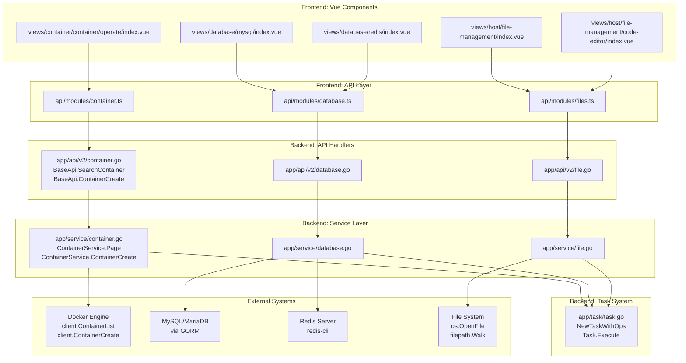
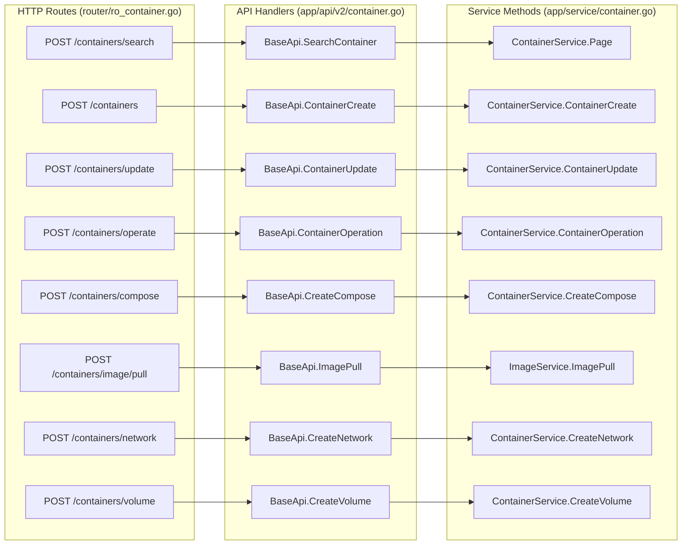
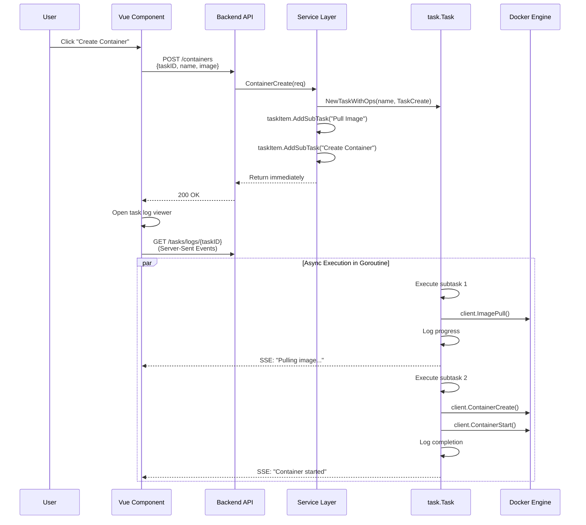
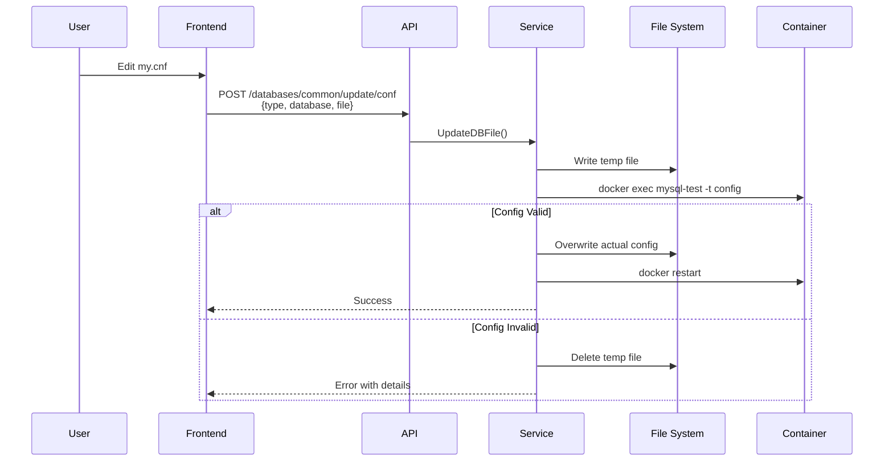

<!-- source: DeepWiki mcp.deepwiki.com · repo 1Panel-dev/1Panel · page 8 Infrastructure Management · fetched 2026-10-29 -->

# Infrastructure Management

<details>
<summary>Relevant source files</summary>

The following files were used as context for generating this wiki page:

- [agent/app/api/v2/container.go](agent/app/api/v2/container.go)
- [agent/app/dto/container.go](agent/app/dto/container.go)
- [agent/app/service/container.go](agent/app/service/container.go)
- [agent/router/ro_container.go](agent/router/ro_container.go)
- [frontend/src/api/interface/container.ts](frontend/src/api/interface/container.ts)
- [frontend/src/api/interface/database.ts](frontend/src/api/interface/database.ts)
- [frontend/src/api/interface/file.ts](frontend/src/api/interface/file.ts)
- [frontend/src/api/modules/container.ts](frontend/src/api/modules/container.ts)
- [frontend/src/api/modules/database.ts](frontend/src/api/modules/database.ts)
- [frontend/src/api/modules/files.ts](frontend/src/api/modules/files.ts)
- [frontend/src/views/container/container/operate/index.vue](frontend/src/views/container/container/operate/index.vue)
- [frontend/src/views/database/mysql/index.vue](frontend/src/views/database/mysql/index.vue)
- [frontend/src/views/database/mysql/setting/index.vue](frontend/src/views/database/mysql/setting/index.vue)
- [frontend/src/views/database/redis/index.vue](frontend/src/views/database/redis/index.vue)
- [frontend/src/views/database/redis/setting/index.vue](frontend/src/views/database/redis/setting/index.vue)
- [frontend/src/views/host/file-management/code-editor/index.vue](frontend/src/views/host/file-management/code-editor/index.vue)
- [frontend/src/views/host/file-management/index.vue](frontend/src/views/host/file-management/index.vue)

</details>


## Purpose and Scope

Infrastructure Management encompasses the core operational capabilities of 1Panel for managing server resources. This module provides three primary subsystems:

1. **Container Management** - Full lifecycle management of Docker containers, images, networks, volumes, and Docker Compose applications. See [Container Management](#8.1) for details.
2. **Database Management** - Administration of MySQL/MariaDB, PostgreSQL, and Redis databases including creation, configuration, backups, and terminal access. See [Database Management](#8.2) for details.
3. **File Management** - Web-based file browser with Monaco code editor, supporting multi-tab editing, file operations, and terminal integration. See [File Management System](#8.3) for details.

These subsystems share common architectural patterns: a Vue.js frontend communicating with Go backend services through RESTful APIs, with operations executed asynchronously via the task system for long-running processes.

---

## System Architecture Overview

### Infrastructure Management Component Map



**Sources:**
- [frontend/src/views/container/container/operate/index.vue:1-350]()
- [frontend/src/views/database/mysql/index.vue:1-266]()
- [frontend/src/views/host/file-management/index.vue:1-650]()
- [frontend/src/api/modules/container.ts:1-232]()
- [frontend/src/api/modules/database.ts:1-195]()
- [frontend/src/api/modules/files.ts:1-181]()
- [agent/app/api/v2/container.go:1-100]()
- [agent/app/service/container.go:1-100]()

---

## Core Data Structures and Interfaces

The infrastructure management subsystems share common architectural patterns in how they define data structures and API interfaces.

### Container Management DTOs

| DTO Type | Purpose | Key Fields |
|----------|---------|------------|
| `PageContainer` | Search/filter containers | `name`, `state`, `filters`, `orderBy` |
| `ContainerInfo` | Container display data | `containerID`, `name`, `state`, `ports`, `isFromApp` |
| `ContainerOperate` | Create/update container | `name`, `image`, `networks[]`, `exposedPorts[]`, `volumes[]` |
| `ContainerUpgrade` | Upgrade container image | `names[]`, `image`, `forcePull` |
| `ComposeInfo` | Docker Compose project | `name`, `configFile`, `containers[]`, `env` |

**Sources:**
- [agent/app/dto/container.go:1-285]()
- [frontend/src/api/interface/container.ts:1-407]()

### Database Management DTOs

| DTO Type | Purpose | Key Fields |
|----------|---------|------------|
| `DatabaseOption` | Database connection selector | `id`, `from`, `type`, `database`, `version` |
| `MysqlDBInfo` | MySQL database record | `id`, `name`, `username`, `password`, `permission` |
| `PostgresqlDBInfo` | PostgreSQL database record | `id`, `name`, `username`, `superUser` |
| `RedisConf` | Redis configuration | `port`, `timeout`, `maxclients`, `maxmemory` |
| `BaseInfo` | Database connection info | `name`, `port`, `password`, `containerName` |

**Sources:**
- [frontend/src/api/interface/database.ts:1-350]()

### File Management DTOs

| DTO Type | Purpose | Key Fields |
|----------|---------|------------|
| `ReqFile` | File listing request | `path`, `search`, `showHidden`, `sortBy` |
| `File` | File/directory info | `path`, `name`, `size`, `isDir`, `mode`, `user`, `group` |
| `FileCreate` | Create file/directory | `path`, `isDir`, `mode`, `isLink` |
| `FileCompress` | Compress files | `files[]`, `type`, `dst`, `secret` |
| `Favorite` | Bookmarked path | `path`, `isDir`, `name` |

**Sources:**
- [frontend/src/api/interface/file.ts:1-264]()

---

## API Routes and Service Mapping

### Container Routes to Services



**Sources:**
- [agent/router/ro_container.go:1-92]()
- [agent/app/api/v2/container.go:1-700]()
- [agent/app/service/container.go:1-920]()

### Database API Endpoints

| Endpoint Pattern | Purpose | Frontend Caller |
|-----------------|---------|-----------------|
| `POST /databases/search` | List MySQL databases | `searchMysqlDBs()` |
| `POST /databases` | Create MySQL database | `addMysqlDB()` |
| `POST /databases/pg/search` | List PostgreSQL databases | `searchPostgresqlDBs()` |
| `POST /databases/redis/conf` | Load Redis config | `loadRedisConf()` |
| `POST /databases/common/load/file` | Load config file | `loadDBFile()` |
| `GET /databases/db/list/{type}` | List database instances | `listDatabases()` |

**Sources:**
- [frontend/src/api/modules/database.ts:1-195]()

### File Management API Endpoints

| Endpoint Pattern | Purpose | Frontend Caller |
|-----------------|---------|-----------------|
| `POST /files/search` | List files/directories | `getFilesList()` |
| `POST /files` | Create file/directory | `createFile()` |
| `POST /files/content` | Read file content | `getFileContent()` |
| `POST /files/save` | Save file content | `saveFileContent()` |
| `POST /files/compress` | Compress files | `compressFile()` |
| `POST /files/decompress` | Extract archive | `deCompressFile()` |
| `POST /files/favorite` | Add to favorites | `addFavorite()` |

**Sources:**
- [frontend/src/api/modules/files.ts:1-181]()

---

## Asynchronous Task Execution Pattern

Long-running infrastructure operations use a common task execution pattern to provide progress tracking and prevent request timeouts.

### Task Execution Flow



### Task System Implementation

The task system is defined in `app/task/task.go` and provides:

- **Task Creation**: `NewTaskWithOps(name, operate, scope, taskID, subTaskCount)` creates a task with a unique ID
- **Subtask Management**: `AddSubTask(name, func, rollback)` adds individual steps with optional rollback functions
- **Execution**: `Execute()` runs all subtasks sequentially, logging progress
- **Logging**: `Log(msg)`, `LogWithStatus(msg, err)`, `Logf(format, args)` write to task log
- **Streaming**: Frontend streams logs via Server-Sent Events from `/tasks/logs/:taskID`

**Task Scope Constants:**
- `TaskScopeContainer` - Container operations
- `TaskScopeImage` - Image operations  
- `TaskScopeDatabase` - Database operations
- `TaskScopeFile` - File operations

**Task Operation Types:**
- `TaskCreate`, `TaskUpdate`, `TaskUpgrade`, `TaskDelete`
- `TaskClean`, `TaskCommit`, `TaskRecover`

**Sources:**
- [agent/app/service/container.go:521-583]() (ContainerCreate with task)
- [agent/app/service/container.go:664-717]() (ContainerUpdate with task)
- [agent/app/service/container.go:719-793]() (ContainerUpgrade with task)

---

## Shared Frontend Patterns

### Database Selection Component Pattern

Both MySQL and Redis management UIs share a common pattern for selecting between local and remote databases:

```typescript
// Common pattern in MySQL and Redis views
const dbOptionsLocal = ref<Array<Database.DatabaseOption>>([]);
const dbOptionsRemote = ref<Array<Database.DatabaseOption>>([]);
const currentDB = ref<Database.DatabaseOption>();
const currentDBName = ref();

// Load available databases
const loadDBOptions = async () => {
    const res = await listDatabases('mysql,mariadb,mysql-cluster');
    // OR: await listDatabases('redis,redis-cluster');
    
    for (const item of res.data) {
        if (item.from === 'local') {
            dbOptionsLocal.value.push(item);
        } else {
            dbOptionsRemote.value.push(item);
        }
    }
};

// Switch between databases
const changeDatabase = async () => {
    currentDB.value = findDatabase(currentDBName.value);
    globalStore.setCurrentDB(currentDB.value.database);
};
```

The UI presents a dropdown with two option groups:
- **Local** - Databases running in Docker containers managed by 1Panel
- **Remote** - External database connections configured by the user

**Sources:**
- [frontend/src/views/database/mysql/index.vue:512-559]() (MySQL implementation)
- [frontend/src/views/database/redis/index.vue:247-288]() (Redis implementation)

### File Management Tab System

The file manager supports multiple concurrent browsing sessions through a tab system:

```typescript
interface Tab {
    id: string;        // Unique tab identifier
    name: string;      // Current directory name
    path: string;      // Full path
}

const editableTabs = ref<Tab[]>([]);
const editableTabsKey = ref('');  // Currently active tab

// Add new tab
const addTab = () => {
    const newTab = {
        id: `tab-${Date.now()}`,
        name: '',
        path: '/'
    };
    editableTabs.value.push(newTab);
    editableTabsKey.value = newTab.id;
};

// Switch tabs
const changeTab = (tabId: string) => {
    editableTabsKey.value = tabId;
    // Reload file list for this tab's path
};
```

Each tab maintains:
- Independent navigation history (back/forward)
- Separate file listings
- Own search filters and sorting

**Sources:**
- [frontend/src/views/host/file-management/index.vue:1-612]()

---

## Resource Monitoring Integration

Infrastructure components expose real-time resource metrics for monitoring.

### Container Stats Collection

The container service provides two levels of stats:

**System-Level Stats** via `ContainerItemStats`:
```go
// agent/app/service/container.go
func (u *ContainerService) ContainerItemStats(req dto.OperationWithName) (dto.ContainerItemStats, error) {
    if req.Name != "system" {
        // Single container stats
        containerInfo, _, err := client.ContainerInspectWithRaw(context.Background(), req.Name, true)
        data.SizeRw = *containerInfo.SizeRw
        data.SizeRootFs = *containerInfo.SizeRootFs
    } else {
        // System-wide disk usage
        usage, err := client.DiskUsage(context.Background(), types.DiskUsageOptions{})
        // Aggregate image, container, volume, build cache usage
    }
}
```

**Per-Container Live Stats** via `ContainerListStats`:
```go
func (u *ContainerService) ContainerListStats() ([]dto.ContainerListStats, error) {
    list, err := client.ContainerList(context.Background(), container.ListOptions{All: true})
    
    var wg sync.WaitGroup
    for _, item := range list {
        go func(item container.Summary) {
            datas = append(datas, loadCpuAndMem(client, item.ID))
            wg.Done()
        }(item)
    }
    wg.Wait()
}
```

Metrics collected: `cpuPercent`, `memoryUsage`, `memoryPercent`, `memoryCache`

**Sources:**
- [agent/app/service/container.go:238-281]() (ContainerItemStats)
- [agent/app/service/container.go:282-303]() (ContainerListStats)

### Database Connection Status

Database status is tracked through container health checks and direct connections:

```typescript
// MySQL status tracking
interface CheckInstalled {
    status: string;        // "Running", "Stopped", "Exited"
    version: string;       // "8.0.33"
    containerName: string; // "1panel-mysql-abc123"
}

// Redis status includes configuration
interface RedisStatus {
    tcp_port: string;
    uptime_in_days: string;
    connected_clients: string;
    used_memory: string;
    total_commands_processed: string;
}
```

Status checks occur:
- On component mount
- After configuration changes
- When switching between databases
- Every 3 seconds for dashboard metrics

**Sources:**
- [frontend/src/views/database/mysql/index.vue:506-510]()
- [frontend/src/views/database/redis/index.vue:116-118]()
- [frontend/src/api/interface/database.ts:242-256]()

---

## Configuration Management

Each infrastructure component supports configuration persistence and updates.

### Database Configuration Files

Configuration updates follow a validate-then-apply pattern:



Configuration endpoints for databases:

| Database | Config File Path | Validation Command |
|----------|-----------------|-------------------|
| MySQL/MariaDB | `/opt/1panel/apps/mysql/{name}/conf/my.cnf` | `mysqld --validate-config` |
| PostgreSQL | `/opt/1panel/apps/postgresql/{name}/data/postgresql.conf` | `postgres -C config_file` |
| Redis | `/opt/1panel/apps/redis/{name}/conf/redis.conf` | `redis-server --test-memory` |

**Sources:**
- [frontend/src/api/modules/database.ts:12-17]() (loadDBFile, updateDBFile)
- [frontend/src/views/database/mysql/setting/index.vue:249-274]() (MySQL config save)
- [frontend/src/views/database/redis/setting/index.vue:241-280]() (Redis config save)

### Container Network Configuration

Containers can be connected to multiple networks with specific IP configurations:

```typescript
interface ContainerNetwork {
    network: string;   // Network name
    ipv4: string;      // Static IPv4 address
    ipv6: string;      // Static IPv6 address
    macAddr: string;   // MAC address
}

// Example: Container with multiple networks
const networks: ContainerNetwork[] = [
    { network: "bridge", ipv4: "", ipv6: "", macAddr: "" },
    { network: "custom-net", ipv4: "172.20.0.10", ipv6: "", macAddr: "" }
];
```

Network types supported:
- **bridge** - Default Docker bridge network
- **host** - Host network mode (no isolation)
- **none** - No network
- **Custom** - User-defined networks with IPAM

**Sources:**
- [frontend/src/api/interface/container.ts:129-134]()
- [agent/app/dto/container.go:102-107]()
- [frontend/src/views/container/container/operate/index.vue:129-162]()

---

## Security and Access Control

Infrastructure management enforces multiple security layers.

### Database Permission Models

**MySQL Permission Scopes:**
- `%` - All hosts (dangerous)
- `localhost` - Local connections only
- Specific IP - Single IP address
- IP range - CIDR notation (e.g., `192.168.1.0/24`)

**PostgreSQL Permission Model:**
```typescript
interface PgBind {
    name: string;      // Database name
    database: string;  // Instance name
    username: string;
    password: string;
    superUser: boolean; // SUPERUSER privilege
}

interface PgChangePrivileges {
    username: string;
    superUser: boolean; // Toggle SUPERUSER
}
```

PostgreSQL distinguishes between:
- Regular users (database-level permissions)
- Superusers (cluster-wide administrative access)

**Sources:**
- [frontend/src/views/database/mysql/index.vue:611-637]() (MySQL permission change)
- [frontend/src/api/interface/database.ts:154-166]() (PostgreSQL permission types)

### Container Privileged Mode Warning

When creating containers with `privileged: true`, the system displays a prominent warning:

```vue
<el-form-item>
    <el-checkbox v-model="form.privileged">
        {{ $t('container.privileged') }}
    </el-checkbox>
    <span class="input-help">{{ $t('container.privilegedHelper') }}</span>
</el-form-item>
```

Privileged mode grants:
- Host device access
- Capability to manage other containers
- Bypass of security restrictions
- Full access to kernel features

**Sources:**
- [frontend/src/views/container/container/operate/index.vue:243-247]()

### File System Permission Management

The file manager provides detailed permission control:

```typescript
interface FileRole {
    paths: string[];   // Files to modify
    mode: number;      // Octal permissions (e.g., 0755)
    user: string;      // Owner username
    group: string;     // Group name
    sub: boolean;      // Apply recursively
}

// Change permissions
await batchChangeRole({
    paths: ["/var/www/html"],
    mode: 0755,
    user: "www-data",
    group: "www-data",
    sub: true
});
```

Permission display format: `-rwxr-xr-x` (mode: 755)

The UI allows clicking on mode/user/group to open modification dialogs.

**Sources:**
- [frontend/src/api/interface/file.ts:215-221]()
- [frontend/src/api/modules/files.ts:150-152]()
- [frontend/src/views/host/file-management/index.vue:523-540]()

---

## Summary

Infrastructure Management provides the foundational operational capabilities for 1Panel through three integrated subsystems. The architecture follows consistent patterns: Vue.js components call typed API methods that route through backend handlers to service layers, which interact with Docker, databases, and the file system. Long-running operations use the task system for async execution with progress streaming. For detailed information on each subsystem, refer to:

- [Container Management](#8.1) - Docker container, image, network, volume, and Compose operations
- [Database Management](#8.2) - MySQL/MariaDB, PostgreSQL, and Redis administration  
- [File Management System](#8.3) - Web-based file browser and Monaco code editor

---

