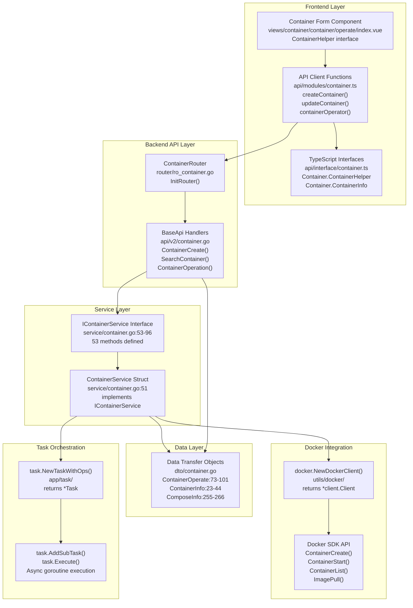
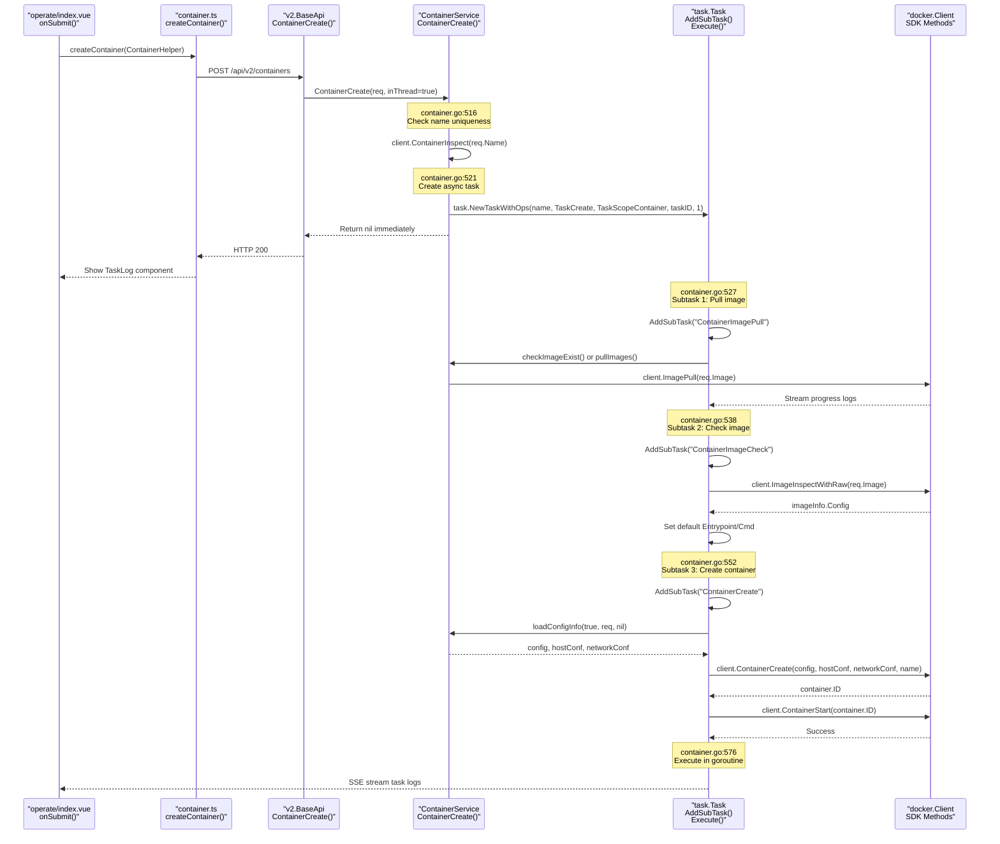
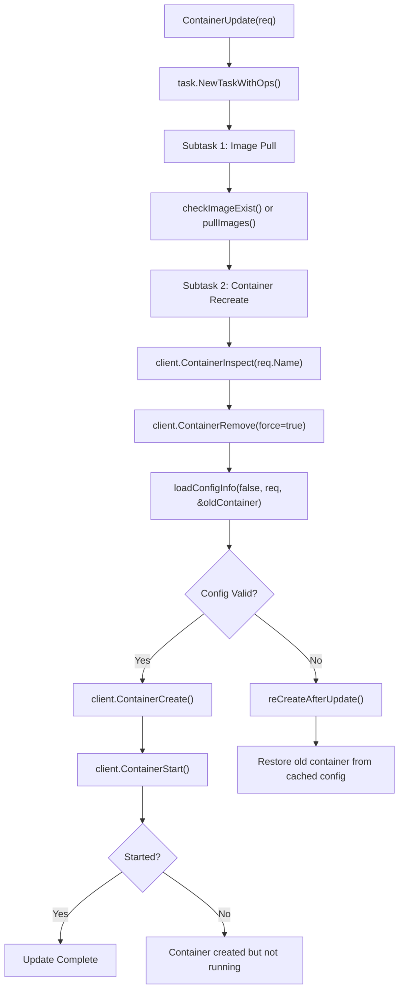
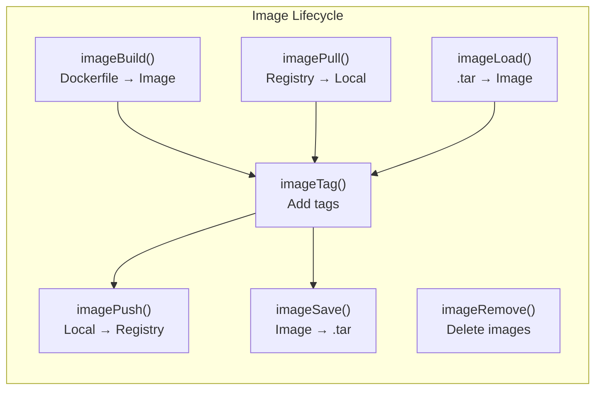
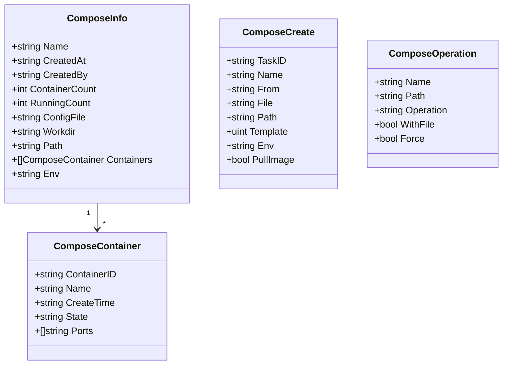
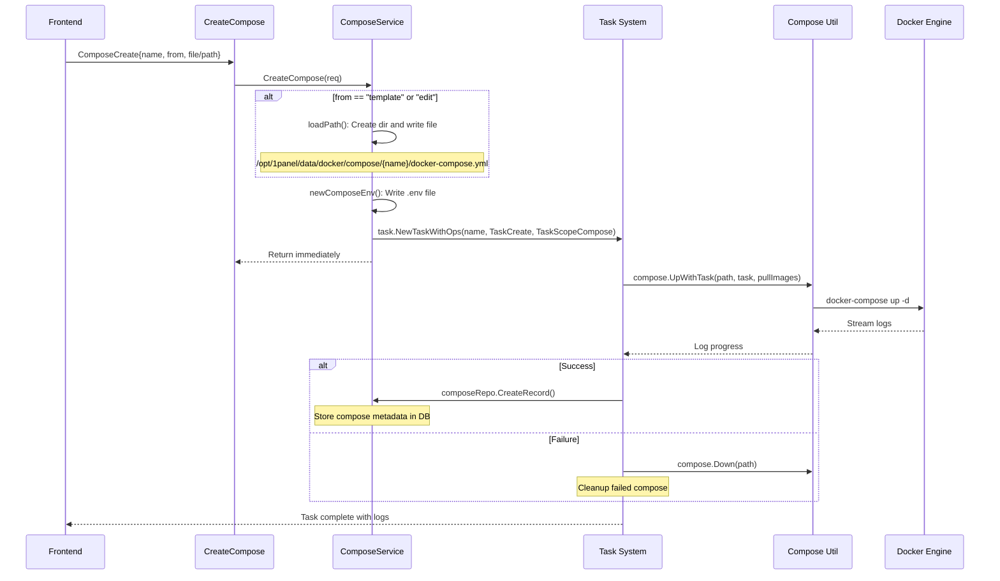
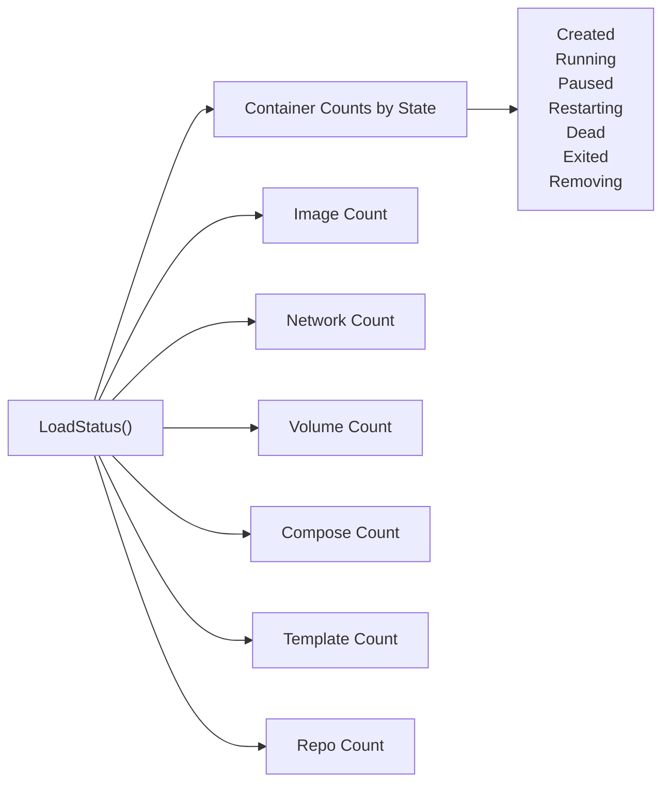
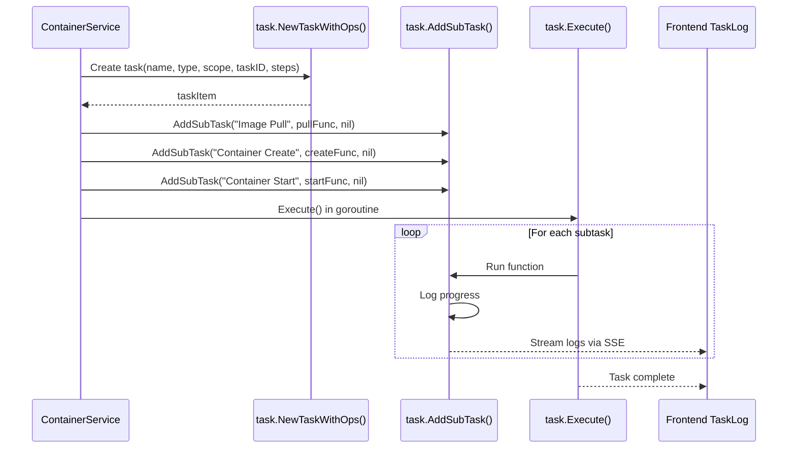
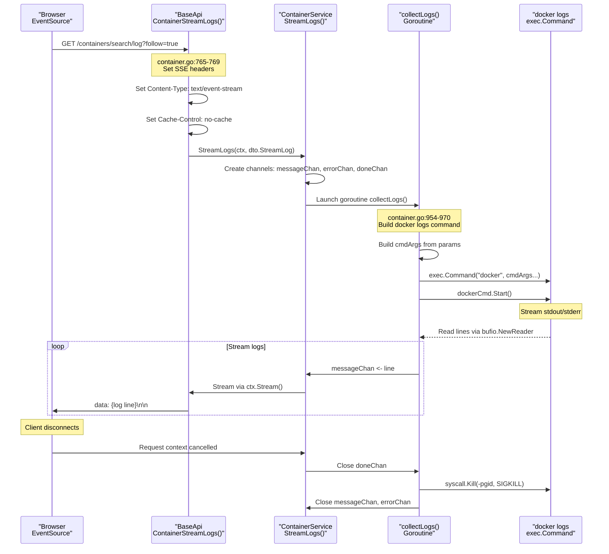

<!-- source: DeepWiki mcp.deepwiki.com · repo 1Panel-dev/1Panel · page 8.1 Container Management · fetched 2026-10-29 -->

# Container Management

<details>
<summary>Relevant source files</summary>

The following files were used as context for generating this wiki page:

- [agent/app/api/v2/container.go](agent/app/api/v2/container.go)
- [agent/app/dto/container.go](agent/app/dto/container.go)
- [agent/app/service/container.go](agent/app/service/container.go)
- [agent/router/ro_container.go](agent/router/ro_container.go)
- [frontend/src/api/interface/container.ts](frontend/src/api/interface/container.ts)
- [frontend/src/api/modules/container.ts](frontend/src/api/modules/container.ts)
- [frontend/src/views/container/container/operate/index.vue](frontend/src/views/container/container/operate/index.vue)

</details>


## Purpose and Scope

This document describes the Container Management subsystem within 1Panel's Infrastructure Management layer. It covers Docker container lifecycle operations (create, update, start, stop, remove), image management (pull, build, push, tag), network and volume orchestration, Docker Compose multi-container applications, and resource monitoring. 

For database container management specifically, see [Database Management](#7.2). For general file operations on container filesystems, see [File Management System](#7.3). For application deployment via containers, see [Application Management System](#6).

**Sources:** [agent/app/service/container.go:51-96](), [agent/app/dto/container.go:1-319]()

---

## System Architecture

The Container Management system wraps the Docker Engine API through a Go service layer that provides RESTful endpoints for the Vue frontend. All long-running operations use the task system for async execution with real-time logging.

### Component Structure

**Diagram 1: Container Management Architecture - Natural Language to Code Entity Mapping**



**Sources:** [agent/app/service/container.go:51-96](), [agent/app/api/v2/container.go:1-793](), [agent/router/ro_container.go:10-91](), [frontend/src/api/modules/container.ts:1-232](), [frontend/src/views/container/container/operate/index.vue:1-700]()

---

## Core Service Interface

The `IContainerService` interface ([agent/app/service/container.go:53-96]()) defines all container management operations. The `ContainerService` struct ([agent/app/service/container.go:51]()) implements this interface, wrapping Docker SDK calls with error handling, validation, and task orchestration.

### Service Methods Overview

**Diagram 2: IContainerService Interface Methods - Code Entity Reference**

| Category | Method Signatures | Return Types | Line References |
|----------|------------------|--------------|-----------------|
| **Container Lifecycle** | `ContainerCreate(dto.ContainerOperate, bool) error`<br/>`ContainerUpdate(dto.ContainerOperate) error`<br/>`ContainerOperation(dto.ContainerOperation) error`<br/>`ContainerUpgrade(dto.ContainerUpgrade) error` | `error` | [container.go:71-74]() |
| **Container Queries** | `Page(dto.PageContainer) (int64, interface{}, error)`<br/>`List() []dto.ContainerOptions`<br/>`ListByImage(string) []dto.ContainerOptions`<br/>`ContainerInfo(dto.OperationWithName) (*dto.ContainerOperate, error)`<br/>`LoadStatus() (dto.ContainerStatus, error)` | Various | [container.go:54-57]() |
| **Resource Management** | `PageNetwork(dto.SearchWithPage) (int64, interface{}, error)`<br/>`ListNetwork() ([]dto.Options, error)`<br/>`PageVolume(dto.SearchWithPage) (int64, interface{}, error)`<br/>`ListVolume() ([]dto.Options, error)`<br/>`CreateNetwork(dto.NetworkCreate) error`<br/>`DeleteNetwork(dto.BatchDelete) error`<br/>`CreateVolume(dto.VolumeCreate) error`<br/>`DeleteVolume(dto.BatchDelete) error` | Various | [container.go:58-90]() |
| **Compose Operations** | `PageCompose(dto.SearchWithPage) (int64, interface{}, error)`<br/>`CreateCompose(dto.ComposeCreate) error`<br/>`ComposeOperation(dto.ComposeOperation) error`<br/>`ComposeUpdate(dto.ComposeUpdate) error`<br/>`TestCompose(dto.ComposeCreate) (bool, error)` | Various | [container.go:63-68]() |
| **Monitoring** | `ContainerStats(string) (*dto.ContainerStats, error)`<br/>`ContainerListStats() ([]dto.ContainerListStats, error)`<br/>`ContainerItemStats(dto.OperationWithName) (dto.ContainerItemStats, error)`<br/>`LoadResourceLimit() (*dto.ResourceLimit, error)` | Stat structs | [container.go:76-78,84]() |
| **Utilities** | `ContainerRename(dto.ContainerRename) error`<br/>`ContainerCommit(dto.ContainerCommit) error`<br/>`Prune(dto.ContainerPrune) error`<br/>`ContainerLogClean(dto.OperationWithName) error`<br/>`Inspect(dto.InspectReq) (string, error)`<br/>`StreamLogs(*gin.Context, dto.StreamLog)` | Various | [container.go:79-81,86,95]() |

**Sources:** [agent/app/service/container.go:53-96]()

---

## Container Lifecycle Operations

### Container Creation

Container creation supports two modes: form-based creation via `ContainerCreate` and command-based creation via `ContainerCreateByCommand`.

#### Form-Based Creation Flow

**Diagram 3: Container Creation Sequence - Method Call Chain**



**Key Implementation Details:**

1. **Validation** ([agent/app/service/container.go:516-519]()): `client.ContainerInspect(ctx, req.Name)` checks if container name already exists, returns `buserr.New("ErrContainerName")` if duplicate
2. **Task Creation** ([agent/app/service/container.go:521-525]()): `task.NewTaskWithOps(req.Name, task.TaskCreate, task.TaskScopeContainer, req.TaskID, 1)` creates orchestrator with 3 subtasks
3. **Image Pull Subtask** ([agent/app/service/container.go:527-536]()): Calls `checkImageExist(client, req.Image)` and `pullImages(taskItem, client, req.Image)` if needed or if `req.ForcePull` is true
4. **Image Inspection Subtask** ([agent/app/service/container.go:538-550]()): `client.ImageInspectWithRaw(ctx, req.Image)` retrieves `imageInfo.Config.Entrypoint` and `imageInfo.Config.Cmd` to use as defaults if not provided
5. **Container Creation Subtask** ([agent/app/service/container.go:552-572]()): 
   - `loadConfigInfo(true, req, nil)` converts `dto.ContainerOperate` to Docker SDK types `*container.Config`, `*container.HostConfig`, `*network.NetworkingConfig`
   - `client.ContainerCreate(ctx, config, hostConf, networkConf, &v1.Platform{}, req.Name)` creates container
   - `client.ContainerStart(ctx, con.ID, container.StartOptions{})` starts container
   - On failure: `client.ContainerRemove(ctx, req.Name, container.RemoveOptions{RemoveVolumes: true, Force: true})` cleans up
6. **Async Execution** ([agent/app/service/container.go:574-582]()): If `inThread=true`, launches `taskItem.Execute()` in goroutine, otherwise executes synchronously

**Sources:** [agent/app/service/container.go:509-583](), [agent/app/dto/container.go:73-101]()

#### Command-Based Creation

The `ContainerCreateByCommand` method ([agent/app/service/container.go:305-339]()) allows users to input raw `docker run` commands:

```go
// Example: docker run -d --name myapp nginx:latest
```

**Process:**
1. **Security Check** ([agent/app/service/container.go:306-308]()): `cmd.CheckIllegal(req.Command)` validates against command injection, returns `buserr.New("ErrCmdIllegal")` if dangerous
2. **Format Validation** ([agent/app/service/container.go:309-311]()): Ensures command starts with `"docker run "`
3. **Name Extraction** ([agent/app/service/container.go:312-318]()): Parses `--name` flag from command string by splitting on spaces and looking for index after `--name`
4. **Detach Flag** ([agent/app/service/container.go:319-321]()): If command lacks ` -d `, replaces `"docker run"` with `"docker run -d"`
5. **Name Generation** ([agent/app/service/container.go:322-325]()): If no `--name` found, appends `--name 1Panel-{random5}-{random4}` using `common.RandStr(5)` and `common.RandStrAndNum(4)`
6. **Task Execution** ([agent/app/service/container.go:326-337]()): Creates task with `task.NewTaskWithOps()`, adds single subtask that executes via `cmd.NewCommandMgr(cmd.WithTask(*taskItem), cmd.WithTimeout(5*time.Minute)).RunBashC(req.Command)`

**DTO Structure:**
```go
type ContainerCreateByCommand struct {
    TaskID  string `json:"taskID"`
    Command string `json:"command"`
}
```

**Sources:** [agent/app/service/container.go:305-339](), [agent/app/dto/container.go:109-112]()

### Container Update

Updating a container recreates it with new configuration while preserving the name.

**Diagram 4: Container Update Flow with Rollback**



**Rollback Mechanism:** 

The `reCreateAfterUpdate()` helper function ([agent/app/service/container.go:2320-2349]()) provides rollback:
- Accepts `name`, `client`, `oldConfig *container.Config`, `oldHostConf *container.HostConfig`, `oldNetworkSettings *network.NetworkSettings`
- Reconstructs `networkConf` from `oldNetworkSettings.Networks` map
- Calls `client.ContainerCreate(ctx, oldConfig, oldHostConf, &networkConf, &v1.Platform{}, name)`
- Calls `client.ContainerStart(ctx, con.ID, container.StartOptions{})`
- Logs errors but continues to attempt restoration

**Implementation Details:**

1. **Async Task** ([agent/app/service/container.go:664-668]()): Entire update runs in goroutine, task created with `task.TaskUpdate` type
2. **Image Pull** ([agent/app/service/container.go:670-680]()): First subtask pulls new image if needed or `req.ForcePull` is true
3. **Container Removal** ([agent/app/service/container.go:683-687]()): `client.ContainerRemove(ctx, req.Name, container.RemoveOptions{Force: true})` removes old container, logs status
4. **Config Loading** ([agent/app/service/container.go:689-695]()): `loadConfigInfo(false, req, &oldContainer)` merges new config with old container's defaults. On error, calls `reCreateAfterUpdate(req.Name, client, oldContainer.Config, oldContainer.HostConfig, oldContainer.NetworkSettings)`
5. **Creation** ([agent/app/service/container.go:697-707]()): `client.ContainerCreate()` with new config, on error attempts rollback, then `client.ContainerStart()` with error logging

**Sources:** [agent/app/service/container.go:652-717](), [agent/app/service/container.go:2320-2349]()

### Container Operations

The `ContainerOperation` method ([agent/app/service/container.go:845-884]()) handles batch operations on multiple containers.

**Operation Mapping Table:**

| `req.Operation` Constant | Docker SDK Method Call | Parameters | Description |
|--------------------------|------------------------|------------|-------------|
| `constant.ContainerOpStart` | `client.ContainerStart(ctx, item, container.StartOptions{})` | Empty options | Start stopped container |
| `constant.ContainerOpStop` | `client.ContainerStop(ctx, item, container.StopOptions{})` | Empty options | Gracefully stop with SIGTERM |
| `constant.ContainerOpRestart` | `client.ContainerRestart(ctx, item, container.StopOptions{})` | Empty options | Stop then start |
| `constant.ContainerOpKill` | `client.ContainerKill(ctx, item, "SIGKILL")` | SIGKILL signal | Forcefully terminate |
| `constant.ContainerOpPause` | `client.ContainerPause(ctx, item)` | None | Suspend processes via cgroups |
| `constant.ContainerOpUnpause` | `client.ContainerUnpause(ctx, item)` | None | Resume paused processes |
| `constant.ContainerOpRemove` | `client.ContainerRemove(ctx, item, container.RemoveOptions{RemoveVolumes: true, Force: true})` | Remove volumes, force delete | Delete container and associated volumes |

**Implementation Flow:**

1. **Task Creation** ([agent/app/service/container.go:853-856]()): `task.NewTaskWithOps(strings.Join(req.Names, " "), req.Operation, task.TaskScopeContainer, req.TaskID, 1)` creates task named after all container names
2. **Subtask Loop** ([agent/app/service/container.go:858-878]()): For each container in `req.Names`, adds subtask with container name as title
3. **Operation Switch** ([agent/app/service/container.go:860-875]()): Switch statement on `req.Operation` dispatches to appropriate Docker SDK method
4. **Async Execution** ([agent/app/service/container.go:880-882]()): `taskItem.Execute()` runs in goroutine, operations execute serially for each container

**DTO Structure:**
```go
type ContainerOperation struct {
    TaskID    string   `json:"taskID"`
    Names     []string `json:"names" validate:"required"`
    Operation string   `json:"operation" validate:"required,oneof=up start stop restart kill pause unpause remove"`
}
```

**Sources:** [agent/app/service/container.go:845-884](), [agent/app/dto/container.go:174-178](), [agent/constant/]()*operation constants*

### Container Upgrade

`ContainerUpgrade` ([agent/app/service/container.go:719-793]()) updates multiple containers to a new image version while preserving their configuration.

**Process Flow:**

1. **Task Setup** ([agent/app/service/container.go:726-730]()): `task.NewTaskWithOps(req.Image, task.TaskUpgrade, task.TaskScopeImage, req.TaskID, 1)` creates task named after the new image
2. **Image Pull Subtask** ([agent/app/service/container.go:732-743]()): Single subtask pulls new image once for all containers using `pullImages(taskItem, client, req.Image)` if not exists or `req.ForcePull` is true
3. **Per-Container Upgrade Loop** ([agent/app/service/container.go:744-785]()): For each name in `req.Names`:
   - **Load Info Subtask** ([agent/app/service/container.go:746-753]()): `client.ContainerInspect(ctx, item)` retrieves `oldContainer` with current config
   - **Recreate Subtask** ([agent/app/service/container.go:755-784]()): 
     - Modifies `config.Image = req.Image` ([container.go:757]())
     - Preserves `hostConf` from old container
     - Reconstructs `networkConf` from first network in `oldContainer.NetworkSettings.Networks` map ([container.go:760-764]())
     - Removes old: `client.ContainerRemove(ctx, item, container.RemoveOptions{Force: true})` ([container.go:766]())
     - Creates new: `client.ContainerCreate(ctx, config, hostConf, &networkConf, &v1.Platform{}, item)` ([container.go:772]())
     - On error, attempts rollback via `reCreateAfterUpdate(item, client, oldContainer.Config, oldContainer.HostConfig, oldContainer.NetworkSettings)` ([container.go:775]())
     - Starts: `client.ContainerStart(ctx, con.ID, container.StartOptions{})` ([container.go:778]())
4. **Goroutine Execution** ([agent/app/service/container.go:787-790]()): Entire task executes in goroutine

**DTO Structure:**
```go
type ContainerUpgrade struct {
    TaskID    string   `json:"taskID"`
    Names     []string `json:"names" validate:"required"`
    Image     string   `json:"image" validate:"required"`
    ForcePull bool     `json:"forcePull"`
}
```

**Sources:** [agent/app/service/container.go:719-793](), [agent/app/dto/container.go:114-119]()

---

## Image Management

Image operations are exposed through the same service interface but use different Docker API endpoints.

### Image Operations



### Image Pull

Image pulling streams progress updates to the task log:

**Implementation:**
- Uses `pullImages()` helper function ([agent/app/service/container.go:524-530]())
- Streams JSON progress events from Docker API
- Parses and logs progress percentage ([agent/app/service/container_image.go]()*not shown but referenced*)
- Supports pulling from custom registries configured via image repos

**Frontend Integration:**
```typescript
export const imagePull = (params: Container.ImagePull) => {
    return http.post<string>(`/containers/image/pull`, params);
};
```

**Sources:** [agent/app/service/container.go:523-532](), [frontend/src/api/modules/container.ts:96-98]()

### Image Build

Building images from Dockerfiles supports multiple source types:

**DTO Structure:**
```typescript
export interface ImageBuild {
    taskID: string;
    from: string;           // "edit" | "path" | "url"
    name: string;
    dockerfile: string;     // Content or path
    tags: Array<string>;
    args: Array<string>;    // Build args (KEY=VALUE)
}
```

**Sources:** [frontend/src/api/interface/container.ts:203-210]()

### Image Prune

The `Prune` operation removes unused Docker resources based on type:

**Prune Types:**
- `container`: Removes stopped containers
- `image`: Removes dangling images (or all with `WithTagAll=true`)
- `volume`: Removes unused volumes
- `network`: Removes unused networks
- `buildcache`: Removes build cache

**Implementation:** ([agent/app/service/container.go:404-486]())
- Uses Docker's prune APIs with filters
- Reports space reclaimed in human-readable format
- Executes asynchronously via task system

**Sources:** [agent/app/service/container.go:404-486](), [agent/app/dto/container.go:196-200]()

---

## Docker Compose Operations

Docker Compose orchestration manages multi-container applications defined in `docker-compose.yml` files.

### Compose Data Model



**Sources:** [agent/app/dto/container.go:255-303]()

### Compose Creation Flow



**Key Functions:**
- `loadPath()` ([agent/app/service/container_compose.go:345-366]()): Writes compose file from template or editor
- `newComposeEnv()` ([agent/app/service/container_compose.go:424-437]()): Creates `.env` file for compose variables
- `compose.UpWithTask()` ([agent/utils/compose/]()*): Executes `docker-compose up` with task logging

**Sources:** [agent/app/service/container_compose.go:189-225]()

### Compose Operations

The `ComposeOperation` method supports these operations:

| Operation | Command | Description |
|-----------|---------|-------------|
| `up` | `docker-compose up -d` | Create and start containers |
| `start` | `docker-compose start` | Start existing stopped containers |
| `restart` | `docker-compose restart` | Restart containers |
| `stop` | `docker-compose stop` | Stop containers without removing |
| `down` | `docker-compose down` | Stop and remove containers, networks |
| `delete` | `down` + remove files | Stop, remove, and delete compose files |

**Delete Operation:** When `WithFile=true`, deletes the entire compose directory after stopping containers ([agent/app/service/container_compose.go:239-247]()).

**Sources:** [agent/app/service/container_compose.go:227-259](), [agent/app/dto/container.go:284-290]()

### Compose Update

Updating a compose file follows this process:

1. **Backup Old File:** Read current `docker-compose.yml` ([agent/app/service/container_compose.go:265-267]())
2. **Write New Content:** Overwrite file with new content ([agent/app/service/container_compose.go:269-276]())
3. **Update Environment:** Write `.env` file ([agent/app/service/container_compose.go:279-281]())
4. **Execute Up:** Run `docker-compose up` to apply changes ([agent/app/service/container_compose.go:283-288]())
5. **Rollback on Failure:** If up fails, recreate old compose file ([agent/app/service/container_compose.go:392-406]())

**Sources:** [agent/app/service/container_compose.go:261-292]()

### Compose Discovery

The `PageCompose` method discovers compose projects from two sources:

1. **Docker Labels:** Queries containers with label `com.docker.compose.project` ([agent/app/service/container_compose.go:47-48]())
2. **Database Records:** Loads compose records created via 1Panel ([agent/app/service/container_compose.go:55-67]())

**Label Constants:**
```go
const composeProjectLabel = "com.docker.compose.project"
const composeConfigLabel = "com.docker.compose.project.config_files"
const composeWorkdirLabel = "com.docker.compose.project.working_dir"
const composeCreatedBy = "createdBy"
```

**Sources:** [agent/app/service/container_compose.go:30-165]()

---

## Network Management

Docker networks enable container communication and isolation.

### Network Data Structures

**Backend DTO:**
```go
type Network struct {
    ID         string
    Name       string
    Labels     []string
    Driver     string      // bridge, host, overlay, macvlan
    IPAMDriver string
    Subnet     string
    Gateway    string
    CreatedAt  time.Time
    Attachable bool
}

type NetworkCreate struct {
    Name       string
    Driver     string
    Options    []string
    Ipv4       bool
    Subnet     string
    Gateway    string
    IPRange    string
    Ipv6         bool
    SubnetV6     string
    GatewayV6    string
    IPRangeV6    string
    Labels       []string
}
```

**Sources:** [agent/app/dto/container.go:202-229]()

### Network Operations

#### Create Network

Network creation supports IPv4/IPv6 dual-stack configuration:

**API Endpoint:** `POST /api/v2/containers/network`

**Frontend Interface:**
```typescript
export const createNetwork = (params: Container.NetworkCreate) => {
    return http.post(`/containers/network`, params);
};
```

**Sources:** [frontend/src/api/modules/container.ts:125-127](), [agent/app/api/v2/container.go:612-623]()

#### List and Search Networks

- `ListNetwork()`: Returns simple name/ID pairs for dropdowns ([agent/app/service/container_network.go:]()*referenced*)
- `PageNetwork(req)`: Paginated search with filtering ([agent/app/service/container_network.go:]()*referenced*)

#### Delete Networks

Batch deletion via `DeleteNetwork(BatchDelete)` validates that networks are not in use before removal.

**Sources:** [agent/app/api/v2/container.go:590-601]()

---

## Volume Management

Docker volumes provide persistent storage for containers.

### Volume Data Structures

```go
type Volume struct {
    Name       string
    Labels     []VolumeOption
    Driver     string       // local, nfs, etc.
    Mountpoint string
    CreatedAt  time.Time
    Options    []VolumeOption
}

type VolumeCreate struct {
    Name    string
    Driver  string
    Options []string    // driver-specific options
    Labels  []string    // key=value pairs
}

type VolumeOption struct {
    Key   string
    Value string
}
```

**Sources:** [agent/app/dto/container.go:231-248]()

### Volume Operations

| Operation | Endpoint | Description |
|-----------|----------|-------------|
| Create | `POST /containers/volume` | Create named volume with driver options |
| List | `GET /containers/volume` | Get all volumes as option list |
| Search | `POST /containers/volume/search` | Paginated volume search |
| Delete | `POST /containers/volume/del` | Batch delete volumes by name |

**Volume Binding in Containers:**

When creating containers, volumes are specified via `VolumeHelper` in the DTO:

```go
type VolumeHelper struct {
    Type         string   // "bind", "volume", "tmpfs"
    SourceDir    string   // Host path or volume name
    ContainerDir string   // Container mount path
    Mode         string   // "ro", "rw"
    Shared       string   // Mount propagation
}
```

**Sources:** [agent/app/dto/container.go:160-166](), [agent/app/api/v2/container.go:699-710]()

---

## Resource Monitoring and Statistics

Container Management provides comprehensive resource monitoring at multiple levels.

### Status Overview

`LoadStatus()` returns aggregate statistics:



**Data Structure:**
```typescript
export interface ContainerStatus {
    created: number;
    running: number;
    paused: number;
    restarting: number;
    removing: number;
    exited: number;
    dead: number;
    
    containerCount: number;
    composeCount: number;
    composeTemplateCount: number;
    imageCount: number;
    networkCount: number;
    volumeCount: number;
    repoCount: number;
}
```

**Sources:** [agent/app/service/container.go:192-233](), [frontend/src/api/interface/container.ts:29-54]()

### Container Statistics

#### Individual Container Stats

`ContainerStats(id)` returns real-time resource usage for a single container:

**Metrics Calculated:**
- **CPU Percent:** `calculateCPUPercentUnix()` computes CPU usage from delta between samples ([agent/app/service/container.go:1208-1218]())
- **Memory Usage:** Current memory consumption minus cache
- **Cache:** Cached memory from `MemoryStats.Stats["cache"]`
- **Block I/O:** Read/write bytes via `calculateBlockIO()` ([agent/app/service/container.go:1220-1228]())
- **Network I/O:** RX/TX bytes via `calculateNetwork()` ([agent/app/service/container.go:1230-1245]())

**API Call:**
```typescript
export const containerStats = (id: string) => {
    return http.get<Container.ContainerStats>(`/containers/stats/${id}`);
};
```

**Sources:** [agent/app/service/container.go:1140-1170](), [frontend/src/api/modules/container.ts:60-62]()

#### List Container Stats

`ContainerListStats()` returns CPU and memory stats for all containers in parallel using goroutines:

**Implementation:**
```go
func (u *ContainerService) ContainerListStats() ([]dto.ContainerListStats, error) {
    // ... get container list
    var wg sync.WaitGroup
    wg.Add(len(list))
    for i := 0; i < len(list); i++ {
        go func(item container.Summary) {
            datas = append(datas, loadCpuAndMem(client, item.ID))
            wg.Done()
        }(list[i])
    }
    wg.Wait()
    return datas, nil
}
```

**Sources:** [agent/app/service/container.go:278-299]()

#### Container Item Stats

`ContainerItemStats(name)` returns disk usage information:

**For Individual Container:**
- `SizeRw`: Writable layer size
- `SizeRootFs`: Total container size

**For System ("system" name):**
- Container usage/reclaimable: Size of stopped containers
- Image usage/reclaimable: Size of unused images
- Volume usage/reclaimable: Size of unreferenced volumes
- Build cache usage: Size of build cache

**Sources:** [agent/app/service/container.go:234-277]()

### Resource Limits

`LoadResourceLimit()` returns host machine limits:

```go
type ResourceLimit struct {
    CPU    int     // Number of CPU cores
    Memory uint64  // Total memory in bytes
}
```

**Usage:** Frontend uses these limits to validate user input when setting container resource constraints (CPU quota, memory limit).

**Sources:** [agent/app/service/container.go:488-503](), [frontend/src/api/modules/container.ts:21-23]()

---

## Task System Integration

All long-running container operations integrate with the task system for async execution and progress tracking.

### Task Creation Pattern



### Task Scopes

Container operations use these task scopes:

- `TaskScopeContainer`: Single container operations
- `TaskScopeCompose`: Compose operations
- `TaskScopeImage`: Image operations

**Sources:** [agent/app/service/container.go:517-521](), [agent/app/service/container.go:322-333]()

### Task Operations

Task types for containers:

| Task Type | Usage |
|-----------|-------|
| `TaskCreate` | Container/compose creation |
| `TaskUpdate` | Container update |
| `TaskUpgrade` | Image upgrade |
| `TaskClean` | Prune operations |
| `TaskCommit` | Container commit to image |

**Sources:** [agent/app/task/]()*task types defined*

### Log Streaming

Container logs support real-time streaming via Server-Sent Events (SSE).

**API Endpoint:** `GET /api/v2/containers/search/log?container={name}&follow=true&tail=100&since=1h&timestamp=true`

**Diagram 5: Log Streaming Architecture**



**Implementation Details:**

1. **Handler Setup** ([agent/app/api/v2/container.go:765-792]()): 
   - `ContainerStreamLogs(c *gin.Context)` sets SSE response headers
   - Parses query params: `since`, `follow`, `tail`, `timestamp`, `container`, `compose`
   - Creates `dto.StreamLog` struct with `Type: "container"` or `"compose"`
   - Calls `containerService.StreamLogs(c, streamLog)`

2. **Service Orchestration** ([agent/app/service/container.go:921-949]()): 
   - Creates channels: `messageChan chan string`, `errorChan chan error`, `doneChan chan struct{}`
   - Launches goroutine monitoring `c.Request.Context().Done()` to close `doneChan` on client disconnect
   - Launches `collectLogs(doneChan, params, messageChan, errorChan)` goroutine
   - Uses `c.Stream()` callback to write SSE events: `fmt.Fprintf(w, "data: %s\n\n", msg)`

3. **Log Collection** ([agent/app/service/container.go:951-1056]()): 
   - Builds command args: `docker logs [-f] [-t] [--tail N] [--since TIME] CONTAINER`
   - For compose: Uses `docker-compose` or `docker compose` with `-f` yaml files ([container.go:973-987]())
   - Sets `SysProcAttr{Setpgid: true}` for process group management ([container.go:992]())
   - Creates `stdout` pipe via `dockerCmd.StdoutPipe()` ([container.go:994]())
   - Starts command with `dockerCmd.Start()` ([container.go:1002]())
   - Reads lines using `bufio.NewReader(stdout).ReadString('\n')` ([container.go:1017,1032]())
   - On `doneChan` close, kills entire process group: `syscall.Kill(-pgid, syscall.SIGKILL)` ([container.go:1020-1028]())
   - Closes channels when EOF reached ([container.go:1034-1043]())

4. **Process Cleanup** ([agent/app/service/container.go:1007-1015]()): Defer function ensures `dockerCmd.Process.Kill()` and `dockerCmd.Wait()` are called even on panic

**Query Parameters:**
- `container`: Container name (for type="container")
- `compose`: Comma-separated yaml paths (for type="compose")
- `since`: Time filter (e.g., "1h", "30m", "2024-01-01")
- `follow`: Boolean, if true streams continuously
- `tail`: Number of lines from end (e.g., "100", "all")
- `timestamp`: Boolean, if true includes timestamps

**Sources:** [agent/app/service/container.go:921-1056](), [agent/app/api/v2/container.go:765-792](), [agent/app/dto/container.go:314-322]()

---

## API Endpoints Reference

The container management REST API is organized under `/api/v2/containers/` with the following route structure:

### Container Endpoints

| Method | Path | Handler | Description |
|--------|------|---------|-------------|
| POST | `/containers` | `ContainerCreate` | Create new container |
| POST | `/containers/command` | `ContainerCreateByCommand` | Create from docker run command |
| POST | `/containers/search` | `SearchContainer` | Paginated container search |
| POST | `/containers/list` | `ListContainer` | List all containers |
| POST | `/containers/list/byimage` | `ListContainerByImage` | Filter by image |
| POST | `/containers/info` | `ContainerInfo` | Get container details |
| POST | `/containers/update` | `ContainerUpdate` | Update container config |
| POST | `/containers/upgrade` | `ContainerUpgrade` | Upgrade to new image |
| POST | `/containers/operate` | `ContainerOperation` | Start/stop/restart/etc |
| POST | `/containers/rename` | `ContainerRename` | Rename container |
| POST | `/containers/commit` | `ContainerCommit` | Commit to image |
| POST | `/containers/prune` | `ContainerPrune` | Clean unused resources |
| POST | `/containers/clean/log` | `CleanContainerLog` | Clear container logs |
| POST | `/containers/inspect` | `Inspect` | Docker inspect |
| GET | `/containers/status` | `LoadContainerStatus` | Status overview |
| GET | `/containers/limit` | `LoadResourceLimit` | Host resource limits |
| GET | `/containers/stats/:id` | `ContainerStats` | Container statistics |
| GET | `/containers/list/stats` | `ContainerListStats` | All container stats |
| POST | `/containers/item/stats` | `ContainerItemStats` | Disk usage stats |
| GET | `/containers/search/log` | `ContainerStreamLogs` | Stream logs (SSE) |
| POST | `/containers/download/log` | `DownloadContainerLogs` | Download logs |

**Sources:** [agent/router/ro_container.go:10-90](), [agent/app/api/v2/container.go:1-770]()

### Image Endpoints

| Method | Path | Handler | Description |
|--------|------|---------|-------------|
| GET | `/containers/image` | `ListImage` | Image options for dropdown |
| GET | `/containers/image/all` | `ListAllImage` | All images with details |
| POST | `/containers/image/search` | `SearchImage` | Paginated search |
| POST | `/containers/image/pull` | `ImagePull` | Pull from registry |
| POST | `/containers/image/push` | `ImagePush` | Push to registry |
| POST | `/containers/image/build` | `ImageBuild` | Build from Dockerfile |
| POST | `/containers/image/save` | `ImageSave` | Export to .tar |
| POST | `/containers/image/load` | `ImageLoad` | Import from .tar |
| POST | `/containers/image/tag` | `ImageTag` | Add tags to image |
| POST | `/containers/image/remove` | `ImageRemove` | Delete images |

**Sources:** [agent/router/ro_container.go:61-70]()

### Network Endpoints

| Method | Path | Handler | Description |
|--------|------|---------|-------------|
| GET | `/containers/network` | `ListNetwork` | List network options |
| POST | `/containers/network/search` | `SearchNetwork` | Paginated search |
| POST | `/containers/network` | `CreateNetwork` | Create network |
| POST | `/containers/network/del` | `DeleteNetwork` | Delete networks |

**Sources:** [agent/router/ro_container.go:72-75]()

### Volume Endpoints

| Method | Path | Handler | Description |
|--------|------|---------|-------------|
| GET | `/containers/volume` | `ListVolume` | List volume options |
| POST | `/containers/volume/search` | `SearchVolume` | Paginated search |
| POST | `/containers/volume` | `CreateVolume` | Create volume |
| POST | `/containers/volume/del` | `DeleteVolume` | Delete volumes |

**Sources:** [agent/router/ro_container.go:76-79]()

### Compose Endpoints

| Method | Path | Handler | Description |
|--------|------|---------|-------------|
| POST | `/containers/compose/search` | `SearchCompose` | List compose projects |
| POST | `/containers/compose` | `CreateCompose` | Create compose |
| POST | `/containers/compose/test` | `TestCompose` | Validate compose file |
| POST | `/containers/compose/operate` | `OperatorCompose` | Up/down/start/stop |
| POST | `/containers/compose/update` | `ComposeUpdate` | Update compose file |
| POST | `/containers/compose/clean/log` | `CleanComposeLog` | Clear compose logs |

**Sources:** [agent/router/ro_container.go:47-52]()

### Compose Template Endpoints

Templates are pre-saved compose files for quick deployment:

| Method | Path | Handler |
|--------|------|---------|
| GET | `/containers/template` | `ListComposeTemplate` |
| POST | `/containers/template/search` | `SearchComposeTemplate` |
| POST | `/containers/template` | `CreateComposeTemplate` |
| POST | `/containers/template/update` | `UpdateComposeTemplate` |
| POST | `/containers/template/batch` | `BatchComposeTemplate` |
| POST | `/containers/template/del` | `DeleteComposeTemplate` |

**Sources:** [agent/router/ro_container.go:54-59]()

### Image Repository Endpoints

Image repos configure custom Docker registries:

| Method | Path | Handler |
|--------|------|---------|
| GET | `/containers/repo` | `ListRepo` |
| POST | `/containers/repo/search` | `SearchRepo` |
| POST | `/containers/repo` | `CreateRepo` |
| POST | `/containers/repo/update` | `UpdateRepo` |
| POST | `/containers/repo/status` | `CheckRepoStatus` |
| POST | `/containers/repo/del` | `DeleteRepo` |

**Sources:** [agent/router/ro_container.go:40-45]()

---

## Frontend Implementation

The frontend provides comprehensive UI for container management through Vue components.

### Container Form Component

The main container create/edit form is located at `frontend/src/views/container/container/operate/index.vue`.

**Key Features:**
1. **Dual Mode:** Create vs Edit, with edit blocking certain fields ([frontend/src/views/container/container/operate/index.vue:5](), [frontend/src/views/container/container/operate/index.vue:362]())
2. **Image Selection:** Dropdown or manual input via checkbox ([frontend/src/views/container/container/operate/index.vue:51-68]())
3. **Port Mapping:** Table-based UI for exposing ports ([frontend/src/views/container/container/operate/index.vue:88-125]())
4. **Tabbed Configuration:**
   - Network (hostname, DNS, multi-network support)
   - Volume (mount points)
   - Command (entrypoint, cmd, working dir)
   - Resource (CPU shares, CPU quota, memory limit)
   - Labels & Environment
   - Restart Policy

**Validation Rules:**
```typescript
const rules = reactive({
    name: [Rules.requiredInput, Rules.containerName],
    image: [Rules.imageName],
    cpuShares: [Rules.integerNumberWith0, checkNumberRange(0, 262144)],
    nanoCPUs: [Rules.floatNumber],
    memory: [Rules.floatNumber],
});
```

**Sources:** [frontend/src/views/container/container/operate/index.vue:469-475](), [frontend/src/views/container/container/operate/index.vue:1-700]()

### Container List View

Container listing supports:
- Filtering by state (running, stopped, etc.)
- Search by name
- App/Website associations displayed
- Real-time stats (CPU%, Memory%)
- Batch operations (start, stop, remove)

**Sources:** [frontend/src/views/container/container/index.vue]()*referenced*

### Task Log Integration

Long-running operations open a `TaskLog` component that polls for progress:

```typescript
// After operation starts
taskLogRef.value.acceptParams({
    taskID: form.taskID,
    title: 'Container Creation'
});
```

The component displays real-time logs streamed from the backend via periodic polling or SSE.

**Sources:** [frontend/src/views/container/container/operate/index.vue:327-332]()

---

## Error Handling and Validation

### Input Validation

1. **Command Injection Prevention:** `cmd.CheckIllegal()` scans for dangerous shell characters ([agent/app/service/container.go:302]())
2. **Container Name Uniqueness:** Checks if name already exists before creation ([agent/app/service/container.go:512-515]())
3. **Resource Limits:** Frontend validates CPU/memory against host limits ([frontend/src/views/container/container/operate/index.vue:218-241]())

### Error Recovery

1. **Container Update Rollback:** If update fails, recreates original container ([agent/app/service/container.go:688-697]())
2. **Compose Update Rollback:** If compose up fails, restores old compose file ([agent/app/service/container_compose.go:284-288]())
3. **Creation Cleanup:** Failed container creation removes partial resources ([agent/app/service/container.go:557-565]())

**Sources:** [agent/app/service/container.go:648-713](), [agent/app/service/container_compose.go:261-292]()

---

## Data Transfer Objects

### Key DTOs

**ContainerOperate** - Full container configuration:
```go
type ContainerOperate struct {
    TaskID    string
    ForcePull bool
    Name      string
    Image     string
    
    // Network
    Hostname   string
    DomainName string
    DNS        []string
    Networks   []ContainerNetwork
    
    // Ports
    PublishAllPorts bool
    ExposedPorts    []PortHelper
    
    // Runtime
    Tty             bool
    OpenStdin       bool
    WorkingDir      string
    User            string
    Cmd             []string
    Entrypoint      []string
    
    // Resources
    CPUShares       int64
    NanoCPUs        float64
    Memory          float64
    Privileged      bool
    AutoRemove      bool
    
    // Storage
    Volumes         []VolumeHelper
    
    // Metadata
    Labels          []string
    Env             []string
    RestartPolicy   string
}
```

**ContainerInfo** - List view data:
```go
type ContainerInfo struct {
    ContainerID string
    Name        string
    ImageId     string
    ImageName   string
    CreateTime  string
    State       string
    RunTime     string
    Network     []string
    Ports       []string
    
    IsFromApp     bool
    IsFromCompose bool
    
    AppName        string
    AppInstallName string
    Websites       []string
}
```

**Sources:** [agent/app/dto/container.go:73-101](), [agent/app/dto/container.go:23-44]()

---

## Integration Points

### Application Management Integration

Containers created via the Application Management system ([#6](#6)) are linked to app installs:

**Backend Logic:**
```go
install, _ := appInstallRepo.GetFirst(appInstallRepo.WithContainerName(backData[i].Name))
if install.ID > 0 {
    backData[i].AppInstallName = install.Name
    backData[i].AppName = install.App.Name
    websites, _ := websiteRepo.GetBy(websiteRepo.WithAppInstallId(install.ID))
    // Link websites using this app
}
```

**Sources:** [agent/app/service/container.go:127-136]()

### Website Management Integration

Websites ([#5](#5)) may be associated with app containers:

**Display:** Container list shows which websites use a container ([agent/app/service/container.go:131-135]())

**Warning:** Containers from apps display a warning in the edit UI about modifying managed containers ([frontend/src/views/container/container/operate/index.vue:19-24]())

### File Management Integration

Terminal access to containers is provided via the File Management terminal component ([#7.3](#7.3)):

**Command Input Mode:** Clicking "Command Input" button opens terminal for direct docker command execution ([frontend/src/views/container/container/operate/index.vue:26-28](), [frontend/src/views/container/container/operate/index.vue:488-490]())

**Sources:** [frontend/src/views/container/container/operate/index.vue:358](), [frontend/src/views/container/container/operate/index.vue:488-490]()

---

