<!-- source: DeepWiki mcp.deepwiki.com · repo 1Panel-dev/1Panel · page 8.2 Database Management · fetched 2026-10-29 -->

# Database Management

<details>
<summary>Relevant source files</summary>

The following files were used as context for generating this wiki page:

- [frontend/src/api/interface/database.ts](frontend/src/api/interface/database.ts)
- [frontend/src/api/modules/database.ts](frontend/src/api/modules/database.ts)
- [frontend/src/views/database/mysql/index.vue](frontend/src/views/database/mysql/index.vue)
- [frontend/src/views/database/mysql/setting/index.vue](frontend/src/views/database/mysql/setting/index.vue)
- [frontend/src/views/database/redis/index.vue](frontend/src/views/database/redis/index.vue)
- [frontend/src/views/database/redis/setting/index.vue](frontend/src/views/database/redis/setting/index.vue)

</details>


## Purpose and Scope

This document describes the Database Management system in 1Panel, which provides unified management interfaces for MySQL/MariaDB, PostgreSQL, and Redis databases. The system supports both locally-installed databases (Docker-based) and externally-hosted remote databases, offering operations such as database creation, user management, configuration editing, performance tuning, and backup/restore integration.

For container-level operations on database containers, see [Container Management](#8.1). For backup and restore operations, see [Backup and Snapshot System](#10.3). For application installation of database services, see [App Installation and Deployment](#6.2).

---

## System Architecture

The Database Management system integrates with both local Docker-based databases and remote database instances. It provides type-specific management interfaces while sharing common operations like backup and connection management.

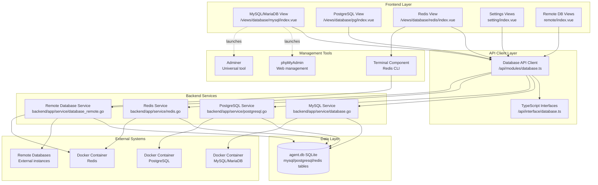

**Diagram: Database Management Architecture**

The frontend provides type-specific views for each database engine, connecting through a unified API client layer to backend services. Local databases are managed through Docker containers, while remote databases connect directly to external instances. The system stores metadata in the SQLite `agent.db` database.

Sources: [frontend/src/views/database/mysql/index.vue:1-680](), [frontend/src/views/database/redis/index.vue:1-423](), [frontend/src/api/modules/database.ts:1-200](), [frontend/src/api/interface/database.ts:1-363]()

---

## Database Types and Sources

1Panel supports two primary sources for databases:

| Source | Description | Management Scope |
|--------|-------------|------------------|
| **local** | Docker-based databases installed through the App Store | Full lifecycle management: install, configure, start/stop, upgrade, uninstall |
| **remote** | External databases hosted elsewhere | Connection management, database/user creation, limited configuration |

### Supported Database Types

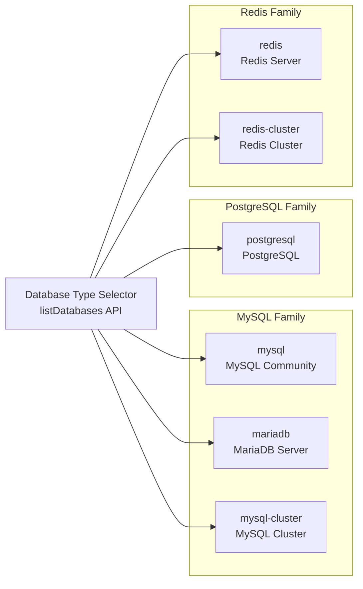

**Diagram: Supported Database Types**

Each database type can be installed locally as a Docker container or registered as a remote connection. The `listDatabases` API returns available instances grouped by source.

Sources: [frontend/src/api/modules/database.ts:157-160](), [frontend/src/views/database/mysql/index.vue:514-559]()

---

## MySQL/MariaDB Management

### Database Operations

The MySQL management interface provides comprehensive operations for database lifecycle management.

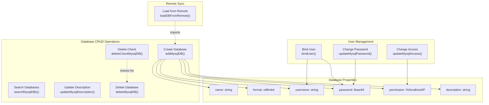

**Diagram: MySQL Database Operations Flow**

The `addMysqlDB` operation creates a database with optional user binding. Passwords are Base64-encoded before transmission. The `deleteCheckMysqlDB` function verifies if databases are in use before deletion.

Sources: [frontend/src/api/modules/database.ts:58-100](), [frontend/src/api/interface/database.ts:42-51]()

### User Management and Permissions

MySQL databases support flexible user binding and permission models:

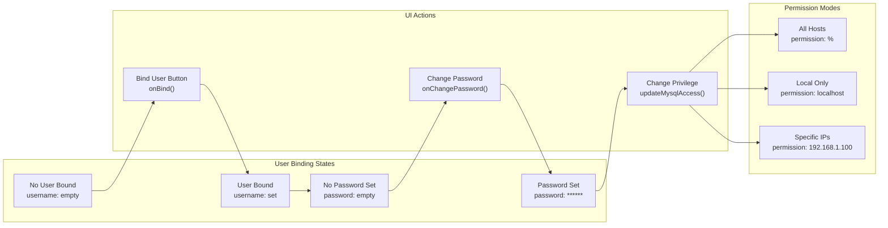

**Diagram: MySQL User Management Flow**

Databases can exist without users (for phpMyAdmin-only access). The binding process creates a MySQL user with specified permissions. The `permission` field controls host-based access: `%` for all hosts, `localhost` for local-only, or specific IP addresses.

Sources: [frontend/src/views/database/mysql/index.vue:579-636](), [frontend/src/api/interface/database.ts:53-59]()

### Configuration and Settings

The MySQL settings interface provides multiple configuration areas:

| Tab | Description | API Endpoint | Requires Running |
|-----|-------------|--------------|------------------|
| **status** | Real-time status metrics | `loadMysqlStatus()` | Yes |
| **conf** | Edit configuration file | `loadDBFile()`, `updateDBFile()` | No |
| **tuning** | Performance variables | `loadMysqlVariables()`, `updateMysqlVariables()` | Yes |
| **port** | Change service port | `changePort()` | No |
| **log** | Container logs | Container log stream | Yes |
| **slowLog** | Slow query analysis | Slow log parsing | Yes |

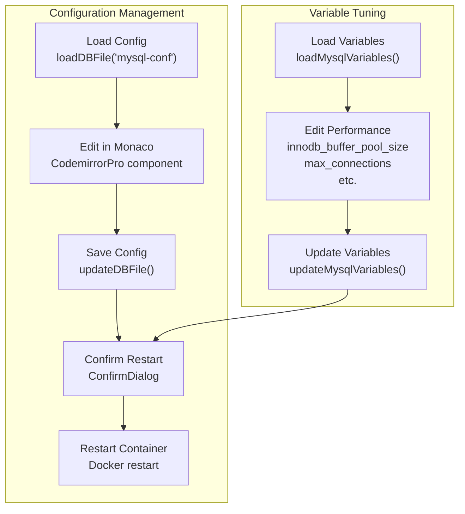

**Diagram: MySQL Configuration Management**

Configuration changes require container restart, triggered through a confirmation dialog. The system loads default configurations via `getAppDefaultConfig()` for reference.

Sources: [frontend/src/views/database/mysql/setting/index.vue:1-343](), [frontend/src/api/modules/database.ts:102-114]()

### Performance Monitoring

The status view displays real-time MySQL metrics:

```typescript
interface MysqlStatus {
    Aborted_clients: number;           // Client connection aborts
    Aborted_connects: number;          // Connection attempt failures
    Bytes_received: number;            // Total bytes received
    Bytes_sent: number;                // Total bytes sent
    Com_commit: number;                // Commit statements
    Com_rollback: number;              // Rollback statements
    Connections: number;               // Total connection attempts
    Created_tmp_disk_tables: number;   // Temp tables on disk
    Created_tmp_tables: number;        // Total temp tables
    Innodb_buffer_pool_pages_dirty: number;
    Innodb_buffer_pool_read_requests: number;
    Innodb_buffer_pool_reads: number;
    Key_read_requests: number;
    Key_reads: number;
    Key_write_requests: number;
    Key_writes: number;
    Max_used_connections: number;
    Open_tables: number;
    Opened_files: number;
    Opened_tables: number;
    Qcache_hits: number;               // Query cache hits
    Qcache_inserts: number;            // Query cache inserts
    Questions: number;                 // Total queries
    Threads_connected: number;         // Current connections
    Threads_running: number;           // Active threads
    Uptime: number;                    // Server uptime in seconds
    Run: number;                       // Binlog position
    File: string;                      // Binlog file name
    Position: number;                  // Binlog position
}
```

Sources: [frontend/src/api/interface/database.ts:108-144]()

### Terminal and Management Tools

MySQL databases integrate with web-based management tools:

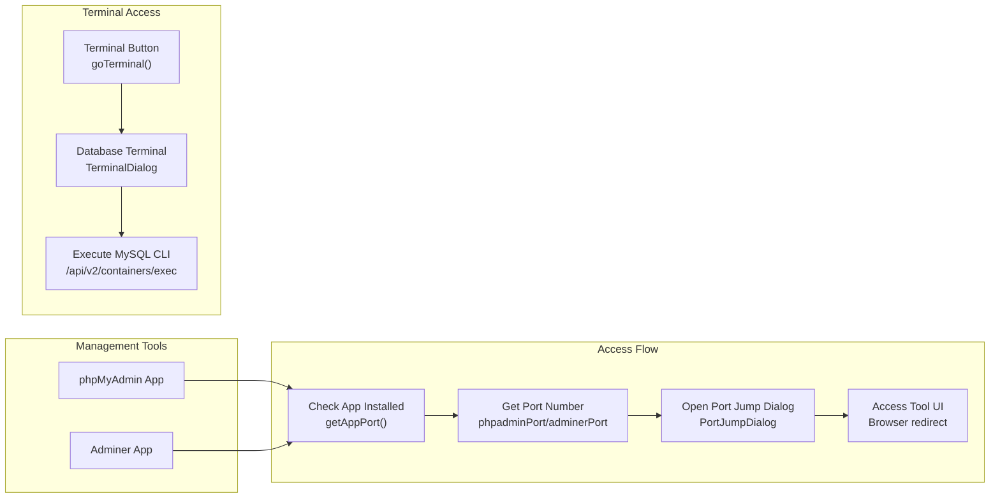

**Diagram: MySQL Management Tool Access**

The system checks if phpMyAdmin or Adminer are installed via `getAppPort()`. If not installed (port = 0), it prompts for installation. The terminal provides direct MySQL CLI access through container exec.

Sources: [frontend/src/views/database/mysql/index.vue:472-510](), [frontend/src/views/database/mysql/index.vue:384-386]()

---

## PostgreSQL Management

PostgreSQL management follows a similar pattern to MySQL with additional superuser privilege support.

### Database and User Operations

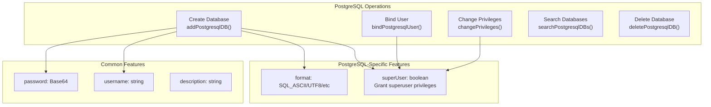

**Diagram: PostgreSQL-Specific Features**

PostgreSQL adds `superUser` boolean field to control elevated privileges. The `changePrivileges()` function allows toggling superuser status without changing passwords.

Sources: [frontend/src/api/modules/database.ts:20-55](), [frontend/src/api/interface/database.ts:154-217]()

### User Privilege Management

PostgreSQL distinguishes between regular users and superusers:

| Property | Regular User | Superuser |
|----------|--------------|-----------|
| **Database Access** | Specific database only | All databases |
| **Object Creation** | Own database | All databases |
| **Role Management** | Cannot create roles | Can create/modify roles |
| **Configuration** | Limited | Full system access |

The `PgChangePrivileges` interface allows updating privilege levels:

```typescript
interface PgChangePrivileges {
    name: string;        // PostgreSQL instance name
    database: string;    // Target database name
    username: string;    // User to modify
    superUser: boolean;  // Grant/revoke superuser
}
```

Sources: [frontend/src/api/interface/database.ts:161-166]()

---

## Redis Management

Redis management centers around terminal/CLI interaction with configuration and monitoring support.

### Terminal Integration

Redis provides an interactive terminal with quick command support:

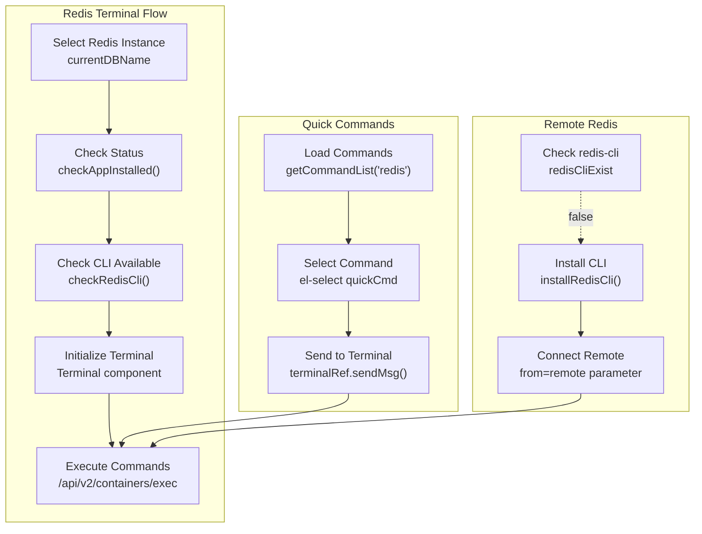

**Diagram: Redis Terminal Integration**

Local Redis instances connect directly through Docker exec. Remote Redis requires the `redis-cli` tool, installed on demand via `installRedisCli()`. Quick commands provide pre-configured Redis commands (GET, SET, KEYS, etc.).

Sources: [frontend/src/views/database/redis/index.vue:295-345](), [frontend/src/views/database/redis/index.vue:352-374](), [frontend/src/views/database/redis/index.vue:376-390]()

### Configuration Management

Redis configuration is managed through multiple interfaces:

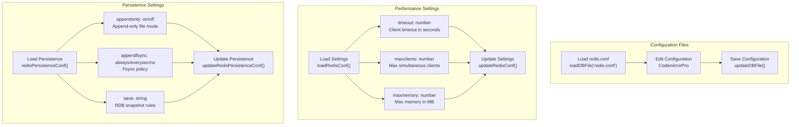

**Diagram: Redis Configuration Management**

Redis supports three configuration levels: raw file editing, performance tuning (timeout, connections, memory), and persistence settings (AOF/RDB). All changes require container restart.

Sources: [frontend/src/views/database/redis/setting/index.vue:1-353](), [frontend/src/api/modules/database.ts:115-148]()

### Redis Status Monitoring

Redis status provides operational metrics:

```typescript
interface RedisStatus {
    tcp_port: string;                      // Listening port
    uptime_in_days: string;                // Days since start
    connected_clients: string;             // Current connections
    used_memory: string;                   // Memory in use
    used_memory_rss: string;               // RSS memory
    used_memory_peak: string;              // Peak memory
    mem_fragmentation_ratio: string;       // Fragmentation ratio
    total_connections_received: string;    // Total connections
    total_commands_processed: string;      // Total commands
    instantaneous_ops_per_sec: string;     // Current ops/sec
    keyspace_hits: string;                 // Cache hits
    keyspace_misses: string;               // Cache misses
    latest_fork_usec: string;              // Last fork duration
}
```

Sources: [frontend/src/api/interface/database.ts:242-256]()

### Persistence Configuration

Redis persistence settings control data durability:

| Mode | Configuration | Behavior |
|------|---------------|----------|
| **AOF (Append-Only File)** | `appendonly: on` | Logs all write operations |
| **AOF Fsync** | `appendfsync: always` | Sync after every write (slow, safe) |
|  | `appendfsync: everysec` | Sync every second (balanced) |
|  | `appendfsync: no` | Let OS decide (fast, less safe) |
| **RDB Snapshots** | `save: "900 1 300 10 60 10000"` | Save after time+changes threshold |

The persistence interface allows enabling/disabling AOF, configuring fsync policy, and setting RDB snapshot rules.

Sources: [frontend/src/api/interface/database.ts:265-269](), [frontend/src/api/modules/database.ts:140-142]()

---

## Remote Database Management

Remote databases provide connection management for external database instances.

### Database Connection Structure

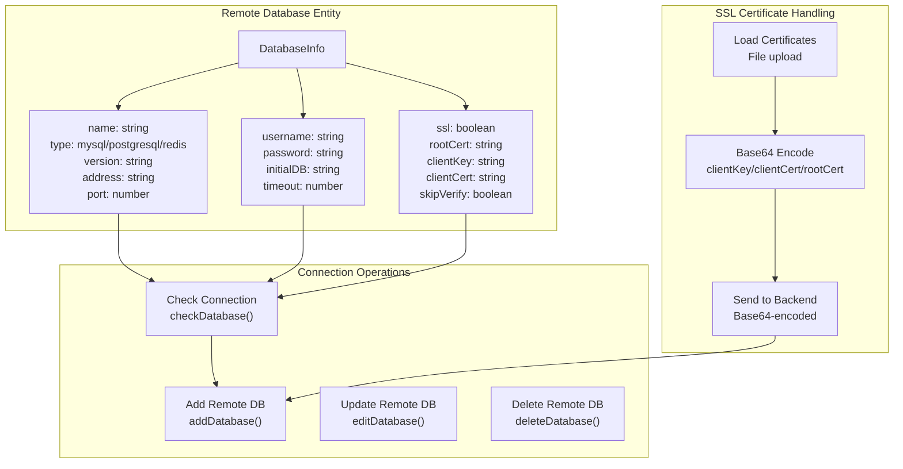

**Diagram: Remote Database Connection Structure**

Remote databases support SSL/TLS connections with client certificates. The `checkDatabase()` function validates connectivity before saving. Certificates are Base64-encoded before transmission.

Sources: [frontend/src/api/modules/database.ts:164-193](), [frontend/src/api/interface/database.ts:272-356]()

### Remote Database Operations

Once registered, remote databases appear in database type selectors alongside local instances:

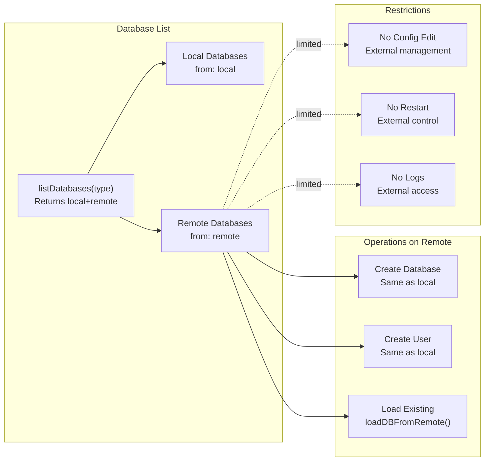

**Diagram: Remote Database Integration**

Remote databases integrate into the same UI as local databases but with limited operations. The `loadDBFromRemote()` function imports existing databases from the remote instance into 1Panel's tracking.

Sources: [frontend/src/views/database/mysql/index.vue:436-457](), [frontend/src/api/modules/database.ts:76-78]()

---

## Common Database Operations

### Database Selector Pattern

All database views use a consistent selector pattern:

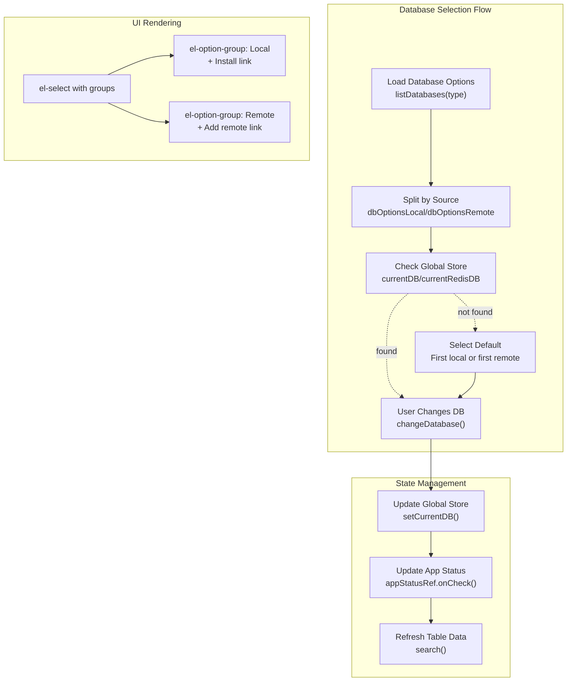

**Diagram: Database Selector Pattern**

The selector persists selection in global store (`currentDB` for MySQL/PostgreSQL, `currentRedisDB` for Redis). When switching databases, it updates app status for local databases and refreshes the data table.

Sources: [frontend/src/views/database/mysql/index.vue:397-418](), [frontend/src/views/database/redis/index.vue:225-245]()

### Backup Integration

Database operations integrate with the backup system:

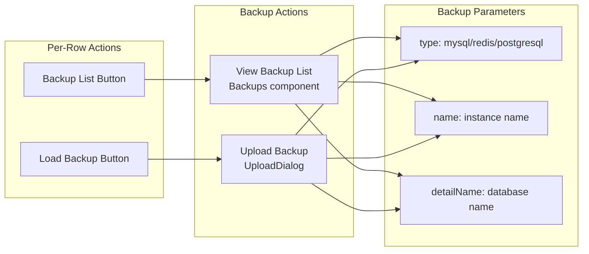

**Diagram: Backup Integration Pattern**

Each database row provides backup operations. The `Backups` component (see [Backup and Snapshot System](#10.3)) handles listing and restore. The `UploadDialog` allows uploading backup files directly.

Sources: [frontend/src/views/database/mysql/index.vue:638-666]()

---

## API Structure and Data Flow

### API Client Organization

The database API client is organized by database type:

```typescript
// Common operations (all types)
loadDBBaseInfo(type: string, database: string)
loadDBFile(type: string, database: string)
updateDBFile(params: DBConfUpdate)

// MySQL-specific
searchMysqlDBs(params: SearchDBWithPage)
addMysqlDB(params: MysqlDBCreate)
bindUser(params: BindUser)
updateMysqlPassword(params: ChangeInfo)
updateMysqlAccess(params: ChangeInfo)
deleteMysqlDB(params: MysqlDBDelete)
loadMysqlVariables(type: string, database: string)
loadMysqlStatus(type: string, database: string)

// PostgreSQL-specific
searchPostgresqlDBs(params: SearchDBWithPage)
addPostgresqlDB(params: PostgresqlDBCreate)
bindPostgresqlUser(params: PgBind)
changePrivileges(params: PgChangePrivileges)
updatePostgresqlPassword(params: ChangeInfo)
deletePostgresqlDB(params: PostgresqlDBDelete)

// Redis-specific
loadRedisStatus(type: string, database: string)
loadRedisConf(type: string, database: string)
redisPersistenceConf(type: string, database: string)
updateRedisConf(params: RedisConfUpdate)
changeRedisPassword(database: string, password: string)

// Remote database management
listDatabases(type: string)
searchDatabases(params: SearchDatabasePage)
checkDatabase(params: DatabaseCreate)
addDatabase(params: DatabaseCreate)
editDatabase(params: DatabaseUpdate)
deleteDatabase(params: DatabaseDelete)
```

Sources: [frontend/src/api/modules/database.ts:1-200]()

### Password Encoding Pattern

All password fields are Base64-encoded before transmission:

```typescript
// Example from addMysqlDB
export const addMysqlDB = (params: Database.MysqlDBCreate) => {
    let request = deepCopy(params) as Database.MysqlDBCreate;
    if (request.password) {
        request.password = Base64.encode(request.password);
    }
    return http.post(`/databases`, request);
};

// Example from updateMysqlPassword
export const updateMysqlPassword = (params: Database.ChangeInfo) => {
    let request = deepCopy(params) as Database.ChangeInfo;
    if (request.value) {
        request.value = Base64.encode(request.value);
    }
    return http.post(`/databases/change/password`, request);
};
```

This encoding pattern applies to all password operations (create, update, bind) across MySQL, PostgreSQL, and Redis. SSL certificates are also Base64-encoded for remote database connections.

Sources: [frontend/src/api/modules/database.ts:20-26](), [frontend/src/api/modules/database.ts:62-68](), [frontend/src/api/modules/database.ts:82-88]()

### Multi-Node Support

Database operations support multi-node deployments through query parameters:

```typescript
// MySQL search with node parameter
export const searchMysqlDBs = (params: Database.SearchDBWithPage, node?: string) => {
    const query = node ? `?operateNode=${node}` : '';
    return http.post<ResPage<Database.MysqlDBInfo>>(`/databases/search${query}`, params);
};

// PostgreSQL search with node parameter
export const searchPostgresqlDBs = (params: Database.SearchDBWithPage, node?: string) => {
    const query = node ? `?operateNode=${node}` : '';
    return http.post<ResPage<Database.PostgresqlDBInfo>>(`/databases/pg/search${query}`, params);
};

// List databases with node parameter
export const listDatabases = (type: string, node?: string) => {
    const query = node ? `?operateNode=${node}` : '';
    return http.get<Array<Database.DatabaseOption>>(`/databases/db/list/${type}${query}`);
};
```

When operating in a multi-node environment (see [Multi-Node Architecture](#2.2)), the optional `node` parameter routes operations to specific agent nodes.

Sources: [frontend/src/api/modules/database.ts:33-36](), [frontend/src/api/modules/database.ts:58-61](), [frontend/src/api/modules/database.ts:157-160]()

---

## Table Structures and Data Models

### MySQL Database Record

```typescript
interface MysqlDBInfo {
    id: number;              // Database ID
    createdAt: Date;         // Creation timestamp
    name: string;            // Database name
    mysqlName: string;       // Parent MySQL instance
    from: string;            // 'local' or 'remote'
    format: string;          // Character set (utf8mb4, etc.)
    username: string;        // Bound MySQL user
    password: string;        // User password
    permission: string;      // Host permission (%, localhost, IP)
    isDelete: string;        // Deletion marker
    description: string;     // User description
}
```

The `isDelete` field marks databases that exist in 1Panel but not in the actual MySQL instance, displayed with an info tag in the UI.

Sources: [frontend/src/api/interface/database.ts:16-28]()

### PostgreSQL Database Record

```typescript
interface PostgresqlDBInfo {
    id: number;                  // Database ID
    createdAt: Date;             // Creation timestamp
    name: string;                // Database name
    postgresqlName: string;      // Parent PostgreSQL instance
    from: string;                // 'local' or 'remote'
    format: string;              // Encoding (UTF8, SQL_ASCII, etc.)
    username: string;            // Bound PostgreSQL user
    password: string;            // User password
    superUser: boolean;          // Superuser privilege flag
    isDelete: string;            // Deletion marker
    description: string;         // User description
}
```

PostgreSQL adds the `superUser` boolean for elevated privileges.

Sources: [frontend/src/api/interface/database.ts:205-217]()

### Remote Database Record

```typescript
interface DatabaseInfo {
    id: number;              // Database ID
    createdAt: Date;         // Registration timestamp
    name: string;            // Display name
    type: string;            // mysql/postgresql/redis
    version: string;         // Database version
    from: string;            // Always 'remote'
    address: string;         // IP address or hostname
    port: number;            // Connection port
    initialDB: string;       // Default database to connect
    username: string;        // Admin username
    password: string;        // Admin password
    
    // SSL/TLS configuration
    ssl: boolean;            // SSL enabled
    hasCA: boolean;          // CA certificate present
    rootCert: string;        // CA certificate (Base64)
    clientKey: string;       // Client private key (Base64)
    clientCert: string;      // Client certificate (Base64)
    skipVerify: boolean;     // Skip certificate verification
    
    timeout: number;         // Connection timeout (seconds)
    description: string;     // User description
}
```

Remote databases support full SSL/TLS with client certificate authentication.

Sources: [frontend/src/api/interface/database.ts:272-294]()

---

## Key Components and Files

### Frontend Components

| Component | Path | Purpose |
|-----------|------|---------|
| **MySQL Index** | [frontend/src/views/database/mysql/index.vue:1-680]() | Main MySQL/MariaDB management view |
| **MySQL Settings** | [frontend/src/views/database/mysql/setting/index.vue:1-343]() | MySQL configuration and monitoring |
| **Redis Index** | [frontend/src/views/database/redis/index.vue:1-423]() | Main Redis management view with terminal |
| **Redis Settings** | [frontend/src/views/database/redis/setting/index.vue:1-353]() | Redis configuration tabs |
| **Database API** | [frontend/src/api/modules/database.ts:1-200]() | API client methods |
| **Database Types** | [frontend/src/api/interface/database.ts:1-363]() | TypeScript interface definitions |

### Common Patterns

**AppStatus Component**: Used in MySQL and Redis local views to display app installation status, version, and provide start/stop/restart controls.

**TerminalDialog Component**: Provides interactive terminal access for Redis CLI and MySQL CLI execution through container exec endpoints.

**ConfirmDialog Component**: Used for configuration changes requiring restart, ensuring users acknowledge the service interruption.

**ComplexTable Component**: Displays database lists with pagination, sorting, search, and per-row action buttons.

Sources: [frontend/src/views/database/mysql/index.vue:15-26](), [frontend/src/views/database/redis/index.vue:14-24]()

---

