<!-- source: DeepWiki mcp.deepwiki.com · repo 1Panel-dev/1Panel · page 8.3 File Management System · fetched 2026-10-29 -->

# File Management System

<details>
<summary>Relevant source files</summary>

The following files were used as context for generating this wiki page:

- [frontend/src/api/interface/file.ts](frontend/src/api/interface/file.ts)
- [frontend/src/api/modules/files.ts](frontend/src/api/modules/files.ts)
- [frontend/src/views/host/file-management/code-editor/index.vue](frontend/src/views/host/file-management/code-editor/index.vue)
- [frontend/src/views/host/file-management/index.vue](frontend/src/views/host/file-management/index.vue)

</details>


## Purpose and Scope

The File Management System provides a comprehensive web-based interface for browsing, editing, and managing files on the Linux server filesystem. This document covers the multi-tab file browser, Monaco-based code editor, file operations (CRUD, compression, conversion), upload mechanisms, favorites, recycle bin, and terminal integration. For terminal-specific operations, see [Terminal and SSH Management](#8.3). For backup and snapshot functionality, see [Backup and Snapshot System](#10.3).

## System Architecture

The File Management System consists of three primary layers: a Vue-based frontend interface with multi-tab support, an API client layer for communication with the backend, and a comprehensive set of file operation endpoints. The system integrates the Monaco editor for code editing and supports up to 10 simultaneous file tabs.

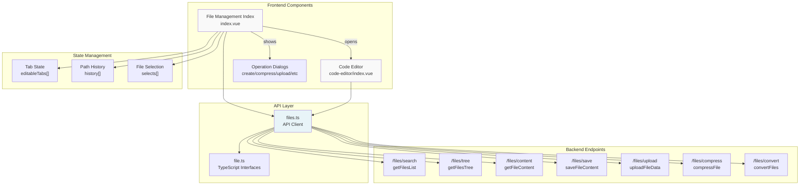

**Sources:** [frontend/src/views/host/file-management/index.vue:1-637](), [frontend/src/views/host/file-management/code-editor/index.vue:1-387](), [frontend/src/api/modules/files.ts:1-181]()

## Multi-Tab File Browser Interface

The file browser implements a tabbed interface allowing users to navigate multiple directories simultaneously. Each tab maintains its own navigation state, path history, and file listings.

### Tab Management System

The system supports multiple file browser tabs with individual navigation contexts. Users can add up to 7 tabs (including the initial tab), with each tab storing its path and display name.

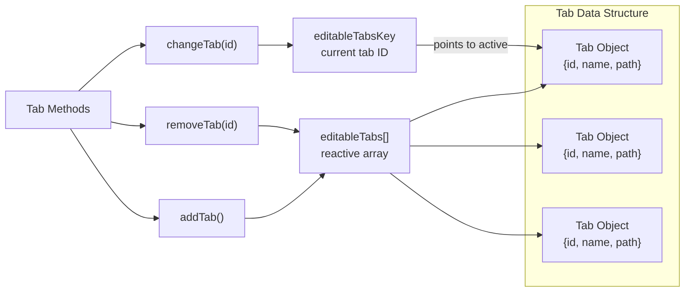

The tab state is managed at [frontend/src/views/host/file-management/index.vue:721-725]() with initialization:

```typescript
const editableTabsKey = ref('');
const editableTabs = ref([
    { id: '1', name: getLastPath(baseDir.value), path: baseDir.value },
    { id: '2', name: 'home', path: '/home' },
]);
```

Tab operations are implemented at [frontend/src/views/host/file-management/index.vue:1653-1719]() including `addTab()`, `removeTab()`, and `changeTab()` methods.

**Sources:** [frontend/src/views/host/file-management/index.vue:721-725](), [frontend/src/views/host/file-management/index.vue:1653-1719]()

### Path Navigation and Breadcrumbs

The navigation system provides forward/back/top navigation buttons and an interactive breadcrumb trail. The breadcrumb can be clicked to navigate to any parent directory or switched to an editable input for direct path entry.

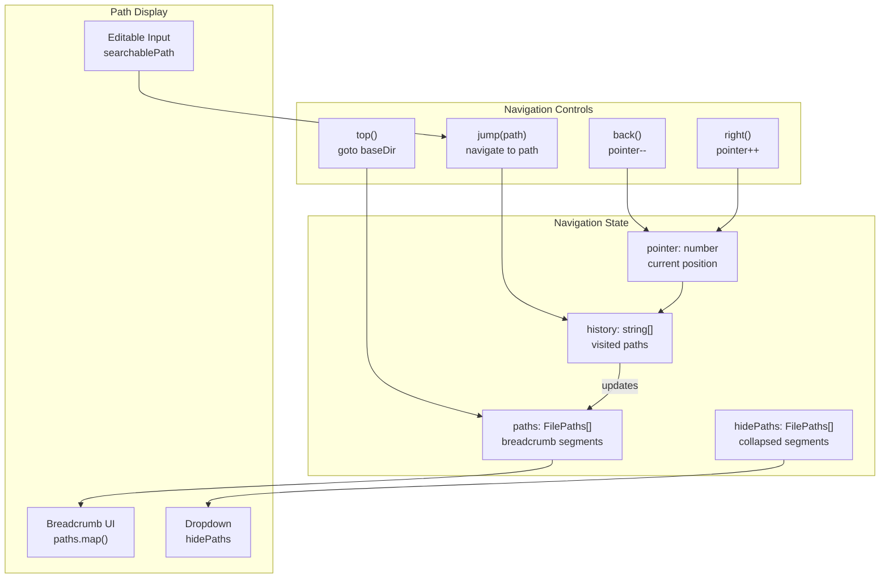

The path navigation system uses a history array with pointer-based navigation at [frontend/src/views/host/file-management/index.vue:752-753]():

```typescript
const history: string[] = [];
let pointer = -1;
```

Navigation methods are implemented at [frontend/src/views/host/file-management/index.vue:1115-1162]() with path splitting and breadcrumb rendering logic at [frontend/src/views/host/file-management/index.vue:1163-1218]().

**Sources:** [frontend/src/views/host/file-management/index.vue:752-753](), [frontend/src/views/host/file-management/index.vue:1115-1218]()

### File Listing and Search

The file listing supports pagination, sorting, filtering by hidden files, and recursive search. The table displays file metadata including name, permissions (mode), owner/group, size, and modification time.

| Column | Description | Actions |
|--------|-------------|---------|
| Name | File/directory name with icon | Click to open, hover for favorites |
| Mode | Unix permissions (e.g., 0755) | Click to edit permissions |
| User/Group | Owner and group IDs | Click to change ownership |
| Size | File size or "Calculate" for directories | Click to compute directory size |
| Modified | Last modification timestamp | Sortable |
| Remark | Optional user annotation | Editable |

The search request structure is defined at [frontend/src/views/host/file-management/index.vue:736-746]():

```typescript
const initData = () => ({
    path: '/',
    expand: true,
    showHidden: localStorage.getItem('show-hidden') === 'true',
    page: 1,
    pageSize: 100,
    search: '',
    containSub: false,
    sortBy: 'name',
    sortOrder: 'ascending',
});
```

The search operation calls `getFilesList()` at [frontend/src/views/host/file-management/index.vue:851-869]() with result handling that populates the data table and calculates directory/file counts.

**Sources:** [frontend/src/views/host/file-management/index.vue:736-746](), [frontend/src/views/host/file-management/index.vue:851-895](), [frontend/src/api/modules/files.ts:9-11]()

## File Operations

### Basic CRUD Operations

The system provides comprehensive create, read, update, and delete operations for both files and directories.

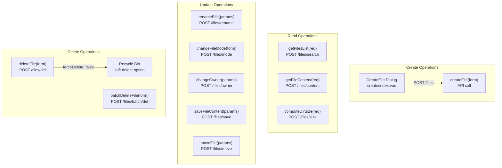

File creation is handled by the `handleCreate()` method at [frontend/src/views/host/file-management/index.vue:1000-1004]() which opens a dialog for directory or file creation. The creation form includes path, type (isDir), permissions (mode), and optional symbolic link configuration defined in the `fileCreate` reactive object at [frontend/src/views/host/file-management/index.vue:755]().

**Sources:** [frontend/src/views/host/file-management/index.vue:755](), [frontend/src/views/host/file-management/index.vue:1000-1004](), [frontend/src/api/modules/files.ts:25-95]()

### Compression and Decompression

The system supports multiple compression formats with configurable options including password protection.

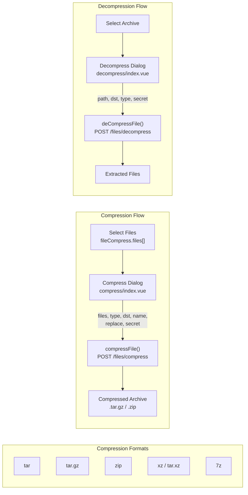

Compression is initiated at [frontend/src/views/host/file-management/index.vue:1343-1351]() with the `openCompress()` method populating the `fileCompress` reactive object:

```typescript
const fileCompress = reactive({ files: [''], name: '', dst: '', operate: 'compress' });
```

The API calls support 10-minute timeouts defined in [frontend/src/api/modules/files.ts:46-50]() to accommodate large file operations.

**Sources:** [frontend/src/views/host/file-management/index.vue:756](), [frontend/src/views/host/file-management/index.vue:1343-1351](), [frontend/src/api/modules/files.ts:46-50]()

### File Upload System

The upload system supports both standard HTTP uploads and chunked uploads for large files, with drag-and-drop functionality.

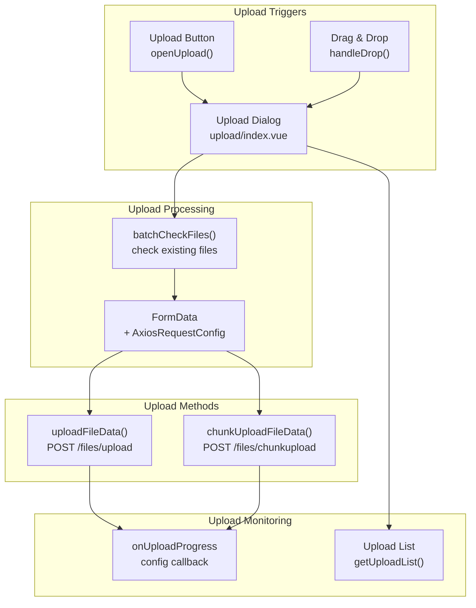

Drag-and-drop is handled at [frontend/src/views/host/file-management/index.vue:1623-1651]() with the `handleDrop()` method detecting dropped files and opening the upload dialog. The upload dialog component is referenced at [frontend/src/views/host/file-management/index.vue:620]().

The API provides both standard and chunked upload endpoints at [frontend/src/api/modules/files.ts:69-87]() with custom Axios configuration for progress tracking.

**Sources:** [frontend/src/views/host/file-management/index.vue:1623-1651](), [frontend/src/api/modules/files.ts:69-87](), [frontend/src/api/interface/file.ts:50-57]()

### Remote File Download (Wget)

The system provides wget functionality for downloading files from remote URLs, with background task tracking.

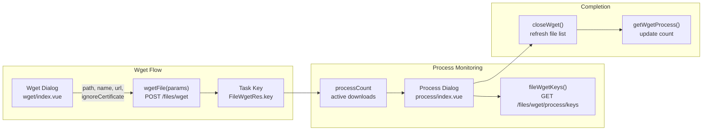

The wget dialog is opened via `openWget()` at [frontend/src/views/host/file-management/index.vue:1006-1012]() which sets the current path. Active wget processes are tracked at [frontend/src/views/host/file-management/index.vue:1738-1747]() with the `getWgetProcess()` method fetching active task keys and updating the badge count.

**Sources:** [frontend/src/views/host/file-management/index.vue:1006-1012](), [frontend/src/views/host/file-management/index.vue:1738-1747](), [frontend/src/api/modules/files.ts:97-119]()

### File Conversion

The system supports format conversion for various file types including images, documents, and media files when FFmpeg is available.

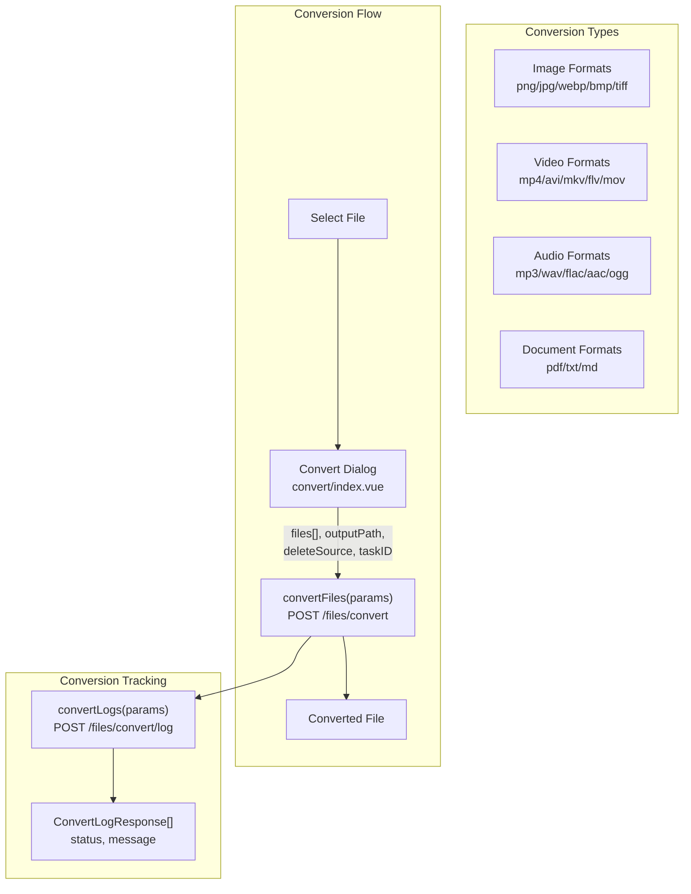

File conversion state is maintained in the `fileConvert` reactive object at [frontend/src/views/host/file-management/index.vue:765-779]():

```typescript
const fileConvert = reactive<{
    outputPath: string;
    files: File.ConvertFile[];
}>({
    outputPath: '',
    files: [
        {
            type: '',
            inputFile: '',
            extension: '',
            path: '',
            outputFormat: '',
        },
    ],
});
```

The conversion is triggered via the table operations menu, opening the convert dialog referenced at [frontend/src/views/host/file-management/index.vue:635]().

**Sources:** [frontend/src/views/host/file-management/index.vue:765-779](), [frontend/src/api/modules/files.ts:174-180](), [frontend/src/api/interface/file.ts:241-263]()

## Monaco Code Editor Integration

The code editor component provides a full-featured Monaco editor instance with file tree navigation, multiple file tabs, and extensive customization options.

### Editor Initialization and Configuration

The Monaco editor is initialized with configurable themes, languages, and display options persisted to localStorage.

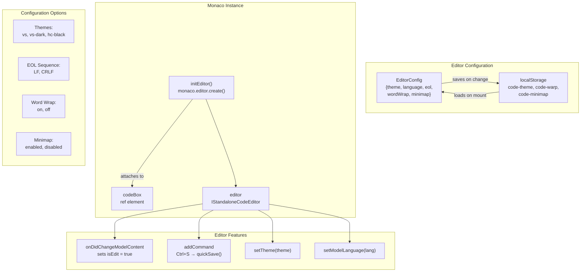

The editor configuration is defined at [frontend/src/views/host/file-management/code-editor/index.vue:501-507]():

```typescript
const config = reactive<EditorConfig>({
    theme: 'vs-dark',
    language: 'plaintext',
    eol: monaco.editor.EndOfLineSequence.LF,
    wordWrap: 'on',
    minimap: false,
});
```

The initialization method at [frontend/src/views/host/file-management/code-editor/index.vue:842-878]() creates the Monaco instance with options including `automaticLayout`, `folding`, and event handlers for content changes and keyboard shortcuts.

**Sources:** [frontend/src/views/host/file-management/code-editor/index.vue:501-507](), [frontend/src/views/host/file-management/code-editor/index.vue:842-878]()

### File Tab Management

The code editor supports up to 10 file tabs with persistent state across sessions.

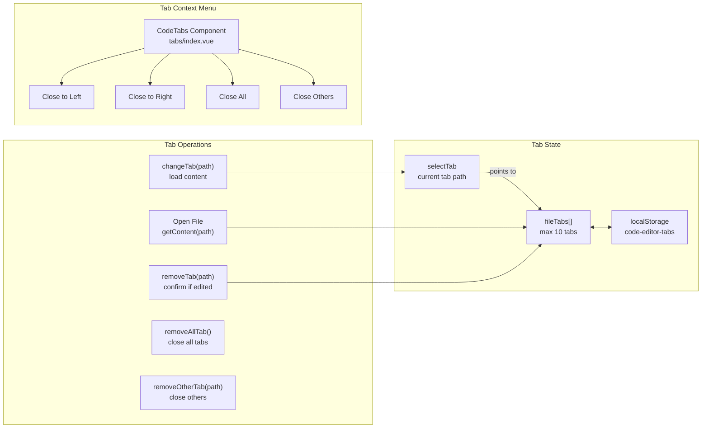

Tab state is persisted using `saveTabsToStorage()` at [frontend/src/views/host/file-management/code-editor/index.vue:528-534]() which stores simplified tab objects containing only path and name. Tab operations at [frontend/src/views/host/file-management/code-editor/index.vue:545-677]() include logic for handling unsaved changes with confirmation dialogs.

**Sources:** [frontend/src/views/host/file-management/code-editor/index.vue:523-544](), [frontend/src/views/host/file-management/code-editor/index.vue:545-677]()

### File Tree Navigation

The code editor includes a collapsible file tree using `el-tree-v2` for efficient rendering of large directory structures.

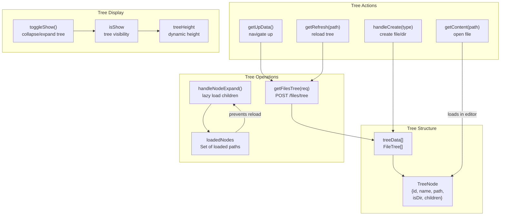

The tree component is rendered at [frontend/src/views/host/file-management/code-editor/index.vue:143-226]() with custom templates for directory and file nodes. The lazy loading logic at [frontend/src/views/host/file-management/code-editor/index.vue:1136-1160]() fetches children only when a directory is expanded, maintaining a `Set` of loaded paths to prevent redundant API calls.

**Sources:** [frontend/src/views/host/file-management/code-editor/index.vue:143-226](), [frontend/src/views/host/file-management/code-editor/index.vue:1136-1175]()

### Language Detection and Syntax Highlighting

The editor automatically detects file languages based on file extensions and provides appropriate syntax highlighting.

Language mappings are defined in `@/global/mimetype` and matched at [frontend/src/views/host/file-management/code-editor/index.vue:1000-1024]():

```typescript
Languages.forEach((language) => {
    const ext = fileExtension.value.substring(1);
    if (language.value.indexOf(ext) > -1) {
        config.language = language.label;
    }
});
```

Monaco worker configuration is set up at [frontend/src/views/host/file-management/code-editor/index.vue:415-431]() supporting JSON, CSS, HTML, and TypeScript/JavaScript language services.

**Sources:** [frontend/src/views/host/file-management/code-editor/index.vue:415-431](), [frontend/src/views/host/file-management/code-editor/index.vue:1000-1024]()

### Save Operations

The editor provides both manual and keyboard shortcut-based save operations with unsaved change tracking.

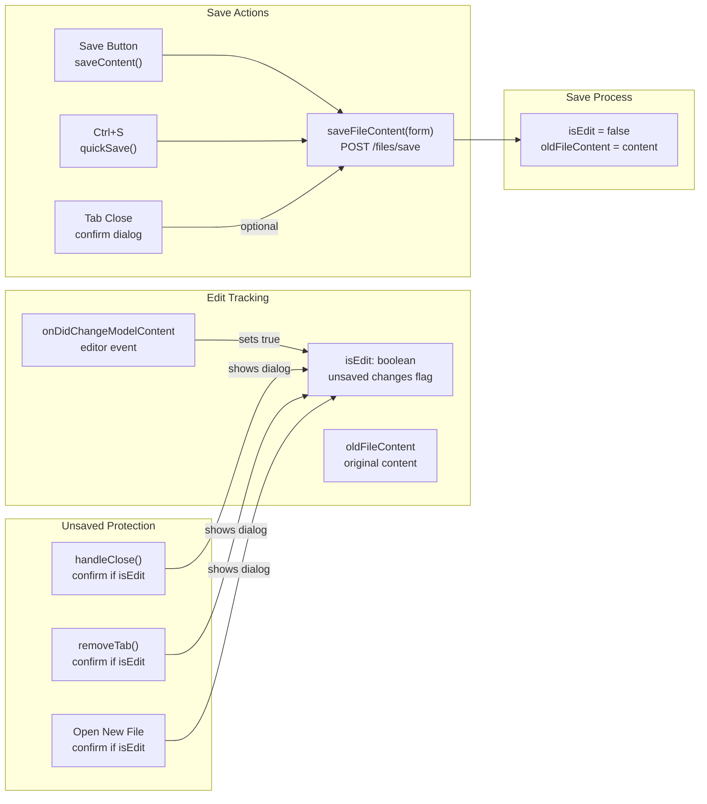

The save operation at [frontend/src/views/host/file-management/code-editor/index.vue:884-903]() calls the API and updates the `isEdit` flag and `oldFileContent` reference on success. The keyboard shortcut is registered at [frontend/src/views/host/file-management/code-editor/index.vue:869]() using Monaco's command binding system.

**Sources:** [frontend/src/views/host/file-management/code-editor/index.vue:869-882](), [frontend/src/views/host/file-management/code-editor/index.vue:884-903]()

## Special Features

### Favorites System

Users can mark frequently accessed files and directories as favorites for quick access.

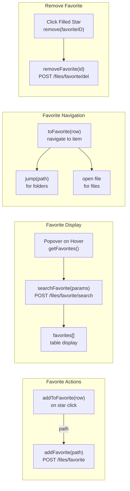

The favorites popover is rendered at [frontend/src/views/host/file-management/index.vue:262-314]() with hover state tracking at [frontend/src/views/host/file-management/index.vue:1720-1737]() using `showFavorite()` and `hideFavorite()` methods to display the star icon on row hover.

**Sources:** [frontend/src/views/host/file-management/index.vue:262-314](), [frontend/src/views/host/file-management/index.vue:1720-1737](), [frontend/src/api/modules/files.ts:133-148]()

### Recycle Bin

Deleted files can be moved to a recycle bin instead of permanent deletion, allowing recovery.

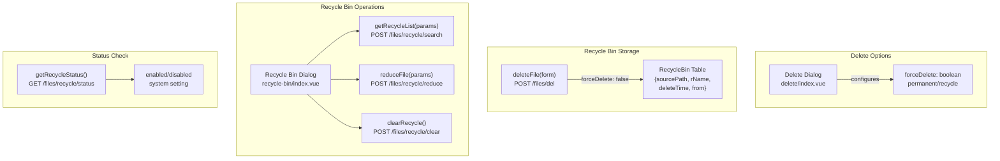

The recycle bin dialog is opened via `openRecycleBin()` at [frontend/src/views/host/file-management/index.vue:1014-1018]() and referenced at [frontend/src/views/host/file-management/index.vue:628](). Files in the recycle bin include metadata like original source path, deletion time, and a recovery name.

**Sources:** [frontend/src/views/host/file-management/index.vue:1014-1018](), [frontend/src/api/modules/files.ts:121-131](), [frontend/src/api/interface/file.ts:180-194]()

### Terminal Integration

The file browser provides direct terminal access at the current directory location.

The terminal is opened via `toTerminal()` at [frontend/src/views/host/file-management/index.vue:1266-1269]() which navigates to the terminal view with the current path as a query parameter:

```typescript
const toTerminal = () => {
    router.push({ path: '/hosts/terminal', query: { path: req.path } });
};
```

A terminal dialog component is also available at [frontend/src/views/host/file-management/index.vue:634]() for in-page terminal access.

**Sources:** [frontend/src/views/host/file-management/index.vue:1266-1269](), [frontend/src/views/host/file-management/index.vue:634]()

### Mount Point Display

The system displays available mount points with free space indicators for quick navigation.

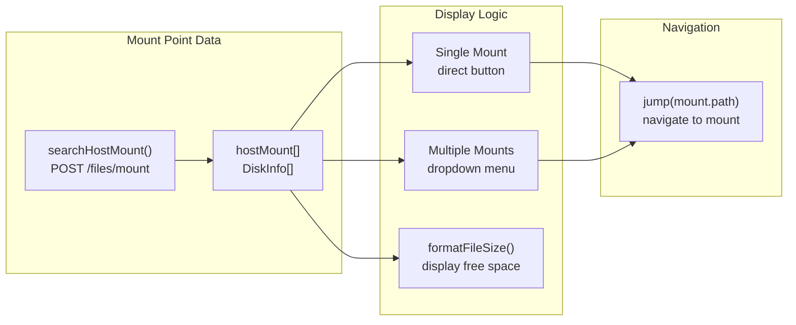

Mount points are displayed at [frontend/src/views/host/file-management/index.vue:318-345]() with conditional rendering: a single button for one mount or a dropdown for multiple mounts. Each mount shows its path and available free space.

**Sources:** [frontend/src/views/host/file-management/index.vue:318-345](), [frontend/src/api/modules/files.ts:166-168]()

## API Layer and Request Flow

### Request/Response Types

The file operations use strongly-typed TypeScript interfaces for all API interactions.

| Interface | Purpose | Key Fields |
|-----------|---------|------------|
| `File.ReqFile` | File listing request | path, search, expand, showHidden, containSub, sortBy, sortOrder |
| `File.File` | File metadata response | path, name, size, isDir, mode, user, group, modTime |
| `File.FileCreate` | File/directory creation | path, isDir, mode, isLink, isSymlink |
| `File.FileEdit` | Save file content | path, content |
| `File.FileCompress` | Compression request | files[], type, dst, name, replace, secret |
| `File.FileMove` | Move/copy operation | oldPaths[], newPath, type |
| `File.FileTree` | Tree node structure | id, name, isDir, path, children[] |

The base request interface `ReqFile` is defined at [frontend/src/api/interface/file.ts:29-39]() extending the common `ReqPage` interface for pagination support. Response types include metadata like permissions, ownership, timestamps, and optional fields like `favoriteID` and `remark`.

**Sources:** [frontend/src/api/interface/file.ts:1-263]()

### API Timeout Configuration

File operations use extended timeouts to accommodate large files and long-running operations.

```typescript
// Standard operations: 5 minutes
getFilesList(params: File.ReqFile) => 
    http.post<File.File>('files/search', params, TimeoutEnum.T_5M)

// Compression: 10 minutes
compressFile(form: File.FileCompress) => 
    http.post<File.File>('files/compress', form, TimeoutEnum.T_10M)

// File download: 40 seconds
downloadFile(params: File.FileDownload) => 
    http.download<BlobPart>('files/download', params, { 
        responseType: 'blob', 
        timeout: TimeoutEnum.T_40S 
    })
```

Timeout values are defined in the `TimeoutEnum` enumeration and passed as the third parameter to HTTP methods. This is critical for operations like directory size calculation, large file compression, and batch operations that may take significant time.

**Sources:** [frontend/src/api/modules/files.ts:9-11](), [frontend/src/api/modules/files.ts:46-50](), [frontend/src/api/modules/files.ts:105-107]()

### Multi-Node Support

File operations support multi-node architecture by accepting an optional `operateNode` query parameter.

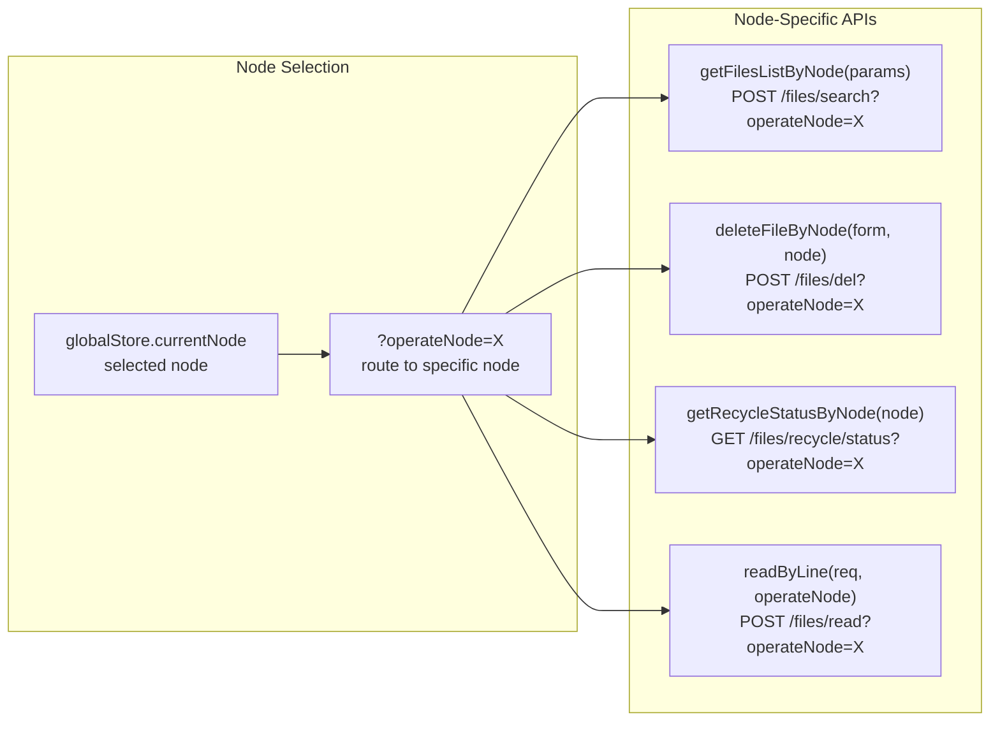

Node-aware API methods are defined at [frontend/src/api/modules/files.ts:13-15](), [frontend/src/api/modules/files.ts:33-35](), [frontend/src/api/modules/files.ts:141-144](), and [frontend/src/api/modules/files.ts:158-160]() allowing the Core API to route requests to specific agent nodes in a multi-node deployment.

**Sources:** [frontend/src/api/modules/files.ts:13-15](), [frontend/src/api/modules/files.ts:33-35](), [frontend/src/api/modules/files.ts:141-144](), [frontend/src/api/modules/files.ts:158-160]()

### Async Task Pattern for Long Operations

Operations like compression, decompression, and large file moves use an asynchronous task pattern to prevent timeout issues.

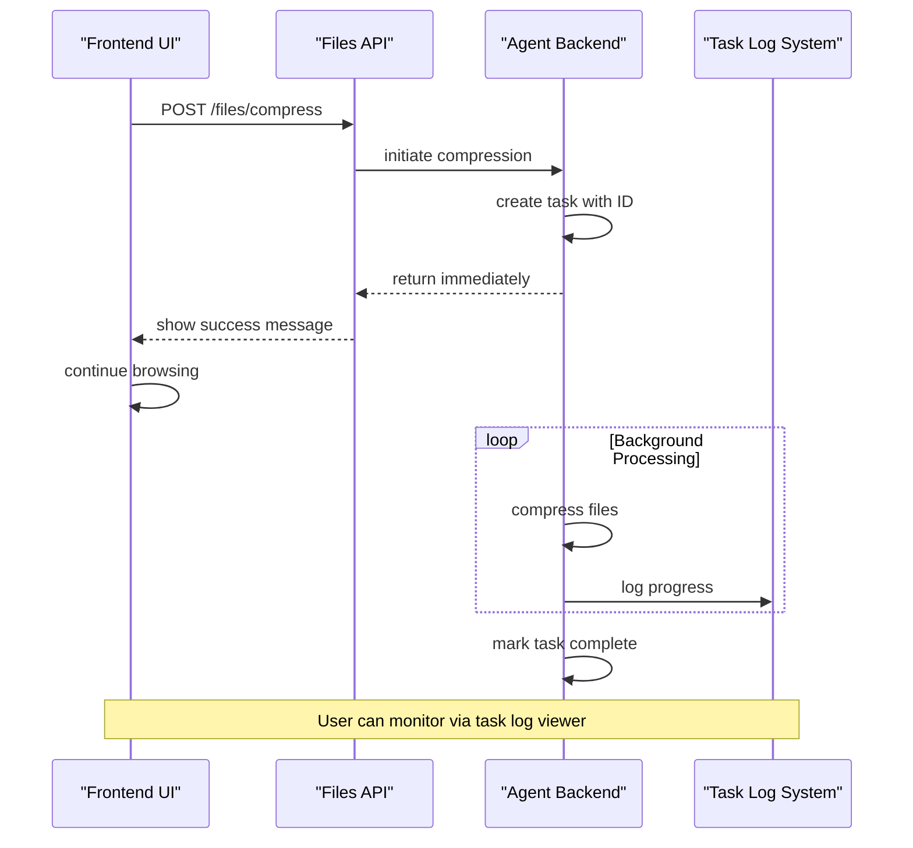

While the frontend file operations use extended timeouts, the backend typically implements asynchronous task processing for operations that may exceed reasonable HTTP timeout limits. Tasks are tracked through the system's general task logging mechanism, allowing users to monitor progress without blocking the UI.

**Sources:** [frontend/src/api/modules/files.ts:46-50](), [frontend/src/views/host/file-management/index.vue:851-869]()

---

