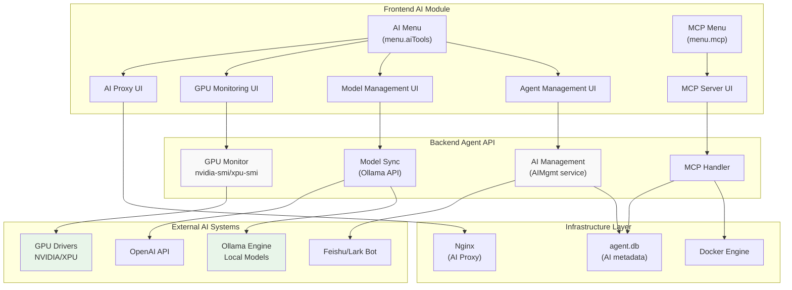
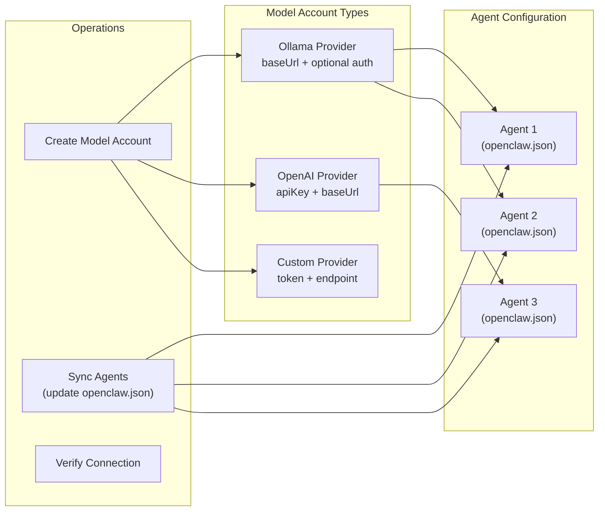
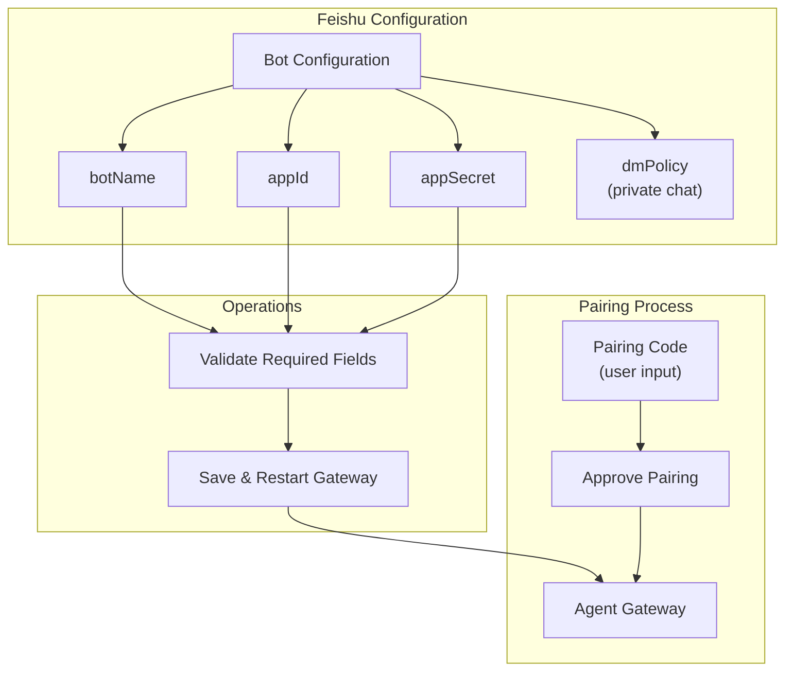
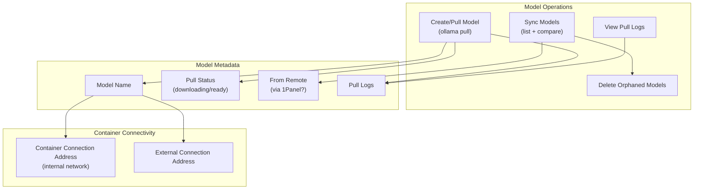
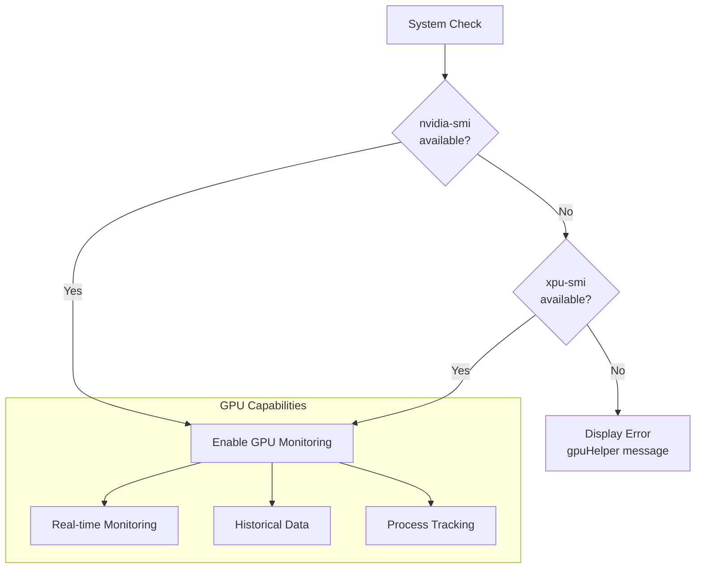
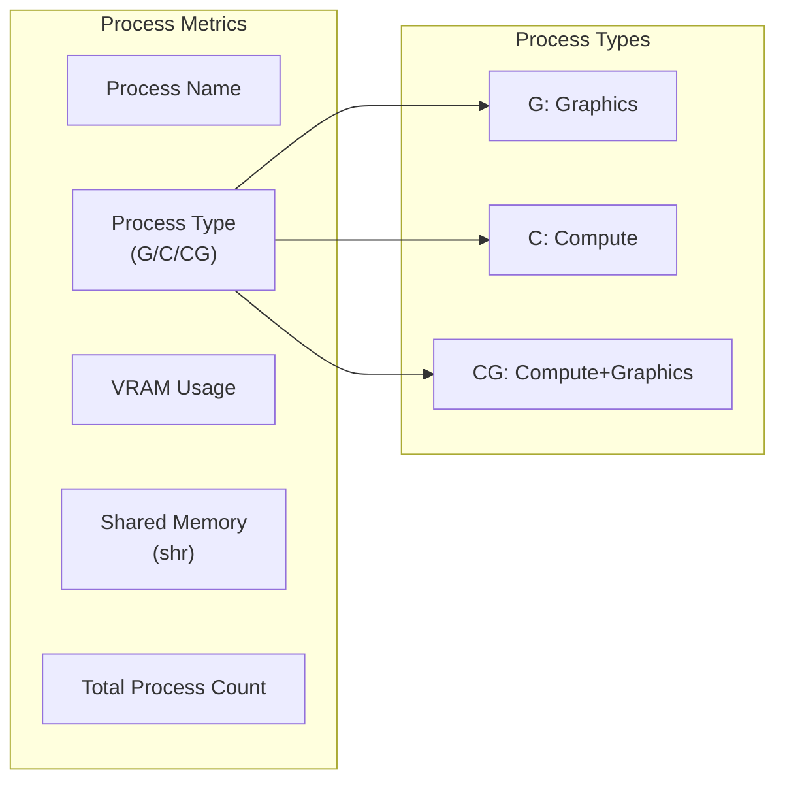
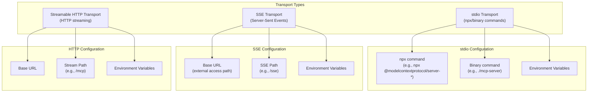
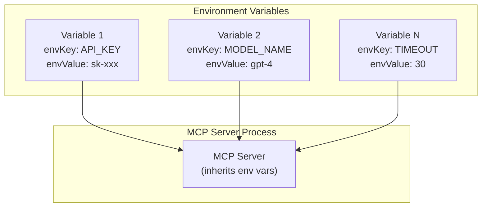
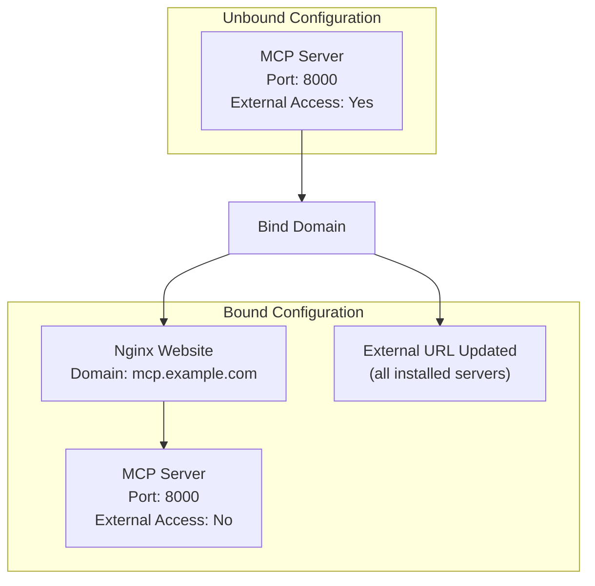
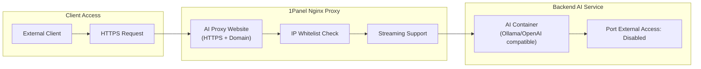

<!-- source: DeepWiki mcp.deepwiki.com · repo 1Panel-dev/1Panel · page 9 AI and ML Infrastructure · fetched 2026-10-29 -->

# AI and ML Infrastructure

<details>
<summary>Relevant source files</summary>

The following files were used as context for generating this wiki page:

- [frontend/src/lang/modules/en.ts](frontend/src/lang/modules/en.ts)
- [frontend/src/lang/modules/es-es.ts](frontend/src/lang/modules/es-es.ts)
- [frontend/src/lang/modules/ja.ts](frontend/src/lang/modules/ja.ts)
- [frontend/src/lang/modules/ko.ts](frontend/src/lang/modules/ko.ts)
- [frontend/src/lang/modules/ms.ts](frontend/src/lang/modules/ms.ts)
- [frontend/src/lang/modules/pt-br.ts](frontend/src/lang/modules/pt-br.ts)
- [frontend/src/lang/modules/ru.ts](frontend/src/lang/modules/ru.ts)
- [frontend/src/lang/modules/tr.ts](frontend/src/lang/modules/tr.ts)
- [frontend/src/lang/modules/zh-Hant.ts](frontend/src/lang/modules/zh-Hant.ts)
- [frontend/src/lang/modules/zh.ts](frontend/src/lang/modules/zh.ts)

</details>


## Purpose and Scope

This document describes 1Panel's AI and Machine Learning infrastructure capabilities, including AI agent deployment, model management (Ollama), GPU/XPU monitoring, MCP (Model Context Protocol) server management, and AI proxy configuration. This infrastructure enables users to deploy and manage AI workloads directly from the 1Panel interface.

For application installation workflow, see [App Installation and Deployment](#6.2). For container management operations, see [Container Management](#8.1). For website proxy configuration, see [Website Management System](#7).

---

## System Architecture

The AI infrastructure integrates with 1Panel's core systems to provide AI agent hosting, model lifecycle management, hardware monitoring, and protocol server deployment.



**AI Infrastructure Architecture**

Sources: [frontend/src/lang/modules/en.ts:386-387](), [frontend/src/lang/modules/zh.ts:373-374]()

---

## AI Agent Management

AI agents in 1Panel are containerized applications that integrate with model providers and chat platforms. Agents are configured with model accounts, which define the LLM backend (Ollama, OpenAI, etc.).

### Model Accounts and Providers

Model accounts store API credentials and connection information for various AI providers. Each account can be shared across multiple agents.



**Model Account and Agent Relationship**

Key configuration fields:

| Field | Description | Location |
|-------|-------------|----------|
| `provider` | Model provider name (Ollama, OpenAI, etc.) | Model account config |
| `apiKey` | API authentication key | Model account config |
| `baseUrl` | Provider endpoint URL | Model account config |
| `token` | Alternative authentication token | Model account config |
| `manualModel` | Manually specified model name | Agent config |
| `verified` | Connection verification status | Runtime state |

Sources: [frontend/src/lang/modules/zh.ts:655-689](), [frontend/src/lang/modules/en.ts:655-689]()

### Agent Lifecycle Operations

Agents support standard lifecycle operations through the 1Panel interface:

- **Create Agent**: Configure model account, ports (WebUI, Bridge), and version
- **Sync Agents**: Update `openclaw.json` files for all agents using a model account
- **Switch Model**: Change the active model for an agent
- **Restart Gateway**: Apply configuration changes

Port configuration:

| Port Type | Description | Default |
|-----------|-------------|---------|
| `webuiPort` | Web interface access port | User-defined |
| `bridgePort` | Internal bridge communication port | User-defined |

Sources: [frontend/src/lang/modules/zh.ts:656-666]()

### Chat Channel Integration

1Panel supports integrating AI agents with Feishu (Lark) chat platform for bot interactions.



**Feishu Bot Integration Flow**

Feishu integration fields:

| Field | Required | Description |
|-------|----------|-------------|
| `botName` | Yes | Bot display name in Feishu |
| `appId` | Yes | Feishu application ID |
| `appSecret` | Yes | Feishu application secret |
| `dmPolicy` | No | Private message handling policy |
| `pairingCode` | Yes | Pairing verification code |

Sources: [frontend/src/lang/modules/zh.ts:677-689]()

---

## Model Management

1Panel provides integrated management for Ollama models with operations for pulling, synchronizing, and monitoring model downloads.

### Ollama Integration

Ollama serves as the primary local model provider, allowing users to run LLMs without external API dependencies.



**Ollama Model Management Flow**

Model states and sources:

| State | Description | Location Reference |
|-------|-------------|-------------------|
| `downloading` | Model pull in progress | Frontend status |
| `ready` | Model available for use | Frontend status |
| `from_remote` | Model not installed via 1Panel | Metadata flag |
| `no_logs` | Pull logs deleted or unavailable | Log status |

Sources: [frontend/src/lang/modules/zh.ts:691-699](), [frontend/src/lang/modules/en.ts:691-699]()

### Model Pull and Synchronization

The model creation dialog supports pulling models from the Ollama registry:

1. User specifies model name (e.g., `llama2`, `mistral`)
2. Backend initiates `ollama pull {model_name}`
3. Pull progress logged to task system
4. Model becomes available at container connection address

**Sync Behavior**: When syncing Ollama models, 1Panel compares the Ollama engine's model list with 1Panel's database. If models exist in 1Panel but not in Ollama, the system prompts for deletion.

Sources: [frontend/src/lang/modules/zh.ts:693-699]()

### Connection Addresses

Models expose two connection types:

- **Container Connection Address**: Used by containers in the same Docker network to access Ollama
- **External Connection Address**: Used by external clients or the host system

Sources: [frontend/src/lang/modules/en.ts:696]()

---

## GPU and XPU Monitoring

1Panel provides real-time and historical monitoring for NVIDIA GPUs and Intel XPUs through command-line tool integration.

### Hardware Detection

The system detects GPU/XPU availability by checking for `nvidia-smi` or `xpu-smi` commands:



**GPU Detection Flow**

Error message when GPUs are not detected:
> "当前系统未检测到 NVIDIA-SMI 或者 XPU-SMI 指令，请检查后重试！"

Sources: [frontend/src/lang/modules/zh.ts:712-713]()

### Performance Metrics

The GPU monitoring interface displays comprehensive hardware metrics:

#### Core Metrics Table

| Metric | Description | Unit | Helper Text |
|--------|-------------|------|-------------|
| `gpuUtil` | GPU compute utilization | % | - |
| `temperature` | GPU die temperature | °C | "GPU 温度过高会导致 GPU 频率下降" |
| `performanceState` | Performance state (P0-P12) | P-state | "从 P0 (最大性能) 到 P12 (最小性能)" |
| `powerUsage` / `powerCurrent` | Current power draw | W | - |
| `powerLimit` | Maximum power limit | W | - |
| `memoryUsage` | VRAM utilization | % | - |
| `memoryUsed` | Used VRAM | GB | - |
| `memoryTotal` | Total VRAM | GB | - |
| `fanSpeed` | Fan rotation speed | % or RPM | - |

Sources: [frontend/src/lang/modules/zh.ts:723-735]()

#### Driver and System Information

| Field | Description |
|-------|-------------|
| `driverVersion` | GPU driver version |
| `cudaVersion` | CUDA toolkit version (NVIDIA) |
| `busID` | PCIe bus address |
| `persistenceMode` | Driver persistence mode (enabled/disabled) |
| `displayActive` | GPU initialized for display output (yes/no) |
| `ecc` | Error Correction Code status |
| `computeMode` | Compute mode (default/exclusive-process/exclusive-thread/prohibited) |
| `migMode` | Multi-Instance GPU mode (supported/not supported) |

**Persistence Mode**: When enabled, the GPU driver remains loaded even when no processes are using it, allowing faster task response times at the cost of increased idle power consumption.

Sources: [frontend/src/lang/modules/zh.ts:737-760]()

### Process Tracking

GPU monitoring includes per-process resource usage:



**GPU Process Information**

Process types indicate the GPU workload category:
- **G (Graphics)**: Rendering and display workloads
- **C (Compute)**: CUDA/OpenCL computational workloads
- **CG (Compute+Graphics)**: Hybrid workloads

Sources: [frontend/src/lang/modules/zh.ts:714-721]()

### Compute Mode Details

| Mode | Description | Use Case |
|------|-------------|----------|
| `default` | Multiple processes can execute concurrently | General purpose |
| `exclusiveProcess` | Only one CUDA context can use the GPU, shared by multiple threads | High-performance single-app scenarios |
| `exclusiveThread` | Only one thread in a CUDA context can use the GPU | Maximum isolation |
| `prohibited` | GPU compute is disabled | Troubleshooting |

Sources: [frontend/src/lang/modules/zh.ts:751-759]()

### Historical Monitoring

The GPU interface provides two views:

- **Real-time Monitoring** (`current`): Live metrics updated at polling intervals
- **Historical Records** (`history`): Time-series data for trend analysis

If certain metrics are unavailable, the interface displays: "当前版本或驱动不支持显示该参数。"

Sources: [frontend/src/lang/modules/zh.ts:762-764]()

---

## MCP Server Management

1Panel supports deploying MCP (Model Context Protocol) servers, enabling AI agents to access external tools and data sources through a standardized protocol.

### Transport Mechanisms

MCP servers support three transport types:



**MCP Transport Configuration Options**

Transport-specific fields:

| Transport | Required Fields | Description |
|-----------|----------------|-------------|
| `stdio` | `command` | Executes npx or binary commands directly |
| `SSE` | `baseUrl`, `ssePath` | Server-Sent Events endpoint |
| `streamableHttp` | `baseUrl`, `streamableHttpPath` | HTTP streaming endpoint |

**Path Uniqueness**: SSE paths and HTTP stream paths must not conflict with other MCP servers on the same host.

Sources: [frontend/src/lang/modules/zh.ts:767-790]()

### Environment Configuration

MCP servers can be configured with environment variables for secrets, API keys, and configuration:



**MCP Environment Variable Configuration**

Sources: [frontend/src/lang/modules/zh.ts:774-776]()

### Domain Binding and External Access

MCP servers can be bound to a website configuration for enhanced security:



**MCP Domain Binding Flow**

When binding a domain:
1. Creates/uses Nginx website configuration
2. Updates `externalUrl` for all installed MCP servers
3. Disables direct port external access for enhanced security
4. MCP servers become accessible via `https://domain.com/sse` or `https://domain.com/mcp`

Domain configuration:
- **domain**: Default access address (IP or domain, e.g., `192.168.1.1` or `example.com`)
- **bindDomain**: Target website for binding
- **bindDomainHelper**: Warning that binding updates all installed MCP servers and closes port external access

Sources: [frontend/src/lang/modules/zh.ts:779-785]()

### MCP Server Import

MCP servers can be imported from a configuration file:

```json
{
  "mcpServers": {
    "server-name": {
      "command": "npx",
      "args": ["@modelcontextprotocol/server-example"],
      "env": {
        "API_KEY": "value"
      }
    }
  }
}
```

**Error Handling**: If the `mcpServers` structure is incorrect, the import displays: "mcpServers 结构不正确"

Sources: [frontend/src/lang/modules/zh.ts:783-784]()

### Transport Command Examples

Transport-specific command helpers:

- **npx/binary**: "当前仅支持 npx 和 二进制启动的命令"
- **npx**: "适合 npx 或者 二进制启动的 mcp"
- **uvx**: "适合 uvx 启动的 mcp"

Sources: [frontend/src/lang/modules/zh.ts:782,789-790]()

---

## AI Proxy Enhancement

1Panel provides AI proxy configuration to enhance security and performance of AI services running in containers.

### Proxy Architecture



**AI Proxy Architecture**

Sources: [frontend/src/lang/modules/zh.ts:701-710]()

### Security Features

The AI proxy configuration provides multiple security enhancements:

| Feature | Description | Implementation |
|---------|-------------|----------------|
| **HTTPS Binding** | Encrypts traffic between clients and proxy | Binds domain with SSL certificate |
| **IP Whitelisting** | Restricts access to authorized IPs only | `whiteListHelper`: Only whitelisted IPs can access |
| **Port Closure** | Disables direct container port access | Close external access in app parameters |
| **Domain Binding** | Access via domain instead of IP:port | Creates Nginx website configuration |

Sources: [frontend/src/lang/modules/zh.ts:703-704,709]()

### Proxy Configuration Steps

1. **Create AI Proxy**: Configure domain and HTTPS binding
2. **Enable Streaming**: Support for streaming API responses (proxyHelper3)
3. **Manage in Website List**: View and manage proxy in website list (proxyHelper4)
4. **Close Container Port**: Disable port external access in App Store > Installed > ollama > Parameters (proxyHelper5)
5. **Delete Proxy**: Remove proxy by deleting website configuration (proxyHelper6)

Sources: [frontend/src/lang/modules/zh.ts:703-708]()

### Streaming Support

The proxy explicitly supports streaming responses, critical for real-time AI interactions where token-by-token generation provides better user experience.

Sources: [frontend/src/lang/modules/zh.ts:705]()

---

## TensorRT LLM Support

1Panel provides infrastructure for deploying TensorRT-optimized language models.

### Configuration

| Field | Description |
|-------|-------------|
| `modelDir` | Directory containing TensorRT model files |
| `commandHelper` | Port configuration for external access |
| `imageAlert` | Warning about large image size |
| `modelSpeedup` | Enable TensorRT model acceleration |
| `modelType` | Type of model being deployed |

**Image Size Warning**: Due to the large size of TensorRT images, 1Panel recommends manually downloading images to the server before installation.

Sources: [frontend/src/lang/modules/zh.ts:792-799]()

### Command Configuration

For external access, the command port must match the application's exposed port to ensure proper routing through 1Panel's network configuration.

Sources: [frontend/src/lang/modules/zh.ts:795]()

---

## Integration with Other Systems

### Application Store Integration

AI components (Ollama, TensorRT LLM, AI agents) are installed through the App Store system:
- Deployed as Docker Compose applications
- Managed via [App Installation and Deployment](#6.2) workflow
- Configuration updates trigger container rebuilds

### Container Network Integration

AI services leverage 1Panel's container networking:
- Internal container-to-container communication via service names
- External access controlled through port mappings
- Network isolation via Docker networks

See [Container Management](#8.1) for details on Docker networking.

### Website Management Integration

AI proxy configurations are implemented as Nginx websites:
- SSL certificate management
- Domain binding and routing
- Access control via IP whitelisting

See [Website Management System](#7) for Nginx configuration details.

---

## Menu Navigation

The AI features are accessible through two main menu items:

| Menu Item | i18n Key | Purpose |
|-----------|----------|---------|
| AI | `menu.aiTools` | Agent management, models, GPU monitoring, proxy |
| MCP | `menu.mcp` | MCP server deployment and configuration |

Sources: [frontend/src/lang/modules/zh.ts:373-374](), [frontend/src/lang/modules/en.ts:386-387]()

---

