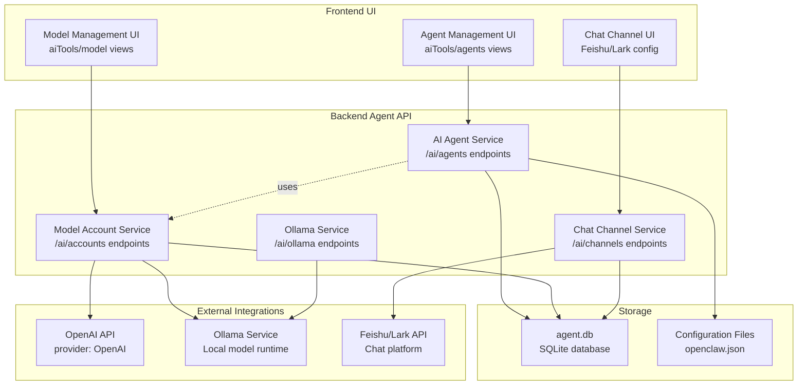
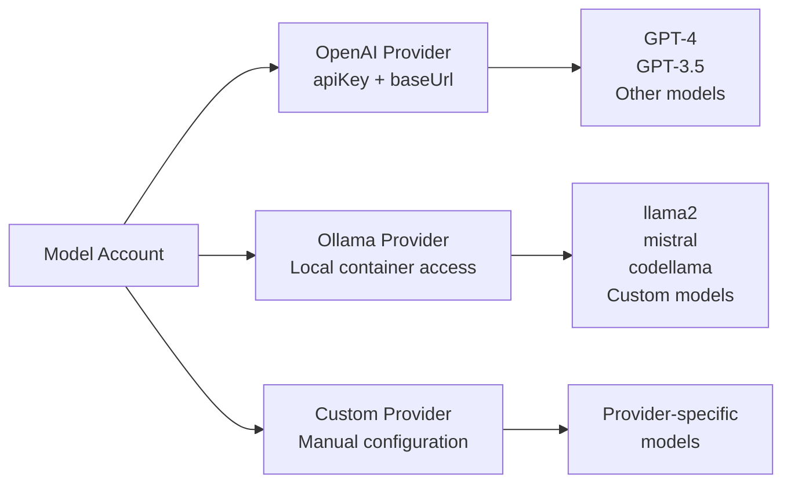
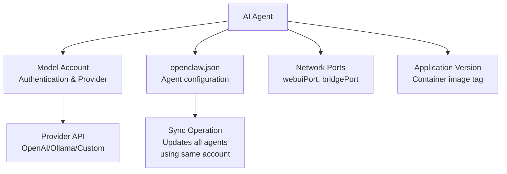
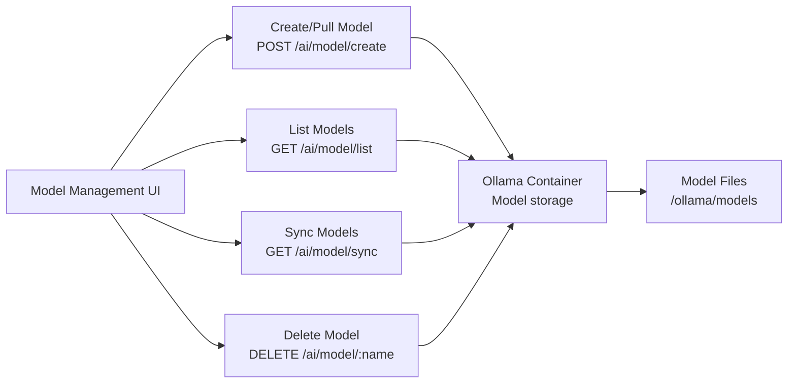
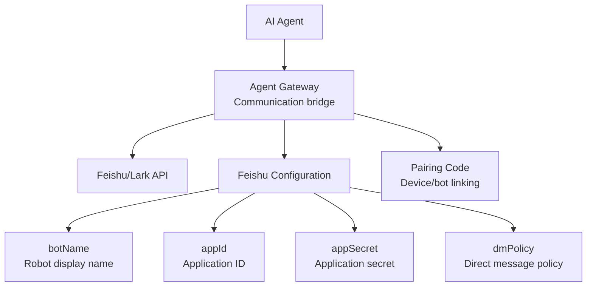
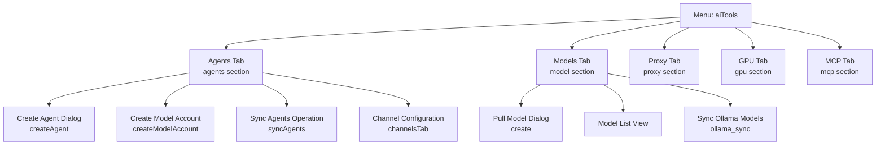
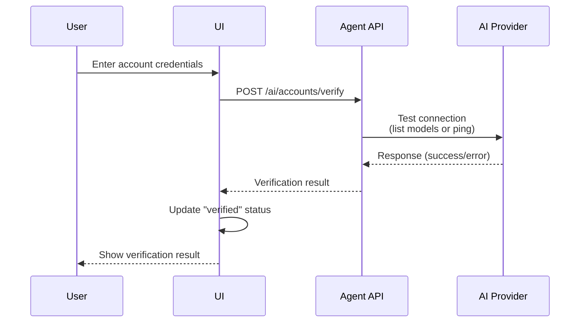
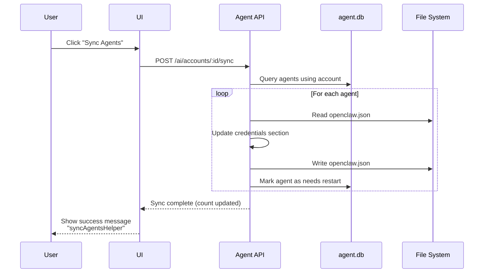
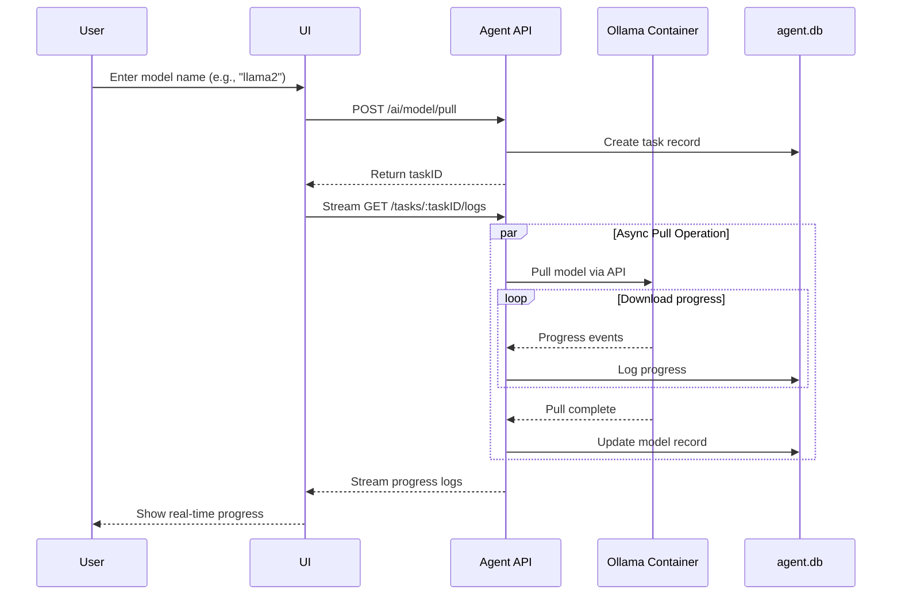

<!-- source: DeepWiki mcp.deepwiki.com · repo 1Panel-dev/1Panel · page 9.1 AI Agents and Model Management · fetched 2026-10-29 -->

# AI Agents and Model Management

<details>
<summary>Relevant source files</summary>

The following files were used as context for generating this wiki page:

- [frontend/src/lang/modules/en.ts](frontend/src/lang/modules/en.ts)
- [frontend/src/lang/modules/es-es.ts](frontend/src/lang/modules/es-es.ts)
- [frontend/src/lang/modules/ja.ts](frontend/src/lang/modules/ja.ts)
- [frontend/src/lang/modules/ko.ts](frontend/src/lang/modules/ko.ts)
- [frontend/src/lang/modules/ms.ts](frontend/src/lang/modules/ms.ts)
- [frontend/src/lang/modules/pt-br.ts](frontend/src/lang/modules/pt-br.ts)
- [frontend/src/lang/modules/ru.ts](frontend/src/lang/modules/ru.ts)
- [frontend/src/lang/modules/tr.ts](frontend/src/lang/modules/tr.ts)
- [frontend/src/lang/modules/zh-Hant.ts](frontend/src/lang/modules/zh-Hant.ts)
- [frontend/src/lang/modules/zh.ts](frontend/src/lang/modules/zh.ts)

</details>


## Purpose and Scope

This document covers 1Panel's AI infrastructure management capabilities, specifically focusing on AI agent creation, model account configuration, and integration with AI model providers. The system enables deployment and management of AI agents that can be connected to chat platforms like Feishu/Lark.

For GPU monitoring and hardware resource tracking, see [GPU Monitoring and XPU Support](#9.2). For MCP (Model Context Protocol) server management, see [MCP Server Management](#9.3). For AI proxy configuration and load balancing, see [AI Proxy Enhancement](#9.4).

---

## System Architecture Overview

The AI agent management system integrates with 1Panel's application ecosystem and provides a layer for connecting AI models with external chat platforms.



**Sources:** [frontend/src/lang/modules/zh.ts:654-700](), [frontend/src/lang/modules/en.ts:654-700]()

---

## Model Account Configuration

Model accounts represent connections to AI model providers. Each account stores authentication credentials and configuration for accessing models from providers like OpenAI, Ollama, or other compatible services.

### Account Structure

| Field | Description | Example |
|-------|-------------|---------|
| `provider` | Model provider identifier | `OpenAI`, `Ollama`, custom providers |
| `apiKey` | API authentication key | Required for OpenAI and similar services |
| `baseUrl` | Base URL for API endpoint | `https://api.openai.com/v1` |
| `token` | Alternative authentication token | Used by some providers |
| `verified` | Account verification status | Boolean indicating successful connection test |

### Supported Providers



### Model Account Workflow

1. **Create Account**: User provides provider type and credentials
2. **Verification**: System tests connection to provider API
3. **Model Selection**: User can manually specify model name or select from available models
4. **Agent Association**: Accounts are linked to one or more AI agents

**Sources:** [frontend/src/lang/modules/zh.ts:656-675](), [frontend/src/lang/modules/en.ts:659-677]()

---

## AI Agent Management

AI agents are intelligent entities that use model accounts to interact with users through chat platforms. Each agent has its own configuration stored in `openclaw.json`.

### Agent Components



### Key Configuration Fields

| Field | Purpose | Notes |
|-------|---------|-------|
| `account` | Associated model account | Reference to model account ID |
| `appVersion` | Application version | Container image version for agent runtime |
| `webuiPort` | Web UI port | Port for agent web interface |
| `bridgePort` | Bridge port | Internal communication port |

### Agent Synchronization

The system provides a `syncAgents` operation that updates the `openclaw.json` configuration file for all agents associated with a specific model account. This ensures consistency when account credentials or settings change.

**Operation Flow:**
1. User updates model account credentials
2. System identifies all agents using that account
3. `openclaw.json` files are regenerated for affected agents
4. Agent containers may need restart to apply changes

**Sources:** [frontend/src/lang/modules/zh.ts:656-690](), [frontend/src/lang/modules/en.ts:659-690]()

---

## Ollama Integration

1Panel provides deep integration with Ollama for managing local AI models. Ollama runs as a containerized service and provides a model management interface.

### Model Management Operations



### Container Connection

Models running in Ollama containers can be accessed by other containers in the same Docker network:

- **Container-to-container access**: Uses service name (e.g., `ollama:11434`)
- **External access**: Exposed port on host (e.g., `localhost:11434`)
- **1Panel integration**: Tracks pull logs and model metadata

### Model Discovery and Sync

The system maintains a catalog of installed Ollama models in `agent.db`. The sync operation:
1. Queries Ollama API for installed models
2. Compares with 1Panel's database records
3. Identifies orphaned records (models deleted outside 1Panel)
4. Prompts user to clean up stale entries

**Ollama Model Metadata:**
- Model name (e.g., `llama2:latest`)
- Pull logs and download progress
- Origin tracking (downloaded via 1Panel vs. external)

**Sources:** [frontend/src/lang/modules/zh.ts:691-700](), [frontend/src/lang/modules/en.ts:692-700]()

---

## Chat Channel Integration

AI agents can be connected to chat platforms to enable conversational interfaces. The primary supported platform is Feishu (also known as Lark).

### Feishu/Lark Configuration



### Configuration Fields

| Field | Required | Purpose |
|-------|----------|---------|
| `botName` | Yes | Display name for the bot in Feishu |
| `appId` | Yes | Feishu application ID from developer portal |
| `appSecret` | Yes | Authentication secret for Feishu API |
| `dmPolicy` | No | Policy for handling direct messages |
| `pairingCode` | Optional | Code for device/bot pairing approval |

### Channel Workflow

1. **Configure Feishu Bot**: Create bot in Feishu developer portal, obtain `appId` and `appSecret`
2. **Link to Agent**: Enter credentials in 1Panel channel configuration
3. **Save and Restart Gateway**: Gateway service restarts to establish connection
4. **Pairing Approval**: If pairing code is provided, approve the pairing to activate bot
5. **Chat Interface Active**: Bot becomes available in Feishu for user interactions

### Gateway Restart Requirement

Changes to chat channel configuration require restarting the agent gateway service to establish new connections. The UI provides a "Save and Restart Gateway" button that combines these operations.

**Sources:** [frontend/src/lang/modules/zh.ts:676-690](), [frontend/src/lang/modules/en.ts:676-690]()

---

## Configuration File Structure

### openclaw.json

The `openclaw.json` file stores agent configuration in JSON format. This file is generated and maintained by 1Panel but can be manually edited if needed.

**Location Pattern**: `/opt/1panel/apps/[agent-name]/data/openclaw.json` (or similar, depending on installation)

**Key Sections:**
```json
{
  "model": {
    "provider": "OpenAI",
    "apiKey": "sk-...",
    "baseUrl": "https://api.openai.com/v1",
    "model": "gpt-4"
  },
  "ports": {
    "webui": 8080,
    "bridge": 8081
  },
  "channels": {
    "feishu": {
      "enabled": true,
      "botName": "Assistant",
      "appId": "cli_...",
      "appSecret": "..."
    }
  }
}
```

### Synchronization Operations

When performing `syncAgents`, the system:
1. Reads current model account configuration from database
2. Identifies all agents using that account (query `agent.db`)
3. For each agent:
   - Generates updated `openclaw.json` with new credentials
   - Writes file to agent's data directory
   - Marks agent as requiring restart

**Sources:** [frontend/src/lang/modules/zh.ts:663-665]()

---

## Frontend UI Components

### Agent Management Views

The frontend provides dedicated views for managing AI infrastructure:



### Translation Keys

The UI uses i18n translation keys organized under `aiTools`:

- **Agent operations**: `aiTools.agents.createAgent`, `aiTools.agents.syncAgents`
- **Model account**: `aiTools.agents.createModelAccount`, `aiTools.agents.account`
- **Model management**: `aiTools.model.create`, `aiTools.model.ollama_sync`
- **Channel config**: `aiTools.agents.channelsTab`, `aiTools.agents.feishu`

**Sources:** [frontend/src/lang/modules/zh.ts:654-800](), [frontend/src/lang/modules/en.ts:654-800]()

---

## API Integration Patterns

### Model Account Verification

When creating or updating a model account, the system performs verification:



### Agent Synchronization

The sync operation ensures all agents using a model account have up-to-date configuration:



### Ollama Model Pull

Pulling an Ollama model is an asynchronous operation with progress tracking:



**Sources:** Based on patterns from [frontend/src/lang/modules/zh.ts:691-700]() and async task patterns from Diagram 3 in high-level architecture

---

## Usage Examples

### Creating an AI Agent

1. **Create Model Account**:
   - Navigate to AI → Agents
   - Click "Create Model Account" (`createModelAccount`)
   - Select provider: OpenAI, Ollama, or custom
   - Enter credentials (API key, base URL)
   - System verifies connection

2. **Create Agent**:
   - Click "Create Agent" (`createAgent`)
   - Select model account from dropdown
   - Configure ports (WebUI port, Bridge port)
   - Set application version
   - System generates `openclaw.json`

3. **Configure Chat Channel** (Optional):
   - Switch to "Chat Channels" tab (`channelsTab`)
   - Select Feishu/Lark
   - Enter bot name, app ID, app secret
   - Click "Save and Restart Gateway" (`saveAndRestartGateway`)
   - Approve pairing if required

### Managing Ollama Models

1. **Pull New Model**:
   - Navigate to AI → Models
   - Click "Add Model" (`create`)
   - Enter model name (e.g., `mistral:latest`)
   - Monitor pull progress in task logs
   - Model becomes available for agent use

2. **Sync Models**:
   - Click sync button to reconcile database with Ollama
   - Review models not installed via 1Panel
   - Clean up orphaned database entries if prompted

3. **Container Access**:
   - Use container connection address for intra-container access
   - Displayed as `ollama:11434` or similar service name
   - No external network exposure required

**Sources:** [frontend/src/lang/modules/zh.ts:654-700](), [frontend/src/lang/modules/en.ts:654-700]()

---

## Error Handling and Validation

### Account Validation

The system validates model account configuration before allowing agent creation:

- **Required fields**: Provider must have all required credentials (`feishuRequired` check)
- **Connection test**: Verification must succeed before account is marked as `verified`
- **Manual model input**: Allows specifying models not in provider's default list

### Common Error Scenarios

| Scenario | Error Message Key | Resolution |
|----------|------------------|------------|
| Missing Feishu credentials | `feishuRequired` | Fill in botName, appId, and appSecret |
| Invalid pairing code | `pairingCodeRequired` | Enter valid code from Feishu |
| Ollama model not found | Model deleted externally | Use sync operation to clean up records |
| Gateway restart needed | Config changes pending | Click "Save and Restart Gateway" |

### Synchronization Conflicts

When syncing agents, the system handles:
- **Account deleted**: Agents become orphaned, user must reassign or delete
- **Model unavailable**: Warns if configured model no longer exists in provider
- **File permission issues**: Logs error if cannot write `openclaw.json`

**Sources:** [frontend/src/lang/modules/zh.ts:685-690](), [frontend/src/lang/modules/en.ts:685-690]()

---

