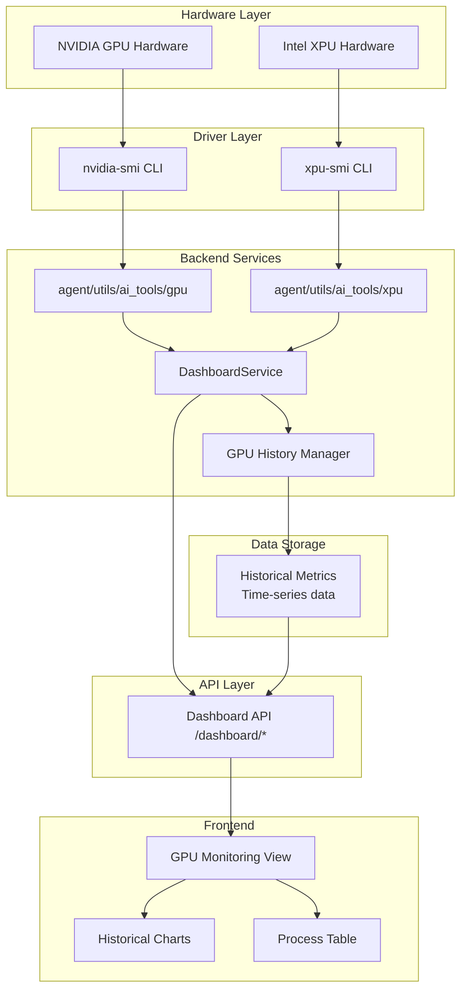
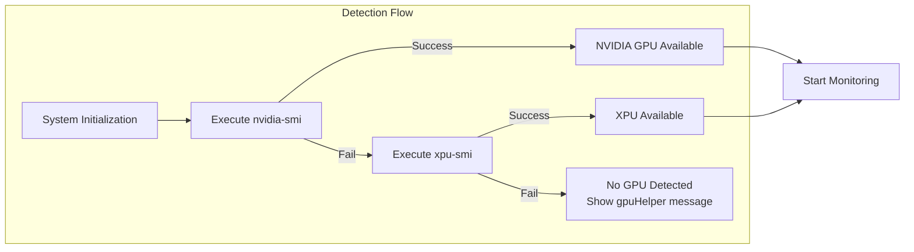
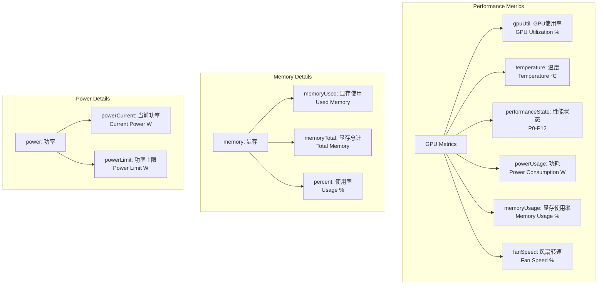
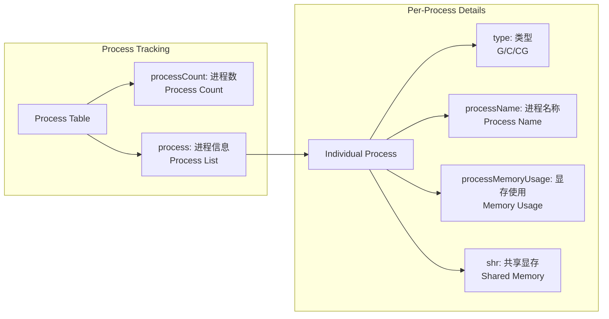
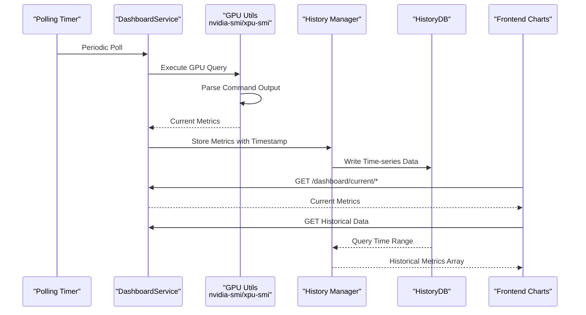
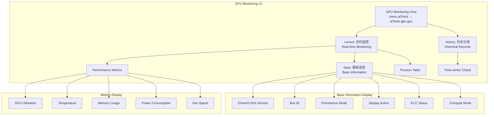
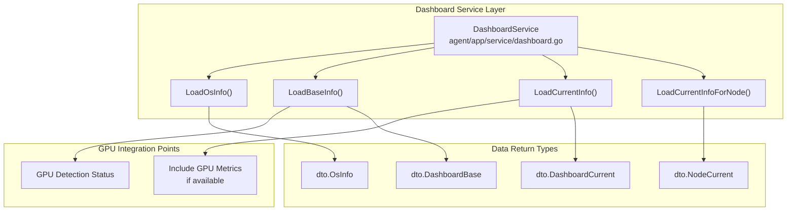

<!-- source: DeepWiki mcp.deepwiki.com · repo 1Panel-dev/1Panel · page 9.2 GPU Monitoring and XPU Support · fetched 2026-10-29 -->

# GPU Monitoring and XPU Support

<details>
<summary>Relevant source files</summary>

The following files were used as context for generating this wiki page:

- [agent/app/api/v2/dashboard.go](agent/app/api/v2/dashboard.go)
- [agent/app/dto/dashboard.go](agent/app/dto/dashboard.go)
- [agent/app/model/app_launcher.go](agent/app/model/app_launcher.go)
- [agent/app/repo/app_launcher.go](agent/app/repo/app_launcher.go)
- [agent/app/service/dashboard.go](agent/app/service/dashboard.go)
- [agent/router/ro_dashboard.go](agent/router/ro_dashboard.go)
- [frontend/src/api/interface/dashboard.ts](frontend/src/api/interface/dashboard.ts)
- [frontend/src/api/modules/dashboard.ts](frontend/src/api/modules/dashboard.ts)
- [frontend/src/lang/modules/en.ts](frontend/src/lang/modules/en.ts)
- [frontend/src/lang/modules/es-es.ts](frontend/src/lang/modules/es-es.ts)
- [frontend/src/lang/modules/ja.ts](frontend/src/lang/modules/ja.ts)
- [frontend/src/lang/modules/ko.ts](frontend/src/lang/modules/ko.ts)
- [frontend/src/lang/modules/ms.ts](frontend/src/lang/modules/ms.ts)
- [frontend/src/lang/modules/pt-br.ts](frontend/src/lang/modules/pt-br.ts)
- [frontend/src/lang/modules/ru.ts](frontend/src/lang/modules/ru.ts)
- [frontend/src/lang/modules/tr.ts](frontend/src/lang/modules/tr.ts)
- [frontend/src/lang/modules/zh-Hant.ts](frontend/src/lang/modules/zh-Hant.ts)
- [frontend/src/lang/modules/zh.ts](frontend/src/lang/modules/zh.ts)
- [frontend/src/views/home/app/index.vue](frontend/src/views/home/app/index.vue)
- [frontend/src/views/home/index.vue](frontend/src/views/home/index.vue)
- [frontend/src/views/home/status/index.vue](frontend/src/views/home/status/index.vue)

</details>


## Purpose and Scope

This page documents 1Panel's GPU and XPU (Intel accelerator) monitoring capabilities. The system provides real-time and historical monitoring of GPU hardware metrics, process tracking, and performance statistics through integration with `nvidia-smi` and `xpu-smi` command-line tools. This functionality enables users to monitor AI/ML workloads running on GPU-accelerated hardware.

For information about AI agent management and model operations, see [AI Agents and Model Management](#9.1). For MCP protocol server management, see [MCP Server Management](#9.3).

## System Architecture

The GPU monitoring subsystem integrates with hardware drivers through command-line utilities and exposes metrics through a dashboard interface with both real-time and historical views.



**Diagram: GPU Monitoring System Architecture**

Sources: [agent/app/service/dashboard.go:21-22](), [frontend/src/lang/modules/zh.ts:711-765]()

## Driver Integration

### Detection and Command Execution

The system detects GPU availability by attempting to execute `nvidia-smi` or `xpu-smi` commands. If neither command is available, the frontend displays a helper message indicating no GPU hardware or drivers are detected.



**Diagram: GPU Detection Flow**

The detection message is defined in the language files as:
- Chinese: "当前系统未检测到 NVIDIA-SMI 或者 XPU-SMI 指令，请检查后重试！"
- English: "The current system has not detected NVIDIA-SMI or XPU-SMI instructions, please check and try again!"

Sources: [frontend/src/lang/modules/zh.ts:713](), [frontend/src/lang/modules/en.ts:629]()

## Monitored Metrics

### Base GPU Information

The system tracks fundamental GPU hardware properties:

| Metric | Translation Key | Description |
|--------|-----------------|-------------|
| Driver Version | `driverVersion` | GPU driver version |
| CUDA Version | `cudaVersion` | CUDA toolkit version (NVIDIA only) |
| Bus ID | `busID` | PCIe bus identifier |
| Persistence Mode | `persistenceMode` | Driver persistence state |
| Display Active | `displayActive` | Display initialization status |
| ECC | `ecc` | Error Checking and Correction status |
| Compute Mode | `computeMode` | GPU compute mode setting |

Sources: [frontend/src/lang/modules/zh.ts:737-759]()

### Real-Time Performance Metrics



**Diagram: GPU Performance Metrics Structure**

Temperature monitoring includes a helper message: "GPU 温度过高会导致 GPU 频率下降" (High GPU temperature will cause GPU frequency to decrease).

Sources: [frontend/src/lang/modules/zh.ts:722-735]()

### Compute Modes

The system displays four compute mode configurations:

| Mode | Translation Key | Description |
|------|-----------------|-------------|
| Default | `default` | Multiple processes can execute concurrently |
| Exclusive Process | `exclusiveProcess` | Only one CUDA context, shared by multiple threads |
| Exclusive Thread | `exclusiveThread` | Only one thread can use GPU in CUDA context |
| Prohibited | `prohibited` | No processes allowed to execute simultaneously |

Each mode includes a helper key (`defaultHelper`, `exclusiveProcessHelper`, etc.) explaining the behavior.

Sources: [frontend/src/lang/modules/zh.ts:751-759]()

## Process Monitoring

### Process Information Structure

The GPU monitoring system tracks GPU processes with detailed resource usage:



**Diagram: Process Tracking Data Structure**

### Process Types

GPU processes are categorized by their usage pattern:

- **G (Graphics)**: Graphics rendering processes (`typeG`)
- **C (Compute)**: Compute-only processes (`typeC`)
- **CG (Compute+Graphics)**: Combined compute and graphics processes (`typeCG`)

Sources: [frontend/src/lang/modules/zh.ts:714-721]()

## Historical Monitoring

The system maintains historical GPU metrics for trend analysis and capacity planning.

### Data Collection Flow



**Diagram: Historical Data Collection and Retrieval**

The historical view provides access to past GPU performance data through the `history` tab key in the language files.

Sources: [agent/app/service/dashboard.go:1-56](), [frontend/src/lang/modules/zh.ts:762-763]()

## API Endpoints

### Dashboard Integration

GPU metrics are exposed through the dashboard API endpoints:

| Endpoint | Method | Purpose |
|----------|--------|---------|
| `/dashboard/base/os` | GET | Load OS information including GPU detection |
| `/dashboard/current/:ioOption/:netOption` | GET | Load current system metrics including GPU |
| `/dashboard/base/:ioOption/:netOption` | GET | Load base dashboard information |

Sources: [agent/router/ro_dashboard.go:14-22](), [agent/app/api/v2/dashboard.go:18-25]()

### Data Structures

The dashboard service utilizes dedicated GPU utility packages:

```go
import (
    "github.com/1Panel-dev/1Panel/agent/utils/ai_tools/gpu"
    "github.com/1Panel-dev/1Panel/agent/utils/ai_tools/xpu"
)
```

These utilities parse command-line output from `nvidia-smi` and `xpu-smi` to extract structured metrics.

Sources: [agent/app/service/dashboard.go:21-22]()

## Frontend Components

### GPU Monitoring View Structure

The frontend organizes GPU monitoring into tabbed sections:



**Diagram: Frontend Component Structure**

Sources: [frontend/src/lang/modules/zh.ts:711-765]()

### Localization Keys

The GPU monitoring interface is fully internationalized with translation keys under the `aiTools.gpu` namespace:

- **Main labels**: `gpu`, `gpuHelper`, `process`, `processCount`, `type`, `processName`
- **Metric labels**: `temperatureHelper`, `gpuUtil`, `temperature`, `performanceState`, `powerUsage`, `memoryUsage`, `fanSpeed`
- **Memory details**: `power`, `powerCurrent`, `powerLimit`, `memory`, `memoryUsed`, `memoryTotal`, `percent`
- **Base info**: `base`, `driverVersion`, `cudaVersion`, `busID`, `persistenceMode`, etc.
- **Status indicators**: `enabled`, `disabled`, `notSupport`
- **Views**: `current`, `history`

Sources: [frontend/src/lang/modules/zh.ts:711-765](), [frontend/src/lang/modules/en.ts:629-665]()

## Special Features

### Performance State (P-States)

NVIDIA GPUs report performance states from P0 (maximum performance) to P12 (minimum performance). The system displays this with a helper message explaining the scale.

**Performance State Helper**: "从 P0 (最大性能) 到 P12 (最小性能)" / "From P0 (maximum performance) to P12 (minimum performance)"

Sources: [frontend/src/lang/modules/zh.ts:741]()

### Persistence Mode

Persistence mode affects GPU responsiveness and power consumption:

**Persistence Mode Helper**: "持续模式能更加快速地响应任务，但相应待机功耗也会增加" / "Persistence mode enables faster task response, but increases idle power consumption accordingly"

Sources: [frontend/src/lang/modules/zh.ts:746]()

### MIG Mode Detection

For supported NVIDIA GPUs, the system detects Multi-Instance GPU (MIG) mode:

**MIG Mode Helper**: "用于创建 MIG 实例，在用户层实现 GPU 的物理隔离" / "Used to create MIG instances, implementing physical isolation of GPU at the user layer"

When MIG is not supported, the system displays `migModeNA: '不支持'` (Not Supported).

Sources: [frontend/src/lang/modules/zh.ts:760-761]()

### Temperature Warnings

The system provides contextual warnings for high GPU temperatures with the helper text explaining that excessive temperature causes GPU frequency throttling.

Sources: [frontend/src/lang/modules/zh.ts:722]()

## Integration with Dashboard

GPU metrics integrate into the main dashboard system through the `DashboardService`:



**Diagram: Dashboard Service Integration**

The dashboard service coordinates GPU monitoring with other system metrics (CPU, memory, network, disk) to provide a unified monitoring interface.

Sources: [agent/app/service/dashboard.go:35-52](), [agent/app/dto/dashboard.go:5-25]()

## Error Handling

When GPU hardware or drivers are not detected, the system gracefully handles the absence:

1. **Detection Phase**: Attempts to execute `nvidia-smi` or `xpu-smi`
2. **Failure Response**: Returns empty GPU data structures
3. **Frontend Display**: Shows helper message via `gpuHelper` translation key
4. **User Guidance**: Prompts user to verify GPU hardware and driver installation

This ensures the system remains functional even without GPU hardware, making GPU monitoring an optional enhancement rather than a required component.

Sources: [frontend/src/lang/modules/zh.ts:713](), [frontend/src/lang/modules/en.ts:629]()

---

