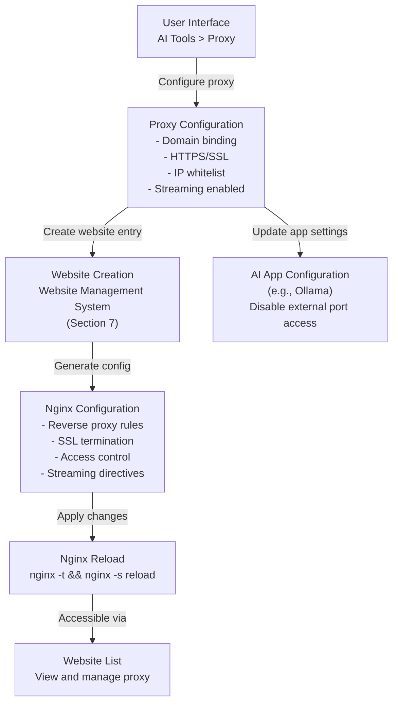
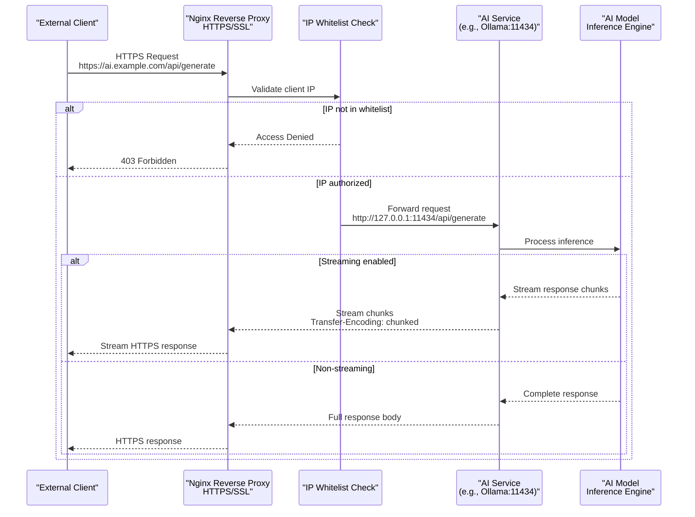
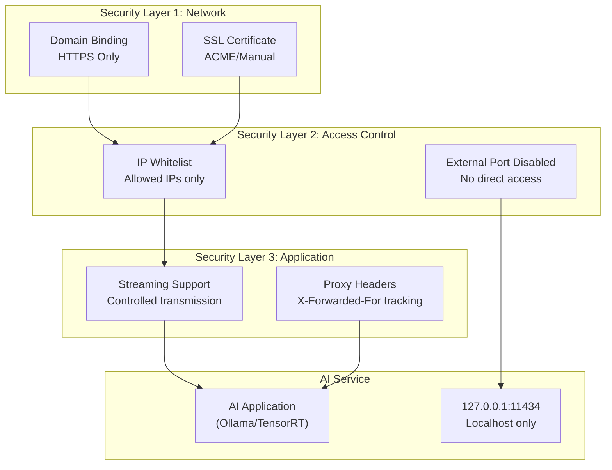
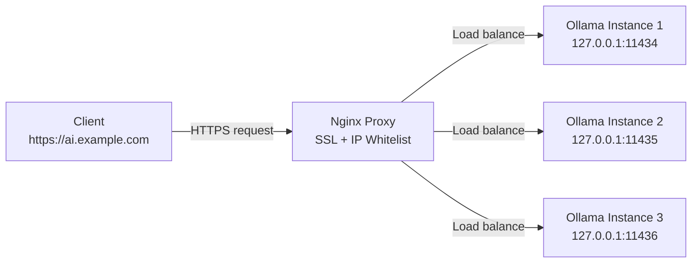
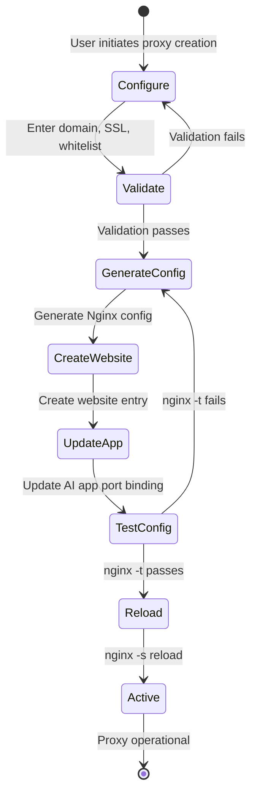

<!-- source: DeepWiki mcp.deepwiki.com · repo 1Panel-dev/1Panel · page 9.4 AI Proxy Enhancement · fetched 2026-10-29 -->

# AI Proxy Enhancement

<details>
<summary>Relevant source files</summary>

The following files were used as context for generating this wiki page:

- [frontend/src/lang/modules/en.ts](frontend/src/lang/modules/en.ts)
- [frontend/src/lang/modules/es-es.ts](frontend/src/lang/modules/es-es.ts)
- [frontend/src/lang/modules/ja.ts](frontend/src/lang/modules/ja.ts)
- [frontend/src/lang/modules/ko.ts](frontend/src/lang/modules/ko.ts)
- [frontend/src/lang/modules/ms.ts](frontend/src/lang/modules/ms.ts)
- [frontend/src/lang/modules/pt-br.ts](frontend/src/lang/modules/pt-br.ts)
- [frontend/src/lang/modules/ru.ts](frontend/src/lang/modules/ru.ts)
- [frontend/src/lang/modules/tr.ts](frontend/src/lang/modules/tr.ts)
- [frontend/src/lang/modules/zh-Hant.ts](frontend/src/lang/modules/zh-Hant.ts)
- [frontend/src/lang/modules/zh.ts](frontend/src/lang/modules/zh.ts)

</details>


## Purpose and Scope

This document explains the AI Proxy Enhancement feature in 1Panel, which provides secure, managed access to AI services through reverse proxy configuration. The AI proxy system allows you to expose AI model services (such as Ollama) with enhanced security through HTTPS binding, IP whitelisting, and streaming support.

For information about AI agent and model management, see [AI Agents and Model Management](#9.1). For MCP server configuration, see [MCP Server Management](#9.3). For general website and proxy configuration, see [Website Management System](#7).

---

## Overview

The AI Proxy Enhancement feature creates a secure reverse proxy layer for AI services, typically used with model inference engines like Ollama. Instead of exposing AI services directly on public ports, the proxy configuration:

- Binds AI services to domain names with HTTPS/SSL certificates
- Restricts access through IP whitelisting
- Enables streaming transmission for real-time AI responses
- Provides centralized management through the website system
- Enhances security by disabling direct external port access

**Sources:** [frontend/src/lang/modules/zh.ts:702-710](), [frontend/src/lang/modules/en.ts:701-710]()

---

## Architecture and Components

### AI Proxy Configuration Flow



**Diagram: AI Proxy Configuration Workflow**

The AI proxy system integrates with 1Panel's website management infrastructure to create secure reverse proxy configurations for AI services.

**Sources:** [frontend/src/lang/modules/zh.ts:702-710](), [frontend/src/lang/modules/en.ts:701-710]()

---

### Request Flow Architecture



**Diagram: AI Proxy Request Flow with Security Layers**

This sequence shows how client requests pass through the proxy with security validation before reaching the AI service.

**Sources:** [frontend/src/lang/modules/zh.ts:702-710](), [frontend/src/lang/modules/en.ts:701-710]()

---

## Configuration Options

### Core Proxy Settings

| Setting | Description | Security Benefit |
|---------|-------------|------------------|
| **Domain Binding** | Bind AI service to a specific domain name | Enables HTTPS/SSL, professional access URLs |
| **HTTPS/SSL** | Enable SSL certificate (ACME or manual) | Encrypts transmission, prevents MITM attacks |
| **IP Whitelist** | List of allowed IP addresses/ranges | Prevents unauthorized public access |
| **Streaming Support** | Enable HTTP chunked transfer encoding | Real-time AI response streaming |
| **External Port Disable** | Turn off direct port access on AI app | Forces all traffic through secure proxy |

**Sources:** [frontend/src/lang/modules/zh.ts:702-710](), [frontend/src/lang/modules/en.ts:702-710]()

---

### Security Layers Diagram



**Diagram: Multi-Layer Security Architecture**

The AI proxy implements defense-in-depth with network encryption, access control, and application-level security.

**Sources:** [frontend/src/lang/modules/zh.ts:702-710](), [frontend/src/lang/modules/en.ts:702-710]()

---

## Integration with Website Management

The AI Proxy Enhancement is tightly integrated with 1Panel's website management system. When you create an AI proxy:

1. **Website Entry Creation**: A new website entry is automatically created in the website list
2. **Nginx Configuration**: The system generates appropriate Nginx reverse proxy configuration
3. **SSL Management**: SSL certificates can be managed through the standard website SSL interface
4. **Domain Management**: Multiple domains can be added through the website domain management
5. **Configuration Access**: Advanced Nginx configuration can be edited through the website config interface

### Management Location

After creation, the AI proxy configuration can be managed from:
- **Website List** (`Website > Project`): View all proxied AI services alongside regular websites
- **AI Tools Section** (`AI > Proxy`): Configure AI-specific proxy settings
- **App Store - Installed** (`Apps > Installed > Ollama > Parameters`): Adjust AI service port exposure settings

**Sources:** [frontend/src/lang/modules/zh.ts:704-706](), [frontend/src/lang/modules/en.ts:704-706]()

---

## Nginx Configuration Details

### Typical Proxy Configuration Structure

The AI proxy generates Nginx configuration with the following key directives:

```
server {
    listen 443 ssl http2;
    server_name ai.example.com;
    
    # SSL Configuration
    ssl_certificate /path/to/cert.pem;
    ssl_certificate_key /path/to/key.pem;
    
    # IP Whitelist
    allow 192.168.1.0/24;
    allow 10.0.0.100;
    deny all;
    
    # Streaming support for AI responses
    proxy_buffering off;
    proxy_cache off;
    
    location / {
        proxy_pass http://127.0.0.1:11434;
        proxy_http_version 1.1;
        
        # Streaming headers
        proxy_set_header Connection "";
        chunked_transfer_encoding on;
        
        # Standard proxy headers
        proxy_set_header Host $host;
        proxy_set_header X-Real-IP $remote_addr;
        proxy_set_header X-Forwarded-For $proxy_add_x_forwarded_for;
        proxy_set_header X-Forwarded-Proto $scheme;
        
        # Timeouts for long-running AI inference
        proxy_read_timeout 300s;
        proxy_send_timeout 300s;
    }
}
```

### Key Configuration Elements

| Directive | Purpose |
|-----------|---------|
| `proxy_buffering off` | Disables buffering to enable real-time streaming |
| `proxy_cache off` | Prevents caching of AI responses |
| `chunked_transfer_encoding on` | Enables HTTP chunked encoding for streaming |
| `proxy_http_version 1.1` | Uses HTTP/1.1 for persistent connections |
| `proxy_read_timeout 300s` | Allows long-running AI inference operations |
| `allow/deny` directives | Implements IP whitelist access control |

**Sources:** Based on Nginx reverse proxy patterns for streaming services

---

## Use Cases and Examples

### Use Case 1: Secure Ollama Deployment

**Scenario**: Expose Ollama model service securely on a public server

**Configuration**:
1. Install Ollama via 1Panel App Store
2. Create AI Proxy with domain `ollama.company.com`
3. Enable HTTPS with ACME certificate
4. Add office IP range to whitelist: `203.0.113.0/24`
5. Disable external port access on Ollama app
6. Enable streaming for real-time responses

**Result**: Ollama is only accessible via HTTPS from office network, with encrypted streaming responses

---

### Use Case 2: Load Balanced AI Services

**Scenario**: Multiple AI model instances behind a single proxy



**Diagram: Load Balanced AI Proxy Configuration**

Multiple AI service instances can be proxied through a single domain with load balancing for improved performance.

**Sources:** Based on Nginx upstream configuration patterns

---

### Use Case 3: API Gateway for Multiple AI Tools

**Scenario**: Single entry point for different AI services

**Configuration**:
- Domain: `ai-gateway.company.com`
- Path-based routing:
  - `/ollama/*` → Ollama service (port 11434)
  - `/tensorrt/*` → TensorRT-LLM service
  - `/mcp/*` → MCP servers (see [MCP Server Management](#9.3))
- Unified SSL and IP whitelist
- Streaming enabled for all paths

---

## Security Best Practices

### Recommended Security Configuration

1. **Always Enable HTTPS**
   - Use ACME (Let's Encrypt) for automatic certificate management
   - Or upload trusted certificates for internal domains

2. **Implement IP Whitelisting**
   - Add specific office/VPN IP ranges
   - Never use `0.0.0.0/0` for production
   - Review and update whitelist regularly

3. **Disable Direct Port Access**
   - After proxy creation, disable external port access on AI app
   - Navigate to: `App Store > Installed > [AI App] > Parameters`
   - Set port binding to `127.0.0.1` only

4. **Monitor Access Logs**
   - Check Nginx access logs for unauthorized attempts
   - Located in website directory under `/logs/`

5. **Use Strong SSL Configuration**
   - Enable TLS 1.2+ only
   - Use modern cipher suites
   - Enable HSTS headers

**Sources:** [frontend/src/lang/modules/zh.ts:709](), [frontend/src/lang/modules/en.ts:709]()

---

## Integration Points

### Website Management System Integration

The AI Proxy Enhancement leverages the existing website management infrastructure:

- **SSL Certificate Management**: Shares SSL management with website system (see [SSL Certificate Management](#7.4))
- **Domain Management**: Uses website domain management features (see [Domain Management](#7.5))
- **Nginx Configuration**: Utilizes Nginx parser and validation system (see [Nginx Configuration Management](#7.3))
- **Configuration Validation**: Benefits from `nginx -t` validation before applying changes

### AI Tools Integration

The proxy integrates with other AI features:

- **AI Agents**: Proxy configuration for agent API endpoints (see [AI Agents and Model Management](#9.1))
- **Ollama Models**: Direct integration with Ollama service proxying
- **MCP Servers**: Can proxy MCP protocol endpoints (see [MCP Server Management](#9.3))
- **GPU Monitoring**: Access to GPU metrics through proxied endpoints (see [GPU Monitoring and XPU Support](#9.2))

**Sources:** [frontend/src/lang/modules/zh.ts:702-710](), [frontend/src/lang/modules/en.ts:702-710]()

---

## Lifecycle Management

### Creating an AI Proxy



**Diagram: AI Proxy Creation State Machine**

**Sources:** Based on website creation flow patterns

---

### Modifying an AI Proxy

After creation, modifications can be made through:

1. **Website List**: Navigate to `Website > Project`, locate the proxy entry
2. **Edit Configuration**: Modify Nginx config, SSL settings, or domains
3. **Update IP Whitelist**: Add/remove allowed IP addresses
4. **SSL Certificate Renewal**: Automatic with ACME or manual upload

---

### Deleting an AI Proxy

To remove an AI proxy configuration:

1. Navigate to `Website > Project`
2. Locate and delete the website entry
3. Optionally, re-enable external port access on the AI application

**Warning**: Deleting the proxy configuration will immediately stop all proxied access to the AI service.

**Sources:** [frontend/src/lang/modules/zh.ts:708](), [frontend/src/lang/modules/en.ts:708]()

---

## Troubleshooting

### Common Issues

| Issue | Cause | Solution |
|-------|-------|----------|
| **403 Forbidden** | IP not in whitelist | Add client IP to whitelist via Website config |
| **502 Bad Gateway** | AI service not running | Check AI app status in App Store > Installed |
| **SSL Certificate Error** | Invalid or expired certificate | Renew certificate through Website > SSL management |
| **Streaming Not Working** | Buffering enabled | Verify `proxy_buffering off` in Nginx config |
| **Timeout Errors** | Inference taking too long | Increase `proxy_read_timeout` in config |

### Verification Steps

1. **Check AI Service Status**: Ensure the underlying AI application is running
2. **Verify DNS Resolution**: Confirm domain resolves to server IP
3. **Test Direct Access**: Temporarily test `http://localhost:11434` on server
4. **Review Nginx Error Logs**: Check `/path/to/website/logs/error.log`
5. **Validate Configuration**: Run `nginx -t` to check syntax

---

## Performance Considerations

### Streaming Performance

- **Disable Buffering**: Set `proxy_buffering off` for real-time streaming
- **HTTP/1.1 Keep-Alive**: Use `proxy_http_version 1.1` for connection reuse
- **Timeout Configuration**: Balance between timeout protection and long inference times

### Load Balancing

For high-traffic deployments, consider:
- Multiple AI service instances
- Nginx upstream load balancing
- Health checks for upstream servers
- Connection pooling configuration

**Sources:** Based on Nginx performance optimization patterns

---

## Summary

The AI Proxy Enhancement feature provides a comprehensive solution for securely exposing AI services through 1Panel's infrastructure. Key benefits include:

- **Enhanced Security**: HTTPS encryption, IP whitelisting, and port isolation
- **Centralized Management**: Integration with website management system
- **Streaming Support**: Real-time AI response streaming
- **Professional Access**: Domain-based URLs with SSL certificates
- **Flexible Configuration**: Customizable Nginx reverse proxy settings

By leveraging 1Panel's existing website and SSL management capabilities, the AI proxy system provides enterprise-grade security and management for AI service deployments.

**Sources:** [frontend/src/lang/modules/zh.ts:702-710](), [frontend/src/lang/modules/en.ts:701-710]()

---

