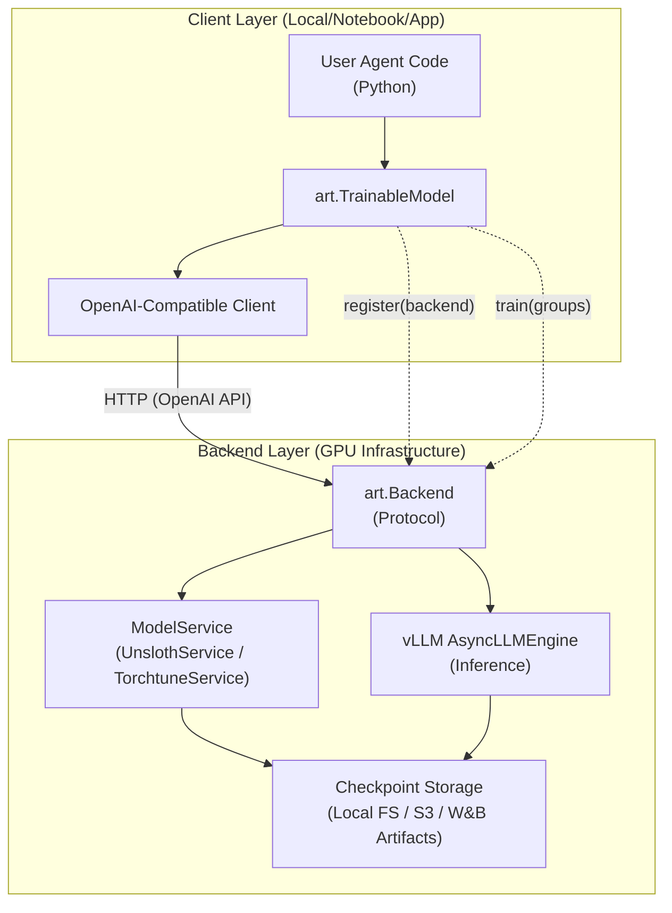
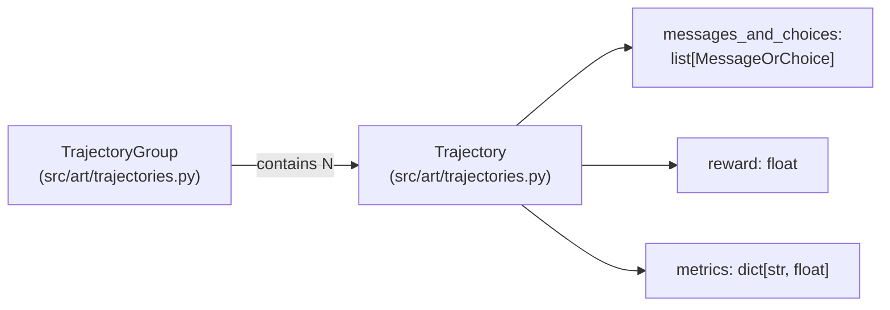
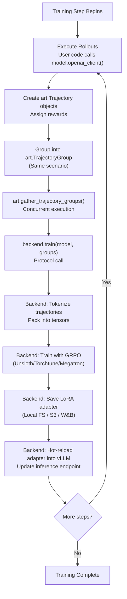
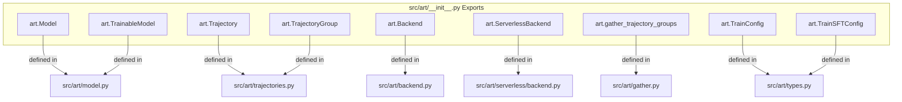

<!-- source: DeepWiki mcp.deepwiki.com · repo OpenPipe/ART · page 1 Overview · fetched 2026-10-29 -->

# Overview

Relevant source files

The following files were used as context for generating this wiki page:

- [README.md](README.md)
- [docs/docs.json](docs/docs.json)
- [docs/fundamentals/art-backend.mdx](docs/fundamentals/art-backend.mdx)
- [docs/fundamentals/art-client.mdx](docs/fundamentals/art-client.mdx)
- [docs/fundamentals/training-loop.mdx](docs/fundamentals/training-loop.mdx)
- [docs/getting-started/about.mdx](docs/getting-started/about.mdx)
- [docs/getting-started/faq.mdx](docs/getting-started/faq.mdx)
- [docs/getting-started/installation-setup.mdx](docs/getting-started/installation-setup.mdx)
- [docs/getting-started/notebooks.mdx](docs/getting-started/notebooks.mdx)
- [docs/getting-started/quick-start.mdx](docs/getting-started/quick-start.mdx)
- [docs/integrations/langgraph-integration.mdx](docs/integrations/langgraph-integration.mdx)
- [docs/style.css](docs/style.css)
- [docs/tutorials/summarizer.mdx](docs/tutorials/summarizer.mdx)
- [src/art/__init__.py](src/art/__init__.py)
- [src/art/openai.py](src/art/openai.py)
- [src/art/transformers/patches.py](src/art/transformers/patches.py)
- [src/art/types.py](src/art/types.py)

This page provides a high-level introduction to ART (Agent Reinforcement Trainer), an open-source framework for training LLM-based agents using reinforcement learning. It covers the core architecture, key abstractions, and deployment options. For installation instructions, see [Installation & Quick Start](#1.1). For detailed explanations of fundamental concepts like trajectories and the GRPO algorithm, see [Core Concepts](#1.2).

## Purpose

ART is a Python library that enables reinforcement learning training for LLM agents through a client-server architecture. It abstracts the complexity of RL training (inference engines, GPU memory management, training algorithms) into a backend service while providing an OpenAI-compatible client interface for agent code. It is specifically designed to improve agent reliability by allowing models to learn from experience via **GRPO** (Group Relative Policy Optimization).

**Sources:** [README.md:1-59](), [src/art/__init__.py:1-17](), [docs/getting-started/about.mdx:1-127]()

## System Architecture

ART divides functionality into two layers: the **Client**, which manages the environment and agent logic, and the **Backend**, which handles token generation and weight updates.

The client communicates with the backend through two pathways:
1. **Inference requests**: Standard OpenAI API calls routed to vLLM.
2. **Training requests**: `TrainableModel.train()` sends trajectory groups to the backend for weight updates.

**Sources:** [docs/fundamentals/art-client.mdx:7-30](), [docs/fundamentals/art-backend.mdx:7-32](), [src/art/model.py:34-100]()

## Core Components

### Model Classes

| Class | Location | Purpose |
|-------|----------|---------|
| `art.Model` | [src/art/model.py:34-100]() | Base class for inference-only models and cost tracking. |
| `art.TrainableModel` | [src/art/model.py:102-300]() | Extends `Model` with `train()`, `train_sft()`, and `register()` capabilities. |

These classes provide the primary API for registering backends, generating completions via `openai_client()`, and initiating training steps.

**Sources:** [src/art/model.py:34-300](), [docs/fundamentals/art-client.mdx:32-61]()

### Trajectory System

ART uses trajectories to capture agent interactions and their resulting rewards.

- **`Trajectory`**: Captures a single rollout, storing `messages_and_choices` (the sequence of `system`/`user`/`assistant` messages and model `Choice` objects) plus a scalar `reward` and optional `metrics`.
- **`TrajectoryGroup`**: Contains multiple `Trajectory` objects from the same scenario. GRPO computes per-group relative advantages across the group to determine which behavior was superior.
- **`messages_and_choices`**: Typed as `list[MessageOrChoice]` where `MessageOrChoice = Message | Choice` ([src/art/types.py:11-14]()).

**Sources:** [src/art/trajectories.py:1-100](), [src/art/types.py:11-14](), [docs/fundamentals/art-client.mdx:144-170]()

### Backend Implementations

All backends implement the `art.Backend` protocol.

| Backend | Module | Use Case |
|---------|--------|----------|
| `LocalBackend` | [src/art/local/backend.py:62]() | Single machine with GPU; runs Unsloth or Torchtune. |
| `ServerlessBackend` | [src/art/serverless/backend.py:1-50]() | W&B managed autoscaling infrastructure; zero-infra setup. |
| `SkyPilotBackend` | `src/art/skypilot/backend.py` | Cloud GPU clusters provisioned via SkyPilot. |
| `MegatronBackend` | `src/art/megatron/backend.py` | Large-scale multi-GPU distributed training. |
| `TinkerBackend` | `src/art/tinker/backend.py` | High-efficiency inference with worker-based prefix caching. |

**Sources:** [src/art/backend.py:1-50](), [docs/fundamentals/art-backend.mdx:34-74](), [README.md:24-53]()

## Training Loop

The ART training loop is strictly sequential, alternating between rollout and training phases.

**Sources:** [docs/fundamentals/training-loop.mdx:1-100](), [docs/fundamentals/art-client.mdx:175-214](), [src/art/gather.py:1-50]()

## Key Python Abstractions

**Public API surface — class names to source files**

**Sources:** [src/art/__init__.py:61-118](), [src/art/types.py:26-53]()

## Installation Options

ART supports several installation extras depending on your hardware and integration needs:

| Extra | Purpose |
|--------------|----------|
| `backend` | Required for `LocalBackend` (installs vLLM, Unsloth, PyTorch). |
| `langgraph` | Integration for training LangGraph ReAct agents. |
| `megatron` | Distributed training support. |
| `tinker` | Prefix-caching inference engine support. |
| `plotting` | Visualization utilities for training data. |

**Sources:** [pyproject.toml:6-74](), [docs/getting-started/installation-setup.mdx:7-21]()

## Next Steps

- **Installation**: See [Installation & Quick Start](#1.1) for environment setup.
- **Core Concepts**: See [Core Concepts](#1.2) for detailed explanations of trajectories and GRPO.
- **Client Usage**: See [Model System](#2.1) for `TrainableModel` API details.
- **Backend Setup**: See [Backend Infrastructure](#2.3) for backend configuration options.
- **LangGraph**: See [LangGraph Integration](#5.1) to train multi-step agents.
- **Examples**: See [Example Applications](#6) for game-playing and tool-calling agents.

**Sources:** [docs/docs.json:42-101]()

---

