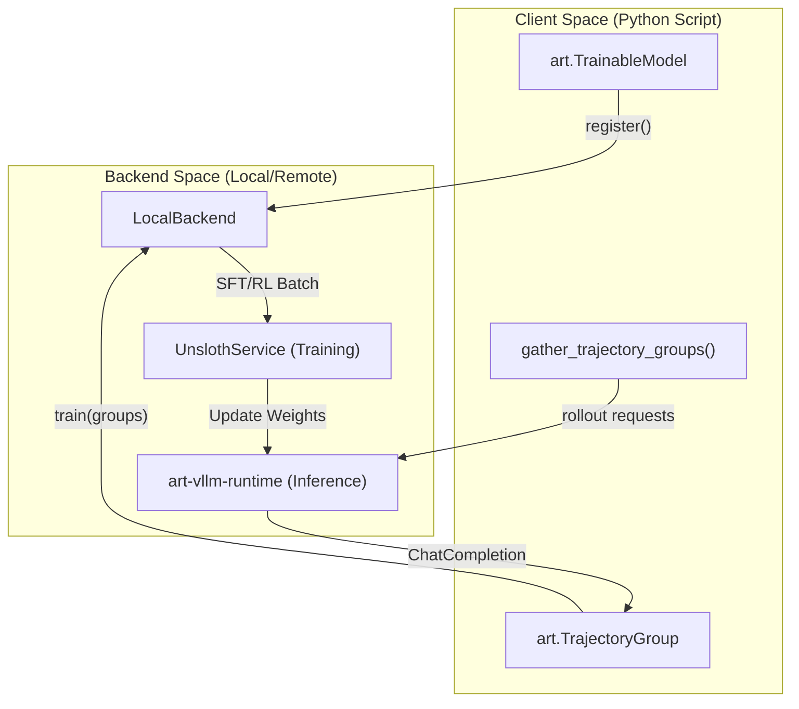

<!-- source: DeepWiki mcp.deepwiki.com · repo OpenPipe/ART · page 1.1 Installation & Quick Start · fetched 2026-10-29 -->

# Installation & Quick Start

<details>
<summary>Relevant source files</summary>

The following files were used as context for generating this wiki page:

- [README.md](README.md)
- [docs/docs.json](docs/docs.json)
- [docs/fundamentals/art-backend.mdx](docs/fundamentals/art-backend.mdx)
- [docs/fundamentals/art-client.mdx](docs/fundamentals/art-client.mdx)
- [docs/fundamentals/training-loop.mdx](docs/fundamentals/training-loop.mdx)
- [docs/getting-started/about.mdx](docs/getting-started/about.mdx)
- [docs/getting-started/faq.mdx](docs/getting-started/faq.mdx)
- [docs/getting-started/installation-setup.mdx](docs/getting-started/installation-setup.mdx)
- [docs/getting-started/notebooks.mdx](docs/getting-started/notebooks.mdx)
- [docs/getting-started/quick-start.mdx](docs/getting-started/quick-start.mdx)
- [docs/integrations/langgraph-integration.mdx](docs/integrations/langgraph-integration.mdx)
- [docs/style.css](docs/style.css)
- [docs/tutorials/summarizer.mdx](docs/tutorials/summarizer.mdx)
- [pyproject.toml](pyproject.toml)
- [src/art/dev/__init__.py](src/art/dev/__init__.py)
- [src/art/dev/get_model_config.py](src/art/dev/get_model_config.py)
- [src/art/dev/model.py](src/art/dev/model.py)
- [tests/unit/test_dedicated_config.py](tests/unit/test_dedicated_config.py)
- [uv.lock](uv.lock)

</details>


This page guides you through installing ART (Agent Reinforcement Training), setting up environments, and running your first training example. ART is designed to be ergonomic, allowing you to run agent logic anywhere while offloading heavy compute (inference and training) to specialized backends.

For core concepts like trajectories and GRPO, see [1.2 Core Concepts](). For backend architecture details, see [2.3 Backend Infrastructure]().

---

## Installation

### Basic Client Installation

The ART client is lightweight and runs on any machine with **Python >=3.12** [pyproject.toml:6-6](). It handles trajectory orchestration and reward calculation.

```bash
pip install openpipe-art
```

This installs core dependencies:
* `openai`: Interface for model interaction [pyproject.toml:8-8]().
* `litellm`: Multi-provider support [pyproject.toml:10-10]().
* `weave`: Experiment tracking and logging [pyproject.toml:11-11]().
* `polars`: High-performance data handling for trajectories [pyproject.toml:12-12]().

**Sources:** [pyproject.toml:1-16](), [docs/getting-started/installation-setup.mdx:7-13]()

### Backend Installation Options

ART supports multiple backend modes. To run training or inference locally, you must install specific extras.

#### Local Backend (GPU Required)
For training on local hardware (e.g., H100, A100), install the `backend` extra:

```bash
pip install "openpipe-art[backend]"
```

This installs the heavy-lift infrastructure:
* `unsloth` & `unsloth-zoo`: Fast, memory-efficient LoRA training [pyproject.toml:25-26]().
* `torch` (v2.11.0) & `torchao`: The underlying tensor framework [pyproject.toml:27-28]().
* `vllm`: High-throughput inference engine (managed via `art-vllm-runtime`).
* `wandb`: Experiment tracking and artifact storage [pyproject.toml:32-32]().

**Sources:** [pyproject.toml:21-43](), [docs/getting-started/installation-setup.mdx:15-21]()

#### Megatron Backend (Distributed)
For large-scale distributed training across multiple GPUs or nodes:

```bash
pip install "openpipe-art[megatron]"
```

This includes `megatron-core`, `transformer-engine`, and specialized kernels like `flash-attn` [pyproject.toml:44-66]().

---

## Environment Setup

### Weights & Biases (W&B)
ART uses W&B for metric tracking, trajectory visualization, and (in serverless mode) GPU orchestration.

1. Create an account at [wandb.ai](https://wandb.ai).
2. Retrieve your API key from [wandb.ai/authorize](https://wandb.ai/authorize).
3. Set the environment variable:
   ```bash
   export WANDB_API_KEY="your_key_here"
   ```

**Sources:** [docs/getting-started/quick-start.mdx:19-33](), [README.md:48-50]()

---

## Minimal Working Example

This example demonstrates the standard workflow: registering a model, running rollouts to collect data, and initiating a training step.

### 1. Initialize the Model and Backend
The `TrainableModel` acts as your primary interface [docs/fundamentals/art-client.mdx:34-49]().

```python
import art
from art.local.backend import LocalBackend

# 1. Setup Backend (Local GPU)
backend = LocalBackend()

# 2. Define the Model
model = art.TrainableModel(
    name="my-first-agent",
    project="art-quickstart",
    base_model="Qwen/Qwen2.5-7B-Instruct"
)

# 3. Connect them
await model.register(backend)
```
**Sources:** [docs/fundamentals/art-client.mdx:34-61](), [docs/getting-started/installation-setup.mdx:25-37]()

### 2. Define the Rollout Function
A rollout executes the agent's logic for a single scenario and returns a `Trajectory` with a `reward` [docs/fundamentals/art-client.mdx:143-170]().

```python
async def rollout(model: art.Model, scenario: str) -> art.Trajectory:
    client = model.openai_client()
    
    # Start tracking the trajectory
    traj = art.Trajectory(
        messages_and_choices=[{"role": "user", "content": scenario}]
    )
    
    # Generate completion via the backend's vLLM instance
    response = await client.chat.completions.create(
        messages=traj.messages(),
        model=model.get_inference_name()
    )
    
    # Record the choice and assign a reward
    traj.messages_and_choices.append(response.choices[0])
    traj.reward = 1.0 if "correct" in response.choices[0].message.content else 0.0
    
    return traj
```
**Sources:** [docs/fundamentals/art-client.mdx:143-170]()

### 3. Run Training Loop
ART uses `gather_trajectory_groups` to manage concurrent rollouts before sending them to the backend for GRPO training [docs/fundamentals/art-client.mdx:175-194]().

```python
scenarios = ["Solve 2+2", "Solve 10/2"]

# Collect experience (8 attempts per scenario)
groups = await art.gather_trajectory_groups(
    (
        art.TrajectoryGroup(rollout(model, s) for _ in range(8))
        for s in scenarios
    ),
    pbar_desc="Gathering"
)

# Execute one GRPO training step
result = await backend.train(model, groups, learning_rate=1e-5)

# Log results to W&B
await model.log(groups, metrics=result.metrics, step=result.step)
```
**Sources:** [docs/fundamentals/art-client.mdx:175-194](), [src/art/dev/get_model_config.py:78-95]()

---

## Data Flow & Architecture

The following diagram bridges the high-level API to the internal code entities.

### Training Data Flow

**Sources:** [docs/fundamentals/art-client.mdx:88-115](), [docs/fundamentals/art-backend.mdx:1-30](), [src/art/dev/get_model_config.py:22-113]()

### Model Configuration Mapping
The `get_model_config` function merges user-provided `InternalModelConfig` with system defaults to prepare the backend [src/art/dev/get_model_config.py:22-27]().

| Code Entity | Configuration Role |
| :--- | :--- |
| `InitArgs` | HuggingFace/Unsloth loading params (4-bit, seq length) [src/art/dev/model.py:194-207]() |
| `EngineArgs` | vLLM runtime settings (GPU utilization, sleep mode) [src/art/dev/engine.py:1-30]() |
| `LoRAConfig` | PEFT adapter settings (rank, alpha, target modules) [src/art/dev/model.py:209-218]() |
| `TrainerArgs` | GRPO/SFT hyperparameters (LR, batch size, optimizer) [src/art/dev/model.py:220-270]() |

**Sources:** [src/art/dev/get_model_config.py:22-113](), [src/art/dev/model.py:121-169]()

---

## Quick Start Notebooks
For a hands-on introduction without local setup, use the provided Google Colab notebooks which utilize the `ServerlessBackend`.

* **2048**: Train an agent to play the 2048 game [docs/getting-started/quick-start.mdx:7-17]().
* **LangGraph**: Train a multi-step ReAct agent [docs/integrations/langgraph-integration.mdx:86-116]().
* **Temporal Clue**: Logic puzzle solving [README.md:69-69]().

**Sources:** [README.md:61-75](), [docs/getting-started/quick-start.mdx:1-42]()

---

