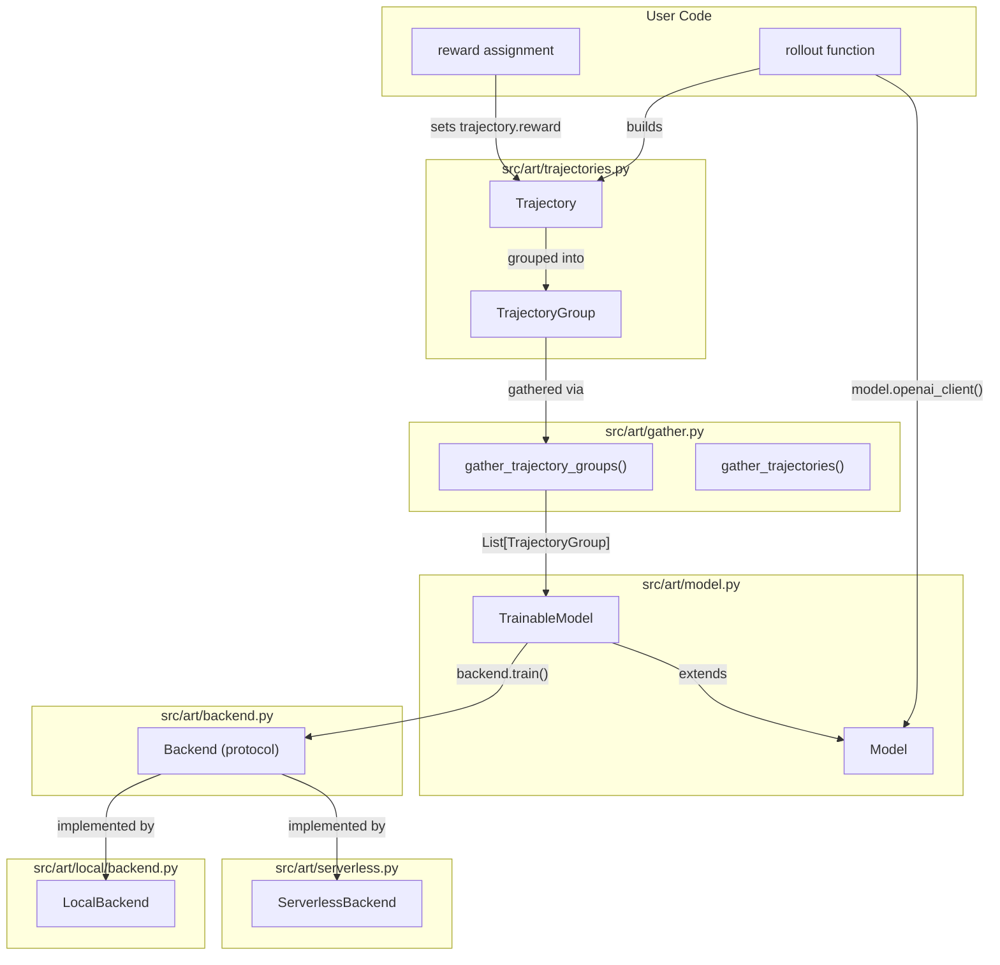
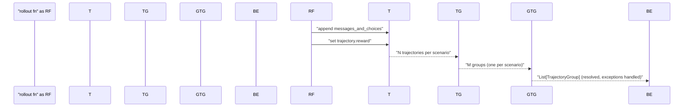
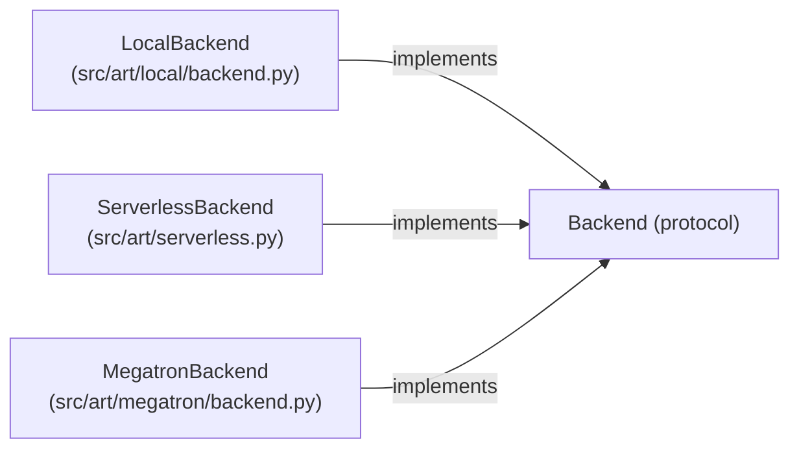
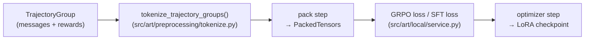

<!-- source: DeepWiki mcp.deepwiki.com · repo OpenPipe/ART · page 2 Core Framework · fetched 2026-10-29 -->

# Core Framework

<details>
<summary>Relevant source files</summary>

The following files were used as context for generating this wiki page:

- [src/art/__init__.py](src/art/__init__.py)
- [src/art/local/backend.py](src/art/local/backend.py)
- [src/art/model.py](src/art/model.py)
- [src/art/openai.py](src/art/openai.py)
- [src/art/transformers/patches.py](src/art/transformers/patches.py)
- [src/art/types.py](src/art/types.py)

</details>


This section documents the internal architecture of the `art` library as it exists in `src/art/`. It covers the four subsystems that every ART training run depends on: the **Model system**, the **Trajectory system**, the **Backend infrastructure**, and the **Data Processing pipeline**.

This page orients you to how these subsystems fit together. For full API-level detail, see:
- [Model System](#2.1)
- [Trajectory System](#2.2)
- [Backend Infrastructure](#2.3)
- [Data Processing Pipeline](#2.4)

For higher-level concepts like what GRPO is or why trajectories are grouped, see [Core Concepts](#1.2). For backend-specific implementations (LocalBackend, ServerlessBackend, etc.), see [Backend Implementations](#4).

---

## What the Core Framework Does

The core framework is the glue between user-written rollout code and backend training engines. It defines:

1.  **What a model is** — how it is identified, how inference is accessed via an OpenAI-compatible proxy, and how training is triggered. [src/art/model.py:166-200]()
2.  **What training data looks like** — the `Trajectory` and `TrajectoryGroup` structures that carry messages, rewards, and metrics from rollout code to the backend. [src/art/trajectories.py:1-10]()
3.  **How backends are abstracted** — the `Backend` protocol that every training engine implements, enabling swappable infrastructure. [src/art/backend.py:1-50]()
4.  **How raw trajectories become tensors** — the tokenization and packing steps that transform `Trajectory` objects into training-ready data. [src/art/local/backend.py:65-75]()

---

## Subsystem Overview

**Core framework component map** — from user entrypoints to backend calls:



Sources: [src/art/__init__.py:60-118](), [src/art/model.py:166-224](), [src/art/trajectories.py:1-10]()

---

## The Model System

The entry point for all user-facing interactions is `art.TrainableModel`, defined in [src/art/model.py](). There are two primary classes:

| Class | Purpose | Key extra fields |
| :--- | :--- | :--- |
| `Model` | Prompted / comparison model. Wraps an OpenAI-compatible inference endpoint. | `inference_base_url`, `inference_api_key`, `inference_model_name` |
| `TrainableModel` | Extends `Model`. Adds RL training, SFT fine-tuning, and checkpoint management. | `base_model`, `_internal_config` |

Both are Pydantic `BaseModel` subclasses. `TrainableModel` carries a `trainable: bool = True` discriminator field used for FastAPI serialization at the backend layer. [src/art/model.py:682-700]()

**Key methods on `Model` / `TrainableModel`:**

| Method | Where defined | What it does |
| :--- | :--- | :--- |
| `register(backend)` | `Model` | Connects the model to a backend and populates inference connection info. [src/art/model.py:416-435]() |
| `openai_client()` | `Model` | Returns an `AsyncOpenAI` instance pointing at the backend inference server. [src/art/model.py:448-477]() |
| `get_step()` | `Model` | Queries the backend for the current training step number. [src/art/model.py:383-390]() |
| `log(trajectories, ...)` | `Model` | Writes trajectory Parquet files and metrics to disk/W&B. [src/art/model.py:479-540]() |
| `train(...)` | `TrainableModel` | Executes an RL (GRPO) training step via the backend. [src/art/model.py:844-906]() |
| `train_sft(...)` | `TrainableModel` | Executes an SFT fine-tuning step via the backend. [src/art/model.py:908-940]() |
| `delete_checkpoints(...)`| `TrainableModel` | Delegates checkpoint cleanup to the backend implementation. [src/art/model.py:794-802]() |

**Model class hierarchy:**

```mermaid
classDiagram
    class "pydantic.BaseModel" {
    }
    class "Model" {
        +name: str
        +project: str
        +inference_base_url: str
        +inference_api_key: str
        +trainable: bool = False
        +register(backend)
        +openai_client() AsyncOpenAI
        +log(trajectories, split)
        +get_step() int
        +read_state()
        +merge_state()
    }
    class "TrainableModel" {
        +base_model: str
        +trainable: bool = True
        +_internal_config: InternalModelConfig
        +train(trajectory_groups, config)
        +train_sft(trajectories, config)
        +delete_checkpoints(metric)
    }

    "pydantic.BaseModel" <|-- "Model"
    "Model" <|-- "TrainableModel"
```

Sources: [src/art/model.py:166-224](), [src/art/model.py:682-700]()

---

## The Trajectory System

Training data is captured as `Trajectory` and `TrajectoryGroup` objects.

A `Trajectory` holds the full message history for a single rollout, its assigned `reward`, and any custom `metrics`. Multiple trajectories from the same scenario are bundled into a `TrajectoryGroup`, which is what GRPO uses to compute group-relative advantages. [src/art/trajectories.py:1-10]()

**Data flow from rollout to training:**



`gather_trajectory_groups()` in [src/art/gather.py]() runs all rollout coroutines concurrently, collects results into `TrajectoryGroup` objects, and surfaces exceptions without aborting the whole batch. [src/art/gather.py:1-50]()

Sources: [src/art/__init__.py:60-65](), [src/art/model.py:479-666]()

---

## The Backend Infrastructure

The `Backend` protocol in `src/art/backend.py` is the contract that every training engine must fulfill.

| Protocol method | Purpose |
| :--- | :--- |
| `register(model)` | Registers a model definition with the backend. |
| `_prepare_backend_for_training(...)` | Starts the inference server; returns `(base_url, api_key)`. |
| `_get_step(model)` | Returns the current training step. |
| `_train_model(...)` | Runs one GRPO training step; yields metrics. |
| `_train_sft(...)` | Runs one SFT training step; yields metrics. |

The `TrainResult` dataclass hierarchy in [src/art/types.py:69-107]() carries the outcome of each training call:

| Class | Extra field | Backend |
| :--- | :--- | :--- |
| `TrainResult` | — | Base for all. |
| `LocalTrainResult` | `checkpoint_path: str \| None` | `LocalBackend`. |
| `ServerlessTrainResult` | `artifact_name: str \| None` | `ServerlessBackend`. |



Sources: [src/art/types.py:69-107](), [src/art/local/backend.py:193-224]()

---

## The Data Processing Pipeline

Before trajectory data reaches the optimizer, it passes through a tokenization and packing pipeline:

1.  **Tokenize** — `tokenize_trajectory_groups()` converts `messages_and_choices` into token IDs and attention masks. [src/art/local/backend.py:71-75]()
2.  **Pack** — Sequences are packed into fixed-size chunks (`PackedTensors`) to maximize GPU utilization. [src/art/local/backend.py:65-70]()
3.  **Loss** — The packed tensors feed the GRPO or SFT loss function.



Sources: [src/art/local/backend.py:65-75](), [src/art/model.py:844-906]()

---

## Public API Surface

The key symbols re-exported from [src/art/__init__.py]() are:

```python
art.Model
art.TrainableModel
art.Trajectory
art.TrajectoryGroup
art.gather_trajectory_groups
art.gather_trajectories
art.TrainConfig
art.TrainSFTConfig
art.TrainResult
art.LocalTrainResult
art.ServerlessTrainResult
art.Backend
art.ServerlessBackend
```

Sources: [src/art/__init__.py:89-118]()

---

