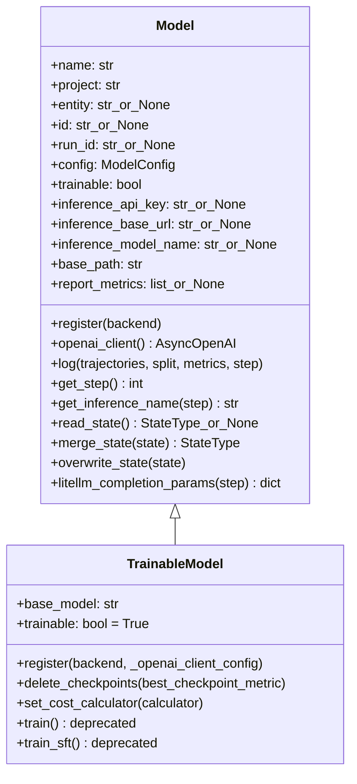
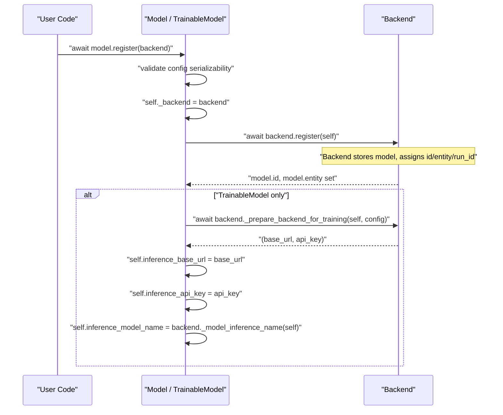
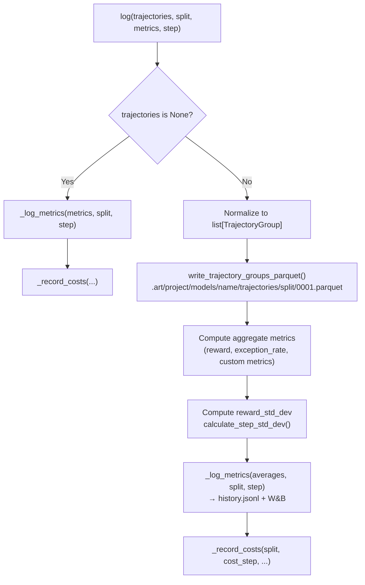
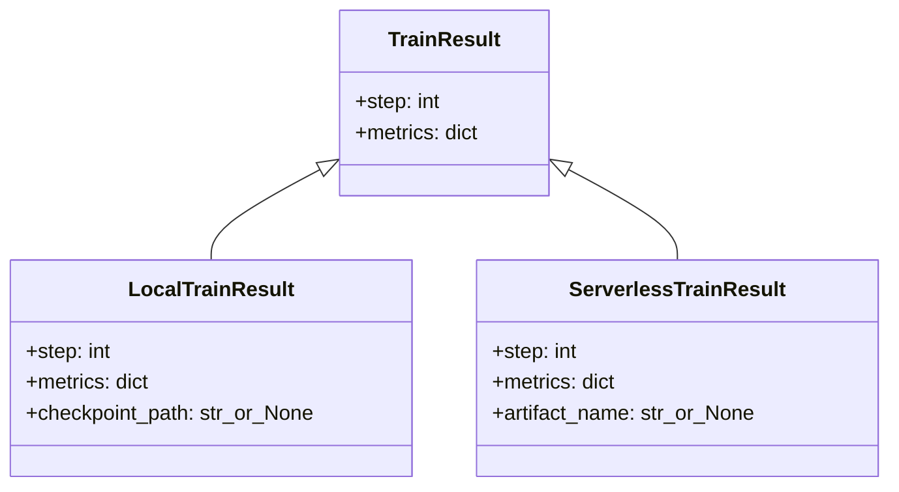

<!-- source: DeepWiki mcp.deepwiki.com · repo OpenPipe/ART · page 2.1 Model System · fetched 2026-10-29 -->

# Model System

<details>
<summary>Relevant source files</summary>

The following files were used as context for generating this wiki page:

- [src/art/__init__.py](src/art/__init__.py)
- [src/art/local/backend.py](src/art/local/backend.py)
- [src/art/model.py](src/art/model.py)
- [src/art/openai.py](src/art/openai.py)
- [src/art/transformers/patches.py](src/art/transformers/patches.py)
- [src/art/types.py](src/art/types.py)
- [tests/unit/test_model_openai_client_costs.py](tests/unit/test_model_openai_client_costs.py)

</details>


This page documents the `Model` and `TrainableModel` classes defined in [src/art/model.py](), which are the primary user-facing abstractions in ART. They handle inference client creation, trajectory logging, state persistence, cost tracking, and delegation of training to a registered backend.

For information about the data structures produced during rollouts, see the [Trajectory System](#2.2). For details on how backends implement training, see [Backend Infrastructure](#2.3). For training configuration objects, see [Training Configuration](#3.4).

---

## Class Hierarchy

**Class hierarchy: `Model` and `TrainableModel`**



Sources: [src/art/model.py:166-231](), [src/art/model.py:720-758]()

Both classes extend `pydantic.BaseModel` and are generic over `ModelConfig` (a `BaseModel` subclass or `None`) and `StateType` (a dict type). `Model` is for non-trainable prompted models used as baselines. `TrainableModel` adds the `base_model` field and training-specific methods.

---

## `Model` — Fields

| Field | Type | Default | Description |
|---|---|---|---|
| `name` | `str` | required | Short identifier for the model |
| `project` | `str` | required | W&B project / directory namespace |
| `entity` | `str \| None` | `None` | W&B entity; populated by backend on register |
| `id` | `str \| None` | `None` | Backend-assigned model ID |
| `run_id` | `str \| None` | `None` | W&B run ID; used for resuming runs |
| `config` | `ModelConfig` | `None` | User-defined Pydantic config attached to the model |
| `trainable` | `bool` | `False` | Discriminator field for FastAPI serialization |
| `inference_api_key` | `str \| None` | `None` | API key for the inference endpoint |
| `inference_base_url` | `str \| None` | `None` | Base URL for the OpenAI-compatible inference server |
| `inference_model_name` | `str \| None` | `None` | Model name sent to the inference endpoint (overrides `name`) |
| `base_path` | `str` | `".art"` | Root directory for local file output |
| `report_metrics` | `list[str] \| None` | `None` | Reporting sinks; `None` means W&B if key is set |

Sources: [src/art/model.py:202-228]()

Private instance attributes (not Pydantic fields):

| Attribute | Type | Role |
|---|---|---|
| `_backend` | `Backend \| None` | Set by `register()`; required for training |
| `_openai_client` | `AsyncOpenAI \| None` | Cached client instance |
| `_wandb_run` | `Run \| None` | Lazy W&B run handle |
| `_costs_lock` | `asyncio.Lock` | Serializes cumulative cost writes |
| `_cost_calculator` | `CostCalculator` | Callable that maps token counts to cost dict |

---

## `TrainableModel` — Additional Fields

| Field | Type | Default | Description |
|---|---|---|---|
| `base_model` | `str` | required | HuggingFace model ID or path (e.g. `"unsloth/Qwen2.5-7B-Instruct"`) |
| `trainable` | `bool` | `True` | Overrides `Model.trainable` |
| `_internal_config` | `dev.InternalModelConfig \| None` | `None` | Unstable per-model config passed to the backend engine |

Sources: [src/art/model.py:720-759]()

---

## Core Methods

### `register(backend)`

**Lifecycle of `register()`**



Sources: [src/art/model.py:314-325](), [src/art/model.py:829-848]()

After `register()`, a `TrainableModel` has its `inference_base_url`, `inference_api_key`, and `inference_model_name` populated automatically. Calling `register()` before `openai_client()` is required for trainable models.

---

### `openai_client()`

Returns a cached `AsyncOpenAI` instance wrapped in an `_OpenAIClientProxy` [src/art/model.py:128-149](). This proxy automatically handles:
- **Cost Recording**: Intercepts responses to update cost metrics via `_record_costs` [src/art/model.py:103]().
- **Metadata Attachment**: Attaches vLLM token and MoE routing metadata to completion choices [src/art/model.py:65-81]().
- **Default Extra Body**: Merges default parameters like `return_token_ids` into requests [src/art/model.py:96-100]().

The client is configured with a 1200-second timeout and a high-throughput `DefaultAsyncHttpxClient` [src/art/model.py:326-351]().

Sources: [src/art/model.py:326-351](), [src/art/model.py:84-149]()

---

### `get_inference_name(step)`

Returns the model name string to pass to the inference endpoint. Behavior depends on the registered backend:
- **`LocalBackend`**: uses `_model_inference_name()` on the backend, which produces `model.name@step` for vLLM's LoRA adapter naming [src/art/local/backend.py:488-490]().
- **`ServerlessBackend`**: returns `wandb-artifact:///{entity}/{project}/{name}:step{step}`.
- **No backend**: returns `inference_model_name or name`, optionally appended with `@{step}`.

Sources: [src/art/model.py:375-398]()

---

### `log(trajectories, split, metrics, step)`

**`log()` internal pipeline**



Sources: [src/art/model.py:511-698]()

Key behaviors:

- **Trajectory input normalization**: accepts `Iterable[Trajectory]`, `Iterable[BaseException]`, or `Iterable[TrajectoryGroup]`. Single trajectories/exceptions are wrapped into a single `TrajectoryGroup`.
- **Parquet output**: each call writes one Parquet file at `{base_path}/{project}/models/{name}/trajectories/{split}/{step:04d}.parquet` [src/art/utils/trajectory_logging.py:33]().
- **Metric aggregation**: averages `reward` and all `trajectory.metrics` fields across all trajectories; averages `group.metrics` fields per-group; appends `reward_std_dev`.
- **Costs**: `costs_*` metrics are treated additively and accumulated into `state.json` via `_record_costs()`.
- **W&B logging**: enabled when `WANDB_API_KEY` is in the environment and `report_metrics` is `None`, or when `"wandb"` is in `report_metrics`.

---

### State Persistence

State is stored as JSON at `{base_path}/{project}/models/{name}/state.json`.

| Method | Behavior |
|---|---|
| `overwrite_state(state)` | Replaces the entire `state.json` with `state` |
| `merge_state(state)` | Deep-merges `state` into existing state; returns merged dict |
| `read_state()` | Reads and returns `state.json`, or `None` if absent |

`merge_state()` performs recursive dict merging: nested dict values are merged rather than replaced. Scalar and non-dict values in `state` always overwrite existing values.

Sources: [src/art/model.py:404-486]()

---

### Cost Tracking

`TrainableModel` associates financial costs with training and inference steps via a `CostCalculator` [src/art/costs.py:17]().

**Type**: `CostCalculator = Callable[[int | None, int | None], dict[str, float]]`

Set it with `model.set_cost_calculator(calculator)`. Costs flow through the `log()` method when metrics contain keys with the `costs_` prefix. The `_record_costs()` method:

1. Accumulates cost components cumulatively in `state.json` under the `_costs` key.
2. Tracks per-split last-seen steps to avoid double-counting [src/art/model.py:653-689]().
3. Logs cumulative cost totals to `history.jsonl` and W&B under the `costs/` prefix.

Sources: [src/art/model.py:653-689](), [src/art/model.py:761-776]()

---

### `delete_checkpoints(best_checkpoint_metric)`

Retains only two checkpoints: the latest step and the step with the best value for `best_checkpoint_metric` (default: `"val/reward"`). Delegates actual file deletion to `backend._delete_checkpoint_files(model, steps_to_keep)`.

The best step is determined by reading `history.jsonl`, grouping by `step`, computing mean per step, and selecting the maximum.

Sources: [src/art/model.py:849-880]()

---

### `train()` and `train_sft()` — Deprecated

`TrainableModel.train()` and `train_sft()` are deprecated wrappers that delegate to `backend.train()` and `backend._train_sft()` respectively. New code should call these directly on the backend object.

```python
# Deprecated
await model.train(trajectory_groups, config=TrainConfig(learning_rate=5e-6))

# Preferred
result = await backend.train(model, trajectory_groups, config=TrainConfig(learning_rate=5e-6))
await model.log(metrics=result.metrics, step=result.step)
```

Sources: [src/art/model.py:882-950]()

---

## Training Result Types

**`TrainResult` class hierarchy**



Sources: [src/art/types.py:69-107]()

| Class | Returned by | Extra field |
|---|---|---|
| `TrainResult` | Base type | — |
| `LocalTrainResult` | `LocalBackend.train()` | `checkpoint_path` — local filesystem path to the saved LoRA checkpoint |
| `ServerlessTrainResult` | `ServerlessBackend.train()` | `artifact_name` — W&B artifact reference |

---

## Output Directory Layout

All local output for a model is rooted at `_get_output_dir()`:

```
{base_path}/
└── {project}/
    └── models/
        └── {name}/
            ├── state.json           # Persistent key-value state
            ├── history.jsonl        # Per-step metric log
            └── trajectories/
                ├── train/
                │   └── 0001.parquet
                └── val/
                    └── 0001.parquet
```

Sources: [src/art/model.py:400-403](), [src/art/model.py:594-602]()

---

