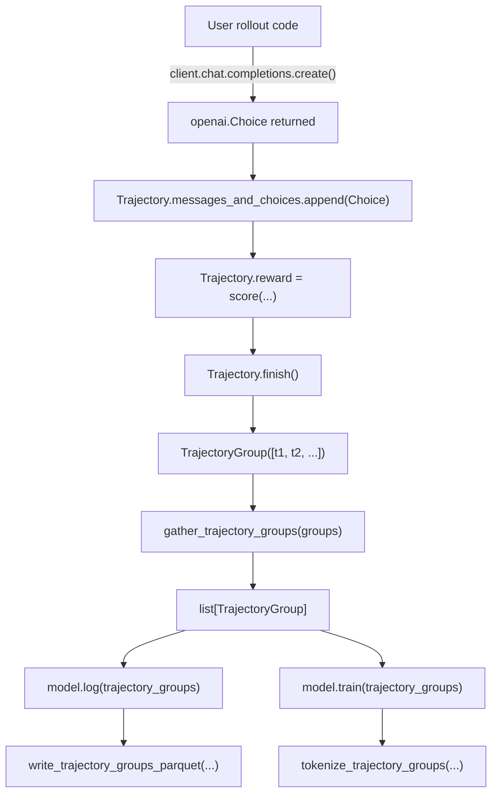
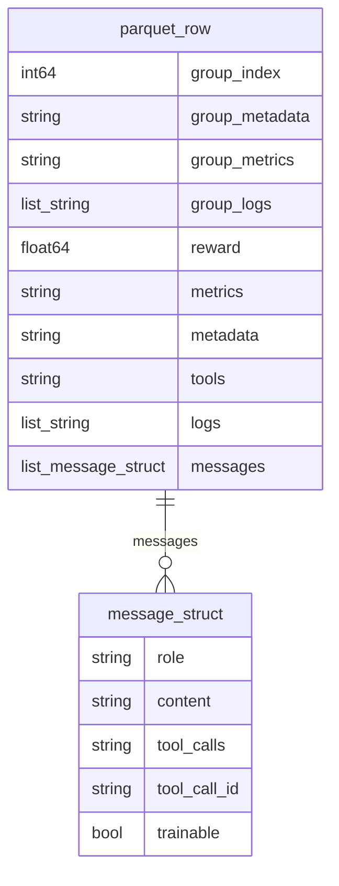

<!-- source: DeepWiki mcp.deepwiki.com · repo OpenPipe/ART · page 2.2 Trajectory System · fetched 2026-10-29 -->

# Trajectory System

<details>
<summary>Relevant source files</summary>

The following files were used as context for generating this wiki page:

- [examples/prisoners-dilemma.ipynb](examples/prisoners-dilemma.ipynb)
- [examples/tic_tac_toe_self_play/game_utils.py](examples/tic_tac_toe_self_play/game_utils.py)
- [examples/tic_tac_toe_self_play/gather_trajectory_groups_by_index.py](examples/tic_tac_toe_self_play/gather_trajectory_groups_by_index.py)
- [examples/tic_tac_toe_self_play/train_o4_mini.py](examples/tic_tac_toe_self_play/train_o4_mini.py)
- [src/art/auto_trajectory.py](src/art/auto_trajectory.py)
- [src/art/batches.py](src/art/batches.py)
- [src/art/gather.py](src/art/gather.py)
- [src/art/trajectories.py](src/art/trajectories.py)
- [src/art/utils/benchmarking/load_trajectories.py](src/art/utils/benchmarking/load_trajectories.py)
- [src/art/utils/benchmarking/pull_model_trajectories.py](src/art/utils/benchmarking/pull_model_trajectories.py)
- [src/art/utils/old_benchmarking/load_benchmarked_models.py](src/art/utils/old_benchmarking/load_benchmarked_models.py)
- [src/art/utils/trajectory_logging.py](src/art/utils/trajectory_logging.py)
- [src/art/utils/trajectory_migration.py](src/art/utils/trajectory_migration.py)
- [src/art/yield_trajectory.py](src/art/yield_trajectory.py)
- [tests/unit/test_auto_trajectory.py](tests/unit/test_auto_trajectory.py)
- [tests/unit/test_trajectory_parquet.py](tests/unit/test_trajectory_parquet.py)
- [tests/unit/test_yield_trajectory.py](tests/unit/test_yield_trajectory.py)

</details>


This page documents the `Trajectory` and `TrajectoryGroup` data structures, how they are built during rollouts, how rewards and metrics are attached, the `additional_histories` feature, and how trajectory data is persisted and queried as Parquet files.

For how trajectories flow into the training algorithm (tokenization, packing, GRPO loss), see [Data Processing Pipeline](#2.4) and [Training Loop & GRPO Algorithm](#3.1). For `gather_trajectory_groups` async patterns and concurrency, see [Async Training Patterns](#7.6).

---

## Core Data Structures

All trajectory types live in [src/art/trajectories.py]().

**Data model overview:**

```mermaid
classDiagram
    class "Trajectory" {
        +messages_and_choices: MessagesAndChoices
        +tools: Tools | None
        +additional_histories: list[History]
        +reward: float
        +initial_policy_version: int | None
        +final_policy_version: int | None
        +metrics: dict[str, float | int | bool]
        +metadata: dict[str, MetadataValue]
        +logs: list[str]
        +start_time: datetime
        +log(message: str)
        +finish() Trajectory
        +track_duration(metric_name: str)
        +messages() Messages
        +for_logging() dict
    }

    class "History" {
        +messages_and_choices: MessagesAndChoices
        +tools: Tools | None
        +messages() Messages
    }

    class "TrajectoryGroup" {
        +trajectories: list[Trajectory]
        +exceptions: list[PydanticException]
        +metadata: dict[str, MetadataValue]
        +metrics: dict[str, float | int | bool]
        +logs: list[str]
        +__init__(trajectories, exceptions, ...)
        +__copy__() TrajectoryGroup
    }

    class "PydanticException" {
        +type: str
        +message: str
        +traceback: str
    }

    "Trajectory" "1" --> "*" "History" : additional_histories
    "TrajectoryGroup" "1" --> "*" "Trajectory" : trajectories
    "TrajectoryGroup" "1" --> "*" "PydanticException" : exceptions
```

Sources: [src/art/trajectories.py:24-179]()

---

### `Trajectory`

`Trajectory` is a `pydantic.BaseModel` that holds the complete record of a single agent rollout.

[src/art/trajectories.py:38-94]()

| Field | Type | Purpose |
|---|---|---|
| `messages_and_choices` | `MessagesAndChoices` | Ordered list of messages (`dict`) and model responses (`openai.Choice`). `Choice` items mark tokens that are trainable. |
| `tools` | `Tools \| None` | Tool definitions available during the rollout. |
| `additional_histories` | `list[History]` | Extra conversation segments for advanced training patterns (see below). |
| `reward` | `float` | Scalar reward assigned after rollout completion. Default `0.0`. |
| `initial_policy_version` | `int \| None` | Step number of the policy that generated the first token. |
| `final_policy_version` | `int \| None` | Step number of the policy at rollout end. |
| `metrics` | `dict[str, float \| int \| bool]` | Arbitrary numeric/boolean metrics (e.g., `duration`, `accuracy`). |
| `metadata` | `dict[str, MetadataValue]` | Arbitrary string/numeric labels for filtering and analysis. |
| `logs` | `list[str]` | Free-form log messages captured during the rollout. |
| `start_time` | `datetime` | Automatically set at construction; used by `finish()` to compute duration. |

**Key methods:**

- `log(message)` — Appends a string to `self.logs` [src/art/trajectories.py:50-51]().
- `finish()` — Records `duration` into `self.metrics` and returns `self`. Should be called at the end of a rollout [src/art/trajectories.py:53-56]().
- `track_duration(metric_name)` — Async context manager; accumulates elapsed time into `self.metrics["{metric_name}_duration"]` [src/art/trajectories.py:59-66]().
- `messages()` — Returns a flat `Messages` list by extracting content from all `messages_and_choices` [src/art/trajectories.py:71-72]().
- `for_logging()` — Returns a JSON-serializable dict annotating each message with a `trainable` boolean [src/art/trajectories.py:75-94]().

Sources: [src/art/trajectories.py:38-94]()

---

### `History`

`History` wraps a self-contained conversation segment — its own `messages_and_choices` and optional `tools`. It is used as a unit for tokenization.

[src/art/trajectories.py:30-36]()

The primary history of a `Trajectory` is constructed from `trajectory.messages_and_choices` and `trajectory.tools`. `Trajectory.additional_histories` holds extra `History` objects for patterns like multi-agent or multi-turn preservation.

---

### `TrajectoryGroup`

`TrajectoryGroup` is a `pydantic.BaseModel` that bundles multiple `Trajectory` objects generated for the **same prompt or scenario**. GRPO computes advantages relative to the group's mean reward, so all trajectories in a group must share the same starting prompt.

[src/art/trajectories.py:130-179]()

| Field | Type | Purpose |
|---|---|---|
| `trajectories` | `list[Trajectory]` | Successfully completed rollouts. |
| `exceptions` | `list[PydanticException]` | Rollouts that raised exceptions (stored for observability). |
| `metadata` | `dict[str, MetadataValue]` | Group-level labels (e.g., scenario ID). |
| `metrics` | `dict[str, float \| int \| bool]` | Group-level aggregate metrics. |
| `logs` | `list[str]` | Group-level log messages. |

The constructor [src/art/trajectories.py:137-179]() allows passing an iterable of trajectories or exceptions. It filters them into the appropriate fields and converts standard `BaseException` objects into `PydanticException` for serialization.

Sources: [src/art/trajectories.py:130-179]()

---

## Trajectory Lifecycle

The diagram below maps the trajectory lifecycle to code entities.

**Trajectory lifecycle diagram:**



Sources: [src/art/trajectories.py:38-94](), [src/art/gather.py:14-65](), [src/art/utils/trajectory_logging.py:59-150]()

### Automated Trajectory Capture

ART provides utilities to capture trajectories automatically from OpenAI client calls using context variables and `httpx` patching.

- **`capture_auto_trajectory`**: An async context that intercepts `httpx` responses from the OpenAI client, reconstructs `Choice` objects (even from streams), and populates a `Trajectory` [src/art/auto_trajectory.py:66-70]().
- **`yield_trajectory`**: Allows a function to "yield" a manually constructed trajectory to a parent caller using `capture_yielded_trajectory` [src/art/yield_trajectory.py:7-17]().

Sources: [src/art/auto_trajectory.py:66-161](), [src/art/yield_trajectory.py:7-33]()

---

## Rewards and Metrics

### Reward

`trajectory.reward` is a scalar `float` set by user code. In GRPO, the reward is used to compute per-trajectory advantage relative to the group mean [src/art/preprocessing/tokenize.py:79-88]().

### Metrics

- **Trajectory-level**: Recorded into the progress bar by `gather_trajectory_groups` via `record_metrics` [src/art/gather.py:183-199](). `completion_tokens` is added automatically if `logprobs` are present.
- **Group-level**: `TrajectoryGroup.metrics` hold scenario-level data. These are written as repeated columns in Parquet so they can be joined with trajectory rows during analysis [src/art/utils/trajectory_logging.py:74-116]().

Sources: [src/art/trajectories.py:53-66](), [src/art/gather.py:183-199]()

---

## Storage: Parquet Files

Trajectory data is stored in Parquet format with ZSTD compression for ~25x space savings over JSONL.

### Schema

The Parquet schema uses nested structures for messages to maintain the `trainable` flag and tool call data.

**Parquet file schema diagram:**



[src/art/utils/trajectory_logging.py:119-142]()

### Reading and Writing

- **`write_trajectory_groups_parquet`**: Serializes a list of `TrajectoryGroup` objects. It flattens `Choice` objects into the `message_struct` and encodes dictionary fields (metrics, metadata) as JSON strings [src/art/utils/trajectory_logging.py:59-150]().
- **`read_trajectory_groups_parquet`**: Reconstructs the objects using DuckDB for efficient columnar loading [src/art/utils/trajectory_logging.py:153-251]().
- **`load_trajectories`**: A high-level benchmarking utility that loads all Parquet files for a project into a unified Polars DataFrame, flattening all JSON metrics into individual columns [src/art/utils/benchmarking/load_trajectories.py:27-334]().

### Migration

Legacy JSONL trajectories can be migrated using `migrate_jsonl_to_parquet` [src/art/utils/trajectory_migration.py:177-248](). This utility provides a `MigrationResult` tracking compression ratios and space saved [src/art/utils/trajectory_migration.py:144-174]().

Sources: [src/art/utils/trajectory_logging.py:59-251](), [src/art/utils/benchmarking/load_trajectories.py:27-334](), [src/art/utils/trajectory_migration.py:144-248]()

---

