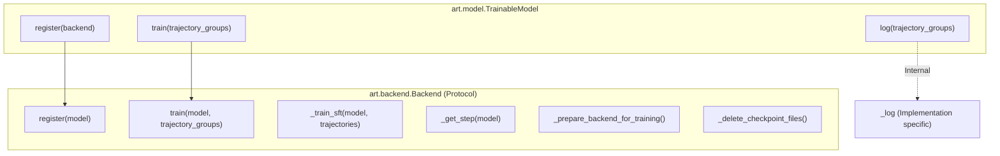
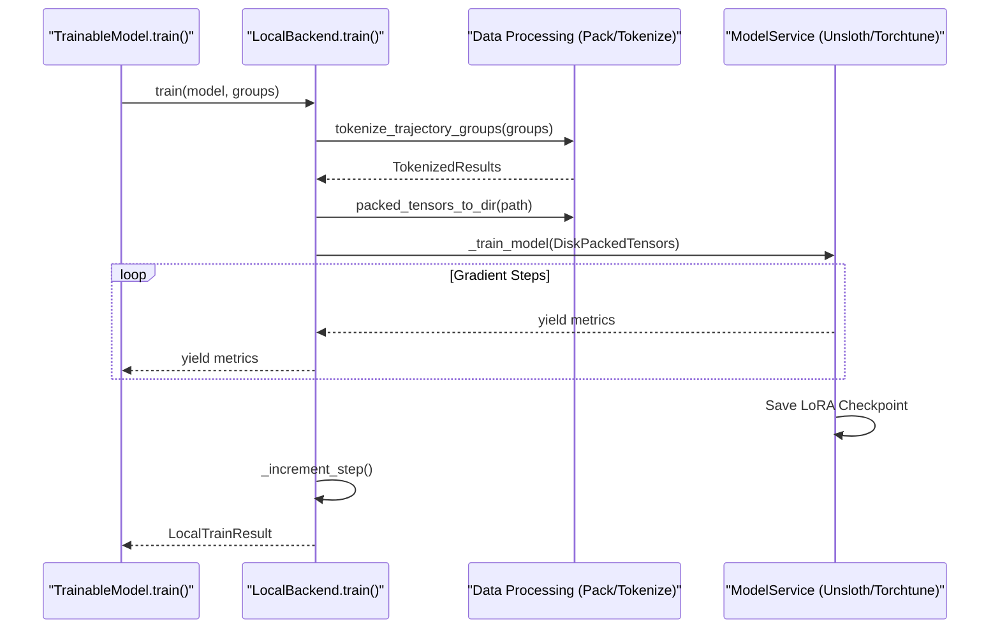
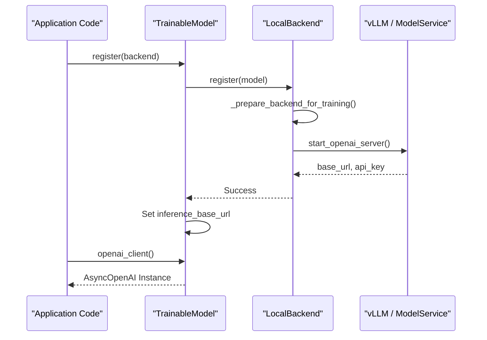

<!-- source: DeepWiki mcp.deepwiki.com · repo OpenPipe/ART · page 2.3 Backend Infrastructure · fetched 2026-10-29 -->

# Backend Infrastructure

Relevant source files

The following files were used as context for generating this wiki page:

- [.env.example](.env.example)
- [examples/tic_tac_toe/tic-tac-toe.py](examples/tic_tac_toe/tic-tac-toe.py)
- [examples/tic_tac_toe_self_play/deploy_step.py](examples/tic_tac_toe_self_play/deploy_step.py)
- [scripts/deploy-model.py](scripts/deploy-model.py)
- [src/art/backend.py](src/art/backend.py)
- [src/art/cli.py](src/art/cli.py)
- [src/art/local/backend.py](src/art/local/backend.py)
- [src/art/model.py](src/art/model.py)
- [src/art/utils/deploy_model.py](src/art/utils/deploy_model.py)
- [src/art/utils/output_dirs.py](src/art/utils/output_dirs.py)
- [src/art/utils/s3.py](src/art/utils/s3.py)
- [tests/test_backend_train_api.py](tests/test_backend_train_api.py)

The Backend system in ART provides an abstract interface that coordinates model training, inference serving, logging, and checkpoint management. Backends handle all GPU infrastructure concerns, allowing client code to focus on defining agent behavior and training scenarios.

This page documents the `Backend` protocol, its core interface methods, and the coordination logic used across different infrastructure types.

## Backend Interface Overview

The `Backend` class is defined as a `Protocol` [src/art/backend.py:15-16](). It establishes the common contract that all implementations—whether local or remote—must fulfill to interface with the `TrainableModel` class.

| Backend | Infrastructure | Use Case |
|---------|---------------|----------|
| `LocalBackend` | Single machine (local or remote VM) | Development, single-GPU training |
| `SkyPilotBackend` | Multi-cloud orchestration (RunPod, AWS, GCP) | Production training with custom infrastructure |
| `ServerlessBackend` | W&B Training managed service | Autoscaling inference and training |

### Code Entity Association: Backend Protocol

The following diagram maps the logical backend operations to the specific methods defined in the `Backend` protocol and used by the `Model` system.

Sources: [src/art/backend.py:15-53](), [src/art/model.py:166-224]()

## Core Protocol Interface

The `Backend` protocol defines the following essential methods for lifecycle management and training execution:

### Lifecycle & Inference Setup
- `register(model: AnyModel) -> None`: Registers a model with the backend, initializing required resources and saving configuration [src/art/backend.py:24-24]().
- `_prepare_backend_for_training(model: AnyTrainableModel, config: dev.OpenAIServerConfig | None) -> tuple[str, str]`: Starts the inference server (typically vLLM) and returns the `(base_url, api_key)` required for the model's `openai_client` [src/art/backend.py:32-36]().
- `_model_inference_name(model: AnyModel, step: int | None = None) -> str`: Returns the specific string identifier used to call the inference endpoint (e.g., adding step suffixes) [src/art/backend.py:18-20]().

### Training Execution
- `train(model: AnyTrainableModel, trajectory_groups: Iterable[TrajectoryGroup], **kwargs: Any) -> TrainResult`: The primary entry point for RL training. It processes groups, performs optimization, and returns a `TrainResult` [src/art/backend.py:38-43]().
- `_train_sft(model: AnyTrainableModel, trajectories: Iterable[Trajectory], config: TrainSFTConfig, dev_config: dev.TrainSFTConfig, verbose: bool = False) -> AsyncIterator[dict[str, float]]`: An asynchronous iterator that streams SFT training metrics (loss, accuracy) back to the caller [src/art/backend.py:45-52]().

### State & Checkpoint Management
- `_get_step(model: AnyTrainableModel) -> int`: Queries the backend for the current training step count [src/art/backend.py:26-26]().
- `_delete_checkpoint_files(model: AnyTrainableModel, steps_to_keep: list[int]) -> None`: Commands the backend to prune checkpoint files from disk or remote storage to save space [src/art/backend.py:28-30]().

Sources: [src/art/backend.py:15-53](), [src/art/model.py:329-348]()

## Backend Coordination Flows

### RL Training Flow (Local Implementation)
When `model.train()` is called, the backend orchestrates data processing before handing off to the underlying `ModelService`.

Sources: [src/art/local/backend.py:404-523](), [src/art/backend.py:38-43]()

### Inference Setup Flow
The `register` call is critical for setting up the `openai_client` used in rollouts.

Sources: [src/art/model.py:329-348](), [src/art/local/backend.py:276-295](), [src/art/backend.py:32-36]()

## Storage & S3 Integration

Backends manage the physical location of model weights and trajectories. The `LocalBackend` defaults to a `.art` directory in the repository root [src/art/local/backend.py:219]().

### S3 Synchronization
Backends provide experimental methods for cloud persistence:
- `_experimental_push_to_s3(model)`: Uploads local checkpoints and logs to the configured `BACKUP_BUCKET` [src/art/local/backend.py:632-642]().
- `_experimental_pull_from_s3(model)`: Downloads model data from S3 to local disk [src/art/local/backend.py:612-623]().

The underlying implementation uses the `s3_sync` utility, which wraps the AWS CLI for efficient directory transfers [src/art/utils/s3.py:66-125]().

### Checkpoint Directory Structure
Checkpoints are organized by step number to allow for easy rollback and evaluation of specific training stages:
- Base path: `{art_path}/{project}/models/{model_name}/` [src/art/utils/output_dirs.py:18-21]()
- Checkpoints: `.../checkpoints/{step:04d}/` [src/art/utils/output_dirs.py:32-33]()
- Trajectories: `.../trajectories/{split}/` [src/art/utils/output_dirs.py:40-41]()

Sources: [src/art/utils/s3.py:27-63](), [src/art/utils/output_dirs.py:1-42](), [src/art/local/backend.py:612-660]()

## FastAPI Server Layer

For remote backends like `SkyPilotBackend`, ART provides a FastAPI-based server that exposes the `Backend` protocol over HTTP. This allows a local `SkyPilotBackend` instance to proxy calls to a `LocalBackend` running on a remote GPU cluster.

### Common Contract Mapping

| HTTP Route | Backend Method |
|------------|----------------|
| `POST /register` | `register()` |
| `POST /_get_step` | `_get_step()` |
| `POST /_train_model` | `train()` (Streaming) |
| `POST /_log` | Implementation-specific logging |

The server handles the serialization of `TrajectoryGroup` objects and `InternalModelConfig` dictionaries across the network, ensuring that training logic remains consistent regardless of where the compute is located.

Sources: [src/art/backend.py:15-53](), [src/art/cli.py:119-150]() (referencing server-side logic in `cli.py` and backend definitions).

---

