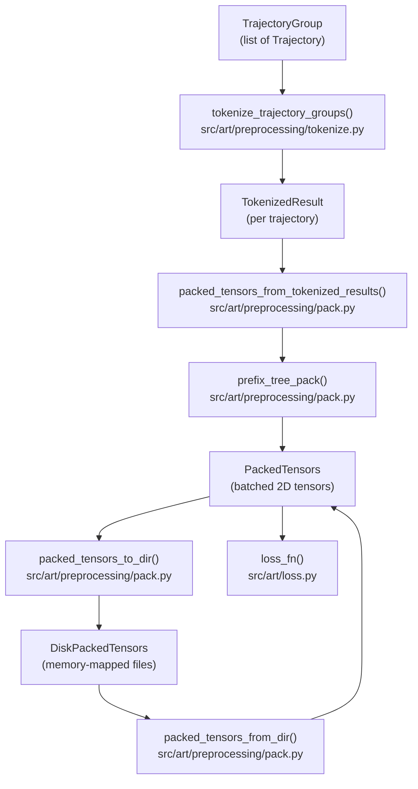
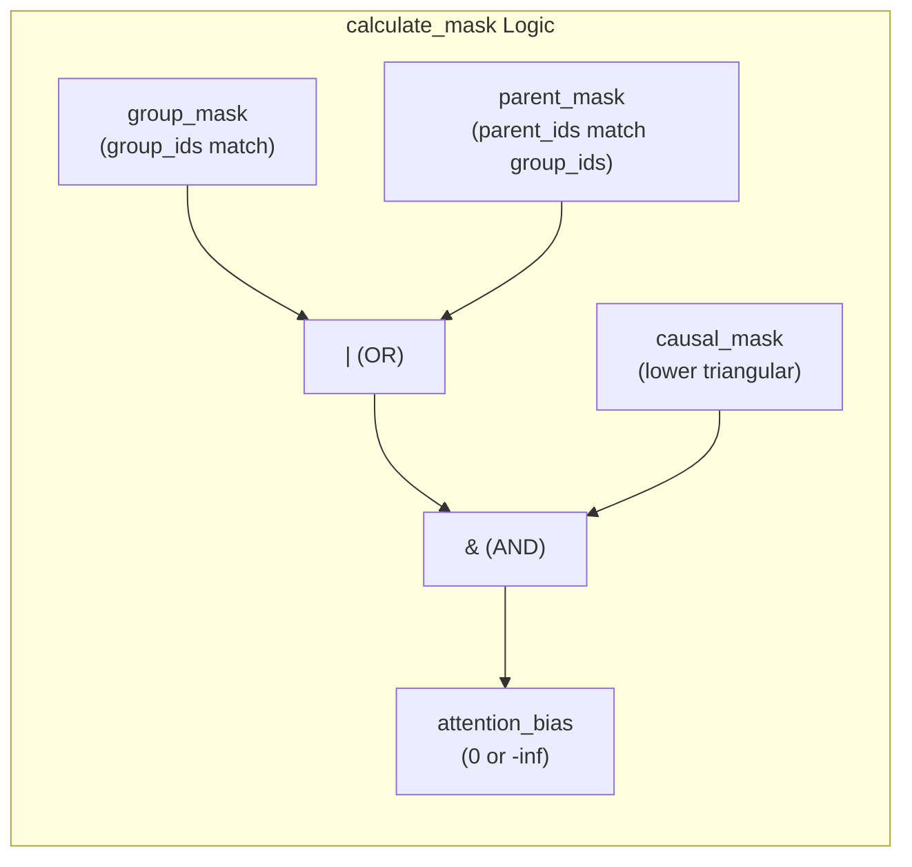
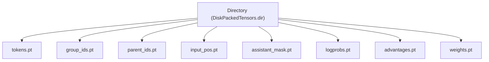

<!-- source: DeepWiki mcp.deepwiki.com · repo OpenPipe/ART · page 2.4 Data Processing Pipeline · fetched 2026-10-29 -->

# Data Processing Pipeline

Relevant source files

The following files were used as context for generating this wiki page:

- [dev/run_yes_no_maybe_kl_advantage.py](dev/run_yes_no_maybe_kl_advantage.py)
- [src/art/megatron/weights/merged_weight_export.py](src/art/megatron/weights/merged_weight_export.py)
- [src/art/preprocessing/inputs.py](src/art/preprocessing/inputs.py)
- [src/art/preprocessing/pack.py](src/art/preprocessing/pack.py)
- [src/art/preprocessing/response_masking.py](src/art/preprocessing/response_masking.py)
- [src/art/preprocessing/tokenize.py](src/art/preprocessing/tokenize.py)
- [src/art/tinker/client.py](src/art/tinker/client.py)
- [src/art/tinker/renderers.py](src/art/tinker/renderers.py)
- [src/art/tinker/server.py](src/art/tinker/server.py)
- [src/art/utils/chat_template.py](src/art/utils/chat_template.py)
- [tests/unit/test_moe_routing_real_path.py](tests/unit/test_moe_routing_real_path.py)
- [tests/unit/test_preprocessing_tokenize.py](tests/unit/test_preprocessing_tokenize.py)

This page documents how trajectory data flows from raw message sequences through tokenization and tensor packing into the format consumed by the training step. It covers the `src/art/preprocessing/` module, specifically `tokenize.py` and `pack.py`, and the data structures they produce.

For context on how trajectories are created and stored, see [Trajectory System](#2.2). For how the resulting tensors are consumed by the optimizer, see [Training Loop & GRPO Algorithm](#3.1). For backend-specific invocations of this pipeline, see [Model Services](#3.2).

---

## Overview

Before a training step can run, `Trajectory` objects — containing raw conversation messages, sampled completions, and rewards — must be converted into dense, padded PyTorch tensors. This conversion happens in two sequential stages:

1.  **Tokenization** — Applies the model's chat template, extracts per-token logprobs from `Choice` objects, computes GRPO advantages, and identifies shared prompt prefixes across a group.
2.  **Packing** — Bins multiple tokenized results into fixed-length sequences using a prefix-tree approach to share prompt prefixes within a bin where possible.

A separate, simpler path handles **Supervised Fine-Tuning (SFT)** batches, where the objective is cross-entropy over assistant tokens rather than a policy gradient loss.

---

## End-to-End Data Flow

**Diagram: RL Data Processing Pipeline**

Sources: [src/art/preprocessing/tokenize.py:149-168](), [src/art/preprocessing/pack.py:26-37](), [src/art/preprocessing/pack.py:76-108](), [src/art/preprocessing/pack.py:195-218]()

---

## Stage 1: Tokenization

### `tokenize_trajectory_groups`

[src/art/preprocessing/tokenize.py:214-358]()

This function is the entry point for RL tokenization. It consumes a `list[TrajectoryGroup]` and produces one `TokenizedResult` per trainable trajectory.

**Processing steps per group:**

| Step | Description |
|---|---|
| 1. Advantage computation | Compute per-group `reward_mean` and `reward_std`; derive `advantage = (reward - mean) / (std + 1e-6)`. |
| 2. History iteration | Iterate over the main `messages_and_choices` and any `additional_histories`. |
| 3. Per-history tokenization | Call `tokenize_trajectory` for each `History` object. |
| 4. Weight normalization | Set `weight = 1 / total_assistant_tokens` across all histories for a trajectory. |
| 5. Prompt prefix detection | Find the longest common token prefix across all results in the group; set `prompt_length`. |

The `prompt_id` is an integer assigned per group. It is used by the packing step to identify when two results share the same prompt so that tokens can be stored only once in a packed sequence.

### `tokenize_trajectory`

[src/art/preprocessing/tokenize.py:464-688]()

This function processes a single `History` object into a `TokenizedResult`.

**Key mechanics:**

1.  **Chat template application**: `tokenizer.apply_chat_template` is used to render the full conversation. Tools are normalized for the specific model family (e.g., `vllm_openai` format) [src/art/preprocessing/tokenize.py:71-93]().
2.  **logprob extraction**: For `Choice` objects, logprobs are extracted from the `logprobs.content` field [src/art/preprocessing/tokenize.py:644-651]().
3.  **`assistant_mask` construction**: Identifies positions where the model's output is being trained. ART supports custom `instruction_part` and `response_part` strings to find boundaries [src/art/preprocessing/tokenize.py:476-477]().
4.  **MoE Routing Alignment**: If the trajectory contains Mixture-of-Experts routing data (from vLLM), `align_choice_routes_to_tokenized_result` maps those routes to the final token sequence [src/art/preprocessing/tokenize.py:663-670]().

### `TokenizedResult` Data Structure

Defined in [src/art/preprocessing/tokenize.py:150-168]().

| Field | Type | Description |
|---|---|---|
| `advantage` | `float` | GRPO group-relative advantage. |
| `token_ids` | `list[int]` | Integer token IDs. |
| `input_pos` | `list[int]` | Position indices `[0, 1, 2, …]`. |
| `assistant_mask` | `list[int]` | `1` for tokens in loss, `0` elsewhere. |
| `logprobs` | `list[float]` | Log-probabilities from the inference pass. |
| `pixel_values` | `torch.Tensor \| None` | Pixel data for vision models. |
| `moe_routed_experts` | `list[TokenRoute \| None]` | Routing metadata for MoE models. |
| `weight` | `float` | Per-trajectory loss weight. |
| `prompt_id` | `int` | Group identifier for prompt sharing. |
| `prompt_length` | `int` | Length of the shared prompt prefix. |

Sources: [src/art/preprocessing/tokenize.py:150-168](), [src/art/preprocessing/tokenize.py:214-358](), [src/art/preprocessing/tokenize.py:464-688]()

---

## Stage 2: Packing

### `prefix_tree_pack`

[src/art/preprocessing/pack.py:98-146]()

This function bins `TokenizedResult` objects into fixed-length sequences of `seq_len`.

**Bin-filling algorithm:**

1.  Iterate through results. If a result fits in the current row's remaining `seq_len`, add it.
2.  If `pack_results=True`, the algorithm attempts to overlap shared prompts. If the `prompt_id` matches an existing item in the row, only the unique completion tokens are added.
3.  **Weight Normalization**: After assembly, the `weights` tensor is normalized so the mean weight among assistant positions equals `1.0` [src/art/preprocessing/pack.py:171-173]().
4.  **Advantage Normalization**: Advantages are normalized by their absolute mean among assistant positions to ensure stable gradients [src/art/preprocessing/pack.py:190-193]().

### `PackedTensors` Data Structure

Defined in [src/art/preprocessing/pack.py:26-37](). All tensors have shape `[num_sequences, seq_len]`.

| Tensor | dtype | Description |
|---|---|---|
| `tokens` | `torch.long` | Token IDs. |
| `group_ids` | `torch.long` | Per-token group identifier for attention masking. |
| `parent_ids` | `torch.long` | Points to shared prompt group for attention masking. |
| `input_pos` | `torch.long` | Position indices for RoPE. |
| `assistant_mask` | `torch.bool` | Mask for positions included in the loss. |
| `moe_routing_replay` | `PackedMoeRoutingReplay` | Data for replaying MoE routing decisions during training. |

**Diagram: Attention mask structure for packed sequences**

Sources: [src/art/preprocessing/pack.py:26-37](), [src/art/preprocessing/pack.py:98-206]()

---

## Stage 3: Disk-Backed Tensors

### `DiskPackedTensors`

Defined in [src/art/preprocessing/pack.py:40-46](). This structure represents tensors that have been memory-mapped to disk.

| Field | Type | Description |
|---|---|---|
| `dir` | `str` | Directory path where `.pt` files are stored. |
| `num_sequences` | `int` | Number of rows. |
| `sequence_length` | `int` | Number of columns. |

### `packed_tensors_to_dir`

[src/art/preprocessing/pack.py:304-338]()

Serializes `PackedTensors` to a directory using `torch.from_file` with `shared=True`. This allows multiple processes (like a training worker and a controller) to access the same tensor data without duplication in memory.

**Diagram: DiskPackedTensors file layout**

Sources: [src/art/preprocessing/pack.py:40-46](), [src/art/preprocessing/pack.py:304-338]()

---

## SFT Path

### `tokenize_sft_batch`

[src/art/preprocessing/tokenize.py:705-771]()

Accepts a `list[Trajectory]` and produces an `SFTBatch`.

1.  **Response Masking**: Uses `response_only_labels` to set labels to `-100` for all non-assistant tokens [src/art/preprocessing/response_masking.py:26-50]().
2.  **No Packing**: Unlike the RL path, sequences are not packed into fixed-length bins. Each trajectory remains an independent dictionary of tensors.

### `SFTBatch` Data Structure

Defined in [src/art/preprocessing/tokenize.py:183-197]().

| Field | Type | Description |
|---|---|---|
| `trajectory_tensors` | `list[dict[str, torch.Tensor]]` | List of dicts containing `input_ids`, `attention_mask`, and `labels`. |
| `num_trainable_tokens` | `int` | Total tokens where `labels != -100`. |

Sources: [src/art/preprocessing/tokenize.py:183-197](), [src/art/preprocessing/tokenize.py:705-771](), [src/art/preprocessing/response_masking.py:26-50]()

---

