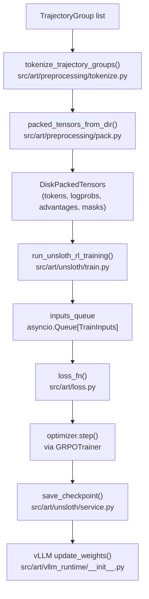
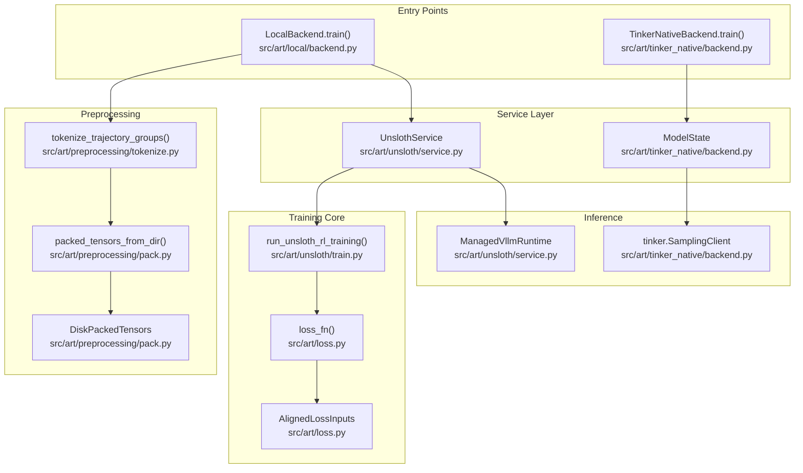

<!-- source: DeepWiki mcp.deepwiki.com · repo OpenPipe/ART · page 3 Training System · fetched 2026-10-29 -->

# Training System

Relevant source files

The following files were used as context for generating this wiki page:

- [dev/run_yes_no_maybe_kl_advantage_tinker.py](dev/run_yes_no_maybe_kl_advantage_tinker.py)
- [dev/yes-no-maybe-kl-advantage-tinker.py](dev/yes-no-maybe-kl-advantage-tinker.py)
- [dev/yes-no-maybe-kl-advantage.py](dev/yes-no-maybe-kl-advantage.py)
- [examples/temporal_clue/temporal-clue-7b-async.ipynb](examples/temporal_clue/temporal-clue-7b-async.ipynb)
- [examples/temporal_clue/temporal-clue-7b.ipynb](examples/temporal_clue/temporal-clue-7b.ipynb)
- [examples/temporal_clue/temporal-clue.py](examples/temporal_clue/temporal-clue.py)
- [src/art/_backend_training.py](src/art/_backend_training.py)
- [src/art/loss.py](src/art/loss.py)
- [src/art/test/test_kl_advantage.py](src/art/test/test_kl_advantage.py)
- [src/art/tinker_native/backend.py](src/art/tinker_native/backend.py)
- [src/art/unsloth/service.py](src/art/unsloth/service.py)
- [src/art/unsloth/train.py](src/art/unsloth/train.py)

This page is the overview for ART's training system. It covers the end-to-end flow from raw trajectories to optimizer steps, the reinforcement learning algorithm, the in-process services that manage GPU resources, and the configuration subsystems.

- For how trajectories are constructed during rollouts, see [Trajectory System](#2.2).
- For the data pipeline that converts trajectories to packed tensors, see [Data Processing Pipeline](#2.4).
- For the backend implementations that host training (LocalBackend, MegatronBackend, etc.), see [Backend Implementations](#4).

---

## Overview

The training system transforms a batch of completed `TrajectoryGroup` objects into a gradient update applied to a LoRA adapter. Every training step follows a fixed sequence:

1.  **Tokenize** — trajectories are tokenized and advantages are computed using GRPO.
2.  **Pack** — tokenized sequences are packed into fixed-length tensors.
3.  **Forward / backward pass** — the GRPO loss is computed and an optimizer step is taken.
4.  **Checkpoint** — a new LoRA adapter snapshot is written to disk.
5.  **Reload** — the vLLM inference engine loads the new adapter before the next step.

Inference is **paused** during training steps. This strict sequential structure allows a single GPU (or shared GPU set) to handle both inference and training by managing resource transitions.

Sources: [src/art/unsloth/train.py:1-44](), [src/art/unsloth/service.py:1-43](), [src/art/loss.py:1-111]()

---

## High-Level Training Flow

**Training step data flow (UnslothService)**

Sources: [src/art/unsloth/train.py:47-48](), [src/art/unsloth/service.py:66-108](), [src/art/loss.py:104-111](), [src/art/preprocessing/pack.py:31-35]()

---

## Subsystem Map

**Code entities in the training system**

Sources: [src/art/unsloth/service.py:131-158](), [src/art/unsloth/train.py:91-102](), [src/art/tinker_native/backend.py:155-173](), [src/art/loss.py:62-81]()

---

## GRPO Algorithm

ART implements **Group Relative Policy Optimization (GRPO)**. Advantages are computed at the `TrajectoryGroup` level by normalizing each trajectory's reward against the group mean and standard deviation.

The `loss_fn` in [src/art/loss.py:104-111]() accepts the packed tensors and applies policy gradient algorithms with several optional features:

| Mode | REINFORCE / CISPO (default) | PPO |
|---|---|---|
| Logic | Clipped IS-weight Policy Optimization | PPO clip |
| Default `epsilon` | `1.0` | `0.2` |
| Default `epsilon_high` | `4.0` | `None` (same as epsilon) |

### KL Regularization
The system supports KL-penalized advantage adjustment to prevent the policy from drifting too far from a reference model. This is controlled via `kl_penalty_coef` and `kl_penalty_source` (either `current_learner` or `sample`).

Sources: [src/art/loss.py:142-182](), [src/art/test/test_kl_advantage.py:143-182](), [src/art/_backend_training.py:15-40]()

---

## Model Services

The `ModelService` protocol defines how ART interacts with different training runtimes.

| Class | File | Use Case |
|---|---|---|
| `UnslothService` | `src/art/unsloth/service.py` | Primary GPU runtime; optimized LoRA + vLLM. |
| `TinkerNativeBackend` | `src/art/tinker_native/backend.py` | Native Tinker integration for efficient sampling and training. |

### GPU Management in UnslothService
`UnslothService` manages resource transitions between inference and training:
- **Offloading**: `UnslothTrainContext.offload_to_cpu()` pins parameters and optimizer state to CPU memory to free GPU space for vLLM [src/art/unsloth/train.py:105-153]().
- **Reloading**: `UnslothTrainContext.reload_to_gpu()` moves weights back to the accelerator for the next training batch [src/art/unsloth/train.py:155-182]().

For detailed documentation of model services, see [Model Services](#3.2).

---

## vLLM Integration

vLLM provides the high-performance inference endpoint used during rollouts. ART wraps this via `ManagedVllmRuntime` [src/art/unsloth/service.py:139-143]().

- **Weight Updates**: After training, weights are synchronized to the inference engine using `trainer_send_weights` or LoRA checkpoint loading [src/art/unsloth/service.py:31-36]().
- **Dedicated Mode**: Inference can be isolated to specific GPUs via `inference_gpu_ids` in the configuration [src/art/unsloth/service.py:201-206]().

For details on vLLM patches and runtime management, see [vLLM Integration](#3.3).

---

## Training Configuration

Training behavior is controlled by structured configuration objects defined in `src/art/types.py` and `src/art/dev/`.

### Key Parameters
- `learning_rate`: The step size for the AdamW optimizer [src/art/_backend_training.py:42]().
- `kl_penalty_coef`: Coefficient for the KL divergence penalty [src/art/_backend_training.py:43]().
- `importance_sampling_level`: Granularity of IS weights (`token`, `sequence`, `average`, `geometric_average`) [src/art/_backend_training.py:20-22]().
- `precalculate_logprobs`: Whether to compute logprobs on the trainer before starting the gradient step [src/art/_backend_training.py:25]().

For complete reference documentation of all configuration objects, see [Training Configuration](#3.4).

Sources: [src/art/_backend_training.py:15-88](), [src/art/unsloth/service.py:48-59]()

---

## Child Pages

| Page | Content |
|---|---|
| [Training Loop & GRPO Algorithm](#3.1) | `loss_fn`, advantage computation, optimizer step, sequential loop structure |
| [Model Services](#3.2) | `UnslothService`, `ModelState`, GPU offload/reload logic |
| [vLLM Integration](#3.3) | `ManagedVllmRuntime`, weight transfer, and inference server lifecycle |
| [Training Configuration](#3.4) | `TrainConfig`, `InternalModelConfig`, and RL parameter validation |

---

