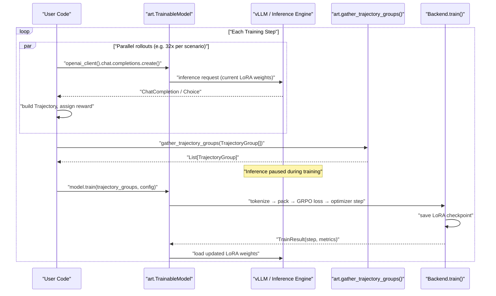
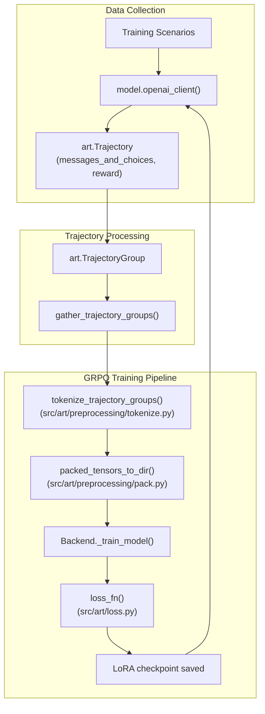
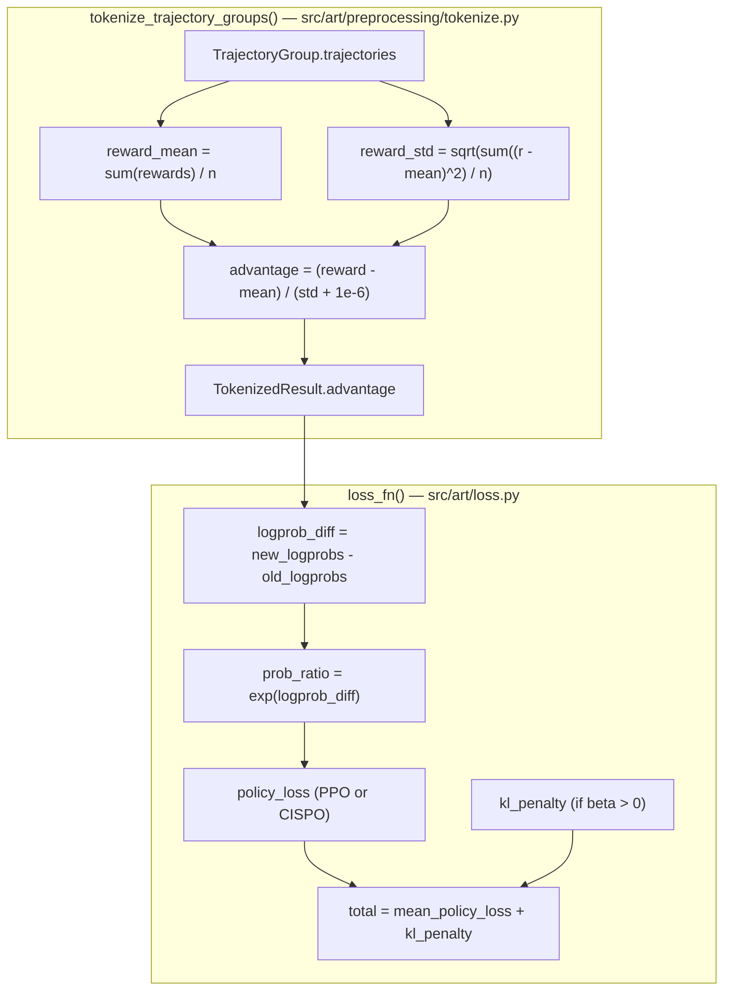
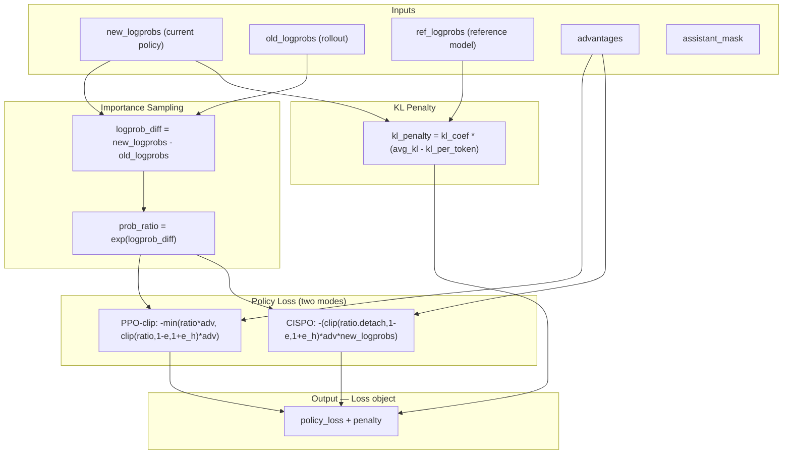
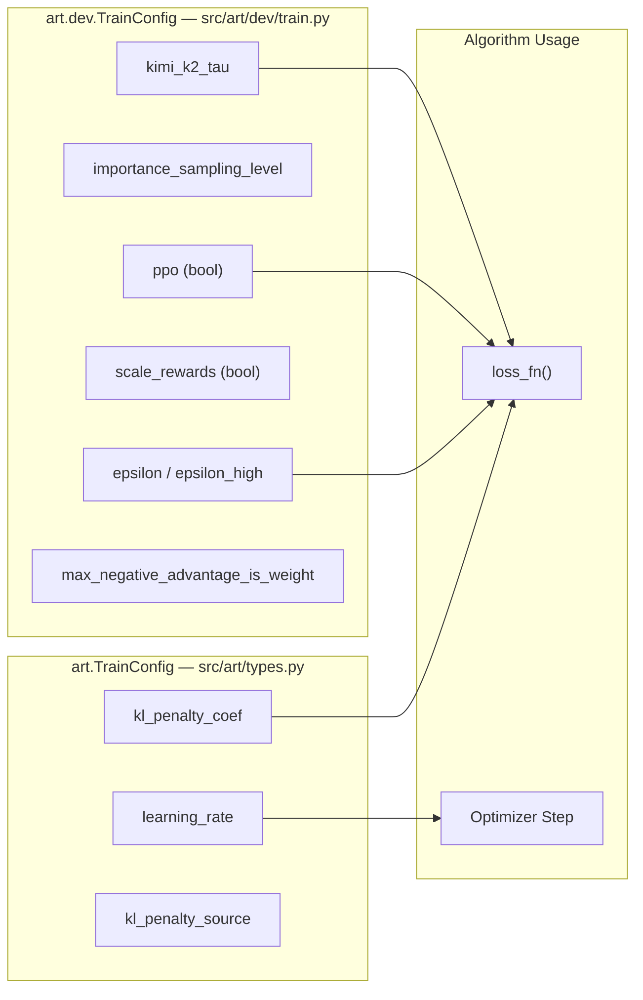

<!-- source: DeepWiki mcp.deepwiki.com · repo OpenPipe/ART · page 3.1 Training Loop & GRPO Algorithm · fetched 2026-10-29 -->

# Training Loop & GRPO Algorithm

Relevant source files

The following files were used as context for generating this wiki page:

- [dev/run_yes_no_maybe_kl_advantage_tinker.py](dev/run_yes_no_maybe_kl_advantage_tinker.py)
- [dev/yes-no-maybe-kl-advantage-tinker.py](dev/yes-no-maybe-kl-advantage-tinker.py)
- [dev/yes-no-maybe-kl-advantage.py](dev/yes-no-maybe-kl-advantage.py)
- [src/art/_backend_training.py](src/art/_backend_training.py)
- [src/art/dev/train.py](src/art/dev/train.py)
- [src/art/local/backend.py](src/art/local/backend.py)
- [src/art/loss.py](src/art/loss.py)
- [src/art/model.py](src/art/model.py)
- [src/art/serverless/backend.py](src/art/serverless/backend.py)
- [src/art/serverless/client.py](src/art/serverless/client.py)
- [src/art/test/test_kl_advantage.py](src/art/test/test_kl_advantage.py)
- [src/art/tinker_native/backend.py](src/art/tinker_native/backend.py)
- [tests/unit/test_serverless_pipeline_trainer_compat.py](tests/unit/test_serverless_pipeline_trainer_compat.py)

This page documents ART's training loop structure and the GRPO (Group Relative Policy Optimization) algorithm used to update model weights. It covers the strictly sequential inference-then-train loop, group-relative advantage computation, the policy loss function, and how the optimizer step is executed.

## The Sequential Training Loop

ART's training loop is **strictly sequential**: all rollouts for a step execute in parallel, then inference is paused while training runs, then the updated checkpoint is loaded before the next step begins. No inference occurs during training, and no training occurs during inference.

**Sequential Training Loop — Code-Level Entities**

Sources: [src/art/model.py:166-200](), [src/art/local/backend.py:338-385](), [dev/yes-no-maybe-kl-advantage.py:86-110]()

## Overall Data Flow

The following diagram maps the high-level stages to the specific code entities involved.

**Training Data Flow — Key Code Entities**

Sources: [src/art/local/backend.py:338-385](), [src/art/loss.py:104-111](), [src/art/preprocessing/tokenize.py:71-75]()

## Trajectory Collection and Grouping

A `TrajectoryGroup` is the fundamental unit of a GRPO training batch. Each group contains multiple `Trajectory` objects produced by running the same scenario multiple times with the same model weights. The group structure is what enables group-relative advantage computation.

| Concept | Code Entity | Location |
|---|---|---|
| Single agent run | `art.Trajectory` | [src/art/trajectories.py:38]() |
| Batch of same-scenario runs | `art.TrajectoryGroup` | [src/art/trajectories.py:102]() |
| Reward field on trajectory | `Trajectory.reward` | [src/art/trajectories.py:43]() |
| Message/completion history | `Trajectory.messages_and_choices` | [src/art/trajectories.py:39]() |

`art.gather_trajectory_groups()` runs all rollout coroutines concurrently, collects results into `TrajectoryGroup` objects, and returns them as a list ready for training.

Sources: [src/art/trajectories.py:38-133](), [dev/yes-no-maybe-kl-advantage.py:87-94]()

## GRPO Algorithm Overview

GRPO (Group Relative Policy Optimization) trains the model by comparing trajectories within a group and computing advantages relative to the group's mean reward. Trajectories that performed better than the group average receive a positive advantage; those that performed worse receive a negative advantage.

**Advantage Computation and Loss Pipeline — Code-Level Entities**

### Advantage Computation

The advantages are computed per group during tokenization. If `scale_rewards` is enabled in the configuration, the advantages are normalized by the standard deviation of rewards within that group.

Sources: [src/art/preprocessing/tokenize.py:74-91](), [src/art/_backend_training.py:18-55]()

## Loss Computation Details

The `loss_fn()` function in `src/art/loss.py` is the core of the GRPO algorithm. It receives tensors from the packed training batch and returns a `Loss` object.

**loss_fn() Internal Flow — src/art/loss.py**

### Policy Loss Modes

ART supports two policy loss modes, selected via `dev.TrainConfig["ppo"]`:

| Mode | `ppo=False` (default) | `ppo=True` |
|---|---|---|
| **Name** | CISPO (Clipped IS-weight Policy Optimization) | PPO-clip |
| **Formula** | `-(clip(prob_ratio.detach(), 1-ε, 1+ε_high) * adv * new_logprobs)` | `-min(prob_ratio * adv, clip(prob_ratio, 1-ε, 1+ε_high) * adv)` |
| **Default ε** | 1.0 | 0.2 |

Sources: [src/art/loss.py:142-192]()

### KL Penalty and Reference Models

When `kl_penalty_coef > 0`, the algorithm applies a penalty based on the divergence from a reference model. The source for the KL calculation can be either the `current_learner` or the `sample` (rollout logprobs).

*   **Reference Step:** `kl_penalty_reference_step` allows using a previous checkpoint as the reference.
*   **Reference Adapter:** `kl_ref_adapter_path` allows specifying an external LoRA adapter as the anchor.

Sources: [src/art/loss.py:168-181](), [src/art/test/test_kl_advantage.py:144-189](), [src/art/tinker_native/backend.py:85-152]()

### Importance Sampling Levels

The `importance_sampling_level` parameter controls the granularity of the importance weight:
*   `token`: Weight computed per individual token.
*   `sequence`: Weight averaged across the entire sequence.
*   `average` / `geometric_average`: Combinations of token and sequence levels.

Sources: [src/art/loss.py:125-141]()

## Training Configuration

Configuration is split between the high-level `TrainConfig` and the internal `dev.TrainConfig` used for algorithm tuning.

**Configuration Objects — Code Entities**

Sources: [src/art/dev/train.py:11-44](), [src/art/_backend_training.py:15-88](), [src/art/serverless/client.py:54-82]()

---

