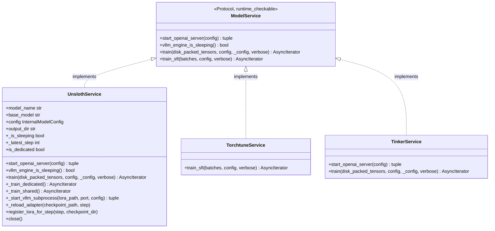
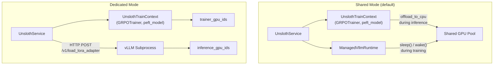
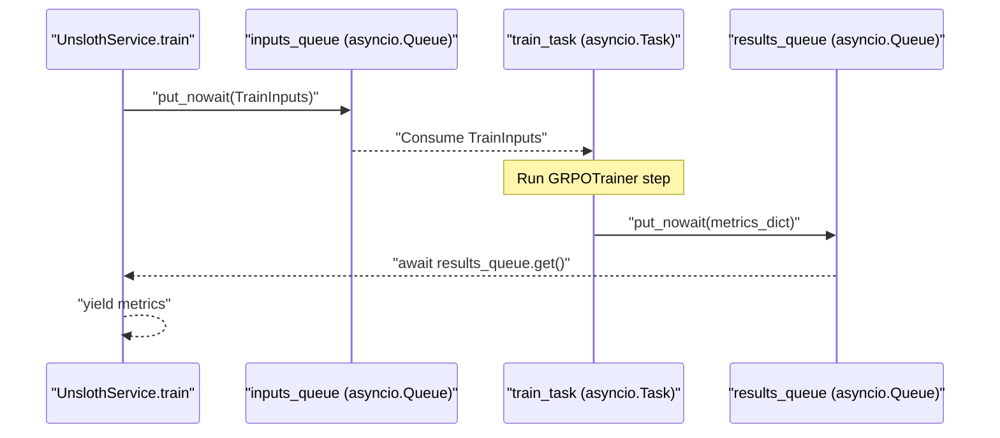

<!-- source: DeepWiki mcp.deepwiki.com · repo OpenPipe/ART · page 3.2 Model Services · fetched 2026-10-29 -->

# Model Services

Relevant source files

The following files were used as context for generating this wiki page:

- [examples/temporal_clue/temporal-clue-7b-async.ipynb](examples/temporal_clue/temporal-clue-7b-async.ipynb)
- [examples/temporal_clue/temporal-clue-7b.ipynb](examples/temporal_clue/temporal-clue-7b.ipynb)
- [examples/temporal_clue/temporal-clue.py](examples/temporal_clue/temporal-clue.py)
- [src/art/local/service.py](src/art/local/service.py)
- [src/art/unsloth/service.py](src/art/unsloth/service.py)
- [src/art/unsloth/train.py](src/art/unsloth/train.py)

## Purpose and Scope

This page documents the `ModelService` protocol and its primary concrete implementation, `UnslothService`, including its dedicated and shared GPU modes. It covers how a service starts the OpenAI-compatible inference endpoint, exposes an async training iterator, and manages GPU memory between inference and training phases.

- For the `LocalBackend` class that owns and manages service instances, see [LocalBackend](#4.1).
- For how vLLM is patched and configured to serve LoRA adapters, see [vLLM Integration](#3.3).
- For training configuration options that select between dedicated and shared mode, see [Training Configuration](#3.4).
- For the `TinkerService` implementation (selected when `tinker_args` is set in config), see [TinkerBackend](#4.6).

---

## The `ModelService` Protocol

`ModelService` is defined in [src/art/local/service.py:9-50]() as a `@runtime_checkable` `Protocol`. Every service class used by `LocalBackend` must satisfy this interface.

| Method | Return Type | Purpose |
|---|---|---|
| `__init__(model_name, base_model, config, output_dir)` | — | Initialize with model identity and paths |
| `start_openai_server(config)` | `tuple[str, int]` | Start the inference endpoint; return `(host, port)` |
| `vllm_engine_is_sleeping()` | `bool` | Whether inference engine is currently paused |
| `train(disk_packed_tensors, config, _config, verbose)` | `AsyncIterator[dict[str, float]]` | RL training; yields per-batch metrics |
| `train_sft(batches, config, verbose)` | `AsyncIterator[dict[str, float]]` | SFT training; yields per-batch metrics |

The `train` method receives a `DiskPackedTensors` — a `TypedDict` with a directory path and tensor shape metadata [src/art/preprocessing/pack.py:26-31]() — rather than in-memory tensors. This enables cross-process tensor sharing via memory-mapped files.

### Service Selection in LocalBackend

`LocalBackend._get_service` selects the concrete service class at first use. If `tinker_args` is present in the configuration, it initializes `TinkerService`; otherwise, it defaults to `UnslothService`. In non-dedicated, non-in-process mode, the selected service object is moved into a child process via `move_to_child_process` from `mp_actors`. This isolates GPU memory from the orchestrator process and allows the system to cleanly reclaim GPU memory between models.

**Diagram: ModelService Protocol and Implementations**

Sources: [src/art/local/service.py:9-50](), [src/art/unsloth/service.py:132-156]()

---

## UnslothService

`UnslothService` [src/art/unsloth/service.py:132-156]() is a `@dataclass` that manages the training lifecycle using Unsloth and TRL's `GRPOTrainer`. It handles the coordination between the inference engine (vLLM) and the training context.

Key fields:

| Field | Type | Role |
|---|---|---|
| `model_name` | `str` | Name used in vLLM model registry (e.g. `model@step`) |
| `base_model` | `str` | HuggingFace model ID |
| `config` | `InternalModelConfig` | Full model configuration dict |
| `output_dir` | `str` | Directory for checkpoints and logs |
| `_vllm_runtime` | `ManagedVllmRuntime` | Orchestrates vLLM lifecycle [src/art/unsloth/service.py:139-143]() |
| `_lifecycle` | `ServiceLifecycle` | Manages service state transitions [src/art/unsloth/service.py:145-149]() |

---

## Dedicated vs Shared GPU Mode

`UnslothService.is_dedicated` [src/art/unsloth/service.py:168-169]() delegates to `is_dedicated_mode(self.config)` to determine if inference and training should run on separate GPU sets.

| Aspect | Shared Mode | Dedicated Mode |
|---|---|---|
| GPU allocation | Single shared GPU pool | Separate `inference_gpu_ids` and `trainer_gpu_ids` |
| vLLM process | Managed by `ManagedVllmRuntime` [src/art/unsloth/service.py:139]() | Subprocess launched via `_start_vllm_subprocess` [src/art/unsloth/service.py:296]() |
| During training | vLLM enters sleep mode; training model reloaded to GPU | vLLM runs uninterrupted on inference GPUs |
| LoRA reload mechanism | `llm.add_lora(...)` via runtime | HTTP `POST /v1/load_lora_adapter` to subprocess [src/art/unsloth/service.py:389]() |
| Memory management | `offload_to_cpu` / `reload_to_gpu` cycle | No offloading required between phases |

**Diagram: Dedicated vs Shared Mode Architecture**

Sources: [src/art/unsloth/service.py:168-175](), [src/art/unsloth/service.py:296-387](), [src/art/unsloth/train.py:105-183]()

---

## Starting the OpenAI Server

`start_openai_server` [src/art/unsloth/service.py:433-466]() initializes the inference endpoint.

1. **Checkpoint Resolution**: It identifies the latest LoRA checkpoint via `get_last_checkpoint_dir`. If none exists, it triggers an initial save via `save_checkpoint` [src/art/unsloth/service.py:66-108]().
2. **Inference Launch**:
   - In **Shared Mode**, it ensures the training model is offloaded to CPU [src/art/unsloth/train.py:105-153]() before starting the vLLM server task.
   - In **Dedicated Mode**, it invokes `_start_vllm_subprocess` [src/art/unsloth/service.py:296-387](), which executes `python -m art.vllm.dedicated_server`. It polls the `/v1/models` endpoint until the server is ready.
3. **Registration**: It returns the `(host, port)` for the OpenAI-compatible client to use.

---

## The Async Training Iterator

The training process uses `UnslothTrainContext` [src/art/unsloth/train.py:92-101]() to manage the bridge between the async service and the synchronous TRL trainer.

### Queue Architecture

| Queue | Purpose |
|---|---|
| `inputs_queue` | Holds `TrainInputs` sent from the service to the training task [src/art/unsloth/train.py:97](). |
| `results_queue` | Holds metric dictionaries sent from the training task back to the service [src/art/unsloth/train.py:98](). |

The `train_task` [src/art/unsloth/train.py:99]() runs the background training loop. It consumes inputs, performs backpropagation, and yields results.

**Diagram: Training Queue Flow**

Sources: [src/art/unsloth/train.py:92-101](), [src/art/unsloth/service.py:522-580]()

### Training Execution Modes

- **`_train_dedicated`**: Directly feeds batches into the `inputs_queue`. After the epoch, it saves a checkpoint and reloads the adapter in the inference subprocess [src/art/unsloth/service.py:541-580]().
- **`_train_shared`**: Performs a memory dance. It puts vLLM to sleep, reloads the model to GPU [src/art/unsloth/train.py:155-183](), runs training, saves the checkpoint, offloads the model back to CPU, and wakes vLLM with the new adapter [src/art/unsloth/service.py:582-628]().

---

## Memory Management: `UnslothTrainContext`

`UnslothTrainContext` provides explicit methods to move model weights and optimizer states between GPU and CPU.

### `offload_to_cpu`
[src/art/unsloth/train.py:105-153]()
- Iterates through `peft_model` parameters.
- Uses **pinned memory** (`pin_memory=True`) for CPU buffers to accelerate future transfers.
- Non-blocking copies are synchronized with `torch.cuda.synchronize()`.
- Optimizer states are also moved to the `_pinned_buffers` [src/art/unsloth/train.py:128-150]().

### `reload_to_gpu`
[src/art/unsloth/train.py:155-183]()
- Reverses the offload process.
- Re-allocates GPU tensors and copies data back from pinned CPU buffers.

---

## Checkpoint Saving and LoRA Registration

### `save_checkpoint`
[src/art/unsloth/service.py:66-108]()
- **Cleanup**: Deletes unused adapters from the PEFT model to release memory before saving.
- **Versioning**: Determines the next step number via `get_step_from_dir`.
- **Conversion**: Calls `convert_checkpoint_if_needed` [src/art/unsloth/service.py:105]() to ensure the LoRA is compatible with vLLM (especially for MoE models).

### `_reload_adapter`
[src/art/unsloth/service.py:389-412]()
- Used in dedicated mode.
- Sends a `POST` request to the dedicated vLLM server's `/v1/load_lora_adapter` endpoint.
- Uses `load_inplace: True` to minimize memory fragmentation in the inference process.

Sources: [src/art/unsloth/service.py:66-108](), [src/art/unsloth/service.py:389-412](), [src/art/unsloth/train.py:105-183]()

---

