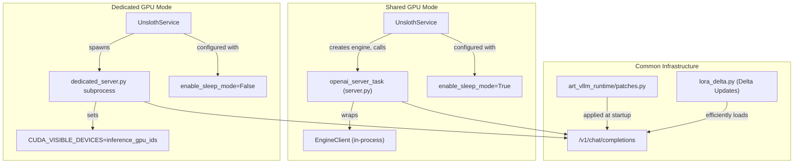
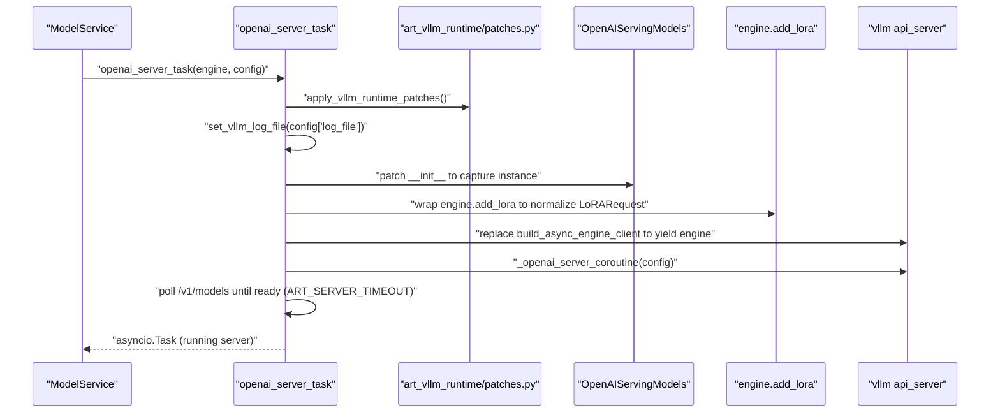
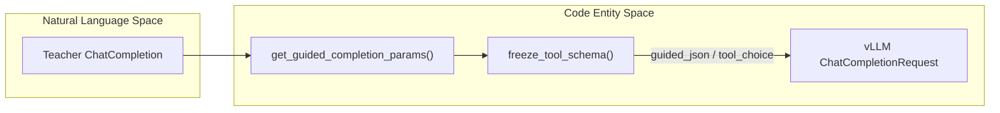

<!-- source: DeepWiki mcp.deepwiki.com · repo OpenPipe/ART · page 3.3 vLLM Integration · fetched 2026-10-29 -->

# vLLM Integration

Relevant source files

The following files were used as context for generating this wiki page:

- [dev/run_qwen3_5_localbackend_yes_no_maybe.py](dev/run_qwen3_5_localbackend_yes_no_maybe.py)
- [dev/yes-no-maybe-metrics.py](dev/yes-no-maybe-metrics.py)
- [examples/tic_tac_toe/rollout.py](examples/tic_tac_toe/rollout.py)
- [examples/tic_tac_toe_self_play/rollout.py](examples/tic_tac_toe_self_play/rollout.py)
- [examples/tic_tac_toe_self_play/train.py](examples/tic_tac_toe_self_play/train.py)
- [src/art/dev/engine.py](src/art/dev/engine.py)
- [src/art/dev/openai_server.py](src/art/dev/openai_server.py)
- [src/art/guided_completion.py](src/art/guided_completion.py)
- [vllm_runtime/src/art_vllm_runtime/lora_delta.py](vllm_runtime/src/art_vllm_runtime/lora_delta.py)
- [vllm_runtime/src/art_vllm_runtime/patches.py](vllm_runtime/src/art_vllm_runtime/patches.py)

## Purpose and Scope

This document describes how ART wraps vLLM to serve an OpenAI-compatible inference endpoint used for rollout data collection during RL training. The integration covers:

- The `art-vllm-runtime` sub-package providing specialized logic for LoRA delta updates and expert sharding.
- The `openai_server_task` entry point that starts a vLLM-backed OpenAI server around a pre-created engine [src/art/vllm/server.py:22-131]().
- Monkey-patches applied at startup to fix vLLM behaviors required for training, such as forced logprobs and tool call streaming [src/art/vllm/patches.py:1-31]().
- A `dedicated_server` subprocess mode that runs vLLM on a separate GPU from the trainer [src/art/vllm/dedicated_server.py:1-98]().
- Configuration logic for `EngineArgs` that selects between shared-GPU and dedicated-GPU inference modes [src/art/dev/engine.py:10-137]().

Sources: [src/art/vllm/server.py:1-211](), [src/art/vllm/patches.py:1-31](), [src/art/vllm/dedicated_server.py:1-98](), [vllm_runtime/src/art_vllm_runtime/patches.py:1-31]()

## Architecture Overview

ART supports two inference modes determined by whether `trainer_gpu_ids` and `inference_gpu_ids` are set in `InternalModelConfig`.

**"Shared GPU" mode (default):** The training service (e.g., `UnslothService`) owns the engine and starts an OpenAI-compatible server around it using `openai_server_task`. Training and inference share the same GPU, with the engine entering sleep mode to free memory during the training step.

**"Dedicated GPU" mode:** `UnslothService` launches `dedicated_server.py` as a subprocess bound to a separate GPU (`CUDA_VISIBLE_DEVICES`), allowing inference and training to run concurrently on different devices.

**Diagram: Inference Modes and Code Entities**

Sources: [src/art/vllm/server.py:22-131](), [src/art/vllm/dedicated_server.py:1-98](), [src/art/dev/engine.py:123-126](), [vllm_runtime/src/art_vllm_runtime/patches.py:1-31]()

## OpenAI-Compatible Server

### `openai_server_task`

The primary entry point for ART's vLLM server is `openai_server_task` in [src/art/vllm/server.py:22-131](). It accepts an existing `EngineClient` and an `OpenAIServerConfig` dict, applies patches, and starts the server as a background `asyncio.Task`.

**Diagram: `openai_server_task` startup sequence**

Sources: [src/art/vllm/server.py:22-131](), [vllm_runtime/src/art_vllm_runtime/patches.py:14-30]()

### Server Configuration

`OpenAIServerConfig` [src/art/dev/openai_server.py:50-65]() governs the server behavior:

| Key | Sub-key | Description |
|-----|---------|-------------|
| `log_file` | — | Path where vLLM and uvicorn logs are written [src/art/dev/openai_server.py:63](). |
| `engine_args` | `model`, `gpu_memory_utilization`, `max_model_len`, … | Forwarded to vLLM `EngineArgs` [src/art/dev/engine.py:10-137](). |
| `server_args` | `api_key`, `enable_auto_tool_choice`, `tool_call_parser`, … | Forwarded to vLLM OpenAI frontend [src/art/dev/openai_server.py:68-104](). |

The helper `get_openai_server_config` [src/art/dev/openai_server.py:8-47]() automatically registers LoRA modules if a `lora_path` is provided, using a specific naming convention: `{model_name}@{step}` [src/art/dev/openai_server.py:27]().

## LoRA Delta Updates

A unique feature of the `art-vllm-runtime` is the ability to compute and apply LoRA weight deltas directly within the inference engine. This is implemented in `lora_delta.py` [vllm_runtime/src/art_vllm_runtime/lora_delta.py:1-150]().

### Key Mechanisms:
- **Delta Computation:** Instead of reloading the entire model, ART computes the matrix product $B \times A$ and scales it by the LoRA alpha/rank [vllm_runtime/src/art_vllm_runtime/lora_delta.py:31-49]().
- **Expert Sharding:** For MoE models (like Gemma 2 9B), it handles the unpacking of expert-specific LoRA B tensors and applies deltas to the correct `gate_proj`, `up_proj`, or `down_proj` weights [vllm_runtime/src/art_vllm_runtime/lora_delta.py:61-135]().
- **Additive Loading:** It provides an `_additive_weight_loader` that can apply these deltas to the base model weights in-place [vllm_runtime/src/art_vllm_runtime/lora_delta.py:181-187]().

Sources: [vllm_runtime/src/art_vllm_runtime/lora_delta.py:31-135]()

## Custom Patches

The `art_vllm_runtime.patches` module applies critical fixes to vLLM at runtime.

| Function | Target | Purpose |
|----------|--------|---------|
| `subclass_chat_completion_request` | `protocol.ChatCompletionRequest` | Forces `logprobs=True` and `return_token_ids=True` for all requests [vllm_runtime/src/art_vllm_runtime/patches.py:76-92](). |
| `patch_listen_for_disconnect` | `api_utils.listen_for_disconnect` | Prevents server crashes on client disconnect by catching `UnboundLocalError` [vllm_runtime/src/art_vllm_runtime/patches.py:94-118](). |
| `patch_tool_parser_manager` | `ToolParserManager.get_tool_parser` | Ensures streaming tool calls return a `DeltaMessage()` instead of `None` [vllm_runtime/src/art_vllm_runtime/patches.py:120-146](). |
| `patch_nccl_unique_id_bootstrap` | `NCCLLibrary.ncclCommInitRank` | Fixes NCCL unique ID propagation in distributed environments [vllm_runtime/src/art_vllm_runtime/patches.py:171-205](). |

Sources: [vllm_runtime/src/art_vllm_runtime/patches.py:14-205]()

## Engine Configuration (`EngineArgs`)

The `EngineArgs` TypedDict [src/art/dev/engine.py:10-137]() mirrors vLLM's internal configuration but adds ART-specific controls:

- **`enable_sleep_mode`**: Boolean flag to enable/disable KV cache offloading [src/art/dev/engine.py:123]().
- **`enable_lora`**: Must be `True` to use the delta update system [src/art/dev/engine.py:66]().
- **`max_loras` / `max_lora_rank`**: Controls the capacity for dynamic adapter loading [src/art/dev/engine.py:68-69]().
- **`weight_transfer_config`**: Configuration for NCCL-based weight synchronization between training and inference [src/art/dev/engine.py:131]().

Sources: [src/art/dev/engine.py:6-137]()

## Guided Completion Integration

ART integrates vLLM's guided decoding (via Outlines or similar backends) to facilitate RL distillation. The `get_guided_completion_params` function [src/art/guided_completion.py:33-78]() takes a completion from a "teacher" model and extracts parameters to force a "student" model to follow the same structure (e.g., specific tool calls or JSON schemas).

**Data Flow: Guided Completion**

Sources: [src/art/guided_completion.py:16-78]()

---

