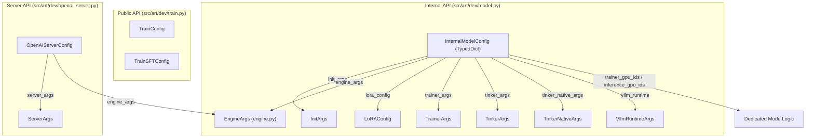
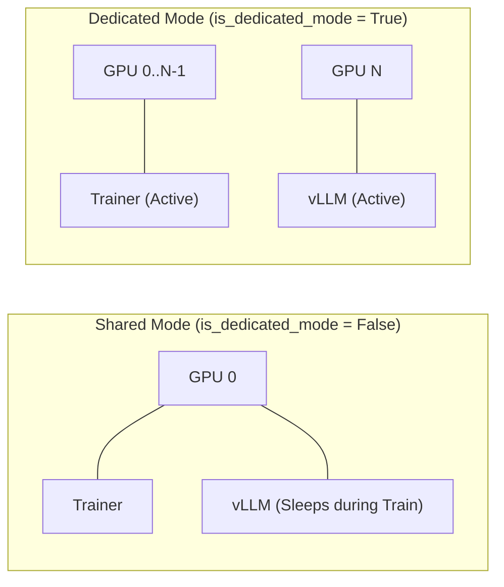

<!-- source: DeepWiki mcp.deepwiki.com · repo OpenPipe/ART · page 3.4 Training Configuration · fetched 2026-10-29 -->

# Training Configuration

Relevant source files

The following files were used as context for generating this wiki page:

- [pyproject.toml](pyproject.toml)
- [src/art/dev/__init__.py](src/art/dev/__init__.py)
- [src/art/dev/get_model_config.py](src/art/dev/get_model_config.py)
- [src/art/dev/model.py](src/art/dev/model.py)
- [src/art/dev/validate.py](src/art/dev/validate.py)
- [tests/unit/test_dedicated_config.py](tests/unit/test_dedicated_config.py)
- [uv.lock](uv.lock)

This page documents all configuration objects used to control model initialization, LoRA adapters, the vLLM inference engine, and the GRPO/SFT trainers in ART. It covers both the public API (`TrainConfig`, `TrainSFTConfig`) and the internal developer API (`InternalModelConfig` and its sub-TypedDicts).

For how configuration flows into the training loop itself, see [Training Loop & GRPO Algorithm](#3.1). For how model services consume these configs at startup, see [Model Services](#3.2). For vLLM-specific behavior, see [vLLM Integration](#3.3).

---

## Configuration Hierarchy

The diagram below maps the configuration types to their source files and shows how they compose.

**Configuration Object Map**

Sources: [src/art/dev/model.py:121-172](), [src/art/dev/openai_server.py:50-66](), [src/art/dev/train.py:1-26](), [src/art/dev/engine.py:1-40]()

---

## Public API: `TrainConfig` and `TrainSFTConfig`

These are the stable, user-facing configuration classes passed to training calls. They live in `src/art/dev/train.py`.

### `TrainConfig`

Used with RL (GRPO) training via `backend.train()`.

| Field | Type | Default | Description |
|---|---|---|---|
| `learning_rate` | `float` | `5e-6` | Learning rate for the GRPO optimizer step. |
| `beta` | `float` | `0.0` | KL penalty coefficient (β in GRPO). |
| `kl_penalty_coef` | `float` | `0.0` | Additional KL penalty scaling coefficient. |

Sources: [src/art/dev/train.py:10-14]()

### `TrainSFTConfig`

Used with supervised fine-tuning via `model.train_sft()`.

| Field | Type | Default | Description |
|---|---|---|---|
| `learning_rate` | `float \| list[float]` | `5e-5` | Learning rate. Pass a list to set a different rate per batch. |
| `batch_size` | `int \| "auto"` | `"auto"` | Batch size for SFT. `"auto"` lets the backend decide. |

Sources: [src/art/dev/train.py:17-20]()

---

## Internal API: `InternalModelConfig`

`InternalModelConfig` is a `TypedDict` stored on `TrainableModel._internal_config`. It is passed at model construction time via the `_internal_config` parameter.

> **Migration Note:** `peft_args` has been replaced by `lora_config`. Attempting to use `peft_args` in `InternalModelConfig` will raise a `ValueError` [src/art/dev/get_model_config.py:32-33]().

### Top-level `InternalModelConfig` keys

| Key | Type | Description |
|---|---|---|
| `init_args` | `InitArgs` | Arguments for model initialization (Unsloth/Transformers). |
| `engine_args` | `EngineArgs` | Arguments for the vLLM engine. |
| `lora_config` | `LoRAConfig` | Configuration for LoRA adapters. |
| `trainer_args` | `TrainerArgs` | Arguments for the GRPO/HuggingFace trainer. |
| `tinker_args` | `TinkerArgs \| None` | Configuration for Tinker training client. |
| `trainer_gpu_ids` | `list[int]` | GPU IDs for training. Enables dedicated mode when set with `inference_gpu_ids`. |
| `inference_gpu_ids` | `list[int]` | GPU IDs for vLLM inference. Enables dedicated mode. |
| `rollout_weights_mode` | `RolloutWeightsMode` | `"lora"` (direct load) or `"merged"` (push merged weights). |
| `vllm_runtime` | `VllmRuntimeArgs` | Controls if vLLM is `managed` (local) or `external`. |

Sources: [src/art/dev/model.py:121-172]()

---

### `InitArgs`

Controls how the base model is loaded.

| Field | Default (from `get_model_config`) | Description |
|---|---|---|
| `model_name` | base model or last checkpoint | HuggingFace model ID or local path. |
| `max_seq_length` | auto-detected from model | Maximum sequence length for the model. |
| `load_in_4bit` | `True` | Load the model in 4-bit quantization. |
| `dtype` | — | Force a specific dtype (e.g., `"bfloat16"`). |
| `token` | — | HuggingFace API token for gated models. |

Sources: [src/art/dev/model.py:194-210](), [src/art/dev/get_model_config.py:44-52]()

---

### `EngineArgs`

Controls the vLLM engine.

| Field | Default (from `get_model_config`) | Description |
|---|---|---|
| `model` | base model | HuggingFace model name for vLLM. |
| `enable_sleep_mode` | `True` (shared), `False` (dedicated) | Allow vLLM to sleep during training to free VRAM. |
| `generation_config` | `"vllm"` | Generation config source. |
| `lora_target_modules` | auto-detected | Specific modules for LoRA in vLLM. |

Sources: [src/art/dev/engine.py:6-40](), [src/art/dev/get_model_config.py:53-60]()

---

### `LoRAConfig`

Replaces the legacy `PeftArgs`.

| Field | Default | Description |
|---|---|---|
| `rank` | `8` | LoRA rank (formerly `r`). |
| `lora_alpha` | `16` | LoRA scaling factor. |
| `target_modules` | auto-detected | Transformer modules to apply LoRA to. |
| `use_gradient_checkpointing` | `"unsloth"` | Mode for gradient checkpointing. |
| `random_state` | `3407` | Seed for weight initialization. |

Sources: [src/art/dev/model.py:213-231](), [src/art/dev/get_model_config.py:63-67]()

---

### `TrainerArgs`

Passed to the HuggingFace/GRPO trainer.

**Default values set by `get_model_config`:**

| Field | Default | Description |
|---|---|---|
| `learning_rate` | `5e-6` | Initial learning rate. |
| `optim` | `"paged_adamw_8bit"` | Optimizer choice. |
| `num_generations` | `2` | GRPO completions per prompt. |
| `max_grad_norm` | `0.1` | Gradient clipping threshold. |
| `save_strategy` | `"no"` | Checkpoint saving frequency. |

Sources: [src/art/dev/model.py:234-362](), [src/art/dev/get_model_config.py:78-96]()

---

## `OpenAIServerConfig`

Controls the standalone vLLM server.

| Field | Type | Description |
|---|---|---|
| `log_file` | `str` | Path to server logs. |
| `server_args` | `ServerArgs` | HTTP server parameters (port, host, API key). |
| `engine_args` | `EngineArgs` | vLLM engine parameters. |

Sources: [src/art/dev/openai_server.py:50-66]()

---

## Dedicated vs Shared GPU Mode

ART manages GPU allocation via `trainer_gpu_ids` and `inference_gpu_ids`.

### Validation Logic (`validate_dedicated_config`)

The system performs strict validation in `src/art/dev/validate.py`:

1.  **Atomicity**: `trainer_gpu_ids` and `inference_gpu_ids` must both be set or both unset [src/art/dev/validate.py:66-69]().
2.  **No Overlap**: Training and inference GPUs must be disjoint sets [src/art/dev/validate.py:95-96]().
3.  **Inference Limit**: Multi-GPU inference is currently not supported; `inference_gpu_ids` must have exactly one GPU [src/art/dev/validate.py:98-101]().
4.  **Contiguity**: `trainer_gpu_ids` must start at GPU 0 and be contiguous (e.g., `[0, 1]`) [src/art/dev/validate.py:103-112]().
5.  **Incompatibilities**: `enable_sleep_mode` is forbidden in dedicated mode [src/art/dev/validate.py:114-118]().

### Mode Comparison

Sources: [src/art/dev/validate.py:23-27](), [src/art/dev/get_model_config.py:38-41](), [tests/unit/test_dedicated_config.py:30-118]()

---

## Config Assembly: `get_model_config`

This function is the central entry point for resolving configuration before passing it to a backend.

**Assembly Logic:**
1.  **Check for Legacy Keys**: Raises error if `peft_args` is present [src/art/dev/get_model_config.py:32-33]().
2.  **Detect Mode**: Sets `enable_sleep_mode` to `False` if dedicated mode is active [src/art/dev/get_model_config.py:38-41]().
3.  **Model Loading**: Resolves `max_seq_length` and `model_name` (handling checkpoint resume) [src/art/dev/get_model_config.py:44-62]().
4.  **LoRA Mapping**: Maps `LoRAConfig` target modules to vLLM-compatible names if `rollout_weights_mode` is `"lora"` [src/art/dev/get_model_config.py:70-77]().

Sources: [src/art/dev/get_model_config.py:22-113]()

---

