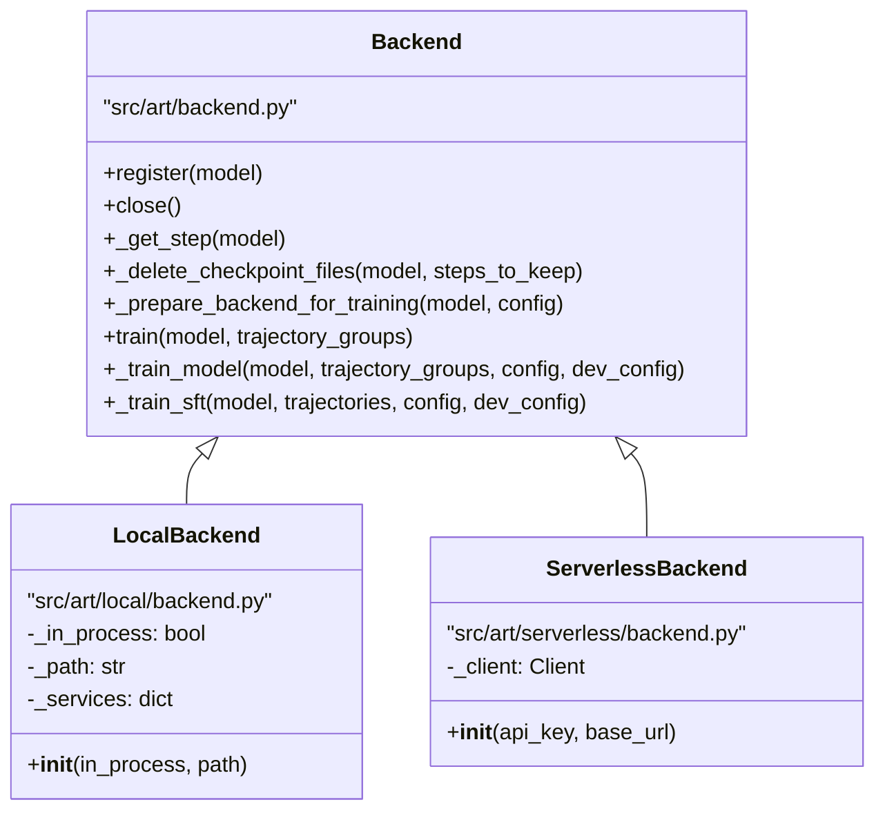
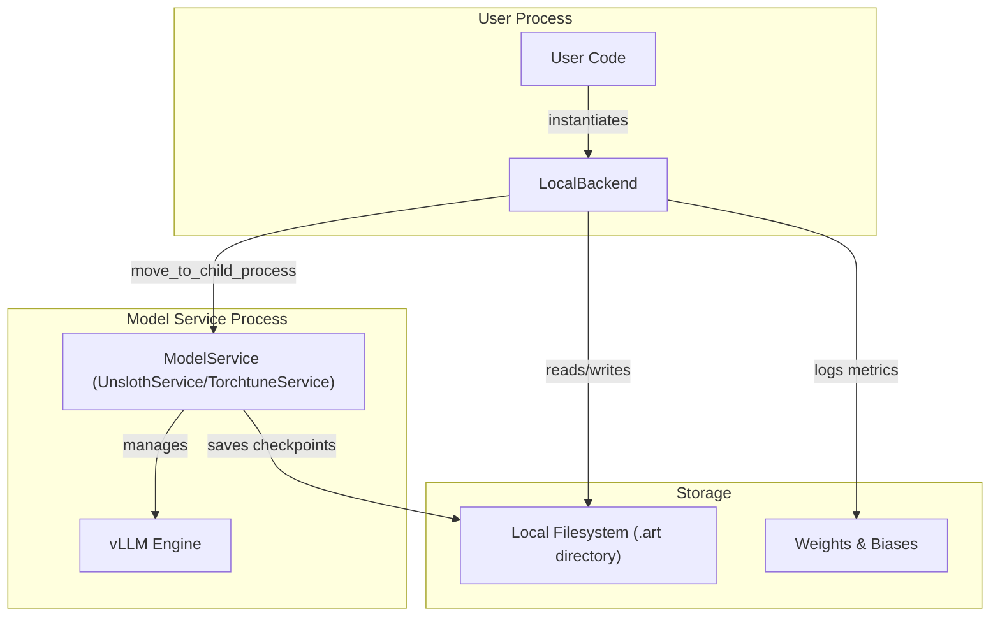
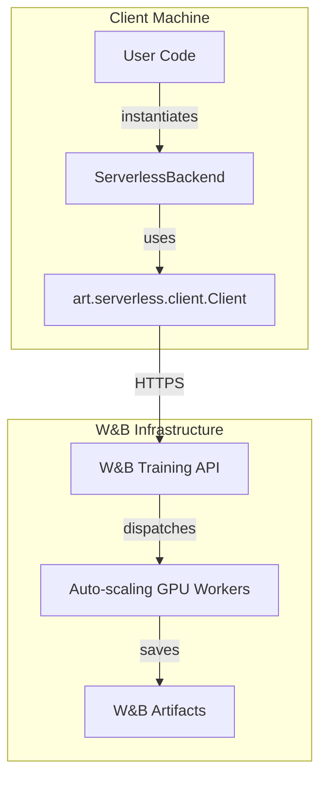

<!-- source: DeepWiki mcp.deepwiki.com · repo OpenPipe/ART · page 4 Backend Implementations · fetched 2026-10-29 -->

# Backend Implementations

Relevant source files

The following files were used as context for generating this wiki page:

- [src/art/dev/train.py](src/art/dev/train.py)
- [src/art/local/backend.py](src/art/local/backend.py)
- [src/art/model.py](src/art/model.py)
- [src/art/serverless/backend.py](src/art/serverless/backend.py)
- [src/art/serverless/client.py](src/art/serverless/client.py)
- [tests/unit/test_serverless_pipeline_trainer_compat.py](tests/unit/test_serverless_pipeline_trainer_compat.py)

ART provides several backend implementations, each targeting a different deployment model and hardware configuration. All backends implement the same `Backend` protocol defined in [src/art/backend.py:53-134](), allowing user code to switch between them by changing a single object.

For the abstract `Backend` protocol definition, see page [2.3](). For details on the model services that run inside backends, see page [3.2]().

---

## Backend Architecture Overview

| Backend | Module | Execution Location | Resource Management | Primary Use Case |
|---------|--------|--------------------|---------------------|-----------------|
| `LocalBackend` | `src/art/local/` | Single machine with GPU | Manual / static | Development, single-GPU training |
| `SkyPilotBackend` | `src/art/skypilot/` | Cloud GPU cluster | Auto-provisioned via SkyPilot | Cloud training with dedicated resources |
| `ServerlessBackend` | `src/art/serverless/` | W&B managed infrastructure | Fully managed, auto-scaling | Managed training without infra overhead |
| `MegatronBackend` | `src/art/megatron/` | Multi-GPU / multi-node cluster | Manual / Megatron-LM | Large models (70B+), distributed training |
| `TinkerBackend` | `src/art/tinker/` | CPU or single GPU | In-process workers | Lightweight inference without vLLM |

Sources: [src/art/local/backend.py:192-230](), [src/art/serverless/backend.py:89-95](), [src/art/backend.py:53-134]()

---

### Backend Protocol and Implementations

The `Backend` protocol in [src/art/backend.py:53-134]() defines the interface. All implementations fulfill this contract:

Sources: [src/art/backend.py:53-134](), [src/art/local/backend.py:192-230](), [src/art/serverless/backend.py:89-95]()

---

### Internal Engine Stack per Backend

Each backend pairs a training engine with an inference engine:

```mermaid
graph TD
    subgraph LocalStack["LocalBackend stack"]
        LS1["UnslothService or TorchtuneService"]
        LS2["vLLM (OpenAI-compatible server)"]
        LS3["LoRA checkpoints on local disk"]
        LS1 --> LS3
        LS3 --> LS2
    end

    subgraph ServerlessStack["ServerlessBackend stack"]
        SL1["W&B Training API"]
        SL2["W&B Artifacts (LoRA checkpoints)"]
        SL3["W&B Inference (vLLM deployment)"]
        SL1 --> SL2
        SL2 --> SL3
    end

    subgraph TinkerStack["TinkerBackend stack"]
        TB1["TinkerService (child process)"]
        TB2["OpenAICompatibleTinkerServer"]
        TB3["Renderer + Tokenizer workers"]
        TB1 --> TB2
        TB2 --> TB3
    end
```

Sources: [src/art/local/backend.py:92-93](), [src/art/serverless/backend.py:151-167](), [src/art/serverless/client.py:200-218]()

---

## Backend Communication Patterns

### LocalBackend: In-Process and Child Process Modes

`LocalBackend` can operate in two modes:

1. **In-Process Mode** (`in_process=True`): All operations execute in the same process.
2. **Proxy Mode** (default): Services run in separate processes, managed via the `mp_actors` proxy system [src/art/local/backend.py:218-230]().

Sources: [src/art/local/backend.py:218-230](), [src/art/local/backend.py:34-39](), [src/art/local/backend.py:50-50]()

### ServerlessBackend: Managed Infrastructure via W&B API

`ServerlessBackend` communicates with Weights & Biases' managed training infrastructure through the `Client` defined in [src/art/serverless/client.py:226-241]().

Sources: [src/art/serverless/backend.py:89-95](), [src/art/serverless/client.py:111-131]()

---

## Backend Implementation Details

### LocalBackend
For details, see [LocalBackend](#4.1).

The `LocalBackend` manages local model directories and selects between `UnslothService` or `TorchtuneService` based on hardware and model configuration [src/art/local/backend.py:192-230](). It handles the local checkpoint directory layout and manages the lifecycle of inference and training services.

### SkyPilotBackend
For details, see [SkyPilotBackend](#4.2).

`SkyPilotBackend` provisions cloud GPU clusters and proxies `Backend` protocol calls to a remote `LocalBackend` running on the cluster node. It utilizes S3 sync utilities for data persistence.

### ServerlessBackend
For details, see [ServerlessBackend](#4.3).

`ServerlessBackend` uses W&B for training job orchestration. It translates ART `TrainConfig` into `ExperimentalTrainingConfig` for the serverless API [src/art/serverless/client.py:54-82]().

### Model Deployment & S3 Storage
For details, see [Model Deployment & S3 Storage](#4.4).

This covers how trained LoRA checkpoints are deployed to external providers and how S3 utilities [src/art/utils/s3.py:41-45]() are used for checkpoint migration and provenance tracking.

### MegatronBackend
For details, see [MegatronBackend](#4.5).

Designed for large-scale distributed training, it uses the `MegatronService` child process architecture to handle LoRA adapter sharding across GPU ranks.

### TinkerBackend
For details, see [TinkerBackend](#4.6).

The `TinkerBackend` provides a multiprocess worker architecture using `move_to_child_process`. It is optimized for scenarios where vLLM is not required, using an `LRUTrieCache` for prefix caching.

---

## Training and Checkpoint Management

### Step Tracking
All backends implement `_get_step()` to retrieve the current training progress:
- `LocalBackend`: Reads the local filesystem for the highest step directory [src/art/local/backend.py:242-250]().
- `ServerlessBackend`: Queries the W&B API for the latest checkpoint step [src/art/serverless/backend.py:178-186]().

### Checkpoint Deletion
Backends implement `_delete_checkpoint_files` to manage storage:
- `LocalBackend`: Deletes local directories while preserving specific steps [src/art/local/backend.py:252-278]().
- `ServerlessBackend`: Calls the serverless API to delete remote checkpoints [src/art/serverless/backend.py:188-205]().

Sources: [src/art/local/backend.py:242-278](), [src/art/serverless/backend.py:178-205]()

---

