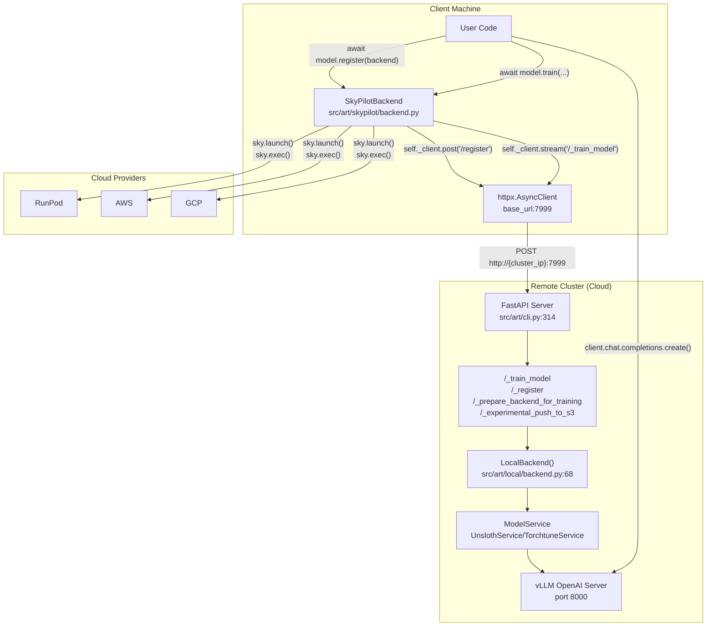
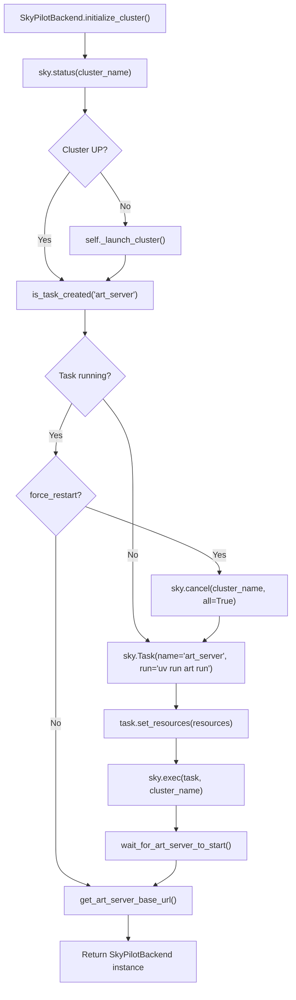

<!-- source: DeepWiki mcp.deepwiki.com · repo OpenPipe/ART · page 4.2 SkyPilotBackend · fetched 2026-10-29 -->

# SkyPilotBackend

<details>
<summary>Relevant source files</summary>

The following files were used as context for generating this wiki page:

- [.agents/skills/fix-art-issues/SKILL.md](.agents/skills/fix-art-issues/SKILL.md)
- [.env.example](.env.example)
- [.github/workflows/build-gpu-image.yml](.github/workflows/build-gpu-image.yml)
- [dev/yes-no-maybe-fork-pipeline.sky.yaml](dev/yes-no-maybe-fork-pipeline.sky.yaml)
- [dev/yes-no-maybe-fork.sky.yaml](dev/yes-no-maybe-fork.sky.yaml)
- [docker/art-gpu.Dockerfile](docker/art-gpu.Dockerfile)
- [examples/tic_tac_toe/tic-tac-toe.py](examples/tic_tac_toe/tic-tac-toe.py)
- [examples/tic_tac_toe_self_play/deploy_step.py](examples/tic_tac_toe_self_play/deploy_step.py)
- [scripts/build-gpu-image.sh](scripts/build-gpu-image.sh)
- [scripts/deploy-model.py](scripts/deploy-model.py)
- [scripts/setup.sh](scripts/setup.sh)
- [skypilot-config.yaml](skypilot-config.yaml)
- [src/art/backend.py](src/art/backend.py)
- [src/art/cli.py](src/art/cli.py)
- [src/art/megatron/backend.py](src/art/megatron/backend.py)
- [src/art/utils/deploy_model.py](src/art/utils/deploy_model.py)
- [src/art/utils/output_dirs.py](src/art/utils/output_dirs.py)
- [src/art/utils/s3.py](src/art/utils/s3.py)

</details>


`SkyPilotBackend` provisions remote GPU clusters across cloud providers (RunPod, AWS, GCP, etc.) and forwards requests to a `LocalBackend` instance running on the cluster via HTTP. It extends the base `Backend` protocol [src/art/backend.py:15-53]() and implements a client-side proxy that enables remote execution.

**Use Cases:**
- Access to specific GPU types (H100, H200, A100-80GB) unavailable locally.
- Automatic cluster provisioning and cost optimization across providers.
- Interactive SSH development on remote GPU machines.
- Training on cloud infrastructure without manual environment setup.

**Key Implementation:** [src/art/skypilot/backend.py:26-384]()

For local single-machine training, see [LocalBackend](#4.1).

Sources: [src/art/skypilot/backend.py:26-84](), [src/art/backend.py:15-53]()

## Architecture

`SkyPilotBackend` acts as an HTTP client that forwards protocol calls to a remote FastAPI server running `LocalBackend`. The cluster is provisioned and managed via SkyPilot's cloud abstraction.

### Request Flow with Code Entities



**Key Methods:**
| Method | Location | Purpose |
|--------|----------|---------|
| `initialize_cluster()` | [src/art/skypilot/backend.py:32-161]() | Provisions cluster via `sky.launch()` and starts the proxy server. |
| `register()` | [src/art/skypilot/backend.py:239-252]() | Overrides to log SSH and log-viewing instructions. |
| `_prepare_backend_for_training()` | [src/art/skypilot/backend.py:254-269]() | Overrides to return the cluster's vLLM URL via `get_vllm_base_url()`. |
| `_experimental_pull_model_checkpoint()` | [src/art/skypilot/backend.py:271-378]() | Pulls checkpoints from S3 to the client machine. |
| `down()` | [src/art/skypilot/backend.py:380-383]() | Calls `sky.down()` to terminate the cloud cluster. |

**Ports:**
- **Port 7999**: FastAPI server started via `art run` [src/art/cli.py:314]() for the Backend protocol API.
- **Port 8000**: vLLM server started by `LocalBackend._prepare_backend_for_training()` [src/art/local/backend.py:279-298]().

Sources: [src/art/skypilot/backend.py:26-149](), [src/art/cli.py:314-401](), [src/art/local/backend.py:68-298](), [src/art/skypilot/utils.py:96-121]()

## Cluster Initialization

The `SkyPilotBackend.initialize_cluster()` class method [src/art/skypilot/backend.py:32-161]() handles the lifecycle of provisioning a cluster and ensuring the ART proxy server is running.

### Initialization Flow



Sources: [src/art/skypilot/backend.py:32-161](), [src/art/skypilot/utils.py:14-46](), [src/art/skypilot/utils.py:69-93]()

### Parameters

| Parameter | Type | Description | Default |
|-----------|------|-------------|---------|
| `cluster_name` | `str` | Name of the SkyPilot cluster. | `"art"` |
| `gpu` | `str \| None` | GPU shorthand (e.g., `"H100"`, `"A100-80GB"`). | `None` |
| `resources` | `sky.Resources \| None` | Full SkyPilot resource specification. | `sky.Resources(accelerators={"H100": 1})` |
| `art_version` | `str \| None` | Version to install (semver or local path). | Current package version |
| `env_path` | `str \| None` | Path to `.env` file to propagate to cluster. | `None` |
| `force_restart` | `bool` | If True, kills existing `art_server` before starting. | `False` |

**Validation:**
- Either `gpu` or `resources` must be provided [src/art/skypilot/backend.py:55-56]().
- Ports 7999 and 8000 are automatically added to `resources.ports` [src/art/skypilot/backend.py:68-73]().

Sources: [src/art/skypilot/backend.py:32-73]()

## Remote Cluster Setup

### Initial Cluster Launch

The `_launch_cluster()` method [src/art/skypilot/backend.py:163-237]() provisions the hardware and runs a setup script:

**Setup Script Generation:**
The script ensures `uv` is installed, configures `git`, and installs ART based on the `art_version` parameter [src/art/skypilot/backend.py:177-214]():
- **Semver (e.g., "0.5.4")**: Runs `uv pip install --system openpipe-art[backend]==0.5.4`.
- **Local Path (e.g., ".")**: Sets `task.workdir` and runs `uv sync --extra backend`.

### Proxy Server (FastAPI)

The remote task runs `uv run art run`, which invokes the CLI command defined in [src/art/cli.py:286-401](). This server instantiates a `LocalBackend` and exposes its methods via HTTP.

**Exposed Routes:**
| Route | Method | Description |
|-------|--------|-------------|
| `/_train_model` | POST | Proxies `LocalBackend._train_model` (streaming). |
| `/_prepare_backend_for_training` | POST | Proxies `LocalBackend._prepare_backend_for_training`. |
| `/_experimental_push_to_s3` | POST | Proxies `LocalBackend._experimental_push_to_s3`. |

Sources: [src/art/cli.py:286-401](), [src/art/skypilot/backend.py:163-237]()

## S3 Sync Utilities

`SkyPilotBackend` relies heavily on S3 for checkpoint persistence, as cloud clusters are ephemeral. The `src/art/utils/s3.py` module provides the underlying implementation.

### Key S3 Functions

| Function | Location | Purpose |
|----------|----------|---------|
| `s3_sync()` | [src/art/utils/s3.py:66-126]() | Asynchronous wrapper around `aws s3 sync`. |
| `push_model_to_s3()` | [src/art/utils/s3.py:223-264]() | Uploads model directory/checkpoints to S3. |
| `pull_model_from_s3()` | [src/art/utils/s3.py:161-220]() | Downloads model from S3 to local disk. |
| `build_s3_path()` | [src/art/utils/s3.py:27-44]() | Generates URI: `s3://{bucket}/{project}/models/{name}`. |

**Usage in SkyPilotBackend:**
The `_experimental_pull_model_checkpoint` method [src/art/skypilot/backend.py:271-378]() uses these utilities to fetch checkpoints from S3 to the user's local machine for evaluation or deployment.

Sources: [src/art/utils/s3.py:1-264](), [src/art/skypilot/backend.py:271-378]()

## Task YAML Configuration

SkyPilot tasks can also be launched using YAML files. ART provides several example configurations:

### Example: `skypilot-config.yaml` Reference
While `SkyPilotBackend` generates tasks programmatically, the `skypilot-config.yaml` documentation [skypilot-config.yaml:1-126]() describes the structure used:
- `workdir`: Synced to `~/sky_workdir` on the cluster.
- `resources.accelerators`: Specifies GPU requirements (e.g., `H100:8`).
- `resources.ports`: Exposes ports to the public internet.

### Example: `yes-no-maybe-fork-pipeline.sky.yaml`
[dev/yes-no-maybe-fork-pipeline.sky.yaml:1-39]()
```yaml
resources:
  accelerators: ["H200:2", "H100-SXM:2", "H100:2", "A100-80GB:2"]
  image_id: docker:docker.io/bradhiltonnw/art-gpu:latest
  ports:
    - 7999 # main ART server
    - 8000 # vLLM server
```

Sources: [skypilot-config.yaml:1-126](), [dev/yes-no-maybe-fork-pipeline.sky.yaml:1-39]()

## GPU Image and Prewarming

To minimize startup time, ART provides a custom GPU image and a build script [scripts/build-gpu-image.sh:1-203]().

- **Dockerfile**: [docker/art-gpu.Dockerfile:1-170]() installs `uv`, `pytorch`, `skypilot-runtime`, and pre-caches dependencies.
- **Prewarming**: The build script [scripts/build-gpu-image.sh:37-55]() includes logic to pre-pull the image on GPU nodes in Kubernetes clusters (`PREWARM_NODES`) to avoid long download times during `sky launch`.

Sources: [scripts/build-gpu-image.sh:1-203](), [docker/art-gpu.Dockerfile:1-170]()

## Usage Example

```python
from art.skypilot.backend import SkyPilotBackend
import art

# 1. Initialize cluster (provisions cloud VM)
backend = await SkyPilotBackend.initialize_cluster(
    cluster_name="my-h100-cluster",
    gpu="H100",
    env_path=".env"
)

model = art.TrainableModel(
    name="llama-8b-rl",
    project="research",
    base_model="meta-llama/Meta-Llama-3.1-8B-Instruct"
)

# 2. Register (sets up remote service)
await model.register(backend)

# 3. Train (proxies calls to remote LocalBackend)
# Trajectories are gathered locally, then sent to remote cluster
await model.train(trajectory_groups)

# 4. Cleanup
await backend.down()
```

Sources: [examples/tic_tac_toe/tic-tac-toe.py:26-59](), [src/art/skypilot/backend.py:32-161]()

---

