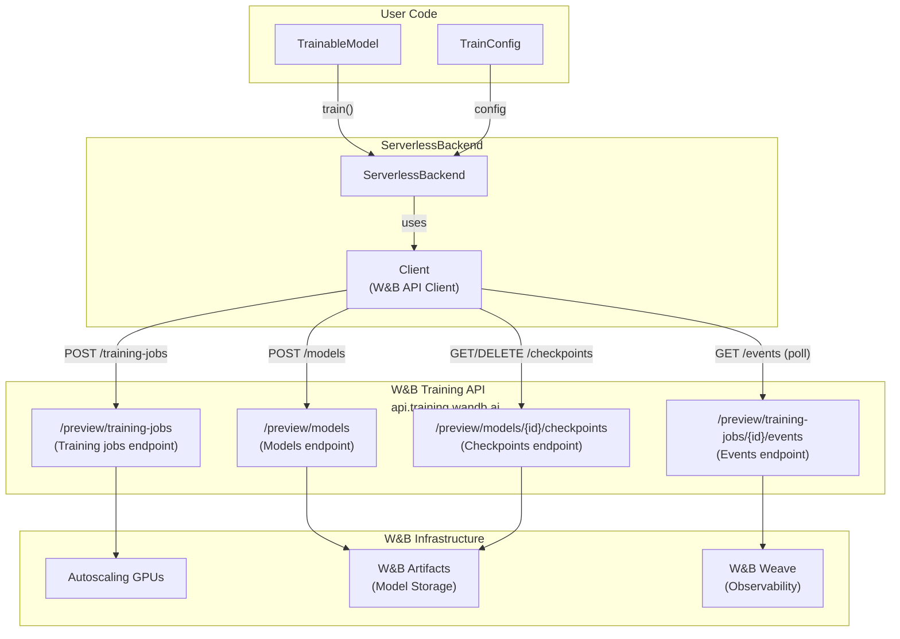
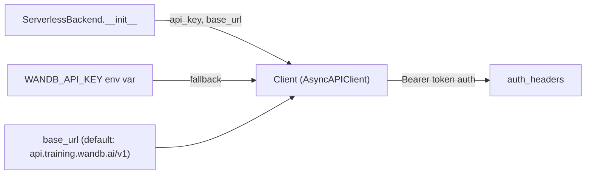
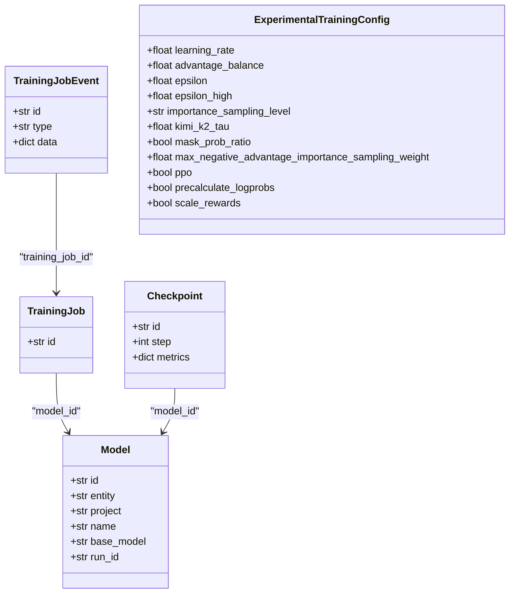
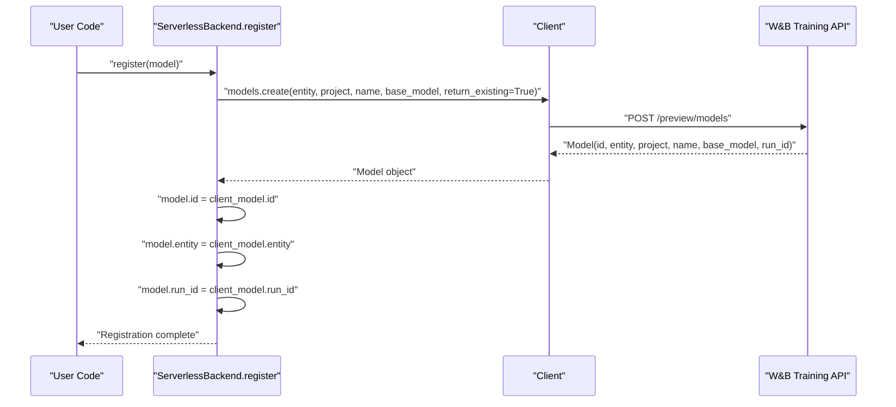
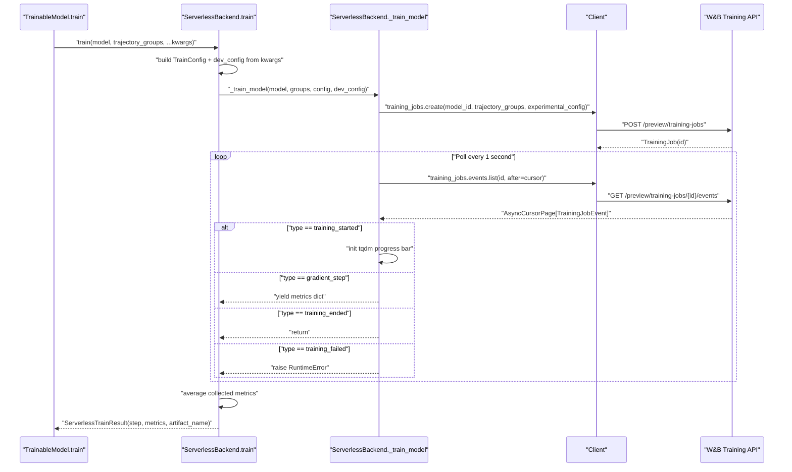

<!-- source: DeepWiki mcp.deepwiki.com · repo OpenPipe/ART · page 4.3 ServerlessBackend · fetched 2026-10-29 -->

# ServerlessBackend

<details>
<summary>Relevant source files</summary>

The following files were used as context for generating this wiki page:

- [src/art/adapter_leases.py](src/art/adapter_leases.py)
- [src/art/dev/train.py](src/art/dev/train.py)
- [src/art/local/adapter_leases.py](src/art/local/adapter_leases.py)
- [src/art/serverless/backend.py](src/art/serverless/backend.py)
- [src/art/serverless/client.py](src/art/serverless/client.py)
- [tests/unit/test_serverless_adapter_lease.py](tests/unit/test_serverless_adapter_lease.py)
- [tests/unit/test_serverless_pipeline_trainer_compat.py](tests/unit/test_serverless_pipeline_trainer_compat.py)

</details>


The `ServerlessBackend` is a managed training backend that delegates all infrastructure management to the Weights & Biases (W&B) Training API. This backend eliminates the need for provisioning or managing GPU infrastructure by using W&B's autoscaling serverless training service.

**Scope**: This document covers the `ServerlessBackend` implementation, the W&B Training API client, training job lifecycle, and limitations. For local development training, see [LocalBackend](#4.1). For provisioning remote GPU clusters, see [SkyPilotBackend](#4.2). For the abstract backend interface, see [Backend Infrastructure](#2.3).

---

## Purpose and Architecture

The `ServerlessBackend` provides a fully managed training experience where:
- No infrastructure provisioning is required
- Training resources autoscale based on demand
- W&B handles model checkpointing and artifact storage
- Training is billed on a pay-per-use basis

Unlike `LocalBackend` and `SkyPilotBackend`, which manage their own training infrastructure, `ServerlessBackend` acts as a thin client that communicates with W&B's hosted training service.

### System Architecture



**Sources**: [src/art/serverless/backend.py:89-96](), [src/art/serverless/client.py:1-254]()

---

## W&B Training API Client

The `ServerlessBackend` uses a custom `Client` class that extends OpenAI's `AsyncAPIClient` to communicate with the W&B Training API.

### Client Initialization

The `Client` constructor in `src/art/serverless/client.py` checks the `api_key` argument first, then falls back to the `WANDB_API_KEY` environment variable. If neither is set, it raises a `ValueError`. The default base URL is `https://api.training.wandb.ai/v1`.



**Sources**: [src/art/serverless/client.py:256-274](), [src/art/serverless/backend.py:90-95]()

### API Resources and Endpoints

| Resource class | Endpoint | Method | Purpose |
|----------------|----------|--------|---------|
| `Models` | `/preview/models` | POST | Register model or return existing [src/art/serverless/client.py:112-131]() |
| `Models` | `/preview/models/{model_id}` | DELETE | Delete a model [src/art/serverless/client.py:153-157]() |
| `Models` | `/preview/models/{model_id}/log` | POST | Log trajectory groups [src/art/serverless/client.py:133-151]() |
| `Checkpoints` | `/preview/models/{model_id}/checkpoints` | GET | List checkpoints (paginated) [src/art/serverless/client.py:165-187]() |
| `Checkpoints` | `/preview/models/{model_id}/checkpoints` | DELETE | Delete specific checkpoint steps [src/art/serverless/client.py:189-196]() |
| `TrainingJobs` | `/preview/training-jobs` | POST | Create a GRPO training job [src/art/serverless/client.py:199-218]() |
| `TrainingJobEvents` | `/preview/training-jobs/{id}/events` | GET | Poll for training events [src/art/serverless/client.py:225-243]() |

**Sources**: [src/art/serverless/client.py:111-254]()

### Key Data Structures

All data models are Pydantic `BaseModel` or `TypedDict` classes in `src/art/serverless/client.py`.



**Sources**: [src/art/serverless/client.py:28-109]()

---

## Registration and Configuration

### Model Registration

Before training, models must be registered with the W&B Training API. The registration process creates a model entity in W&B's system.



The `register()` method:
- Only supports `TrainableModel` instances; non-trainable models are rejected with a warning [src/art/serverless/backend.py:115-119]()
- Sets `return_existing=True` to reuse existing models with the same name [src/art/serverless/backend.py:125]()
- Updates the model's `id`, `entity`, and `run_id` fields from the API response [src/art/serverless/backend.py:127-129]()

**Sources**: [src/art/serverless/backend.py:103-130]()

---

## Training Flow

### GRPO Training Job Lifecycle

The public `train()` method on `ServerlessBackend` delegates to `_train_model()`, which creates a training job and polls for events until completion.

#### Training Job Sequence



**Sources**: [src/art/serverless/backend.py:207-334](), [src/art/serverless/client.py:199-243]()

### `ExperimentalTrainingConfig` Payload

These fields are extracted from the ART `TrainConfig` and passed to the W&B API:

| Field | Description |
|-------|-------------|
| `learning_rate` | Optimizer learning rate [src/art/serverless/backend.py:276]() |
| `advantage_balance` | Balance between negative/positive advantages [src/art/serverless/backend.py:277]() |
| `epsilon` | Clip epsilon for IS weights [src/art/serverless/backend.py:279]() |
| `importance_sampling_level` | Level at which IS weights are computed [src/art/serverless/backend.py:281]() |
| `ppo` | Use PPO clipping [src/art/serverless/backend.py:292]() |
| `precalculate_logprobs` | Precalculate log probabilities [src/art/serverless/backend.py:293]() |

**Sources**: [src/art/serverless/backend.py:275-296](), [src/art/serverless/client.py:54-82]()

---

## Checkpoint Management

### Listing Checkpoints

`_get_step()` fetches the most recent checkpoint step by listing with `limit=1, order="desc"`:

```python
async for checkpoint in self._client.models.checkpoints.list(
    limit=1, order="desc", model_id=model.id
):
    return checkpoint.step
```

**Sources**: [src/art/serverless/backend.py:178-186](), [src/art/serverless/client.py:165-187]()

### Deleting Checkpoints

`_delete_checkpoint_files()` accepts a `steps_to_keep` list and deletes all other checkpoint steps:

1. Fetch all checkpoint steps via `checkpoints.list(model_id=model.id)` [src/art/serverless/backend.py:197]()
2. Compute `steps_to_delete = [step for step in all_steps if step not in steps_to_keep]` [src/art/serverless/backend.py:200]()
3. Call `checkpoints.delete(model_id=model.id, steps=steps_to_delete)` [src/art/serverless/backend.py:201-204]()

**Sources**: [src/art/serverless/backend.py:188-205](), [src/art/serverless/client.py:189-196]()

---

## Inference and Adapter Leases

### Inference Name Generation

`_model_inference_name()` returns a W&B Artifact URI for inference. It checks for a pinned step from an active `adapter_lease` before defaulting to the latest checkpoint.

```python
def _model_inference_name(self, model: "Model", step: int | None = None) -> str:
    if step is None:
        step = pinned_inference_step(model.name)
    base_name = f"wandb-artifact:///{model.entity}/{model.project}/{model.name}"
    if step is not None:
        return f"{base_name}:step{step}"
    return base_name
```

**Sources**: [src/art/serverless/backend.py:151-167](), [src/art/adapter_leases.py:11-12]()

### Adapter Leases

`adapter_lease()` uses `pin_inference_step` to set a model-specific checkpoint step in a `ContextVar`. This ensures that any inference calls made within the context block use the specified checkpoint version.

```python
@asynccontextmanager
async def adapter_lease(self, model: AnyTrainableModel, step: int) -> AsyncIterator[None]:
    async with pin_inference_step(model.name, step):
        yield
```

**Sources**: [src/art/serverless/backend.py:169-176](), [src/art/adapter_leases.py:15-26]()

---

## Metric Canonicalization

Metrics returned from the W&B Training API are canonicalized to match ART's internal metric taxonomy using `_canonicalize_upstream_metrics`.

| API Metric Key | ART Metric Key |
|----------------|----------------|
| `loss/train` | `loss` |
| `loss/entropy` | `entropy` |
| `loss/kl_div` | `kl_div` |
| `loss/grad_norm` | `grad_norm` |
| `data/step_num_trajectories` | `num_trajectories` |
| `group_metric_*` | `group_*` |

**Sources**: [src/art/serverless/backend.py:51-86]()

---

