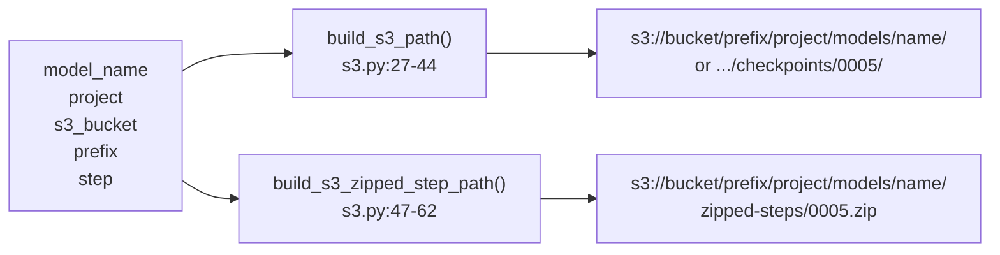
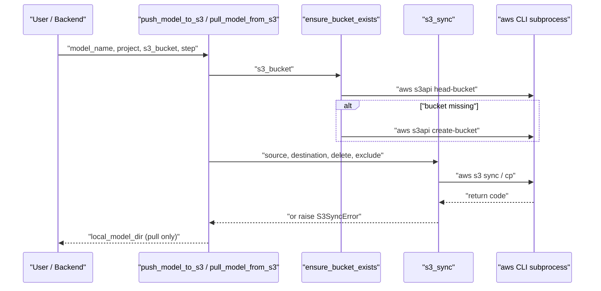
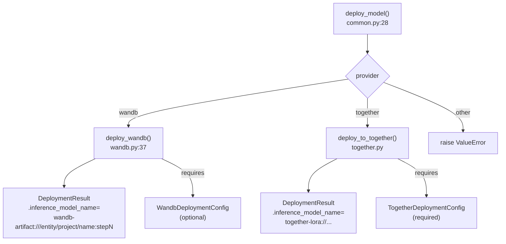
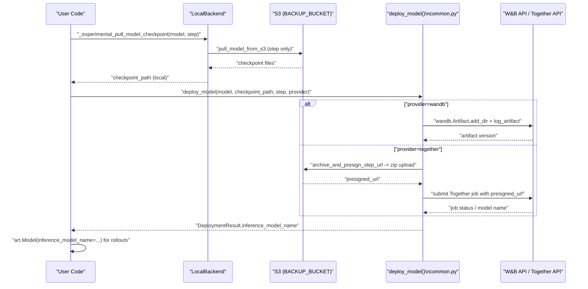
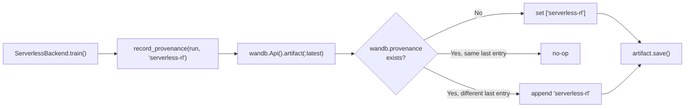
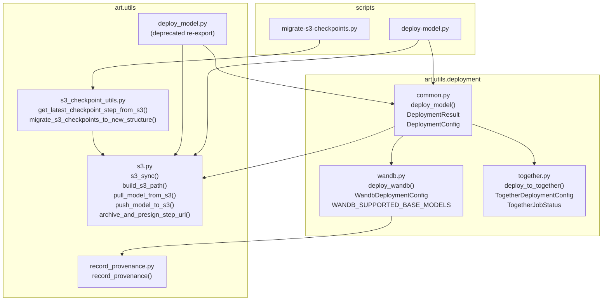

<!-- source: DeepWiki mcp.deepwiki.com · repo OpenPipe/ART · page 4.4 Model Deployment & S3 Storage · fetched 2026-10-29 -->

# Model Deployment & S3 Storage

<details>
<summary>Relevant source files</summary>

The following files were used as context for generating this wiki page:

- [.env.example](.env.example)
- [.skyignore](.skyignore)
- [CLAUDE.md](CLAUDE.md)
- [examples/tic_tac_toe/tic-tac-toe.py](examples/tic_tac_toe/tic-tac-toe.py)
- [examples/tic_tac_toe_self_play/deploy_step.py](examples/tic_tac_toe_self_play/deploy_step.py)
- [scripts/deploy-model.py](scripts/deploy-model.py)
- [scripts/migrate-s3-checkpoints.py](scripts/migrate-s3-checkpoints.py)
- [src/art/backend.py](src/art/backend.py)
- [src/art/cli.py](src/art/cli.py)
- [src/art/utils/deploy_model.py](src/art/utils/deploy_model.py)
- [src/art/utils/deployment/common.py](src/art/utils/deployment/common.py)
- [src/art/utils/deployment/wandb.py](src/art/utils/deployment/wandb.py)
- [src/art/utils/output_dirs.py](src/art/utils/output_dirs.py)
- [src/art/utils/record_provenance.py](src/art/utils/record_provenance.py)
- [src/art/utils/s3.py](src/art/utils/s3.py)
- [src/art/utils/s3_checkpoint_utils.py](src/art/utils/s3_checkpoint_utils.py)
- [tests/integration/test_provenance.py](tests/integration/test_provenance.py)

</details>


This page documents the mechanisms for persisting trained LoRA checkpoints to S3 and deploying them to external inference providers. It covers:

- **S3 storage utilities**: syncing local checkpoint directories to and from S3 [src/art/utils/s3.py:1-18]().
- **Model deployment**: uploading a checkpoint to a hosted inference endpoint like W&B or Together AI [src/art/utils/deployment/common.py:28-118]().
- **Provenance tracking**: recording training history on W&B artifacts to track model lineage [src/art/utils/record_provenance.py:1-28]().
- **S3 checkpoint migration**: moving checkpoints from the old path format to the new structure [src/art/utils/s3_checkpoint_utils.py:107-245]().

For details on how checkpoints are saved locally during training, see [Checkpoint Management](#7.3). For the `ServerlessBackend` which uses W&B as its training orchestrator, see [ServerlessBackend](#4.3). For the `SkyPilotBackend` which uses S3 for syncing state to cloud VMs, see [SkyPilotBackend](#4.2).

---

## S3 Storage

### Path Structure

The S3 path layout mirrors the local `.art/` directory layout. The `build_s3_path` function [src/art/utils/s3.py:27-44]() constructs the canonical S3 URI for any model:

| Object | Local path | S3 path |
|---|---|---|
| Model root | `.art/{project}/models/{name}/` | `s3://{bucket}/{prefix}/{project}/models/{name}/` |
| Single checkpoint | `.art/{project}/models/{name}/checkpoints/{step:04d}/` | `s3://{bucket}/{prefix}/{project}/models/{name}/checkpoints/{step:04d}/` |
| Zipped checkpoint | _(temporary)_ | `s3://{bucket}/{prefix}/{project}/models/{name}/zipped-steps/{step:04d}.zip` |

The S3 bucket defaults to the `BACKUP_BUCKET` environment variable if not supplied explicitly [src/art/utils/s3.py:36-37](). The optional `prefix` parameter allows namespacing multiple projects within one bucket.

**S3 URI construction diagram:**



Sources: [src/art/utils/s3.py:27-62](), [src/art/utils/output_dirs.py:32-33]()

---

### Core Sync Function

`s3_sync` [src/art/utils/s3.py:65-124]() is the low-level async wrapper around the AWS CLI. All higher-level S3 operations go through it.

| Parameter | Type | Description |
|---|---|---|
| `source` | `str` | Local path or `s3://` URI |
| `destination` | `str` | Local path or `s3://` URI |
| `profile` | `str \| None` | Optional AWS CLI profile name |
| `verbose` | `bool` | Stream AWS CLI output to stdout |
| `delete` | `bool` | Pass `--delete` to remove files absent in the source |
| `exclude` | `list[ExcludableOption] \| None` | Skip `checkpoints`, `logs`, or `trajectories` subdirectories |

`s3_sync` is decorated with `@limit_concurrency(1)` [src/art/utils/s3.py:65](), meaning at most one AWS sync subprocess runs at a time, even if called concurrently from async code. For file sources it uses `aws s3 cp`; for directory sources it uses `aws s3 sync` [src/art/utils/s3.py:101-104]().

Sources: [src/art/utils/s3.py:65-124]()

---

### High-Level Push & Pull

**`push_model_to_s3`** [src/art/utils/s3.py:223-263]() uploads the entire local model directory for a given `(model_name, project)` pair. It resolves the local path using `get_output_dir_from_model_properties`, verifies it exists, then calls `s3_sync`.

**`pull_model_from_s3`** [src/art/utils/s3.py:161-220]() downloads from S3. If a specific `step` is given, it downloads only `checkpoints/{step:04d}/` into the corresponding local directory [src/art/utils/s3.py:196-200](). Without `step`, it syncs the entire model directory.

Both functions call `ensure_bucket_exists` [src/art/utils/s3.py:127-158]() before syncing, which checks for the bucket with `aws s3api head-bucket` and creates it if missing using `aws s3api create-bucket`.

**Flow diagram:**



Sources: [src/art/utils/s3.py:127-263]()

---

### Presigned URL Generation

`archive_and_presign_step_url` [src/art/utils/s3.py:266-342]() packages a single checkpoint directory into a `.zip` file, uploads it to the `zipped-steps/` prefix in S3, and returns a presigned URL with a 1-hour expiry. This is used when a checkpoint needs to be handed to an external service (e.g., Together AI) that fetches the LoRA adapter from an HTTP URL.

Steps:
1. Locate the checkpoint directory via `get_step_checkpoint_dir` [src/art/utils/s3.py:284]().
2. Zip all files under that directory into a temporary file [src/art/utils/s3.py:293-305]().
3. Upload the zip with `s3_sync` to the `zipped-steps/{step:04d}.zip` key [src/art/utils/s3.py:314]().
4. Run `aws s3 presign` on the resulting key and return the URL [src/art/utils/s3.py:328-335]().

Sources: [src/art/utils/s3.py:266-342]()

---

## Model Deployment

Once a checkpoint has been trained and optionally pushed to S3, it can be deployed to a hosted inference endpoint using `deploy_model`.

### The `deploy_model` Dispatcher

`deploy_model` [src/art/utils/deployment/common.py:28-118]() is the single entry point for all deployment operations. It accepts a `provider` argument and delegates to the appropriate backend-specific function.

| Parameter | Type | Description |
|---|---|---|
| `model` | `TrainableModel` | Source model (name, project, base_model, entity) |
| `checkpoint_path` | `str` | **Local** path to the checkpoint directory |
| `step` | `int` | Training step this checkpoint represents |
| `provider` | `Literal["together", "wandb"]` | Target deployment platform |
| `config` | `DeploymentConfig \| None` | Provider-specific configuration |
| `verbose` | `bool` | Print progress |

Returns a `DeploymentResult` containing `inference_model_name` — the model identifier to pass to an OpenAI-compatible client.

**Deployment dispatch diagram:**



Sources: [src/art/utils/deployment/common.py:28-118](), [src/art/utils/deployment/wandb.py:37-55]()

---

### W&B Deployment (`deploy_wandb`)

`deploy_wandb` [src/art/utils/deployment/wandb.py:37-108]() publishes a checkpoint as a W&B Artifact of type `lora`. The artifact is then consumable by W&B Inference for serverless LoRA serving.

**Supported base models** (checked at call time against `WANDB_SUPPORTED_BASE_MODELS` [src/art/utils/deployment/wandb.py:29-34]()):

| Base Model |
|---|
| `meta-llama/Llama-3.1-8B-Instruct` |
| `meta-llama/Llama-3.1-70B-Instruct` |
| `OpenPipe/Qwen3-14B-Instruct` |
| `Qwen/Qwen2.5-14B-Instruct` |

**Deployment steps:**
1. Resolve `model.entity` from the W&B API if not already set [src/art/utils/deployment/wandb.py:65-68]().
2. Open a W&B run named `{model.name} (deployment)` [src/art/utils/deployment/wandb.py:72-77]().
3. Create a `wandb.Artifact` with `type="lora"`, setting `wandb.base_model` in the metadata and optionally `wandb.provenance` from `WandbDeploymentConfig` [src/art/utils/deployment/wandb.py:79-87]().
4. Add the checkpoint directory with `artifact.add_dir(checkpoint_path)` [src/art/utils/deployment/wandb.py:88]().
5. Log the artifact with aliases `[f"step{step}", "latest"]` [src/art/utils/deployment/wandb.py:89]().
6. Return the inference name: `wandb-artifact:///{entity}/{project}/{name}:step{step}` [src/art/utils/deployment/wandb.py:101-103]().

Sources: [src/art/utils/deployment/wandb.py:1-108]()

---

### End-to-End Deployment Flow

The typical pattern after training involves pulling the checkpoint from S3 (if not local) and then calling the deployment dispatcher.



Sources: [src/art/utils/deployment/common.py:28-118](), [src/art/utils/s3.py:266-342](), [examples/tic_tac_toe/tic-tac-toe.py:61-98](), [scripts/deploy-model.py:50-110]()

---

### The `scripts/deploy-model.py` Script

`scripts/deploy-model.py` [scripts/deploy-model.py:1-110]() is a standalone CLI script for deploying a checkpoint from the command line.

```bash
python scripts/deploy-model.py \
    --project my-project \
    --model my-model \
    --base-model meta-llama/Llama-3.1-8B-Instruct \
    --backup-bucket my-s3-bucket \
    --step 50
```

With `--step latest`, it pulls all checkpoints from S3 first to determine the latest step using `get_model_step` [scripts/deploy-model.py:61-70]().

Sources: [scripts/deploy-model.py:1-110]()

---

## Provenance Tracking

W&B Artifact metadata carries a `wandb.provenance` key that records the ordered list of training techniques applied to the model (e.g., `["local-rl", "serverless-rl"]`).

### `record_provenance`

`record_provenance(run, provenance)` [src/art/utils/record_provenance.py:9-28]() appends a provenance string to the `latest` artifact for the current run:

1. Fetches the artifact at `{run.entity}/{run.project}/{run.name}:latest` with type `"lora"` [src/art/utils/record_provenance.py:14-16]().
2. If the artifact has no existing provenance, sets `wandb.provenance = [provenance]`.
3. If it does, and the last element differs from the new string, appends it [src/art/utils/record_provenance.py:22-23]().
4. Calls `artifact.save()` [src/art/utils/record_provenance.py:28]().

The deduplication prevents repeated calls within the same technique from producing duplicate entries.

**Provenance lifecycle:**



Sources: [src/art/utils/record_provenance.py:1-28](), [tests/integration/test_provenance.py:40-101]()

---

## S3 Checkpoint Migration

The S3 path format changed to include a `checkpoints/` subdirectory for better organization.

| Version | S3 path |
|---|---|
| Old | `s3://bucket/.../models/name/0001/` |
| New | `s3://bucket/.../models/name/checkpoints/0001/` |

### `migrate_s3_checkpoints_to_new_structure`

`migrate_s3_checkpoints_to_new_structure` [src/art/utils/s3_checkpoint_utils.py:107-245]() handles migrating checkpoints in-place in S3:

1. Lists all directories directly under the model path using `aws s3 ls` [src/art/utils/s3_checkpoint_utils.py:143-150]().
2. Identifies 4-digit numeric directories (old checkpoint format) [src/art/utils/s3_checkpoint_utils.py:155-159]().
3. For each, copies from the old path to `checkpoints/{step}/` using `aws s3 sync` [src/art/utils/s3_checkpoint_utils.py:177-187]().
4. Removes the old directory with `aws s3 rm --recursive` [src/art/utils/s3_checkpoint_utils.py:221-231]().

The `scripts/migrate-s3-checkpoints.py` script [scripts/migrate-s3-checkpoints.py:1-65]() wraps this function as a CLI tool.

Sources: [src/art/utils/s3_checkpoint_utils.py:1-104](), [scripts/migrate-s3-checkpoints.py:1-65]()

---

## Module Structure Summary



Sources: [src/art/utils/s3.py:1-18](), [src/art/utils/deployment/common.py:1-30](), [src/art/utils/deployment/wandb.py:1-35](), [src/art/utils/deploy_model.py:1-57](), [src/art/utils/s3_checkpoint_utils.py:1-25]()

---

