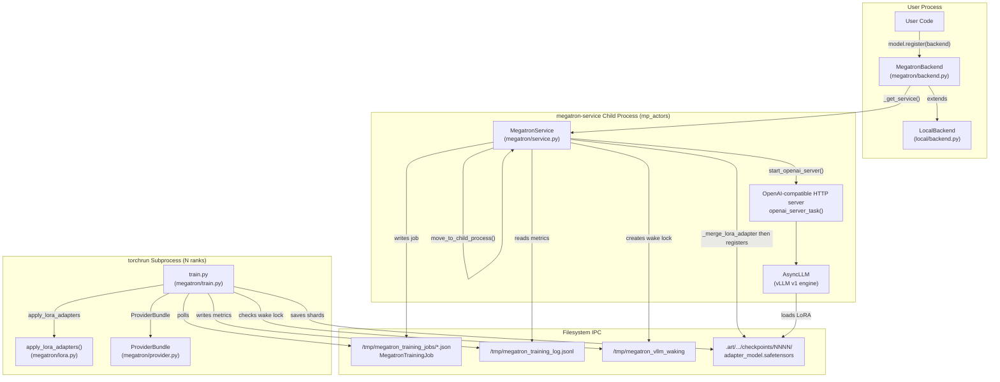
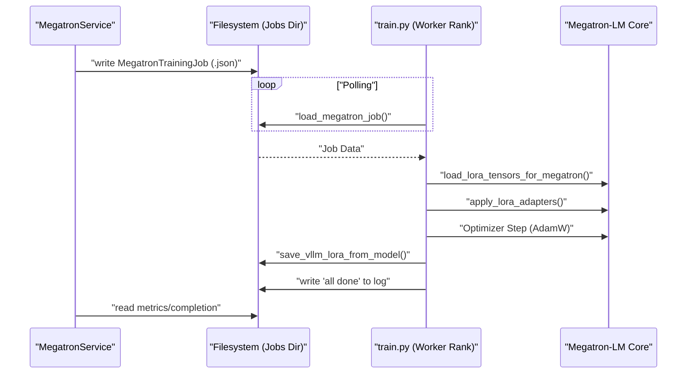

<!-- source: DeepWiki mcp.deepwiki.com · repo OpenPipe/ART · page 4.5 MegatronBackend · fetched 2026-10-29 -->

# MegatronBackend

Relevant source files

The following files were used as context for generating this wiki page:

- [.agents/skills/fix-art-issues/SKILL.md](.agents/skills/fix-art-issues/SKILL.md)
- [.github/workflows/build-gpu-image.yml](.github/workflows/build-gpu-image.yml)
- [dev/yes-no-maybe-fork-pipeline.sky.yaml](dev/yes-no-maybe-fork-pipeline.sky.yaml)
- [dev/yes-no-maybe-fork.sky.yaml](dev/yes-no-maybe-fork.sky.yaml)
- [docker/art-gpu.Dockerfile](docker/art-gpu.Dockerfile)
- [scripts/build-gpu-image.sh](scripts/build-gpu-image.sh)
- [scripts/setup.sh](scripts/setup.sh)
- [skypilot-config.yaml](skypilot-config.yaml)
- [src/art/megatron/backend.py](src/art/megatron/backend.py)
- [src/art/megatron/lora.py](src/art/megatron/lora.py)
- [src/art/megatron/provider.py](src/art/megatron/provider.py)
- [src/art/megatron/service.py](src/art/megatron/service.py)
- [src/art/megatron/setup.sh](src/art/megatron/setup.sh)
- [src/art/megatron/train.py](src/art/megatron/train.py)

This page documents the `MegatronBackend` and its supporting components, covering how distributed training with Megatron-LM is integrated into the ART training loop. This includes the `MegatronService` child process, the file-based job protocol between the service and the training subprocess, the custom LoRA adapter system for Megatron, and the GPU offload/reload cycle.

For the general Backend protocol that `MegatronBackend` conforms to, see [2.3](). For the `LocalBackend` base class that `MegatronBackend` extends, see [4.1](). For memory management strategies used here, see [7.2]().

---

## Purpose and Scope

`MegatronBackend` is the backend for large-scale distributed training using Megatron-LM. It is designed for models too large for a single GPU or for workloads that require expert/tensor/pipeline parallelism. The primary target is Qwen3 MoE-class models on multi-GPU hosts.

Unlike `LocalBackend`, which runs training in-process via Unsloth or TorchTune, `MegatronBackend` spawns a persistent `torchrun` subprocess that runs `src/art/megatron/train.py`. The two sides communicate through the filesystem. Inference is served via vLLM's `AsyncLLM` engine with LoRA hot-swapping.

---

## Architecture

**Diagram: MegatronBackend Component Architecture**

Sources: [src/art/megatron/backend.py:15-74](), [src/art/megatron/service.py:188-255](), [src/art/megatron/train.py:10-134]()

---

## MegatronBackend Class

`MegatronBackend` (defined in [src/art/megatron/backend.py:15-82]()) extends `LocalBackend` and overrides `_get_service` to return a `MegatronService`.

**Constructor parameters:**

| Parameter | Type | Default | Description |
|---|---|---|---|
| `in_process` | `bool` | `False` | If `True`, run `MegatronService` in the same process instead of a child process |
| `path` | `str \| None` | `None` | Override the `.art/` directory path for checkpoint storage |
| `enable_expert_replay` | `bool` | `True` | Whether to enable MoE routing replay for training efficiency |

When `in_process=False` (the default), the returned `MegatronService` object is wrapped with `move_to_child_process()`, making it run in an isolated subprocess managed by the `mp_actors` library [src/art/megatron/backend.py:69-73]().

---

## MegatronService

`MegatronService` (defined in [src/art/megatron/service.py:188-340]()) manages the vLLM inference engine and the lifecycle of the Megatron training subprocess.

### Identity LoRA Initialization
Before starting the inference server, `MegatronService` must provide a valid LoRA adapter. `create_identity_lora` ([src/art/megatron/service.py:82-186]()) uses PEFT to create an adapter with zeroed weights (an identity transformation) and saves it. This ensures vLLM can always load a LoRA at startup even before the first training step.

### Training Job Orchestration
The `train` method ([src/art/megatron/service.py:257-333]()) coordinates with the `torchrun` subprocess. It writes a `MegatronTrainingJob` JSON file to the filesystem, which the training process polls for.

**`MegatronTrainingJob` parameters [src/art/megatron/runtime/jobs.py:58-62]():**
- `lora_path`: Path to the adapter to load.
- `disk_packed_tensors`: Path to the training data.
- `config`: Training hyperparameters (learning rate, etc.).

Sources: [src/art/megatron/service.py:188-340](), [src/art/megatron/runtime/jobs.py:55-66]()

---

## train.py — Distributed Training Runtime

The `run_megatron_worker_loop` in `src/art/megatron/train.py` ([src/art/megatron/train.py:130-130]()) is the entry point for the `torchrun` ranks.

**Diagram: Megatron Training Worker Loop**

### LoRA Adapter Sharding
Megatron-LM uses Tensor Parallelism (TP) and Expert Parallelism (EP). Standard PEFT adapters do not support these sharding schemes. `src/art/megatron/lora.py` implements custom logic to:
1. **Sharding**: `load_lora_tensors_for_megatron` ([src/art/megatron/model_support/lora_disk.py:44-45]()) shards weights across TP/EP ranks.
2. **Merging**: After training, `save_vllm_lora_from_model` ([src/art/megatron/weights/lora_publish.py:113-113]()) gathers shards back into a single `adapter_model.safetensors` file that vLLM can load.

Sources: [src/art/megatron/train.py:1-134](), [src/art/megatron/lora.py:1-220]()

---

## GPU Offload/Reload Cycle

To maximize GPU utilization, ART implements a cycle where training weights are offloaded to CPU when the inference server is active, and vice versa.

- **`WeightOffloadManager`**: Manages the movement of model weights between GPU and CPU [src/art/megatron/train.py:112-112]().
- **Wake Lock**: `MegatronService` creates a "wake lock" file at `DEFAULT_VLLM_WAKE_LOCK_PATH` ([src/art/megatron/train.py:57-57]()) to signal to the training process that it should prepare for training and reload weights to the GPU.

Sources: [src/art/megatron/train.py:57-112](), [src/art/megatron/service.py:69-70]()

---

## SkyPilot and Docker Setup

The Megatron backend is typically deployed on high-end GPU clusters (e.g., H100/H200) using SkyPilot.

### SkyPilot Configuration
The `skypilot-config.yaml` ([skypilot-config.yaml:1-178]()) specifies resource requirements such as `accelerators: H100:8` [skypilot-config.yaml:63-63]() and `disk_size: 256` [skypilot-config.yaml:115-115]().

### Setup Script
`src/art/megatron/setup.sh` ([src/art/megatron/setup.sh:1-42]()) prepares the environment:
- Installs `libcudnn9-headers-cuda-12` and `libibverbs-dev` [src/art/megatron/setup.sh:8-8]().
- Syncs the `megatron` extra via `uv` [src/art/megatron/setup.sh:37-37]().
- Prepares the `vllm_runtime` project [src/art/megatron/setup.sh:40-40]().

### Docker Image
The `docker/art-gpu.Dockerfile` ([docker/art-gpu.Dockerfile:1-170]()) provides a pre-baked environment with `CUDA 12.8` [docker/art-gpu.Dockerfile:23-23]() and all necessary Megatron/vLLM dependencies cached in `/opt/uv-cache` [docker/art-gpu.Dockerfile:150-150]().

Sources: [skypilot-config.yaml:1-178](), [src/art/megatron/setup.sh:1-42](), [docker/art-gpu.Dockerfile:1-170]()

---

