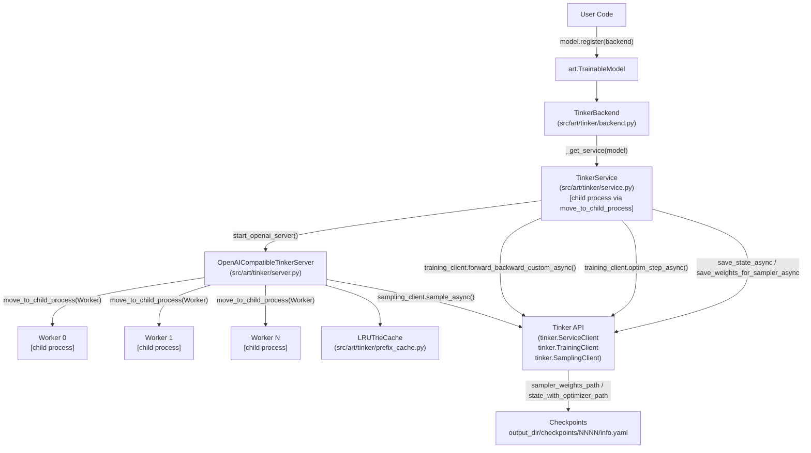
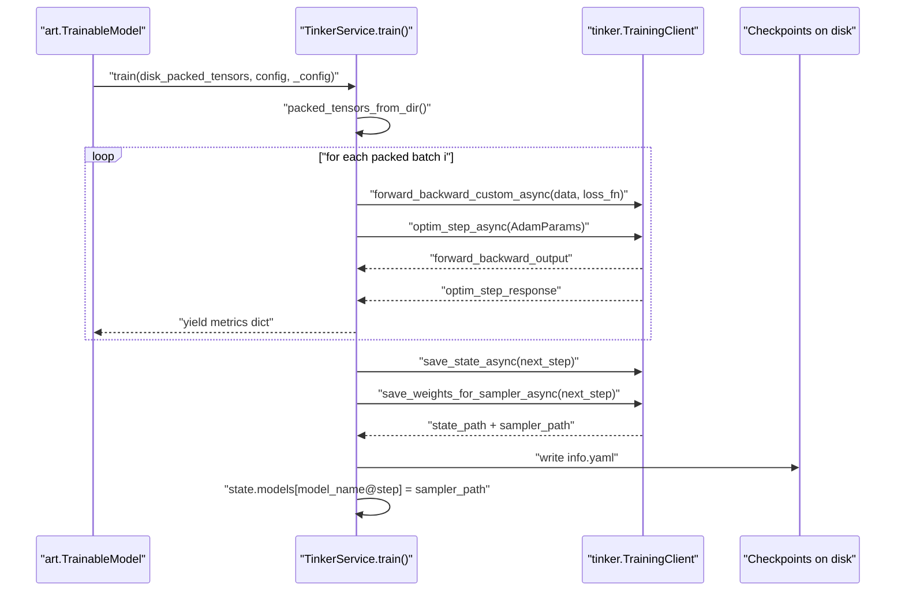
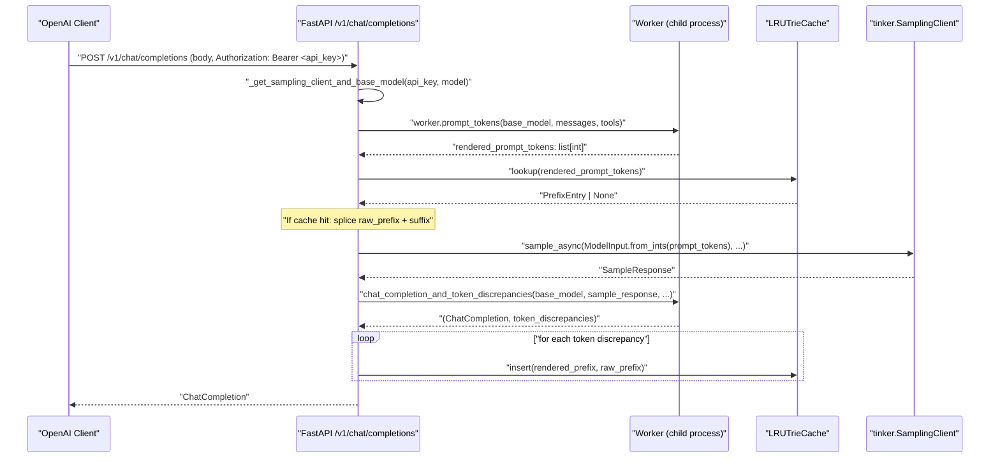
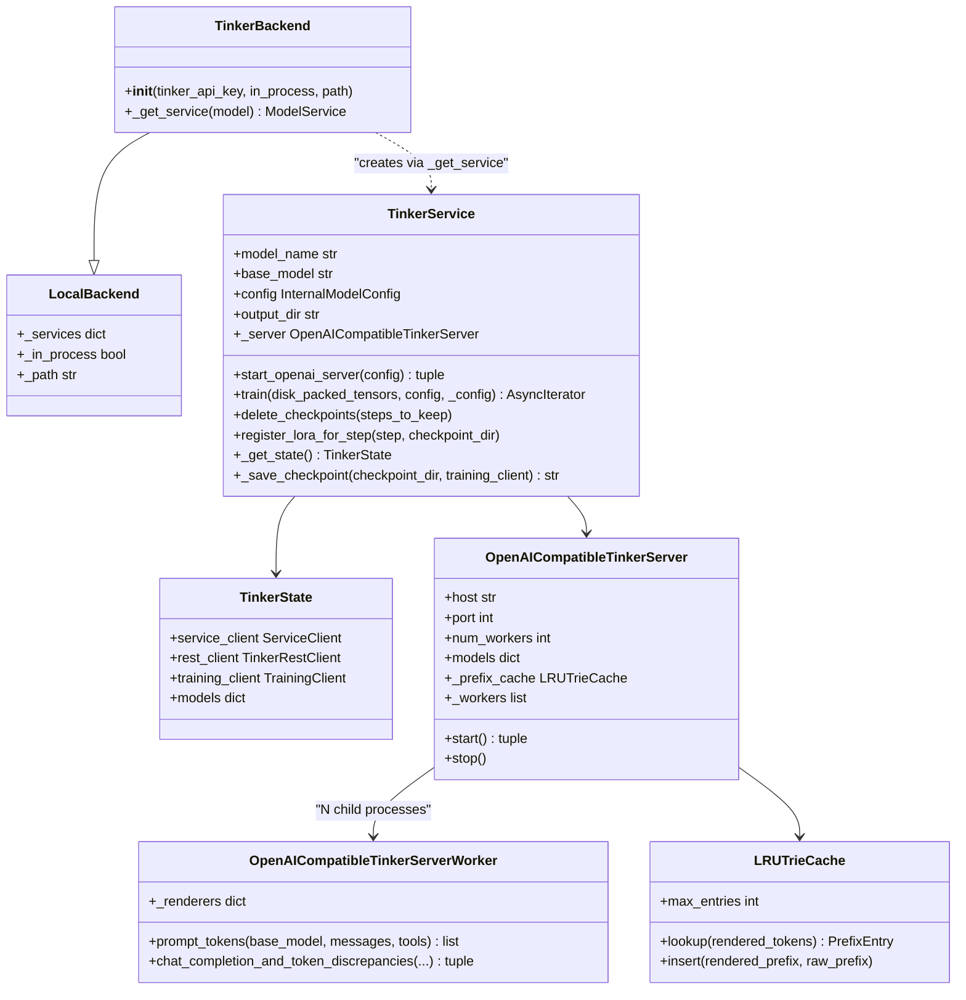

<!-- source: DeepWiki mcp.deepwiki.com · repo OpenPipe/ART · page 4.6 TinkerBackend · fetched 2026-10-29 -->

# TinkerBackend

<details>
<summary>Relevant source files</summary>

The following files were used as context for generating this wiki page:

- [dev/profile.ipynb](dev/profile.ipynb)
- [dev/yes-no-maybe-megatron.py](dev/yes-no-maybe-megatron.py)
- [dev/yes-no-maybe.py](dev/yes-no-maybe.py)
- [src/art/preprocessing/tokenize.py](src/art/preprocessing/tokenize.py)
- [src/art/tinker/__init__.py](src/art/tinker/__init__.py)
- [src/art/tinker/backend.py](src/art/tinker/backend.py)
- [src/art/tinker/client.py](src/art/tinker/client.py)
- [src/art/tinker/prefix_cache.py](src/art/tinker/prefix_cache.py)
- [src/art/tinker/renderers.py](src/art/tinker/renderers.py)
- [src/art/tinker/server.py](src/art/tinker/server.py)
- [src/art/tinker/service.py](src/art/tinker/service.py)
- [src/mp_actors/__init__.py](src/mp_actors/__init__.py)
- [src/mp_actors/move.py](src/mp_actors/move.py)
- [tests/unit/test_mp_actors.py](tests/unit/test_mp_actors.py)
- [tests/unit/test_prefix_cache.py](tests/unit/test_prefix_cache.py)
- [tests/unit/test_preprocessing_tokenize.py](tests/unit/test_preprocessing_tokenize.py)

</details>


This page documents the `TinkerBackend` and its supporting components: `TinkerService`, `OpenAICompatibleTinkerServer`, `Worker`, and `LRUTrieCache`. These live under `src/art/tinker/`. TinkerBackend delegates inference and training to the external **Tinker** platform rather than running vLLM locally, making it suitable when a Tinker API key is available and local GPU resources are limited or unnecessary.

For the local GPU path (vLLM + Unsloth/TorchTune), see [LocalBackend (4.1)](). For the multiprocess actor framework used by this backend, see [Multi-Process Architecture (7.1)](). For general training configuration options, see [Training Configuration (3.4)]().

---

## Architecture Overview

**Component Topology for TinkerBackend**



Sources: [src/art/tinker/backend.py:16-85](), [src/art/tinker/service.py:36-305](), [src/art/tinker/server.py:118-362](), [src/mp_actors/move.py:56-76]()

---

## TinkerBackend Class

`TinkerBackend` ([src/art/tinker/backend.py:16-85]()) extends `LocalBackend` and overrides `_get_service`. Its constructor:

1. Validates that `TINKER_API_KEY` is set (or sets it from the `tinker_api_key` argument) [src/art/tinker/backend.py:24-30]().
2. Delegates to `LocalBackend.__init__` with `in_process` and `path` forwarded [src/art/tinker/backend.py:30-30]().

```python
TinkerBackend(
    tinker_api_key: str | None = None,
    in_process: bool = False,
    path: str | None = None,
)
```

`_get_service(model)` ([src/art/tinker/backend.py:54-84]()) creates a `TinkerService` for each registered model. If `in_process=False` (the default), the service is immediately moved to a child process via `move_to_child_process` [src/art/tinker/backend.py:79-83]():

```python
self._services[model.name] = move_to_child_process(
    self._services[model.name],
    process_name="tinker-service",
)
```

This isolates the Tinker service's event loop and state from the main process. All method calls are transparently forwarded via inter-process message passing (see [7.1]()).

**Key constructor parameters**

| Parameter | Default | Effect |
|---|---|---|
| `tinker_api_key` | `None` | Sets `TINKER_API_KEY` env var if not already set |
| `in_process` | `False` | If `True`, runs `TinkerService` in the main process (useful for debugging) |
| `path` | `None` | Root path for checkpoint storage (defaults to `.art`) |

Sources: [src/art/tinker/backend.py:16-85]()

---

## TinkerService

`TinkerService` ([src/art/tinker/service.py:36-305]()) manages the full lifecycle for one model: initialization from Tinker's API, serving inference, training, and checkpoint management.

**Initialization (`_get_state`)**

`_get_state` ([src/art/tinker/service.py:197-231]()) runs lazily via `_state_task`. It:

1. Checks `output_dir/checkpoints/` for an existing checkpoint directory [src/art/tinker/service.py:199-201]().
2. If a checkpoint exists, calls `create_training_client_from_state_with_optimizer_async` to restore weights and optimizer state [src/art/tinker/service.py:202-208]().
3. If no checkpoint exists, calls `create_lora_training_client_async` with the base model and LoRA rank settings, then saves step `0000` [src/art/tinker/service.py:209-225]().
4. Builds `TinkerState` containing the `ServiceClient`, `RestClient`, `TrainingClient`, and the `models` dict [src/art/tinker/service.py:226-231]().

**`TinkerState` dataclass** ([src/art/tinker/service.py:299-305]())

```python
TinkerState:
    service_client: tinker.ServiceClient
    rest_client:    TinkerRestClient
    training_client: tinker.TrainingClient
    models:          dict[str, str]   # model alias -> sampler_weights_path
```

The `models` dict is passed to `OpenAICompatibleTinkerServer` and maps names like `"my-model"` and `"my-model@3"` to `tinker://...` paths [src/art/tinker/service.py:52-52]().

Sources: [src/art/tinker/service.py:197-231](), [src/art/tinker/service.py:299-305]()

---

### Training Lifecycle

**Training Loop Sequence for TinkerService**



The `train` method ([src/art/tinker/service.py:79-173]()) is an async generator that:

1. Loads packed tensors from disk via `packed_tensors_from_dir` [src/art/tinker/service.py:86-86]().
2. For each batch row `i`, constructs per-group masks using `group_ids` and `parent_ids` [src/art/tinker/service.py:115-124]().
3. Calls `forward_backward_custom_async` with a `custom_loss_fn` that wraps ART's standard `loss_fn` [src/art/tinker/service.py:126-153]().
4. Fires `optim_step_async` with the provided learning rate [src/art/tinker/service.py:154-156]().
5. Yields combined metrics from both forward-backward and optimization steps [src/art/tinker/service.py:160-163]().
6. After all batches, saves a new checkpoint and registers the new sampler path in `state.models` [src/art/tinker/service.py:164-173]().

The `custom_loss_fn` passed to Tinker reconstructs a flat `logprobs` tensor from the per-group logprobs list, then delegates to ART's `loss_fn` to produce a scalar `mean_policy_loss` [src/art/tinker/service.py:89-110]().

Sources: [src/art/tinker/service.py:79-173]()

---

### Checkpoint Format

Each checkpoint is stored as a directory `output_dir/checkpoints/NNNN/` with an `info.yaml`:

```yaml
model_id: "..."
state_with_optimizer_path: "tinker://run-id/step-name"
sampler_weights_path: "tinker://run-id/step-name/weights"
```

`_save_checkpoint` ([src/art/tinker/service.py:260-280]()) calls both `save_state_async` and `save_weights_for_sampler_async` concurrently, then writes the YAML locally.

`delete_checkpoints` ([src/art/tinker/service.py:189-208]()) deletes both the remote Tinker artifacts (via `RestClient.delete_checkpoint_from_tinker_path_async`) and the local directory, and removes the model alias from `state.models`.

Sources: [src/art/tinker/service.py:260-280](), [src/art/tinker/service.py:189-208]()

---

## OpenAICompatibleTinkerServer

`OpenAICompatibleTinkerServer` ([src/art/tinker/server.py:118-348]()) is a FastAPI/uvicorn HTTP server that exposes an OpenAI-compatible `/v1/chat/completions` endpoint backed by Tinker's sampling API.

**Responsibilities:**

| Concern | Component |
|---|---|
| HTTP routing | FastAPI app inside `_run()` [src/art/tinker/server.py:192-200]() |
| Prompt tokenization | `Worker.prompt_tokens()` (child process) [src/art/tinker/server.py:225-227]() |
| Response rendering | `Worker.chat_completion_and_token_discrepancies()` (child process) [src/art/tinker/server.py:264-273]() |
| Prefix token rewriting | `LRUTrieCache` [src/art/tinker/server.py:240-258]() |

### Worker Processes

Workers are instances of `OpenAICompatibleTinkerServerWorker` ([src/art/tinker/server.py:23-116]()), each moved to a child process via `move_to_child_process` [src/art/tinker/server.py:149-152](). 

**Worker responsibilities:**

- `prompt_tokens(base_model, messages, tools)` — Applies the chat template via the model's tokenizer to produce integer token IDs [src/art/tinker/server.py:53-73]().
- `chat_completion_and_token_discrepancies(...)` — Parses raw token sequences from Tinker's response and reports any token ID mismatches between rendered and raw forms [src/art/tinker/server.py:75-116]().

Sources: [src/art/tinker/server.py:23-116](), [src/art/tinker/server.py:146-153]()

### Request Handling Flow

**Request Flow Through OpenAICompatibleTinkerServer**



Sources: [src/art/tinker/server.py:214-286]()

---

## LRUTrieCache — Prefix Caching

`LRUTrieCache` ([src/art/tinker/prefix_cache.py:59-207]()) implements an LRU-bounded radix trie for token sequence rewrites. It maps a rendered token sequence (from the local tokenizer) to the corresponding raw token prefix (from Tinker).

| Operation | Method | Behavior |
|---|---|---|
| `insert(rendered_prefix, raw_prefix)` | `insert` | Stores mapping; evicts LRU entries above `max_entries` [src/art/tinker/prefix_cache.py:99-146]() |
| `lookup(rendered_tokens)` | `lookup` | Returns `PrefixEntry` for the longest matching prefix [src/art/tinker/prefix_cache.py:70-97]() |

**Usage in request handling:** After inference, if `Worker` detects that Tinker's token IDs differ from the local re-encoding, the server inserts the rendered+raw pair into the cache [src/art/tinker/server.py:281-285](). On subsequent requests, the cached raw prefix replaces the rendered prefix for the matching portion [src/art/tinker/server.py:240-258]().

Sources: [src/art/tinker/prefix_cache.py:59-207](), [src/art/tinker/server.py:240-285]()

---

## Renderer Mapping

`get_renderer_name(base_model)` ([src/art/tinker/renderers.py:5-36]()) maps a base model string to a Tinker renderer name. 

| Base model prefix | Renderer name |
|---|---|
| `meta-llama/` | `llama3` |
| `Qwen/Qwen3-` (Instruct) | `qwen3_instruct` |
| `Qwen/Qwen3.` | `qwen3_5_disable_thinking` |
| `deepseek-ai/DeepSeek-V3` | `deepseekv3_disable_thinking` |

Sources: [src/art/tinker/renderers.py:5-36]()

---

## Class Relationship Diagram

**TinkerBackend Code Entities**



Sources: [src/art/tinker/backend.py:16-85](), [src/art/tinker/service.py:36-305](), [src/art/tinker/server.py:23-348](), [src/art/tinker/prefix_cache.py:59-207]()

---

## Minimal Usage Example

The `dev/yes-no-maybe.py` script ([dev/yes-no-maybe.py:1-94]()) shows the minimal setup:

```python
backend = TinkerBackend()                     # reads TINKER_API_KEY from env
model = art.TrainableModel(
    name="my-model",
    project="my-project",
    base_model="Qwen/Qwen3-30B-A3B-Instruct-2507",
)
await model.register(backend)

openai_client = model.openai_client()         # points to OpenAICompatibleTinkerServer

for _ in range(start_step, start_step + max_steps):
    train_groups = await art.gather_trajectory_groups(...)
    await model.train(train_groups, config=art.TrainConfig(learning_rate=1e-4))
```

Sources: [dev/yes-no-maybe.py:43-89]()

---

