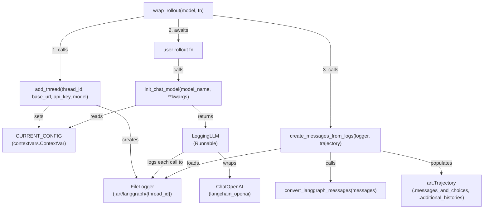
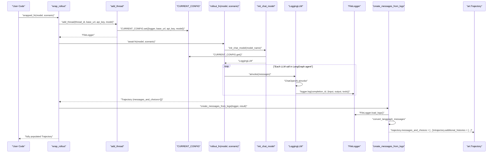
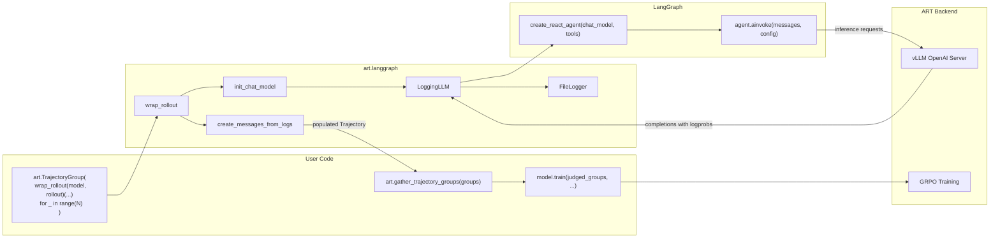

<!-- source: DeepWiki mcp.deepwiki.com · repo OpenPipe/ART · page 5.1 LangGraph Integration · fetched 2026-10-29 -->

# LangGraph Integration

<details>
<summary>Relevant source files</summary>

The following files were used as context for generating this wiki page:

- [README.md](README.md)
- [docs/fundamentals/art-backend.mdx](docs/fundamentals/art-backend.mdx)
- [docs/fundamentals/ruler.mdx](docs/fundamentals/ruler.mdx)
- [docs/getting-started/installation-setup.mdx](docs/getting-started/installation-setup.mdx)
- [docs/integrations/langgraph-integration.mdx](docs/integrations/langgraph-integration.mdx)
- [docs/tutorials/summarizer.mdx](docs/tutorials/summarizer.mdx)
- [src/art/langgraph/__init__.py](src/art/langgraph/__init__.py)
- [src/art/langgraph/llm_wrapper.py](src/art/langgraph/llm_wrapper.py)
- [src/art/langgraph/logging.py](src/art/langgraph/logging.py)
- [src/art/langgraph/message_utils.py](src/art/langgraph/message_utils.py)
- [src/art/rewards/ruler.py](src/art/rewards/ruler.py)
- [tests/unit/test_langgraph_llm_wrapper.py](tests/unit/test_langgraph_llm_wrapper.py)
- [tests/unit/test_langgraph_logging.py](tests/unit/test_langgraph_logging.py)

</details>


This page covers the `art.langgraph` module: its public API (`init_chat_model`, `wrap_rollout`), the internal logging and message-conversion machinery, and how they fit into the ART training loop. It focuses exclusively on the code in `src/art/langgraph/`. For a description of the general ART training loop and `Trajectory` data structures, see the Core Framework section and Trajectory System.

---

## Overview

ART's LangGraph integration lets you train a LangGraph `ReAct` agent (or any LangGraph graph that calls an LLM) with GRPO without rewriting the agent. It works by:

1. Intercepting every LLM call made by LangGraph and writing it to a per-rollout log file [src/art/langgraph/llm_wrapper.py:193-197]().
2. After the rollout finishes, replaying the log to reconstruct an ART `Trajectory` (with `messages_and_choices` and `additional_histories`) that the standard training pipeline can consume [src/art/langgraph/llm_wrapper.py:110]().

The integration surface is two functions exported from `src/art/langgraph/__init__.py`:

| Symbol | Role |
|---|---|
| `init_chat_model` | Drop-in replacement for LangChain's `init_chat_model`; returns a `LoggingLLM` wired to the ART backend [src/art/langgraph/llm_wrapper.py:115-173]() |
| `wrap_rollout` | Decorator that sets up per-call logging context and post-processes the returned `Trajectory` [src/art/langgraph/llm_wrapper.py:100-112]() |

Sources: [src/art/langgraph/__init__.py:1-3](), [src/art/langgraph/llm_wrapper.py:100-173]()

---

## Installation

The integration requires the `langgraph` extra:

```bash
uv pip install -U openpipe-art[backend,langgraph]>=0.4.9
```

Sources: [docs/integrations/langgraph-integration.mdx:15]()

---

## Architecture

### Component Map

**Diagram: art.langgraph module components and their relationships**



Sources: [src/art/langgraph/llm_wrapper.py:22-112](), [src/art/langgraph/logging.py:5-18]()

---

### Data Flow Through a Single Rollout

**Diagram: Sequence of operations inside wrap_rollout**



Sources: [src/art/langgraph/llm_wrapper.py:100-112](), [src/art/langgraph/llm_wrapper.py:45-97]()

---

## Module Components

### `wrap_rollout`

[src/art/langgraph/llm_wrapper.py:100-112]()

```python
wrap_rollout(model, fn) -> async wrapper
```

`wrap_rollout` is a higher-order function that takes the ART model object and a rollout coroutine and returns a new coroutine with the same signature. The wrapper:

1. Generates a unique `thread_id` (UUID4) [src/art/langgraph/llm_wrapper.py:102]().
2. Calls `add_thread` to register the thread in `CURRENT_CONFIG` and create a `FileLogger` at `.art/langgraph/{thread_id}` [src/art/langgraph/llm_wrapper.py:103-108]().
3. Awaits the original rollout function [src/art/langgraph/llm_wrapper.py:109]().
4. Calls `create_messages_from_logs` to backfill the returned `Trajectory`'s `messages_and_choices` field and `additional_histories` list from the captured logs [src/art/langgraph/llm_wrapper.py:110]().

---

### `init_chat_model`

[src/art/langgraph/llm_wrapper.py:115-173]()

```python
init_chat_model(model=None, *, model_provider=None, ..., **kwargs) -> LoggingLLM
```

A drop-in for LangChain's `init_chat_model`. Reads `CURRENT_CONFIG` (set by `wrap_rollout`'s call to `add_thread`) and returns a `LoggingLLM` backed by a `ChatOpenAI` pointed at the ART backend's inference endpoint [src/art/langgraph/llm_wrapper.py:133-173]().

> **Important:** `init_chat_model` must be called inside the rollout function, after `wrap_rollout` has set up `CURRENT_CONFIG`. Calling it outside this context will raise a `LookupError` because the context variable has no value [src/art/langgraph/llm_wrapper.py:133]().

---

### `LoggingLLM`

[src/art/langgraph/llm_wrapper.py:176-239]()

`LoggingLLM` is a LangChain `Runnable` that wraps a chat model (typically `ChatOpenAI`). It intercepts all LLM calls and writes input/output pairs to the `FileLogger` [src/art/langgraph/llm_wrapper.py:193-197]().

| Method | Description |
|---|---|
| `invoke(input, config, **kwargs)` | Synchronous call; logs result via `_log` [src/art/langgraph/llm_wrapper.py:198-206]() |
| `ainvoke(input, config, **kwargs)` | Async call with 10-minute default timeout; logs result [src/art/langgraph/llm_wrapper.py:220-229]() |
| `bind_tools(tools)` | Returns a new `LoggingLLM` with tools registered for logging [src/art/langgraph/llm_wrapper.py:231-239]() |

Tool calls are normalized: string `args` are parsed from JSON into dicts before logging [src/art/langgraph/llm_wrapper.py:210-213]().

---

### `CURRENT_CONFIG` Context Variable

[src/art/langgraph/llm_wrapper.py:22]()

`CURRENT_CONFIG` is a `contextvars.ContextVar` holding a dict with keys `logger`, `base_url`, `api_key`, and `model` [src/art/langgraph/llm_wrapper.py:34-41](). It is set once per rollout by `add_thread` and read by `init_chat_model` [src/art/langgraph/llm_wrapper.py:133](). Using a context variable instead of a global makes parallel async rollouts safe—each coroutine has its own isolated context.

---

### `FileLogger`

[src/art/langgraph/logging.py:4-19]()

`FileLogger` maintains an in-memory list of logs for the duration of the rollout and also writes them to a file for persistence [src/art/langgraph/logging.py:7-14]().

| Path | Format | Purpose |
|---|---|---|
| `{filepath}` | Plain text (append) | Human-readable log for debugging [src/art/langgraph/logging.py:11-12]() |

`log(name, entry)` appends to both the file and the internal `_logs` list. `load_logs()` returns a copy of the captured entries [src/art/langgraph/logging.py:16-18]().

---

### `create_messages_from_logs`

[src/art/langgraph/llm_wrapper.py:45-97]()

After a rollout finishes, this function reconstructs the conversation history from the `FileLogger`.

1. Load all log entries (each entry contains `input`, `output`, and `tools`) [src/art/langgraph/llm_wrapper.py:46-50]().
2. Deduplicate and merge conversations by matching input prefixes [src/art/langgraph/llm_wrapper.py:64-78](). This handles LangGraph's behavior of re-invoking the LLM with growing context windows.
3. Convert each distinct conversation using `convert_langgraph_messages` [src/art/langgraph/llm_wrapper.py:86]().
4. Assign the first conversation to `trajectory.messages_and_choices` and subsequent ones to `trajectory.additional_histories` as `History` objects [src/art/langgraph/llm_wrapper.py:87-93]().

---

### `convert_langgraph_messages`

[src/art/langgraph/message_utils.py:90-123]()

Converts a list of LangChain `BaseMessage` objects to ART's format.

Messages that have `logprobs` in `response_metadata` are treated as model completions and converted to `Choice` objects [src/art/langgraph/message_utils.py:94-115](). This is critical because ART's training pipeline requires `Choice` objects to compute GRPO loss. All other messages are converted to `ChatCompletionMessageParam` using `langchain_msg_to_openai` [src/art/langgraph/message_utils.py:117]().

| LangChain type | Converted to |
|---|---|
| `HumanMessage` | `user` role [src/art/langgraph/message_utils.py:55-56]() |
| `AIMessage` with logprobs | `openai.types.chat.Choice` [src/art/langgraph/message_utils.py:106-115]() |
| `AIMessage` without logprobs | `assistant` role [src/art/langgraph/message_utils.py:57-58]() |
| `SystemMessage` | `system` role [src/art/langgraph/message_utils.py:59-60]() |
| `ToolMessage` | `tool` role [src/art/langgraph/message_utils.py:61-62]() |

Sources: [src/art/langgraph/message_utils.py:54-87](), [src/art/langgraph/message_utils.py:90-123]()

---

## Integration with the ART Training Loop

**Diagram: LangGraph integration in the full ART training loop**



Sources: [docs/integrations/langgraph-integration.mdx:146-193](), [src/art/langgraph/llm_wrapper.py:100-112]()

---

## Usage Pattern

The minimal integration pattern is:

1. Define a rollout function that creates a LangGraph agent using `init_chat_model` [docs/integrations/langgraph-integration.mdx:92]().
2. Wrap the rollout with `wrap_rollout(model, rollout_fn)` when building `TrajectoryGroup` instances [docs/integrations/langgraph-integration.mdx:164]().
3. Use `art.gather_trajectory_groups` and `model.train` [docs/integrations/langgraph-integration.mdx:173-191]().

```python
# Inside the rollout:
chat_model = init_chat_model(model.get_inference_name(), temperature=1.0)
react_agent = create_react_agent(chat_model, tools)
await react_agent.ainvoke({"messages": [...]}, config=config)

# In the training loop:
for batch in training_iterator:
    groups = [
        art.TrajectoryGroup(
            wrap_rollout(model, rollout)(model, scenario)
            for _ in range(rollouts_per_group)
        )
        for scenario in batch.items
    ]
    finished_groups = await art.gather_trajectory_groups(groups)
    # ... score and train ...
```

Sources: [docs/integrations/langgraph-integration.mdx:89-116](), [docs/integrations/langgraph-integration.mdx:158-193]()

---

## Handling Multi-Turn Tool Calls

LangGraph's ReAct agents make sequential LLM calls as tools are invoked and results returned. `create_messages_from_logs` handles this:

- It deduplicates turn sequences so that only the complete final conversation is stored in `messages_and_choices` [src/art/langgraph/llm_wrapper.py:64-81]().
- If the agent spawns sub-graphs or independent branches, these are captured as separate entries in `additional_histories` [src/art/langgraph/llm_wrapper.py:91-93]().

Sources: [src/art/langgraph/llm_wrapper.py:45-97]()

---

