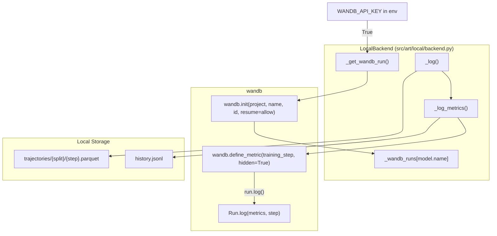
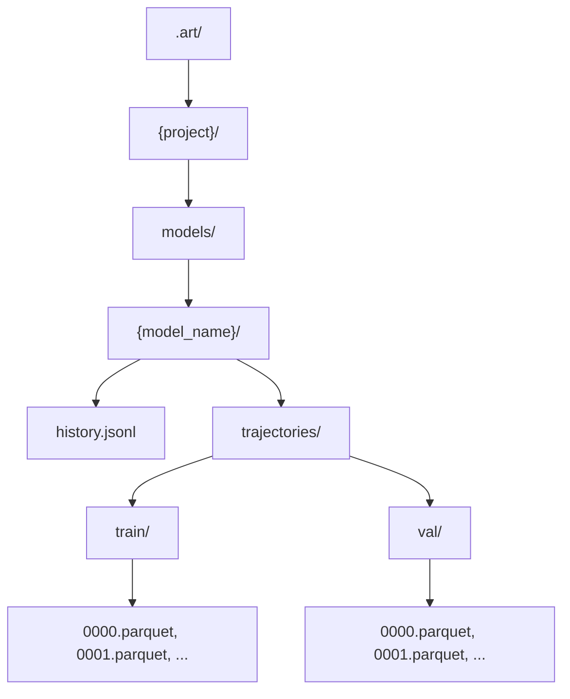
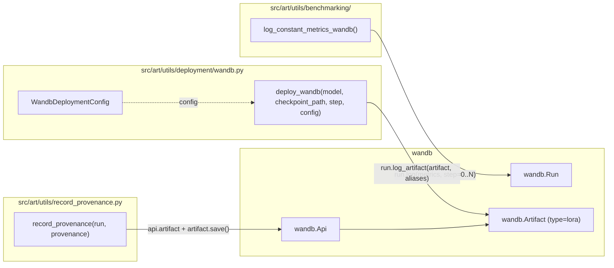

<!-- source: DeepWiki mcp.deepwiki.com · repo OpenPipe/ART · page 5.2 Experiment Tracking · fetched 2026-10-29 -->

# Experiment Tracking

Relevant source files

The following files were used as context for generating this wiki page:

- [dev/sft/sft-from-file.py](dev/sft/sft-from-file.py)
- [dev/sft/sft-warmup.py](dev/sft/sft-warmup.py)
- [src/art/metrics_taxonomy.py](src/art/metrics_taxonomy.py)
- [src/art/utils/benchmarking/log_constant_metrics_wandb.py](src/art/utils/benchmarking/log_constant_metrics_wandb.py)
- [src/art/utils/deployment/common.py](src/art/utils/deployment/common.py)
- [src/art/utils/deployment/wandb.py](src/art/utils/deployment/wandb.py)
- [src/art/utils/record_provenance.py](src/art/utils/record_provenance.py)
- [src/art/utils/sft.py](src/art/utils/sft.py)
- [tests/integration/test_provenance.py](tests/integration/test_provenance.py)
- [tests/unit/test_frontend_logging.py](tests/unit/test_frontend_logging.py)
- [tests/unit/test_metric_routing.py](tests/unit/test_metric_routing.py)

ART integrates with Weights & Biases (W&B) as its primary experiment tracking platform. Langfuse and OpenPipe are supported as optional trajectory logging integrations used in example code. Local file-based logs are always written regardless of external integrations.

For information about model deployment and artifact publishing, see page 4.4. For training configuration, see page 3.4.

## Overview

The experiment tracking system covers three areas:

1.  **Metrics Logging**: Training and validation metrics are logged to both `history.jsonl` and W&B at each training step.
2.  **Trajectory Storage**: Full agent rollout data is written to Parquet files under `.art/` [tests/unit/test_frontend_logging.py:89-91]().
3.  **Model Artifact Tracking**: LoRA checkpoints can be uploaded as W&B Artifacts with provenance metadata via `deploy_wandb` [src/art/utils/deployment/wandb.py:37-43]() and `record_provenance` [src/art/utils/record_provenance.py:11-29]().

The tracking system operates within `LocalBackend` directly, and is transparently proxied by `SkyPilotBackend` to a remote `LocalBackend`.

Sources: [src/art/local/backend.py](), [src/art/utils/benchmarking/log_constant_metrics_wandb.py](), [src/art/utils/record_provenance.py](), [src/art/utils/deployment/wandb.py]()

## W&B Integration

W&B is ART's primary experiment tracking integration. It is activated automatically when `WANDB_API_KEY` is present in the environment.

**W&B Run Lifecycle in `LocalBackend`**

Sources: [src/art/local/backend.py](), [tests/unit/test_frontend_logging.py:89-91]()

`LocalBackend` holds a `_wandb_runs` dict keyed by `model.name`. A run is created (or resumed) via `_get_wandb_run()` when a `TrainableModel` with `trainable=True` is registered and `WANDB_API_KEY` is set.

ART defines a specific metric taxonomy to ensure charts are organized correctly in W&B [tests/unit/test_metric_routing.py:66-81]():

| Step Metric | Target Metrics |
|---|---|
| `training_step` | `reward/*`, `loss/*`, `throughput/*`, `costs/*`, `time/*`, `data/*`, `train/*`, `val/*`, `test/*`, `discarded/*` |
| `sft/gradient_step` | `sft/*` |

Sources: [tests/unit/test_metric_routing.py:66-81](), [src/art/metrics_taxonomy.py:8-12]()

### Metric Logging

The `_log_metrics()` method in `LocalBackend` writes to two destinations simultaneously. Metrics are routed based on their prefix [tests/unit/test_metric_routing.py:12-31]():

-   **Local**: Appends a JSON line to `history.jsonl`. Known sections (like `reward/`) are logged without split prefixes, while custom metrics are prefixed with the current split (e.g., `train/custom`) [tests/unit/test_metric_routing.py:37-40]().
-   **W&B**: Calls `run.log()` with the metrics and the current `training_step`. It also automatically logs `time/wall_clock_sec` [tests/unit/test_metric_routing.py:41-42]().

Sources: [src/art/local/backend.py](), [tests/unit/test_metric_routing.py:12-43]()

### Trajectory-Level Metrics

`model.log()` aggregates metrics from `TrajectoryGroup` objects. The system supports logging complex nested metrics like costs [tests/unit/test_metric_routing.py:103-107]().

| Metric | Source | Description |
|--------|--------|-------------|
| `reward` | `Trajectory.reward` | Mean reward across all trajectories |
| `data/*` | `summarize_trajectory_groups` | Counts of scenarios, trajectories, and trainable groups [src/art/metrics_taxonomy.py:82-94] |
| `costs/*` | Training system | Prefill and sample costs [tests/unit/test_metric_routing.py:103-107] |

Sources: [src/art/local/backend.py](), [src/art/metrics_taxonomy.py:82-94](), [tests/unit/test_metric_routing.py:103-107]()

## Local File Storage

All data is written to the `.art/` directory. Trajectories are stored in Parquet format for efficiency [tests/unit/test_frontend_logging.py:74-77]().

**`.art/` Directory Layout**

Sources: [src/art/local/backend.py](), [tests/unit/test_frontend_logging.py:89-91]()

**`history.jsonl`** — One JSON object per line. Used by `delete_checkpoints()` to identify the best checkpoint [tests/unit/test_frontend_logging.py:193-196]().

**`trajectories/{split}/{step}.parquet`** — Serialized trajectory groups. The schema includes `group_index`, `reward`, `metrics`, `metadata`, `tools`, `logs`, and `messages` [tests/unit/test_frontend_logging.py:121-132]().

Sources: [tests/unit/test_frontend_logging.py:121-132](), [tests/unit/test_frontend_logging.py:193-196]()

## Baseline Comparison: `log_constant_metrics_wandb`

`log_constant_metrics_wandb` in [src/art/utils/benchmarking/log_constant_metrics_wandb.py]() creates a W&B run that logs the same metric values at every step from `0` to `num_steps`. This produces horizontal reference lines on W&B charts.

**Function signature**: `async def log_constant_metrics_wandb(model, num_steps, split_metrics, logged_run_name=None)` [src/art/utils/benchmarking/log_constant_metrics_wandb.py:7-12]()

| Parameter | Type | Description |
|-----------|------|-------------|
| `model` | `art.Model` | Used for `project` and `name` [src/art/utils/benchmarking/log_constant_metrics_wandb.py:22-23] |
| `num_steps` | `int` | Total training steps to log [src/art/utils/benchmarking/log_constant_metrics_wandb.py:24-25] |
| `split_metrics` | `dict` | Nested dict mapping splits to metrics [src/art/utils/benchmarking/log_constant_metrics_wandb.py:26-30] |

Sources: [src/art/utils/benchmarking/log_constant_metrics_wandb.py:7-50]()

## Model Artifact Tracking

**Tracking Utilities Code Map**

Sources: [src/art/utils/deployment/wandb.py](), [src/art/utils/record_provenance.py]()

### `deploy_wandb`

`deploy_wandb` in [src/art/utils/deployment/wandb.py]() uploads a LoRA checkpoint as a W&B Artifact of type `"lora"` [src/art/utils/deployment/wandb.py:82-84](). It tags the artifact with `step{step}` and `latest` aliases [src/art/utils/deployment/wandb.py:89]().

Supported base models include Llama-3.1 and Qwen-2.5/3 variants [src/art/utils/deployment/wandb.py:29-34]().

Sources: [src/art/utils/deployment/wandb.py:29-89]()

### `record_provenance`

`record_provenance(run, provenance)` in [src/art/utils/record_provenance.py]() appends a training technique identifier (e.g., `"serverless-rl"`) to the `wandb.provenance` list in the latest artifact's metadata [src/art/utils/record_provenance.py:20-27](). This is used to track the history of models as they move through different training phases [tests/integration/test_provenance.py:77-81]().

Sources: [src/art/utils/record_provenance.py:11-29](), [tests/integration/test_provenance.py:77-81]()

## SFT Experiment Tracking

When using `create_sft_dataset_iterator` [src/art/utils/sft.py:145-157](), the system handles learning rate scheduling and metric logging across multiple `train_sft` calls. Each `SFTChunk` contains its own configuration and step tracking to ensure W&B charts show a continuous training curve [src/art/utils/sft.py:16-21]().

Sources: [src/art/utils/sft.py:16-21](), [src/art/utils/sft.py:145-157]()

---

