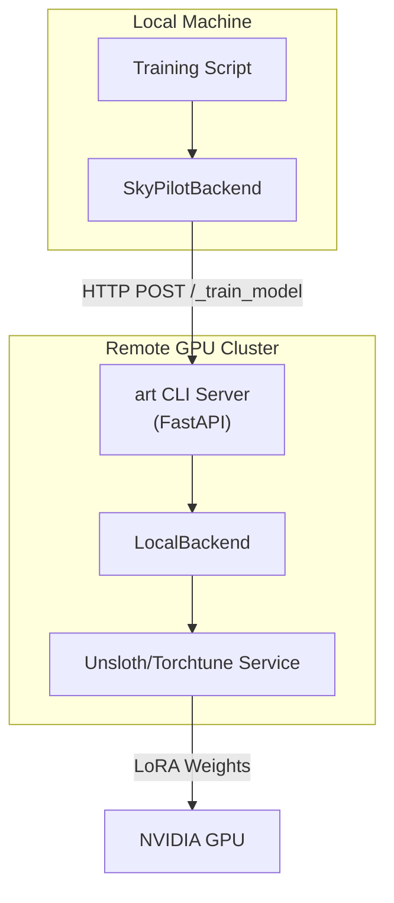

<!-- source: DeepWiki mcp.deepwiki.com · repo OpenPipe/ART · page 5.3 CLI and Scripting · fetched 2026-10-29 -->

# CLI and Scripting

<details>
<summary>Relevant source files</summary>

The following files were used as context for generating this wiki page:

- [.agents/skills/train-rl/SKILL.md](.agents/skills/train-rl/SKILL.md)
- [.agents/skills/train-sft/SKILL.md](.agents/skills/train-sft/SKILL.md)
- [.env.example](.env.example)
- [dev/sft/dataset.jsonl](dev/sft/dataset.jsonl)
- [dev/sft/distillation.py](dev/sft/distillation.py)
- [examples/tic_tac_toe/tic-tac-toe.py](examples/tic_tac_toe/tic-tac-toe.py)
- [examples/tic_tac_toe_self_play/deploy_step.py](examples/tic_tac_toe_self_play/deploy_step.py)
- [scripts/deploy-model.py](scripts/deploy-model.py)
- [src/art/backend.py](src/art/backend.py)
- [src/art/cli.py](src/art/cli.py)
- [src/art/utils/deploy_model.py](src/art/utils/deploy_model.py)
- [src/art/utils/output_dirs.py](src/art/utils/output_dirs.py)
- [src/art/utils/s3.py](src/art/utils/s3.py)

</details>


The ART framework provides a unified command-line interface via the `art` command and a set of interactive "skills" designed to assist AI coding agents in generating training scripts. This page documents the CLI commands, the interactive wizard system, and utility scripts for data migration and model deployment.

---

## Overview

The ART CLI is built using the `typer` library and serves as the primary entry point for initializing projects, installing agent skills, and performing maintenance tasks like trajectory data migration.

| Command | Purpose | Entry Point |
|---------|---------|-------------|
| `art init` | Initializes ART in a project and installs skills | [src/art/cli.py:85-97]() |
| `art install-skills` | Copies SKILL.md files to `.claude/skills` and `.agents/skills` | [src/art/cli.py:59-82]() |
| `art migrate` | Converts trajectory files from JSONL to Parquet format | [src/art/cli.py:120-201]() |
| `art run` | Starts the ART backend FastAPI server | [src/art/cli.py:218-231]() |
| `art help` | Displays getting-started information | [src/art/cli.py:99-116]() |

**Sources:** [src/art/cli.py:10-231]()

---

## Interactive Agent Skills

ART includes bundled "skills" (in `SKILL.md` format) that teach AI coding assistants (like Claude Code or OpenAI Codex) how to interact with the ART framework. These skills act as interactive wizards.

### Skill Installation
The `install_skills` command locates bundled skills within the package or development environment and copies them into the target project's hidden directories (`.claude/skills/` and `.agents/skills/`) [src/art/cli.py:35-55]().

### The RL Training Wizard (`train-rl`)
The `train-rl` skill provides a step-by-step decision tree for generating reinforcement learning scripts. It forces the assistant to resolve "Blocking Decisions" before writing code:

1.  **Replayability:** Determines if the environment can be rolled out repeatedly [.agents/skills/train-rl/SKILL.md:52-64]().
2.  **Task Shape:** Identifies if the task is multi-turn or single-turn [.agents/skills/train-rl/SKILL.md:65-83]().
3.  **Reward Choice:** Guides the user between Programmatic, RULER (LLM judge), or Custom rewards [.agents/skills/train-rl/SKILL.md:84-107]().
4.  **Backend Selection:** Chooses between `LocalBackend` and `ServerlessBackend` [.agents/skills/train-rl/SKILL.md:121-136]().

**Sources:** [.agents/skills/train-rl/SKILL.md:1-164]()

---

## Trajectory Migration (`art migrate`)

The `migrate` command is used to convert legacy `.jsonl` trajectory files into the high-performance `.parquet` format. Parquet provides approximately 25x compression and 20x faster query speeds for large-scale training runs [src/art/cli.py:140-141]().

### Migration Logic
The command intelligently detects the path type and delegates to specific utility functions:
- **Model Directory:** Migrates trajectories for a specific model [src/art/cli.py:161-166]().
- **Trajectories Directory:** Migrates a flat folder of JSONL files [src/art/cli.py:170-175]().
- **Project Directory:** Iterates through all models in the project and migrates their respective trajectory folders [src/art/cli.py:178-195]().

### Performance Comparison
| Feature | JSONL | Parquet |
|---------|-------|---------|
| Storage | Uncompressed text | Columnar, compressed |
| Read Speed | Sequential scan | Columnar skip/filter |
| Use Case | Debugging/Human readable | Training/Large-scale RL |

**Sources:** [src/art/cli.py:120-201](), [src/art/utils/trajectory_migration.py:1-200]()

---

## Server and Remote Execution

The `art run` command (aliased to the base `art` command in some contexts) starts a FastAPI server. This is primarily used by the `SkyPilotBackend` to proxy training commands to a remote GPU cluster.

### Server Architecture



**Sources:** [src/art/cli.py:218-231](), [src/art/backend.py:15-53]()

---

## Scripting Patterns

### Model Deployment Scripts
ART provides utilities in `art.utils.deployment` for deploying trained LoRA checkpoints to providers like Together.ai or W&B Inference.

```python
# Example deployment logic found in scripts/deploy-model.py
checkpoint_path = get_step_checkpoint_dir(model_dir, step)
result = await deploy_model(
    model=model,
    checkpoint_path=checkpoint_path,
    provider="together",
    config=TogetherDeploymentConfig(s3_bucket=backup_bucket)
)
```

**Sources:** [scripts/deploy-model.py:50-103](), [src/art/utils/deployment/__init__.py:8-20]()

### S3 Integration Utilities
For cloud-based workflows, the CLI and scripts interact with S3 for checkpoint persistence.

| Function | Purpose |
|----------|---------|
| `s3_sync` | Wraps `aws s3 sync` for efficient directory mirroring [src/art/utils/s3.py:66-126]() |
| `push_model_to_s3` | Archives a specific training step and uploads to the backup bucket [src/art/utils/s3.py:223-250]() |
| `pull_model_from_s3` | Downloads model checkpoints to the local `.art` directory [src/art/utils/s3.py:161-220]() |

**Sources:** [src/art/utils/s3.py:1-250]()

---

## CLI Reference

### `art migrate`
```bash
art migrate [PATH] [--dry-run] [--keep-jsonl] [--verbose]
```
- `PATH`: Path to a model, project, or trajectories directory.
- `--dry-run`: Show estimated space savings without modifying files [src/art/cli.py:124-129]().
- `--keep-jsonl`: Do not delete original files after conversion [src/art/cli.py:130-132]().

### `art install-skills`
```bash
art install-skills [PATH]
```
- `PATH`: The root of your repository where `.claude/skills` should be created. Defaults to current directory [src/art/cli.py:60-62]().

**Sources:** [src/art/cli.py:58-201]()

---

