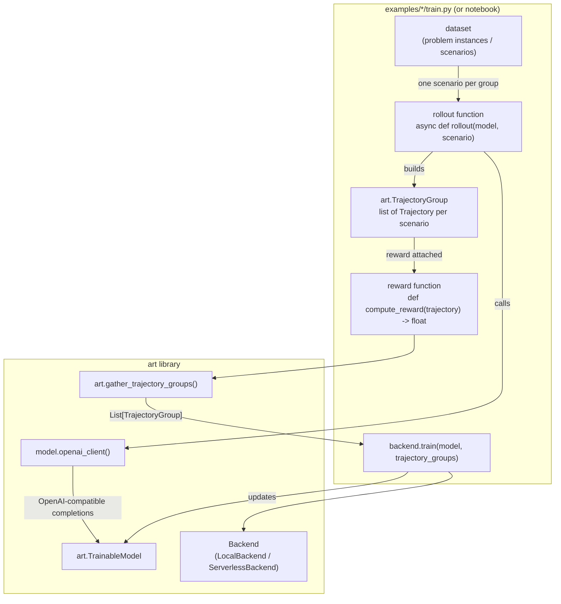
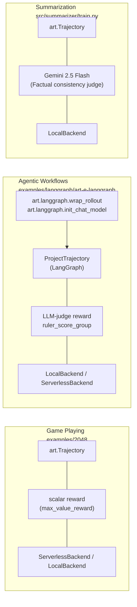

<!-- source: DeepWiki mcp.deepwiki.com · repo OpenPipe/ART · page 6 Example Applications · fetched 2026-10-29 -->

# Example Applications

Relevant source files

The following files were used as context for generating this wiki page:

- [README.md](README.md)
- [docs/fundamentals/art-backend.mdx](docs/fundamentals/art-backend.mdx)
- [docs/getting-started/installation-setup.mdx](docs/getting-started/installation-setup.mdx)
- [docs/integrations/langgraph-integration.mdx](docs/integrations/langgraph-integration.mdx)
- [docs/tutorials/summarizer.mdx](docs/tutorials/summarizer.mdx)
- [examples/2048/display_benchmarks.ipynb](examples/2048/display_benchmarks.ipynb)
- [examples/2048/generate_benchmarks.py](examples/2048/generate_benchmarks.py)
- [examples/2048/rollout.py](examples/2048/rollout.py)
- [examples/2048/train.py](examples/2048/train.py)
- [examples/2048/utils.py](examples/2048/utils.py)

This page provides an orientation to the example training scripts and notebooks included in the ART repository. Each example demonstrates a complete training loop using `art.TrainableModel`, covering rollout generation, reward assignment, and gradient updates via GRPO. The examples are organized by problem domain and live under the `examples/` directory at the root of the repository.

This page is a directory and overview. For detailed walkthroughs of specific examples, see the child pages:

- Game playing agents (2048, Tic-Tac-Toe, Codenames): see [Game Playing Agents](#6.1)
- Tool calling and Tau-Bench: see [Tool Calling & Tau-Bench](#6.2)
- Email and research agents using LangGraph: see [Deep Research & Email Agents](#6.3)
- Temporal Clue puzzle and minimal yes/no/maybe pattern: see [Temporal Clue & Simple Patterns](#6.4)
- Hacker News title generation with composite rewards: see [Summarization & Title Generation](#6.5)

For background on the core abstractions that every example uses, see [Core Concepts](#1.2) and the [Model System](#2.1) and [Trajectory System](#2.2) pages.

---

## Example Index

| Example | Directory | Domain | Reward Strategy | ART Features Used |
|---|---|---|---|---|
| 2048 | `examples/2048/` | Game playing | Score / tile reached | `TrainableModel`, `Trajectory`, `ServerlessBackend` |
| Tic-Tac-Toe | `examples/tic_tac_toe/` | Game playing | Win / loss / draw | `TrainableModel`, `Trajectory` |
| Codenames | `examples/codenames/` | Game playing | Guess accuracy | `TrainableModel`, `Trajectory` |
| MCP-RL | `examples/mcp_rl/` | Tool calling | Task completion | Tool call trajectories |
| Tau-Bench | `examples/tau_bench/` | Tool calling / benchmark | Benchmark accuracy | Multi-turn tool trajectories |
| art-e (email agent) | `examples/art_e/` | Agentic workflow | LLM-judge reward | LangGraph integration, `ProjectTrajectory` |
| Open Deep Research | `examples/open_deep_research/` | Agentic workflow | LLM-judge reward | LangGraph integration |
| Temporal Clue | `examples/temporal_clue/` | Puzzle solving | Accuracy | `LocalBackend`, `gather_trajectory_groups` |
| Yes-No-Maybe | `examples/yes_no_maybe/` | Minimal pattern | Binary accuracy | Minimal training loop |
| Hacker News | `examples/hacker_news/` | Summarization | Composite reward model | External reward model, `ValidationCallback` |

Sources: [README.md:63-74](), [examples/2048/train.py:16-20](), [examples/2048/rollout.py:33-46]()

---

## Common Architecture Across Examples

Every example follows the same structural pattern, regardless of domain. The diagram below maps natural language concepts onto the ART code entities used in each example.

**Diagram: Common example training loop pattern**

Sources: [examples/2048/train.py:46-77](), [examples/2048/rollout.py:26-61](), [docs/integrations/langgraph-integration.mdx:143-193]()

---

## Mapping Examples to ART Abstractions

The following diagram shows which ART integration points and backend features each example category exercises.

**Diagram: Example categories and the ART abstractions they exercise**

Sources: [examples/2048/rollout.py:101-114](), [docs/integrations/langgraph-integration.mdx:89-132](), [docs/tutorials/summarizer.mdx:87-101]()

---

## Structural Patterns

The examples fall into three structural patterns based on how rollouts are collected.

### 1. Direct rollout (single-turn or short multi-turn)
Used by the game playing, Temporal Clue, and yes-no-maybe examples. The rollout function calls `model.openai_client().chat.completions.create()` [examples/2048/rollout.py:56-61]() once or in a loop, builds a `Trajectory` from the messages and the completion, attaches a scalar reward, and returns the trajectory [examples/2048/rollout.py:116]().

### 2. Tool-call rollout
Used by MCP-RL and Tau-Bench. The rollout function issues multiple completions, each potentially containing tool call messages. The resulting `Trajectory` contains the full interleaved sequence of model messages and tool result messages.

### 3. LangGraph agent rollout
Used by art-e and Open Deep Research. The rollout function uses `art.langgraph.wrap_rollout` [docs/integrations/langgraph-integration.mdx:164]() around a LangGraph graph execution. Trajectory capture, tool call logging, and step boundaries are handled automatically. Reward is often assigned by `ruler_score_group` [docs/integrations/langgraph-integration.mdx:182]() using an LLM-as-judge.

---

## Backend Usage in Examples

Most examples support both `LocalBackend` for single-machine use and `ServerlessBackend` for managed scaling.

| Example | Default Backend | Cloud / Managed Option |
|---|---|---|
| 2048 | `ServerlessBackend` [README.md:66]() | `LocalBackend` [examples/2048/train.py:34]() |
| art-e | `ServerlessBackend` [README.md:65]() | `LocalBackend` |
| Summarizer | `LocalBackend` [docs/tutorials/summarizer.mdx:36]() | — |
| LangGraph Agents | `LocalBackend` | `ServerlessBackend` [docs/getting-started/installation-setup.mdx:53]() |

For backend selection guidance, see [Backend Implementations](#4).

---

## Child Pages

| Page | Content |
|---|---|
| [Game Playing Agents](#6.1) | 2048, Tic-Tac-Toe, Codenames: game state prompts, turn-based rollouts, win/loss rewards |
| [Tool Calling & Tau-Bench](#6.2) | MCP-RL and Tau-Bench: tool call trajectory capture, benchmark evaluation, training results |
| [Deep Research & Email Agents](#6.3) | art-e and Open Deep Research: LangGraph integration, `ProjectTrajectory`, dual LLM-judge rewards |
| [Temporal Clue & Simple Patterns](#6.4) | Temporal Clue puzzle and yes-no-maybe: dataset loading, accuracy rewards, minimal local training loop |
| [Summarization & Title Generation](#6.5) | Hacker News title generation: composite reward function, external reward model, `ValidationCallback` |

---

