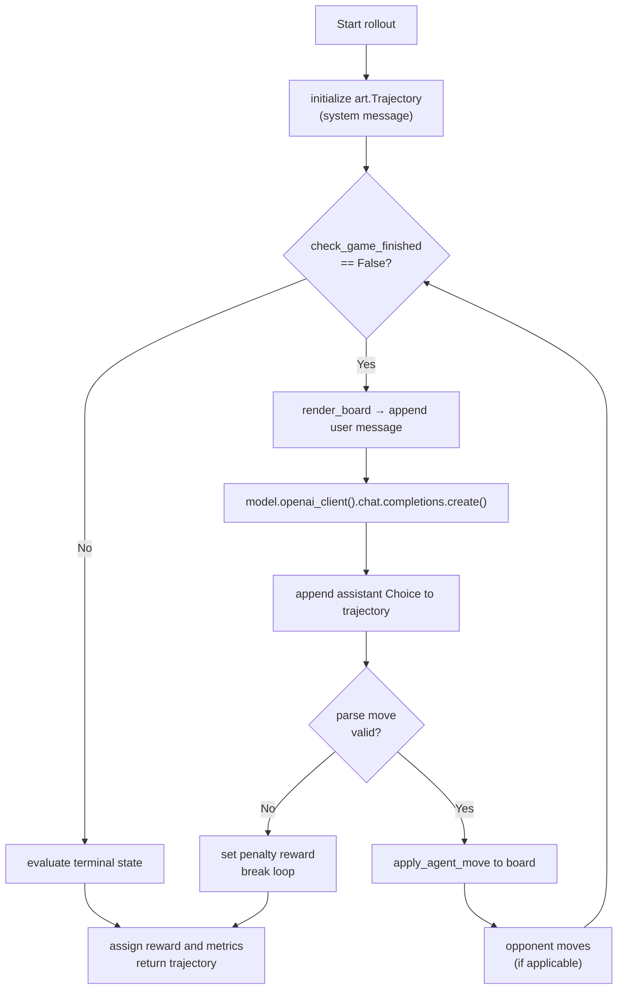
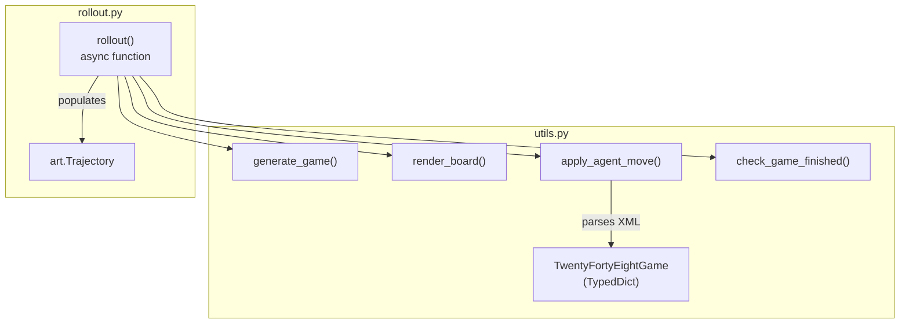
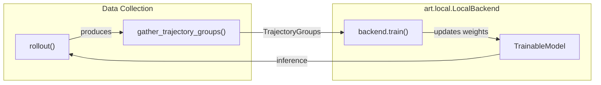

<!-- source: DeepWiki mcp.deepwiki.com · repo OpenPipe/ART · page 6.1 Game Playing Agents · fetched 2026-10-29 -->

# Game Playing Agents

<details>
<summary>Relevant source files</summary>

The following files were used as context for generating this wiki page:

- [dev/run_qwen3_5_localbackend_yes_no_maybe.py](dev/run_qwen3_5_localbackend_yes_no_maybe.py)
- [dev/yes-no-maybe-metrics.py](dev/yes-no-maybe-metrics.py)
- [examples/2048/display_benchmarks.ipynb](examples/2048/display_benchmarks.ipynb)
- [examples/2048/generate_benchmarks.py](examples/2048/generate_benchmarks.py)
- [examples/2048/rollout.py](examples/2048/rollout.py)
- [examples/2048/train.py](examples/2048/train.py)
- [examples/2048/utils.py](examples/2048/utils.py)
- [examples/tic_tac_toe/rollout.py](examples/tic_tac_toe/rollout.py)
- [examples/tic_tac_toe_self_play/rollout.py](examples/tic_tac_toe_self_play/rollout.py)
- [examples/tic_tac_toe_self_play/train.py](examples/tic_tac_toe_self_play/train.py)
- [src/art/dev/engine.py](src/art/dev/engine.py)
- [src/art/guided_completion.py](src/art/guided_completion.py)

</details>


This page covers the game-playing example applications included in the ART repository. It explains how game state is encoded in prompts, how multi-turn rollout loops are structured for turn-based environments, and how win/loss/draw outcomes map to scalar rewards for GRPO training.

---

## Overview

The repository includes several game-playing examples designed to demonstrate reinforcement learning in discrete state spaces:

| Example | Location | Game Type | Opponent Strategy |
|---|---|---|---|
| Tic-Tac-Toe | `examples/tic_tac_toe/` | Turn-based, two-player | Random move selection |
| Tic-Tac-Toe Self-Play | `examples/tic_tac_toe_self_play/` | Turn-based, two-player | Self-play vs current model |
| 2048 | `examples/2048/` | Single-player, tile merging | N/A (environment) |
| Yes-No-Maybe | `dev/yes-no-maybe-metrics.py` | Single-turn response | N/A (stateless) |

All game examples follow a structural pattern: each training rollout plays out a complete game episode, the final outcome determines the reward attached to the `art.Trajectory`, and the full game conversation is captured as the trajectory's message sequence.

---

## Common Patterns

### Game State Encoding
Game state is converted to a text string at each turn and appended to the conversation as a `user` message. 

For Tic-Tac-Toe, `render_board()` in [examples/tic_tac_toe/game_utils.py:23-36]() produces an ASCII grid. In 2048, `render_board()` in [examples/2048/utils.py:59-84]() creates a padded pipe-delimited grid:
```
  2 |  _ |  _ |  4
  4 |  8 |  2 | 16
 16 | 32 | 64 | 128
  _ |  2 |  2 |  4
```
The system message establishes the agent's role, the move format (typically XML), and the goal [examples/2048/rollout.py:33-39]().

### Turn-Based Rollout Loop
Each rollout plays a complete game episode by calling the model repeatedly until a terminal state is reached.

**Rollout loop for turn-based games:**


Sources: [examples/tic_tac_toe/rollout.py:50-106](), [examples/2048/rollout.py:48-88]()

### Reward Assignment
All game examples assign a scalar reward to `trajectory.reward` after the episode ends. GRPO uses these rewards to compute group-relative advantages across a `TrajectoryGroup`.

---

## Tic-Tac-Toe Examples

### Standard vs. Self-Play
- **Standard (`examples/tic_tac_toe/`)**: The agent plays against a scripted opponent that selects random empty squares [examples/tic_tac_toe/game_utils.py:102-109]().
- **Self-Play (`examples/tic_tac_toe_self_play/`)**: The rollout involves two `art.Model` instances. It can include "teacher" models (like `o4-mini`) to provide `guided_choice` for the student model, facilitating RL-based distillation [examples/tic_tac_toe_self_play/rollout.py:49-61]().

### Reward Structure
| Outcome | `trajectory.reward` | `metrics["win"]` |
|---|---|---|
| Agent wins | `1 - move_number / 40` | `1` |
| Opponent wins | `0 + move_number / 40` | `0` |
| Draw | `0.5` | `0.5` |
| Invalid move | `-2 + log(move_number + 1) / log(10)` | `0` (invalid_move: 1) |

The reward function often includes a small bonus/penalty based on `move_number` to encourage faster wins or longer survival [examples/tic_tac_toe_self_play/rollout.py:190-193]().

---

## 2048 Example

### Implementation Details
The 2048 implementation uses a `while True` loop that continues until `check_game_finished(game)` returns `True` or the model makes an invalid move [examples/2048/rollout.py:48-88]().

**2048 Code Entity Space:**

Sources: [examples/2048/utils.py:15-180](), [examples/2048/rollout.py:26-116]()

### Composite Reward Function
The 2048 reward is multi-faceted to guide the agent through the sparse reward space of reaching the 2048 tile:
1. **Win Reward**: If `agent_won`, `trajectory.reward = 2` [examples/2048/rollout.py:101-103]().
2. **Progress Reward**: If the game ends without a win, the reward is a weighted sum of the `max_value` achieved and the `board_value` (sum of all tiles), both scaled logarithmically [examples/2048/rollout.py:106-114]().
3. **Invalid Move**: Results in a hard penalty of `-1` [examples/2048/rollout.py:83]().

---

## Training and Benchmarking

### Local Training Loop
The training scripts (e.g., `examples/2048/train.py`) utilize the `LocalBackend` and `art.gather_trajectory_groups` to collect data before calling `backend.train`.

**Data Flow in Training:**

Sources: [examples/2048/train.py:34-77](), [examples/tic_tac_toe_self_play/train.py:30-116]()

### Benchmarking
The `examples/2048/generate_benchmarks.py` script demonstrates how to compare a trained model against baselines (e.g., `gpt-4o-mini`) by running rollouts with `is_validation=True` and logging the results to the project history for visualization [examples/2048/generate_benchmarks.py:42-61]().

---

## Key Design Principles

1. **Self-contained game logic**: Game rules reside in `utils.py` or `game_utils.py`, isolated from ART rollout logic.
2. **XML Move Parsing**: Agents are instructed via system prompts to return moves in XML (e.g., `<move>left</move>`), which is parsed using `xml.etree.ElementTree` [examples/2048/utils.py:144-156]().
3. **Guided Distillation**: In self-play, teacher models can generate `guided_choice` parameters, which are passed to the student's inference call to constrain its output during RL [src/art/guided_completion.py:33-77]().
4. **Metric Tracking**: Beyond rewards, agents track `metrics` (e.g., `win`, `invalid_move`, `num_moves`) which are logged to W&B or local history for granular performance analysis [examples/tic_tac_toe_self_play/rollout.py:191-204]().

---

