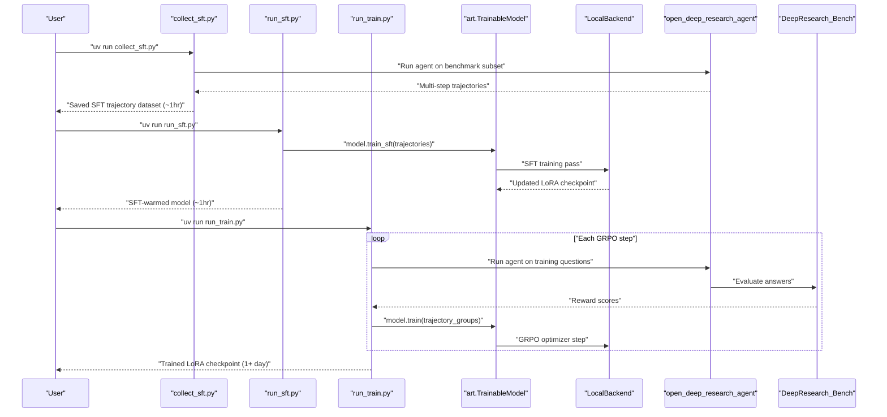
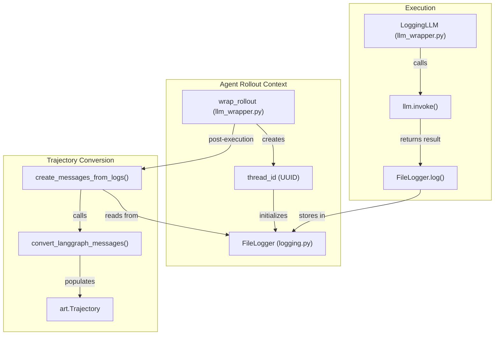

<!-- source: DeepWiki mcp.deepwiki.com · repo OpenPipe/ART · page 6.3 Deep Research & Email Agents · fetched 2026-10-29 -->

# Deep Research & Email Agents

Relevant source files

The following files were used as context for generating this wiki page:

- [docs/fundamentals/ruler.mdx](docs/fundamentals/ruler.mdx)
- [docs/images/open-deep-research-progress.png](docs/images/open-deep-research-progress.png)
- [docs/tutorials/open-deep-research.mdx](docs/tutorials/open-deep-research.mdx)
- [src/art/langgraph/__init__.py](src/art/langgraph/__init__.py)
- [src/art/langgraph/llm_wrapper.py](src/art/langgraph/llm_wrapper.py)
- [src/art/langgraph/logging.py](src/art/langgraph/logging.py)
- [src/art/langgraph/message_utils.py](src/art/langgraph/message_utils.py)
- [src/art/rewards/ruler.py](src/art/rewards/ruler.py)
- [tests/unit/test_langgraph_llm_wrapper.py](tests/unit/test_langgraph_llm_wrapper.py)
- [tests/unit/test_langgraph_logging.py](tests/unit/test_langgraph_logging.py)

This page documents two agentic training examples included with (or associated with) the ART framework: the **art-e email agent** and the **Open Deep Research** agent. Both demonstrate multi-step, tool-calling agentic workflows trained with a combination of SFT warm-up and GRPO RL using ART.

---

## Overview

Both examples share a common training pattern:

| Example | Agent Type | Base Model | Benchmark | Training Phases |
|---|---|---|---|---|
| Open Deep Research | Research / web browsing | Qwen2.5 14B Instruct | DeepResearch Bench | SFT warm-up → GRPO |
| art-e Email Agent | Email task completion | Various | Internal task suite | SFT warm-up → GRPO |

The core challenge in both is that each **rollout is a long, multi-step agentic trajectory** — the agent calls tools, receives observations, and must synthesize information over many turns before producing a final answer. This requires careful reward design and efficient trajectory capture.

---

## Open Deep Research

The Open Deep Research example trains a local Qwen2.5 14B model to exceed the performance of frontier models (GPT-4.1, Claude Sonnet 4) on the [DeepResearch Bench](https://github.com/Ayanami0730/deep_research_bench) benchmark. The training code lives in a companion repository (`OpenPipe/open_deep_research_training`).

### Repository Structure

**Training pipeline** (companion repo `open_deep_research_training`):

| File | Purpose |
|---|---|
| `collect_sft.py` | Run research agent on benchmark subset; collect SFT trajectories |
| `run_sft.py` | SFT warm-up training on collected trajectories |
| `run_train.py` | Main GRPO RL training loop |
| `evaluate/benchmark_model.py` | Run held-out benchmark evaluation |
| `display_benchmarks.ipynb` | Visualize benchmark results |

Sources: [docs/tutorials/open-deep-research.mdx:30-107]()

### Training Pipeline

The training follows a strict phase ordering. SFT first bootstraps the model's format compliance, then GRPO optimizes for research quality.

**Training Pipeline Sequence:**

Sources: [docs/tutorials/open-deep-research.mdx:57-90]()

---

## LangGraph Integration & Logging

The `art.langgraph` module provides the bridge between agent frameworks and the ART trajectory system. It uses `contextvars` to track rollout state and a `FileLogger` to capture intermediate steps.

### Logging and Trajectory Construction

The `LoggingLLM` class wraps a LangChain `Runnable` (the LLM) to intercept and log every interaction during a rollout.

**Logging Data Flow:**

Sources: [src/art/langgraph/llm_wrapper.py:100-112](), [src/art/langgraph/llm_wrapper.py:176-192](), [src/art/langgraph/logging.py:4-18](), [src/art/langgraph/message_utils.py:90-123]()

### Key Components

- **`wrap_rollout`**: An async decorator that sets up a unique `thread_id` and `FileLogger` for a rollout function. [src/art/langgraph/llm_wrapper.py:100-112]()
- **`init_chat_model`**: Factory function that creates a `LoggingLLM` instance. It automatically configures the LLM to point to the active ART inference endpoint (vLLM or Tinker). [src/art/langgraph/llm_wrapper.py:115-173]()
- **`create_messages_from_logs`**: Reconstructs a full `art.Trajectory` from the flat logs. It handles deduplication of conversations and populates `additional_histories` for multi-path agents. [src/art/langgraph/llm_wrapper.py:45-97]()

---

## Reward Pipeline: RULER

For agents like the email assistant where ground truth is hard to define, ART uses **RULER (Relative Universal LLM-Elicited Rewards)**.

### How RULER Works
RULER leverages the insight that relative scoring is easier for LLMs than absolute scoring. It takes a `TrajectoryGroup` and passes all completions to a "Judge LLM" (e.g., GPT-4o or o3) to rank them.

**RULER Implementation Details:**
1. **Prefix Deduplication**: RULER identifies the `common_prefix_len` across all trajectories in a group to avoid sending redundant system prompts to the judge. [src/art/rewards/ruler.py:150-157]()
2. **Judge Prompting**: The judge receives a rubric and the trajectories. It must return a `Response` object containing `TrajectoryScore` entries with explanations. [src/art/rewards/ruler.py:24-38]()
3. **Cost Tracking**: Costs for the judge model are tracked via `MetricsBuilder` and labeled as `judge/ruler`. [src/art/rewards/ruler.py:62-83]()

### Dual LLM Judge Pattern
In complex agent tasks, a dual-judge pipeline is often used:
- **Judge 1 (Reasoning)**: A high-capability model (like `openai/o3`) provides the RULER scores and explanations. [src/art/rewards/ruler.py:88]()
- **Judge 2 (Verification)**: A separate check can be applied to ensure the agent didn't violate hard constraints (e.g., sending an email to the wrong person).

Sources: [src/art/rewards/ruler.py:86-140](), [docs/fundamentals/ruler.mdx:26-40]()

---

## Training Results

The Open Deep Research tutorial demonstrates that a Qwen2.5 14B model, starting from a base performance below GPT-4, can exceed frontier models after the ART pipeline.

**Performance Milestones:**
- **Base Model**: Low accuracy, often fails to follow research agent formatting.
- **After SFT**: Improved format compliance and basic reasoning patterns. [docs/tutorials/open-deep-research.mdx:70-72]()
- **After GRPO**: Learns optimal research strategies (information gathering, synthesis) and exceeds GPT-4.1 and Claude Sonnet 4 performance. [docs/tutorials/open-deep-research.mdx:112-121]()

The progress is visualized in `docs/images/open-deep-research-progress.png`.

Sources: [docs/tutorials/open-deep-research.mdx:8-18](), [docs/tutorials/open-deep-research.mdx:112-122]()

---

