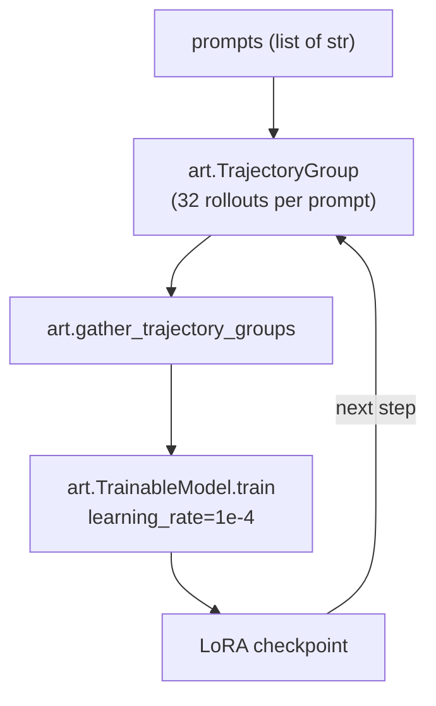
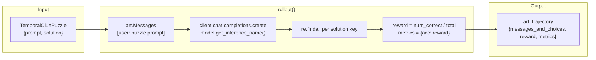
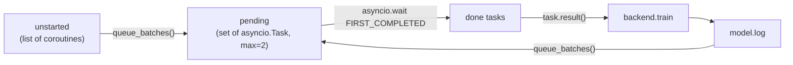

<!-- source: DeepWiki mcp.deepwiki.com · repo OpenPipe/ART · page 6.4 Temporal Clue & Simple Patterns · fetched 2026-10-29 -->

# Temporal Clue & Simple Patterns

<details>
<summary>Relevant source files</summary>

The following files were used as context for generating this wiki page:

- [dev/yes-no-maybe.ipynb](dev/yes-no-maybe.ipynb)
- [examples/hn_title_generator/reference_grpo_trainer.py](examples/hn_title_generator/reference_grpo_trainer.py)
- [examples/hn_title_generator/train.py](examples/hn_title_generator/train.py)
- [examples/hn_title_generator/utils.py](examples/hn_title_generator/utils.py)
- [examples/temporal_clue/temporal-clue-7b-async.ipynb](examples/temporal_clue/temporal-clue-7b-async.ipynb)
- [examples/temporal_clue/temporal-clue-7b.ipynb](examples/temporal_clue/temporal-clue-7b.ipynb)
- [examples/temporal_clue/temporal-clue.py](examples/temporal_clue/temporal-clue.py)
- [src/art/unsloth/service.py](src/art/unsloth/service.py)
- [src/art/unsloth/train.py](src/art/unsloth/train.py)
- [src/art/utils/benchmark_rollout.py](src/art/utils/benchmark_rollout.py)
- [src/art/utils/format_message.py](src/art/utils/format_message.py)
- [src/art/utils/iterate_dataset.py](src/art/utils/iterate_dataset.py)
- [src/art/utils/retry.py](src/art/utils/retry.py)

</details>


This page covers two example training setups that together illustrate the full ART training loop at different levels of complexity:

- **yes-no-maybe** ([dev/yes-no-maybe.ipynb]()), a minimal, self-contained example used for development and sanity-checking the framework.
- **Temporal Clue** ([examples/temporal_clue/]()), a realistic puzzle-solving task with a structured dataset, regex-based accuracy scoring, and concurrent validation.

For general documentation on the `Trajectory` and `TrajectoryGroup` data structures, see [2.2](). For training loop mechanics and GRPO, see [3.1](). For custom reward function design patterns, see [7.4]().

---

## yes-no-maybe: Minimal Training Pattern

The yes-no-maybe notebook is the simplest complete ART training loop. It teaches a model to respond to prompts like `"respond with 'yes', 'no', or 'maybe'"` with exactly one of those three words, with a graded reward that steers toward `"maybe"`.

### Setup

A `LocalBackend` is instantiated and a `TrainableModel` is registered against it [dev/yes-no-maybe.ipynb:47-57](). No special `_internal_config` is required for this task; the defaults are sufficient.

```python
model = art.TrainableModel(
    name="010",
    project="yes-no-maybe",
    base_model="Qwen/Qwen2.5-7B-Instruct",
)
```

### Prompt Generation

Prompts are generated programmatically from all permutations of `["yes", "no", "maybe"]` combined with different prefixes and quoting styles [dev/yes-no-maybe.ipynb:84-95](). This produces a diverse set of phrasings for the same underlying instruction:

| Prefix | Quoting | Example prompt |
|---|---|---|
| `"respond"` | with quotes | `respond with 'yes', 'no', 'maybe'` |
| `"just respond"` | without quotes | `just respond with yes or no` |
| `"respond"` | 2-word subset | `respond with yes or maybe` |

The goal of this diversity is to discourage the model from pattern-matching on a single phrasing rather than learning the underlying instruction-following behavior.

### Rollout and Reward

The rollout function sends a single user message and checks the raw completion content against three exact strings [dev/yes-no-maybe.ipynb:60-81]().

| Model output | Reward |
|---|---|
| `"yes"` | 0.5 |
| `"no"` | 0.75 |
| `"maybe"` | 1.0 |
| anything else | 0.0 |

The graded reward structure (rather than a binary 0/1) creates a gradient that pushes the model first to comply with the instruction format (score > 0) and then toward the preferred answer (`"maybe"`).

### Training Loop

32 rollouts are collected per prompt, grouped into a `TrajectoryGroup` [dev/yes-no-maybe.ipynb:98-111](). All groups are gathered concurrently via `art.gather_trajectory_groups`, then a single `model.train` call executes the optimizer step.

**Training loop data flow diagram**


Sources: [dev/yes-no-maybe.ipynb:60-111]()

---

## Temporal Clue: Puzzle-Solving with Accuracy Reward

Temporal Clue is a structured reasoning task where each puzzle presents temporal clues and the model must identify which event belongs to which time period.

### Dataset Structure

Each puzzle is a `TemporalCluePuzzle` TypedDict with three fields [examples/temporal_clue/temporal-clue.py:16-19]():

| Field | Type | Description |
|---|---|---|
| `num_clues` | `int` | Number of temporal clues in the puzzle |
| `prompt` | `str` | Full puzzle text sent to the model |
| `solution` | `dict[str, str]` | Mapping from event label to correct time period |

The JSON file is split deterministically [examples/temporal_clue/temporal-clue.py:28-32]():
- `val_puzzles`: first 64 puzzles.
- `train_puzzles`: remaining puzzles, shuffled with seed 42.

### Rollout and Accuracy Scoring

The rollout sends the puzzle `prompt` as a single user message [examples/temporal_clue/temporal-clue.py:35-53](). The model response is parsed using a regex pattern for each solution key. The reward is the fraction of keys answered correctly, also stored as a metric named `"acc"`.

**Rollout data flow diagram (Temporal Clue)**


Sources: [examples/temporal_clue/temporal-clue.py:35-53]()

### Training Loop

The main loop uses a stride-based approach: at step `i`, puzzles `train_puzzles[i*stride : (i+1)*stride]` are used [examples/temporal_clue/temporal-clue.py:74-91](). Both validation and training rollout groups are collected **concurrently** using `asyncio.gather`.

After rollout collection:
1. `model.log(val_groups)` — logs validation metrics [examples/temporal_clue/temporal-clue.py:92]().
2. `model.delete_checkpoints()` — removes stale LoRA checkpoints [examples/temporal_clue/temporal-clue.py:93]().
3. `backend.train(model, train_groups, learning_rate=5e-5)` — executes optimizer step [examples/temporal_clue/temporal-clue.py:100]().
4. `model.log(train_groups, ...)` — logs train metrics [examples/temporal_clue/temporal-clue.py:101-103]().

**Full loop sequence diagram**

```mermaid
sequenceDiagram
    participant Loop as "training loop (i)"
    participant AGTG as "asyncio.gather"
    participant GTG as "art.gather_trajectory_groups"
    participant BE as "LocalBackend.train"
    participant LOG as "model.log / model.delete_checkpoints"

    Loop->>AGTG: "gather val + train concurrently"
    AGTG->>GTG: "val: 2 rollouts × 64 puzzles"
    AGTG->>GTG: "train: 50 rollouts × stride puzzles"
    GTG-->>AGTG: "val_groups, train_groups"
    AGTG-->>Loop: "both complete"
    Loop->>LOG: "model.log(val_groups)"
    Loop->>LOG: "model.delete_checkpoints()"
    Loop->>BE: "backend.train(model, train_groups, lr=5e-5)"
    BE-->>Loop: "TrainResult(step, metrics)"
    Loop->>LOG: "model.log(train_groups, metrics, step, split=train)"
```
Sources: [examples/temporal_clue/temporal-clue.py:56-107]()

---

## 7B Notebook Variant

The notebook variant ([examples/temporal_clue/temporal-clue-7b.ipynb]()) makes several adjustments for a different training regime:

| Parameter | Script (`temporal-clue.py`) | Notebook (`temporal-clue-7b.ipynb`) |
|---|---|---|
| Rollouts per puzzle (train) | 50 | 16 |
| Stride | 4 | 8 |
| Learning rate | 5e-5 | 5e-6 |
| `precalculate_logprobs` | not set | `True` |
| `scale_rewards` | not set | `False` |

The notebook also annotates each group with a `max_reward` metric, tracking the best rollout per group at each step [examples/temporal_clue/temporal-clue-7b.ipynb:115-118]().

Sources: [examples/temporal_clue/temporal-clue-7b.ipynb:95-130]()

---

## Async Prefetch Variant

The async notebook ([examples/temporal_clue/temporal-clue-7b-async.ipynb]()) demonstrates a prefetch pattern where up to `max_pending=2` batches of rollouts are in-flight concurrently [examples/temporal_clue/temporal-clue-7b-async.ipynb:128-139](). The core idea is to keep inference busy while the previous batch is being used for training.

**Prefetch queue diagram**


Sources: [examples/temporal_clue/temporal-clue-7b-async.ipynb:118-164]()

---

## Key Patterns Summary

| Pattern | Code construct | Where used |
|---|---|---|
| Single-turn rollout | `client.chat.completions.create` + `art.Trajectory` | both examples |
| Accuracy-based reward | `num_correct / len(solution)` | Temporal Clue |
| Graded scalar reward | hardcoded reward per output token | yes-no-maybe |
| Group metric annotation | `trajectory.metrics["max_reward"]` | 7B notebook |
| Concurrent val + train | `asyncio.gather(...)` | Temporal Clue |
| Checkpoint pruning | `model.delete_checkpoints()` | Temporal Clue |
| Stride-based iteration | `train_puzzles[i*stride:(i+1)*stride]` | Temporal Clue |
| Async prefetch | `asyncio.Task`, `asyncio.wait(FIRST_COMPLETED)` | async notebook |

Sources: [dev/yes-no-maybe.ipynb](), [examples/temporal_clue/temporal-clue.py](), [examples/temporal_clue/temporal-clue-7b.ipynb](), [examples/temporal_clue/temporal-clue-7b-async.ipynb]()

---

