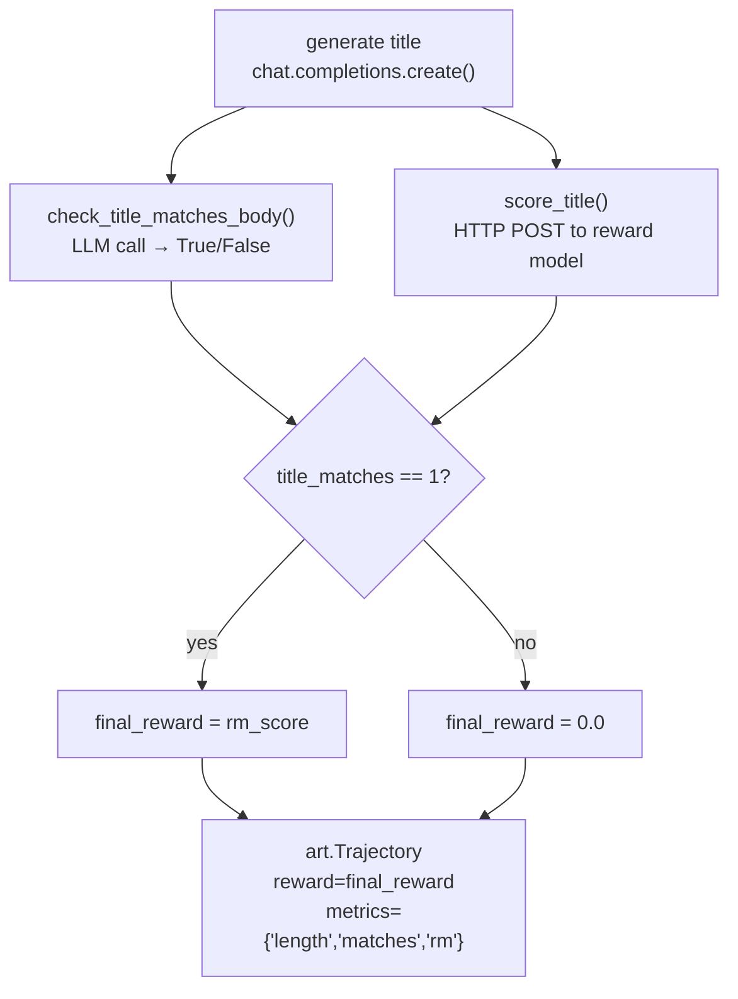
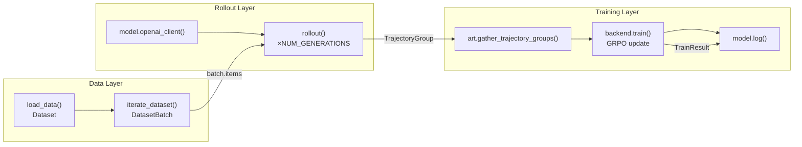
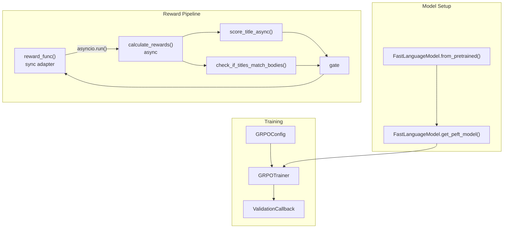
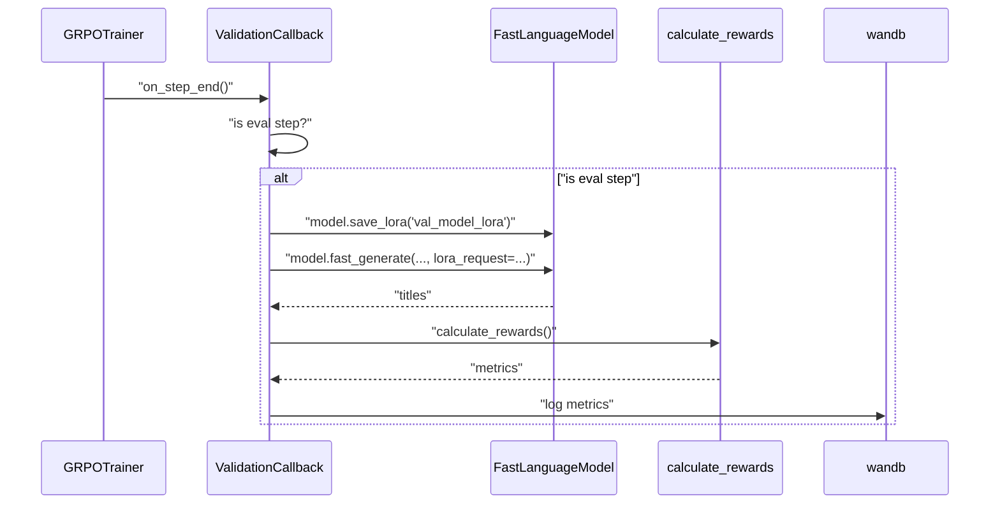

<!-- source: DeepWiki mcp.deepwiki.com · repo OpenPipe/ART · page 6.5 Summarization & Title Generation · fetched 2026-10-29 -->

# Summarization & Title Generation

Relevant source files

The following files were used as context for generating this wiki page:

- [dev/run_yes_no_maybe_kl_advantage_tinker.py](dev/run_yes_no_maybe_kl_advantage_tinker.py)
- [dev/yes-no-maybe-kl-advantage-tinker.py](dev/yes-no-maybe-kl-advantage-tinker.py)
- [dev/yes-no-maybe-kl-advantage.py](dev/yes-no-maybe-kl-advantage.py)
- [dev/yes-no-maybe.ipynb](dev/yes-no-maybe.ipynb)
- [examples/hn_title_generator/reference_grpo_trainer.py](examples/hn_title_generator/reference_grpo_trainer.py)
- [examples/hn_title_generator/train.py](examples/hn_title_generator/train.py)
- [examples/hn_title_generator/utils.py](examples/hn_title_generator/utils.py)
- [src/art/_backend_training.py](src/art/_backend_training.py)
- [src/art/loss.py](src/art/loss.py)
- [src/art/test/test_kl_advantage.py](src/art/test/test_kl_advantage.py)
- [src/art/tinker_native/backend.py](src/art/tinker_native/backend.py)
- [src/art/utils/benchmark_rollout.py](src/art/utils/benchmark_rollout.py)
- [src/art/utils/format_message.py](src/art/utils/format_message.py)
- [src/art/utils/iterate_dataset.py](src/art/utils/iterate_dataset.py)
- [src/art/utils/retry.py](src/art/utils/retry.py)

This page documents the Hacker News title generation example in the ART repository (`examples/hn_title_generator/`). It covers the dataset pipeline, composite reward function, ART-based training loop, and the parallel reference implementation using TRL's `GRPOTrainer`. For general GRPO algorithm details, see [3.1](). For reward function design patterns, see [7.4]().

---

## Overview

The example trains `Qwen/Qwen2.5-7B-Instruct` to generate engaging Hacker News submission titles from article body text. The training signal is a **composite reward**: an external HTTP reward model scores title quality, but a factual consistency gate zeroes out the reward for any title that makes claims unsupported by the article body.

Two implementations exist side-by-side:

| File | Framework | Purpose |
|---|---|---|
| `examples/hn_title_generator/train.py` | ART (`LocalBackend`) | Primary training script |
| `examples/hn_title_generator/reference_grpo_trainer.py` | TRL `GRPOTrainer` + Unsloth | Reference baseline for comparison |
| `examples/hn_title_generator/utils.py` | Shared utilities | Data loading, prompts, reward model client |

Sources: [examples/hn_title_generator/train.py:1-30](), [examples/hn_title_generator/reference_grpo_trainer.py:1-55]()

---

## Dataset

Data is loaded from the HuggingFace dataset `OpenPipe/hacker-news-scraped-stories-filtered`. The `pull_data` function in `utils.py` fetches a split and filters by minimum community score [examples/hn_title_generator/utils.py:131-143]().

After loading, each row is mapped to a structured prompt via `prompt_for_title` [examples/hn_title_generator/utils.py:146-157](). The system message instructs the model to respond with only the title. The user message embeds the full article body.

A length filter (`filter_on_length`) tokenizes each prompt using `AutoTokenizer` and discards any row whose tokenized length exceeds `MAX_PROMPT_LENGTH` (8192 tokens minus completion space). This prevents silent truncation during training [examples/hn_title_generator/train.py:35-72]().

**Key dataset constants** (from `train.py`):

| Constant | Value | Meaning |
|---|---|---|
| `TRAINING_DATASET_SIZE` | 5000 | Max training rows |
| `VAL_SET_SIZE` | 100 | Validation rows |
| `MAX_COMPLETION_LENGTH` | 100 | Max tokens for generated title |
| `MAX_PROMPT_LENGTH` | 8092 | `8192 - MAX_COMPLETION_LENGTH` |
| `NUM_GENERATIONS` | 6 | Rollouts per prompt per step |
| `NUM_EPOCHS` | 1 | Dataset passes |

Sources: [examples/hn_title_generator/train.py:20-32](), [examples/hn_title_generator/utils.py:131-157]()

---

## Composite Reward Function

The reward pipeline has two independent components that are combined with a hard zero gate.

**Reward pipeline diagram:**

Sources: [examples/hn_title_generator/train.py:159-231]()

### Factual Consistency Gate

`check_title_matches_body` sends the article body and the generated title to the **same base model** (not the policy being trained) with a judge prompt asking whether the title makes any unsubstantiated claims [examples/hn_title_generator/train.py:120-156]().

The response is parsed: strings starting with `"true"` return `1`, strings starting with `"false"` return `0`. Any other content defaults to `0` (mismatch). This call uses `BASE_MODEL` directly via the ART OpenAI client, not the LoRA adapter being trained, to prevent the policy model from influencing its own consistency check [examples/hn_title_generator/train.py:131-135]().

### External Reward Model

`score_title` in `utils.py` makes an HTTP POST to a hosted reward model endpoint [examples/hn_title_generator/utils.py:89-124](). Calls are cached with `SQLiteCache` to avoid redundant network requests. In `train.py`, `call_score_title` wraps this with `@limit_concurrency(10)` to throttle concurrent HTTP calls [examples/hn_title_generator/train.py:114-117]().

### Recorded Metrics

Each `art.Trajectory` records sub-signals independently [examples/hn_title_generator/train.py:225-230]():

| Metric key | Type | Meaning |
|---|---|---|
| `length` | `int` | Character length of generated title |
| `matches` | `int` (0 or 1) | Factual consistency gate result |
| `rm` | `float` | Raw reward model score |

---

## ART Training Loop (`train.py`)

The main loop is driven by `iterate_dataset`, which yields `DatasetBatch` objects containing a list of rows for the current step [src/art/utils/iterate_dataset.py:21-45]().

**Data flow through the ART training loop:**

Sources: [examples/hn_title_generator/train.py:235-362](), [src/art/utils/iterate_dataset.py:21-95]()

For each batch step:
1. `art.gather_trajectory_groups` is called with one `TrajectoryGroup` per prompt, each containing `NUM_GENERATIONS` (6) concurrent `rollout()` coroutines [examples/hn_title_generator/train.py:285-295]().
2. `backend.train()` is called with `valid_train_groups` and `learning_rate` [examples/hn_title_generator/train.py:307-312]().
3. Every `EVAL_STEPS` (50) steps, validation rollouts run against the full `val_data_list` using `art.gather_trajectories` [examples/hn_title_generator/train.py:330-345]().

---

## Reference GRPOTrainer Implementation

`reference_grpo_trainer.py` implements the same task using TRL's `GRPOTrainer` and Unsloth directly [examples/hn_title_generator/reference_grpo_trainer.py:110-416]().

**Reference implementation structure:**

Sources: [examples/hn_title_generator/reference_grpo_trainer.py:110-416]()

### ValidationCallback Design

The `ValidationCallback` class is a `TrainerCallback` that runs periodic evaluation during training [examples/hn_title_generator/reference_grpo_trainer.py:231-328]().

**Callback lifecycle:**

Sources: [examples/hn_title_generator/reference_grpo_trainer.py:231-328]()

**Key implementation note:** `model.fast_generate()` on an Unsloth LoRA model does **not** automatically use the LoRA weights. To get LoRA-adapted outputs during validation, the callback explicitly saves the LoRA weights and passes a `lora_request` parameter to `fast_generate` [examples/hn_title_generator/reference_grpo_trainer.py:259-261]().

---

## Shared Utilities (`utils.py`)

| Symbol | Type | Role |
|---|---|---|
| `pull_data` | `function` | Loads from HuggingFace, filters by `min_score` |
| `prompt_for_title` | `function` | Constructs message list for a given body text |
| `score_title` | `async function` | HTTP POST to reward model; cached via `SQLiteCache` |
| `cache` | `SQLiteCache` | Persistent local cache at `shared_cache.db` |

Sources: [examples/hn_title_generator/utils.py:1-157]()

The `SQLiteCache` is shared between `train.py` and `reference_grpo_trainer.py`, so reward model calls for already-seen `(story_dict, reward_model)` pairs are served from disk. This is important because while the factual consistency gate produces unique `(body, title)` pairs, the base reward model score is deterministic for a fixed story/title pair.

---

