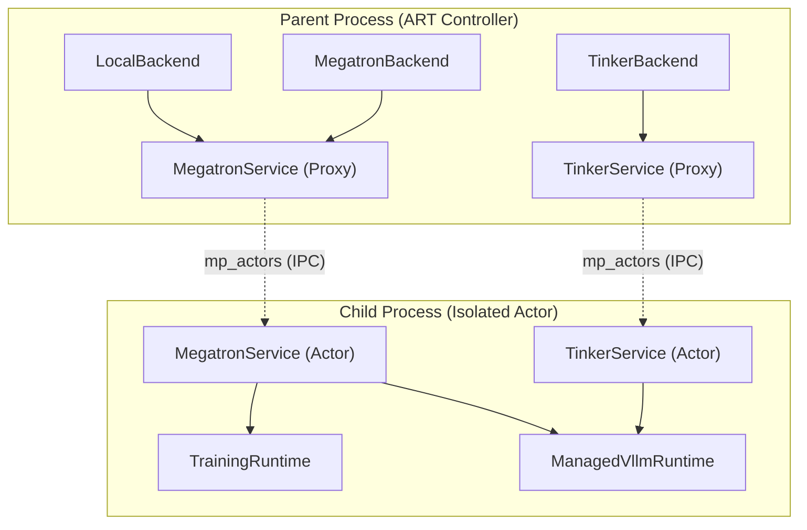
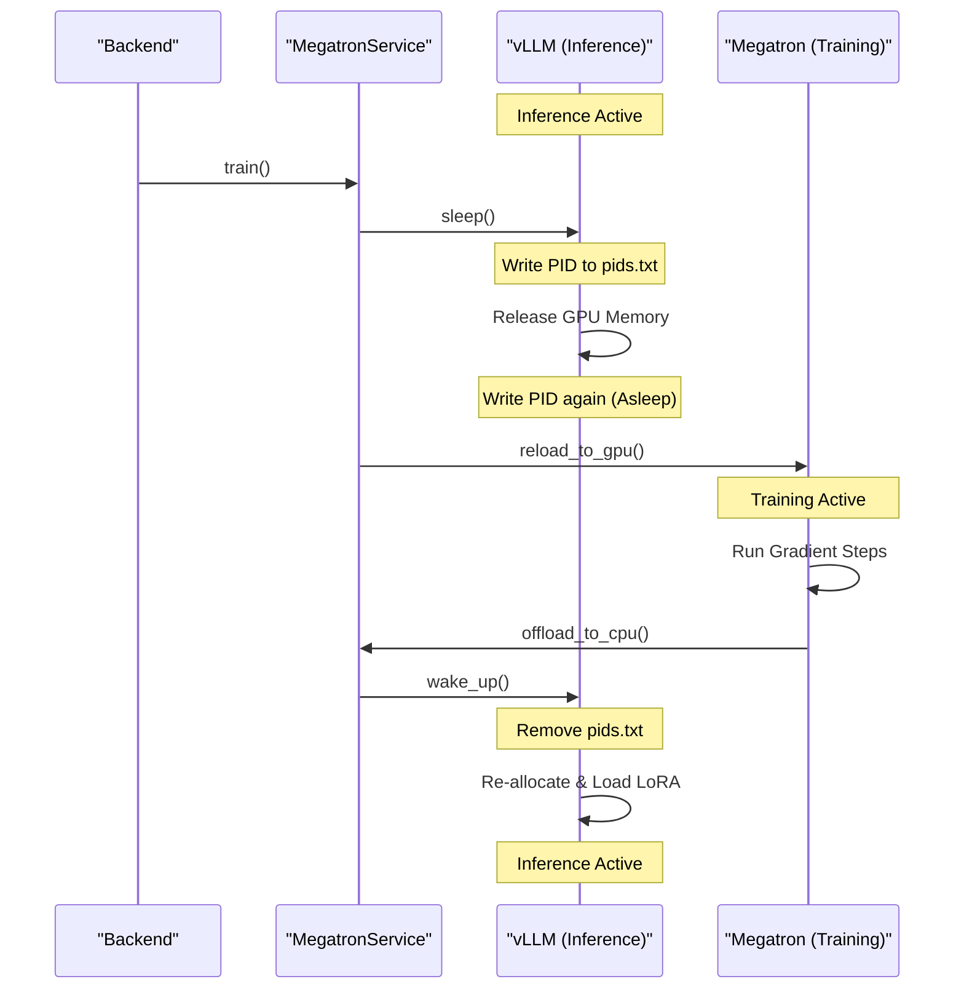
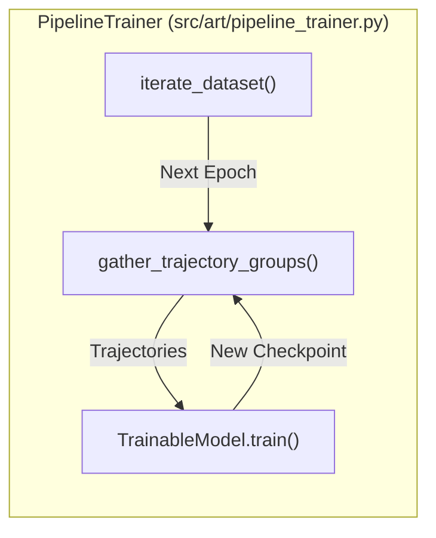

<!-- source: DeepWiki mcp.deepwiki.com · repo OpenPipe/ART · page 7 Advanced Topics · fetched 2026-10-29 -->

# Advanced Topics

Relevant source files

The following files were used as context for generating this wiki page:

- [src/art/megatron/lora.py](src/art/megatron/lora.py)
- [src/art/megatron/provider.py](src/art/megatron/provider.py)
- [src/art/megatron/service.py](src/art/megatron/service.py)
- [src/art/megatron/train.py](src/art/megatron/train.py)
- [src/art/tinker/prefix_cache.py](src/art/tinker/prefix_cache.py)
- [src/mp_actors/__init__.py](src/mp_actors/__init__.py)
- [src/mp_actors/move.py](src/mp_actors/move.py)
- [tests/unit/test_mp_actors.py](tests/unit/test_mp_actors.py)
- [tests/unit/test_prefix_cache.py](tests/unit/test_prefix_cache.py)

This page introduces advanced features and techniques for power users who need fine-grained control over training behavior, memory usage, and performance optimization. These features go beyond the basic training loop and enable sophisticated workflows including distributed training, multi-process actor isolation, concurrent rollout generation, and low-level memory management.

For basic training concepts and the standard workflow, see [Core Concepts](#1.2). For production deployment strategies, see [Backend Implementations](#4). For integration with external systems, see [Integrations](#5).

---

## Training Service Architecture

ART provides several training service implementations, each with different capabilities and use cases. A key architectural distinction is the use of the `mp_actors` framework to isolate heavy runtimes (like Megatron or Tinker) in child processes.

### System Architecture: Code Entity Mapping

The following diagram bridges the high-level service concepts to the specific code entities that implement them, highlighting the process isolation boundary.

**Architecture: Process Isolation and Service Mapping**

**Sources:** [src/art/megatron/service.py:188-214](), [src/art/tinker/service.py:34-60](), [src/mp_actors/move.py:56-76]()

### Multi-Process Actor Framework (`mp_actors`)

ART uses a custom actor framework in `src/mp_actors` to move complex objects into child processes. This is critical for:
- **Isolation:** Preventing CUDA context pollution between inference and training.
- **Cleanup:** Ensuring GPU memory is fully released when a service is closed via `close_proxy` [src/mp_actors/move.py:79-88]().
- **Async Interop:** Supporting both sync and async method calls across the process boundary [tests/unit/test_mp_actors.py:61-71]().

For details, see [Multi-Process Architecture](#7.1).

---

## Memory Management & Optimization

ART implements sophisticated memory management to enable training and inference on the same GPU hardware, particularly in the `MegatronService`.

### Memory Transition Lifecycle

**Sources:** [src/art/megatron/service.py:188-345](), [src/art/vllm_runtime/runtime.py:25-94]()

### Key Optimization Strategies
- **Offload/Reload Cycle:** `MegatronService` manages a weight offload cycle where model weights are moved to CPU memory during inference and reloaded to GPU for training [src/art/megatron/service.py:69-70]().
- **vLLM Sleep Mode:** vLLM workers are patched to release GPU memory when signaled via a `pids.txt` wake-lock file [src/art/megatron/service.py:56-57]().
- **LRU Prefix Caching:** The `TinkerBackend` uses an `LRUTrieCache` to manage token sequence rewrites efficiently [src/art/tinker/prefix_cache.py:59-68]().

For details, see [Memory Optimization](#7.2).

---

## Advanced Training Dynamics

### Distributed Training with Megatron-LM
The `MegatronBackend` supports large-scale distributed training using `megatron-core`. It configures complex topologies including:
- **Tensor Parallelism (TP):** Sharding weights across GPUs.
- **Pipeline Parallelism (PP):** Splitting layers across GPUs.
- **Expert Parallelism (EP):** For MoE models like Qwen2-57B [src/art/megatron/provider.py:65-67]().

For details, see [Distributed Training & Parallelism](#7.7).

### Async Pipelining
The `PipelineTrainer` implements a 3-stage async pipeline (Rollout → Train → Eval) to maximize GPU utilization by overlapping I/O and computation.

**Code Entity Mapping: Async Training Loop**

**Sources:** [src/art/pipeline_trainer.py:45-120](), [src/art/unsloth/train.py:46-219]()

For details, see [Async Training Patterns](#7.6).

---

## Checkpoint & Reward Management

### Checkpoint Lifecycle
ART supports advanced checkpointing features:
- **Experimental Forking:** `_experimental_fork_checkpoint` allows branching training from an existing LoRA state.
- **Metric Selection:** Models can be deleted or kept based on `best_checkpoint_metric` [src/art/local/checkpoints.py:20-31]().
- **S3 Sync:** Automated synchronization of checkpoints to S3 for cloud persistence.

For details, see [Checkpoint Management](#7.3).

### Reward Engineering
Beyond simple scalar rewards, ART supports:
- **Composite Rewards:** Combining multiple metrics with hard-zero gating (e.g., must be valid JSON AND have correct answer).
- **LLM-as-Judge:** Using a separate model to evaluate trajectories [src/art/langgraph/rollout.py:45-80]().

For details, see [Custom Reward Functions](#7.4).

---

## Summary Table: Advanced Feature Support

| Feature | Local (Unsloth) | Megatron | Tinker |
| :--- | :--- | :--- | :--- |
| **Process Isolation** | Partial | Full (`mp_actors`) | Full (`mp_actors`) |
| **Weight Offloading** | No | Yes (CPU/GPU) | No |
| **Distributed (TP/PP)** | No | Yes | No |
| **Prefix Caching** | No | No | Yes (`LRUTrieCache`) |
| **Sleep Mode** | Yes | Yes | Yes |

**Sources:** [src/art/megatron/service.py:188-214](), [src/art/tinker/service.py:34-60](), [src/art/tinker/prefix_cache.py:59-68]()

---

