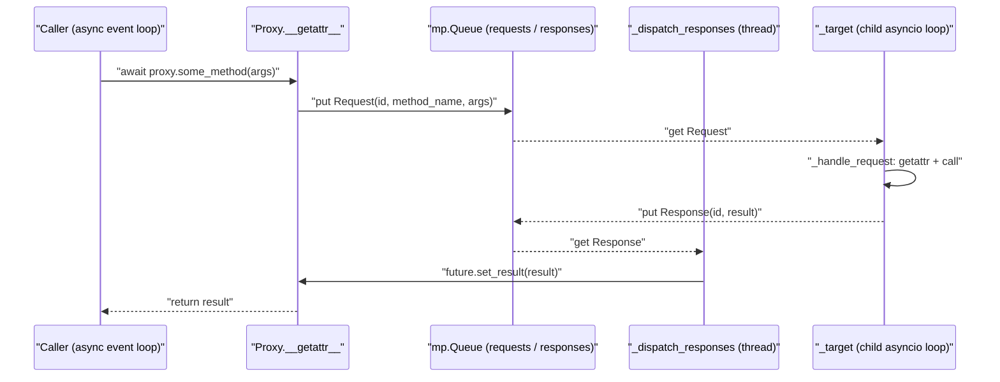
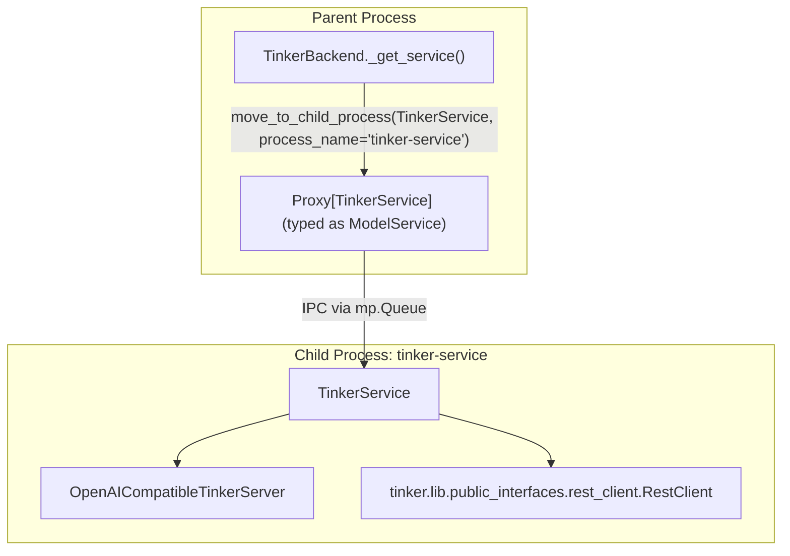
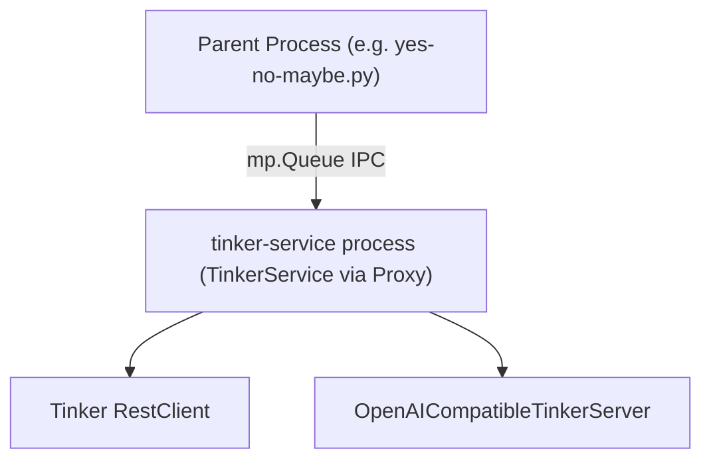

<!-- source: DeepWiki mcp.deepwiki.com · repo OpenPipe/ART · page 7.1 Multi-Process Architecture · fetched 2026-10-29 -->

# Multi-Process Architecture

<details>
<summary>Relevant source files</summary>

The following files were used as context for generating this wiki page:

- [dev/profile.ipynb](dev/profile.ipynb)
- [dev/yes-no-maybe-megatron.py](dev/yes-no-maybe-megatron.py)
- [dev/yes-no-maybe.py](dev/yes-no-maybe.py)
- [src/art/tinker/__init__.py](src/art/tinker/__init__.py)
- [src/art/tinker/backend.py](src/art/tinker/backend.py)
- [src/art/tinker/prefix_cache.py](src/art/tinker/prefix_cache.py)
- [src/art/tinker/service.py](src/art/tinker/service.py)
- [src/mp_actors/__init__.py](src/mp_actors/__init__.py)
- [src/mp_actors/move.py](src/mp_actors/move.py)
- [tests/unit/test_mp_actors.py](tests/unit/test_mp_actors.py)
- [tests/unit/test_prefix_cache.py](tests/unit/test_prefix_cache.py)

</details>


This page documents the `mp_actors` framework — the library ART uses to isolate heavyweight service objects into dedicated child processes — and the primary consumers of that framework: `TinkerBackend` and `MegatronService`.

---

## The `mp_actors` Framework

`mp_actors` (located at `src/mp_actors/`) is a small in-tree library that provides a single main primitive: `move_to_child_process`. It spawns an object inside a fresh child process and returns a transparent *proxy* back to the caller. The proxy has the same method signatures as the original object; all calls are serialized over `multiprocessing.Queue` channels and dispatched to the child process's event loop.

The motivation is process isolation: services that hold GPU memory (like `TinkerService`), heavy model state (like `MegatronService`), or blocking native libraries can live in a separate address space without interfering with the parent's async event loop or memory layout.

### Public API

| Symbol | Purpose |
|--------|---------|
| `move_to_child_process(obj, log_file, process_name)` | Pickles `obj`, spawns a child process, returns a `Proxy` typed as the original object |
| `close_proxy(proxy)` | Terminates the child process and cleans up queues and threads |

Both are exported from `src/mp_actors/__init__.py`.

Sources: [src/mp_actors/__init__.py:1-3](), [src/mp_actors/move.py:56-76]()

---

## Internal Architecture of `Proxy`

**Diagram: mp_actors internal data flow**



Sources: [src/mp_actors/move.py:106-350]()

### Key Classes and Data Structures

| Class / Dataclass | File | Role |
|-------------------|------|------|
| `Proxy` | `src/mp_actors/move.py` | Wraps a child process; intercepts all attribute access via `__getattr__` |
| `Request` | `src/mp_actors/move.py` | Carries `id`, `method_name`, `args`, `kwargs`, `send_value` into the child queue |
| `Response` | `src/mp_actors/move.py` | Carries `id`, `result`, `exception` back from the child queue |

The `Proxy` constructor [src/mp_actors/move.py:107-170]() does the following:

1. Creates two `mp.Queue` instances — one for outgoing `Request` objects, one for incoming `Response` objects.
2. Spawns a `mp.Process` targeting `_target`, which calls `asyncio.run(_handle_requests(...))` in the child.
3. Starts a daemon thread `_dispatch_responses` that reads from the response queue and resolves `concurrent.futures.Future` objects stored in `_futures`.

The start method is always `spawn` [src/mp_actors/move.py:23-24](), ensuring a clean address space for every child regardless of the parent process state.

### Method Dispatch via `__getattr__`

`Proxy.__getattr__` [src/mp_actors/move.py:194-270]() inspects the wrapped object at construction time and returns one of three wrapper types based on the nature of the attribute:

| Attribute kind | Wrapper returned |
|----------------|-----------------|
| Regular coroutine (`async def`) | `async_method_wrapper` — awaits a `Future` via `asyncio.wrap_future` |
| Async generator (`async def ... yield`) | `async_gen_wrapper` — drives the generator with `asend` calls, reusing the same request `id` |
| Sync callable | `method_wrapper` — calls `future.result()` synchronously |
| Non-callable attribute | Fetched as a sync call (zero-arg dispatch) |

### Async Generator Protocol

For async generators, the same request `id` is reused across all `asend` calls [src/mp_actors/move.py:239-252](). In the child, `_handle_request` stores the generator in a `generators: dict[int, AsyncGenerator]` dict and calls `asend` on each subsequent request with the same id [src/mp_actors/move.py:323-336](). `StopAsyncIteration` is returned as a normal `Response` exception and re-raised on the proxy side.

### Error Handling and Process Death

If the child process exits unexpectedly, the dispatcher thread detects the dead process, creates a `RuntimeError` describing the exit code, and calls `_fail_pending` to reject all in-flight futures [src/mp_actors/move.py:171-192](). Subsequent calls against a dead proxy also fail immediately with the same sticky error [src/mp_actors/move.py:220-223]().

Exceptions thrown *inside* the child are serialized using `tblib.pickling_support` and re-raised on the proxy side with the original traceback [src/mp_actors/move.py:346-348]().

### Lifecycle and Cleanup

`close_proxy` [src/mp_actors/move.py:79-88]() delegates to `Proxy.close()` [src/mp_actors/move.py:272-292]() which:

1. Sets `_closing = True`, failing all pending futures with `"Proxy is closing"`.
2. Calls `process.terminate()`, then `process.kill()` if needed.
3. Closes both queues and joins the dispatcher thread.

A module-level `WeakSet` (`_LIVE_PROXIES`) and an `atexit` handler [src/mp_actors/move.py:33-53]() ensure that proxies are closed even if the caller forgets to call `close_proxy`.

Sources: [src/mp_actors/move.py:106-350]()

---

## How TinkerBackend Uses Child Processes

`TinkerBackend` uses `mp_actors` to isolate the `TinkerService` and its underlying training/inference clients.

### `TinkerService` as a Child Process

**Diagram: TinkerBackend process topology**



`TinkerBackend._get_service` [src/art/tinker/backend.py:54-84]() constructs a `TinkerService` instance and, unless `in_process=True`, wraps it with `move_to_child_process`:

```python
if not self._in_process:
    self._services[model.name] = move_to_child_process(
        self._services[model.name],
        process_name="tinker-service",
    )
```

This means all calls to `train`, `start_openai_server`, or `register_lora_for_step` on the returned object are transparently forwarded to the child process. The parent never directly holds GPU state or live Tinker client connections.

Sources: [src/art/tinker/backend.py:54-84](), [src/art/tinker/service.py:36-41]()

### OpenAI Server Workers

Within the `TinkerService`, the `OpenAICompatibleTinkerServer` manages workers. During shutdown, `TinkerService.close` iterates through these workers and explicitly closes their proxies [src/art/tinker/service.py:67-77]():

```python
for worker in self._server._workers:
    close_proxy(worker)
```

Sources: [src/art/tinker/service.py:67-77]()

---

## Prefix Cache (`LRUTrieCache`)

The `TinkerService` uses an `LRUTrieCache` [src/art/tinker/prefix_cache.py:59-206]() to optimize token sequence lookups. It is an LRU-bounded radix trie designed for token sequence rewrites.

| Method | Behavior |
|--------|---------|
| `lookup(rendered_tokens)` | Performs longest-prefix match in the trie and promotes the node in LRU [src/art/tinker/prefix_cache.py:70-97]() |
| `insert(rendered_prefix, raw_prefix)` | Inserts a sequence, splitting nodes if necessary, and triggers eviction if the cache is full [src/art/tinker/prefix_cache.py:99-146]() |

The cache maintains detailed statistics via `PrefixCacheStats` [src/art/tinker/prefix_cache.py:14-27](), including hit rates, evictions, and trie structural changes (splits/merges).

Sources: [src/art/tinker/prefix_cache.py:59-206]()

---

## MegatronBackend Isolation

The `MegatronBackend` uses a similar pattern to isolate the multi-GPU training environment. Examples like `dev/yes-no-maybe-megatron.py` instantiate `MegatronBackend` [dev/yes-no-maybe-megatron.py:201](), which internally manages the `MegatronService` in a separate process to prevent CUDA context collisions and handle the complex `torchrun` lifecycle.

Sources: [dev/yes-no-maybe-megatron.py:201]()

---

## Testing Patterns for Actor-Based Code

`tests/unit/test_mp_actors.py` demonstrates the canonical patterns for testing proxy-based code.

**Key test scenarios:**

| Test | What it checks |
|------|---------------|
| `test_proxy_supports_sync_async_and_attribute_access` | Sync methods, async methods, and attribute reads all work through a proxy [tests/unit/test_mp_actors.py:61-71]() |
| `test_child_exit_error_is_sticky_for_followup_calls` | After a child exit, subsequent calls raise `RuntimeError` with the exit code [tests/unit/test_mp_actors.py:74-87]() |
| `test_async_generator_cancellation_does_not_break_future_calls` | Cancelling an async generator does not corrupt the proxy state [tests/unit/test_mp_actors.py:89-109]() |
| `test_close_fails_inflight_requests_and_is_idempotent` | `close_proxy` rejects pending tasks and is safe to call multiple times [tests/unit/test_mp_actors.py:111-130]() |
| `test_child_exceptions_are_propagated_and_proxy_recovers` | Exceptions from the child are re-raised but don't kill the proxy [tests/unit/test_mp_actors.py:131-141]() |

Sources: [tests/unit/test_mp_actors.py:1-141]()

---

## Process Hierarchy Summary

**Diagram: Full process tree during TinkerBackend operations**



| Process | Created by | Contains |
|---------|-----------|---------|
| Parent | user script | `TinkerBackend`, `Proxy[TinkerService]` |
| `tinker-service` | `move_to_child_process` | `TinkerService`, `LRUTrieCache`, `RestClient` |

Sources: [src/art/tinker/backend.py:80-83](), [src/art/tinker/service.py:36-41](), [dev/yes-no-maybe.py:43-46]()

---

