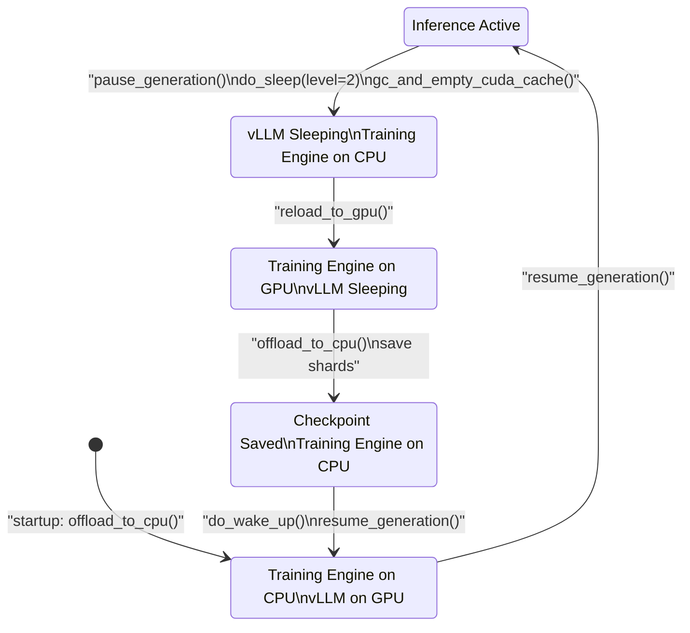
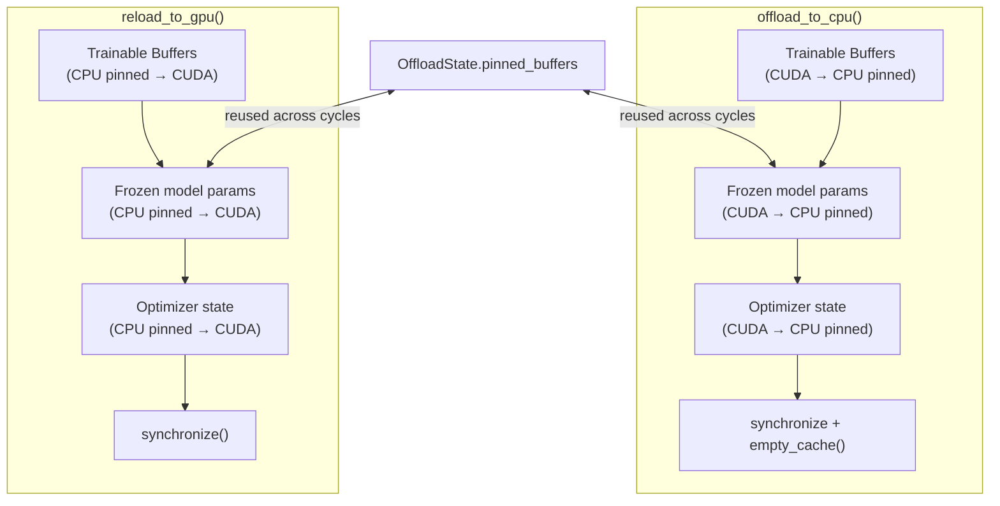
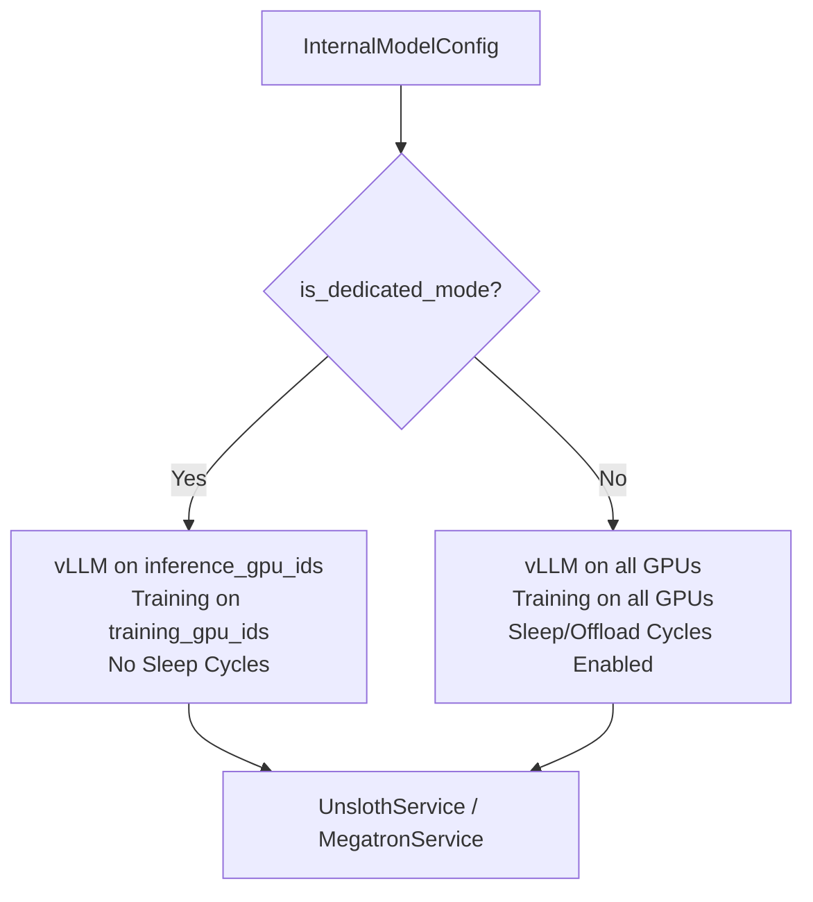

<!-- source: DeepWiki mcp.deepwiki.com · repo OpenPipe/ART · page 7.2 Memory Optimization · fetched 2026-10-29 -->

# Memory Optimization

Relevant source files

The following files were used as context for generating this wiki page:

- [examples/temporal_clue/temporal-clue-7b-async.ipynb](examples/temporal_clue/temporal-clue-7b-async.ipynb)
- [examples/temporal_clue/temporal-clue-7b.ipynb](examples/temporal_clue/temporal-clue-7b.ipynb)
- [examples/temporal_clue/temporal-clue.py](examples/temporal_clue/temporal-clue.py)
- [src/art/megatron/lora.py](src/art/megatron/lora.py)
- [src/art/megatron/provider.py](src/art/megatron/provider.py)
- [src/art/megatron/service.py](src/art/megatron/service.py)
- [src/art/megatron/train.py](src/art/megatron/train.py)
- [src/art/megatron/training/offload.py](src/art/megatron/training/offload.py)
- [src/art/megatron/training/streaming_weight_offload.py](src/art/megatron/training/streaming_weight_offload.py)
- [src/art/megatron/training/weight_offload.py](src/art/megatron/training/weight_offload.py)
- [src/art/unsloth/service.py](src/art/unsloth/service.py)
- [src/art/unsloth/train.py](src/art/unsloth/train.py)

This page documents GPU memory management strategies used in ART to enable inference and training to share the same physical GPU(s) without running out of memory. The primary focus is on the `MegatronBackend`'s CPU offload/reload pattern, `UnslothService`'s offload capabilities, vLLM's sleep mode, and streaming weight management.

For background on training configuration flags like `gpu_memory_utilization`, see [Training Configuration](#3.4). For details on the MegatronBackend itself, see [MegatronBackend](#4.5). For Model Service implementations, see [Model Services](#3.2).

---

## The Core Problem

ART's training loop is strictly sequential: inference runs first, then training occurs, then a new checkpoint is loaded for the next inference phase. When inference (vLLM) and training (Megatron/Unsloth) share the same GPU memory, both cannot be loaded simultaneously. ART solves this through coordinated suspend-and-resume cycles and weight offloading.

---

## Memory States During a Training Step

**Diagram: GPU memory state transitions across one training step**

Sources: [src/art/megatron/service.py:381-480](), [src/art/megatron/train.py:112-250](), [src/art/unsloth/service.py:132-295]()

---

## CPU Offload Patterns

### Megatron Offload (`OffloadState`)

The `MegatronBackend` uses a manual offload pattern to move the entire training state (model and optimizer) to CPU pinned memory between jobs.

*   **`OffloadState`**: A dataclass defined in [src/art/megatron/training/offload.py:21-25]() that tracks offload status and holds pinned CPU memory buffers. Reusing pinned buffers avoids repeated `pin_memory` allocations.
*   **`offload_to_cpu()`**: [src/art/megatron/training/offload.py:71-107]() moves model parameters to CPU pinned memory. It specifically handles frozen parameters while allowing Megatron's `DistributedDataParallel` to handle trainable buffer offloading via `offload_trainable_buffers_to_cpu` [src/art/megatron/training/offload.py:53-59]().
*   **`reload_to_gpu()`**: [src/art/megatron/training/offload.py:110-143]() reverses the process, copying pinned CPU tensors back to the current CUDA device using non-blocking transfers.

### Unsloth Offload (`UnslothTrainContext`)

The `UnslothService` provides similar offload capabilities via the `UnslothTrainContext` [src/art/unsloth/train.py:92-153]().

*   **`offload_to_cpu()`**: Iterates through `peft_model.named_parameters()` and the optimizer state, copying CUDA tensors to pinned CPU buffers [src/art/unsloth/train.py:105-153]().
*   **`reload_to_gpu()`**: Moves the parameters and optimizer state back to the specified GPU device [src/art/unsloth/train.py:155-182]().

**Diagram: Data flow through offload/reload functions**

Sources: [src/art/megatron/training/offload.py:71-143](), [src/art/unsloth/train.py:105-182]()

---

## Streaming Weight Offload

For extremely large models that cannot fit in GPU memory even during training (e.g., when LoRA training on limited VRAM), ART implements a `StreamingWeightOffloader` [src/art/megatron/training/streaming_weight_offload.py:107-135]().

This component manages a subset of transformer layers on the GPU at any given time:
1.  **Layer Prefetching**: Uses a background thread to load the next required layers into "slots" [src/art/megatron/training/streaming_weight_offload.py:228-261]().
2.  **Forward Hooks**: `_pre_forward` and `_post_forward` hooks trigger the loading of upcoming layers and the offloading of completed ones [src/art/megatron/training/streaming_weight_offload.py:189-206]().
3.  **Resident Layers**: Configured via `StreamingWeightOffloadConfig.resident_layers` to determine how many layers stay in GPU memory [src/art/megatron/training/streaming_weight_offload.py:45]().

Sources: [src/art/megatron/training/streaming_weight_offload.py:39-206]()

---

## vLLM Sleep Mode and Wake Lock

### `do_sleep` and `do_wake_up`

When sharing GPUs, the `ModelService` must put the vLLM inference engine to sleep to free up memory for the training engine.

| Function | Implementation | Purpose |
|----------|----------------|---------|
| `do_sleep` | [src/art/vllm_runtime/runtime.py:255-265]() | Puts vLLM workers into sleep, releasing the GPU executor memory. |
| `do_wake_up` | [src/art/vllm_runtime/runtime.py:267-271]() | Re-initializes the GPU executor and wakes the workers. |

### Wake Lock Coordination

To prevent the training process (e.g., `run_megatron_worker_loop`) from competing for memory while vLLM is still waking up, a file-based wake lock is used at `DEFAULT_VLLM_WAKE_LOCK_PATH` (`/tmp/art_vllm_waking`) [src/art/megatron/runtime/jobs.py:57]().

1.  **Service Side**: `MegatronService` or `UnslothService` creates the lock file before calling `do_wake_up` [src/art/megatron/service.py:465-474]().
2.  **Worker Side**: The training loop checks for this file and waits if it exists [src/art/megatron/train.py:330-333]().

Sources: [src/art/megatron/service.py:465-474](), [src/art/megatron/train.py:330-333](), [src/art/vllm_runtime/runtime.py:255-271]()

---

## CUDA Allocator Configuration

To reduce fragmentation during the heavy allocation/deallocation cycles of RL training, ART configures the PyTorch CUDA allocator.

| Setting | Value | Source |
|---------|-------|--------|
| `PYTORCH_CUDA_ALLOC_CONF` | `expandable_segments:True` | [src/art/megatron/runtime/runtime_env.py:35-37]() |
| `CUDA_DEVICE_MAX_CONNECTIONS` | `1` | [src/art/megatron/runtime/runtime_env.py:38-39]() |

`expandable_segments:True` is particularly important for the Megatron backend to prevent OOM errors when switching between model chunks and optimizer states.

Sources: [src/art/megatron/runtime/runtime_env.py:30-40]()

---

## Dedicated vs Shared GPU Mode

Configuration is managed via the `InternalModelConfig` and validated by `is_dedicated_mode` [src/art/dev/validate.py:10-17]().

*   **Shared Mode**: Training and Inference share the same GPU IDs. Requires vLLM sleep and training offload cycles.
*   **Dedicated Mode**: `inference_gpu_ids` and `training_gpu_ids` are disjoint [src/art/dev/validate.py:12-14](). In this mode, vLLM does not need to sleep, and training state can remain on GPU, significantly increasing throughput.

**Diagram: GPU allocation logic in `UnslothService`**

Sources: [src/art/dev/validate.py:10-17](), [src/art/unsloth/service.py:168-170](), [src/art/megatron/service.py:251-253]()

---

## CUDA Cache Clearing

Explicit cache clearing is performed at critical transition points to ensure memory is actually returned to the OS/other processes:
1.  After vLLM enters sleep mode [src/art/unsloth/service.py:240]().
2.  After saving a training checkpoint [src/art/unsloth/service.py:107]().
3.  Between training jobs in the worker loop [src/art/megatron/training/weight_offload.py:104]().

The utility function `gc_and_empty_cuda_cache()` [src/art/unsloth/train.py:306-310]() is used throughout the codebase to trigger Python garbage collection followed by `torch.cuda.empty_cache()`.

Sources: [src/art/unsloth/train.py:306-310](), [src/art/unsloth/service.py:107](), [src/art/megatron/training/weight_offload.py:104]()

---

