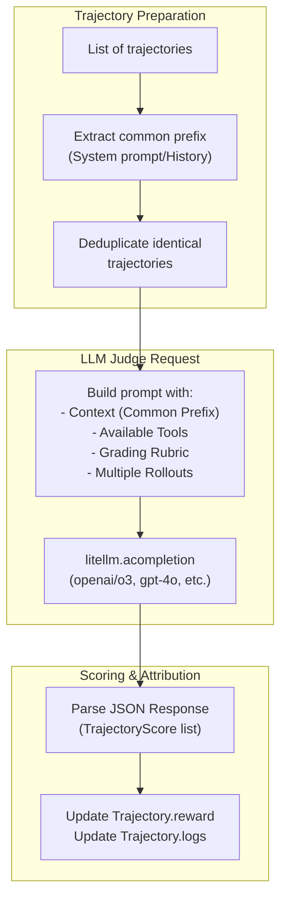
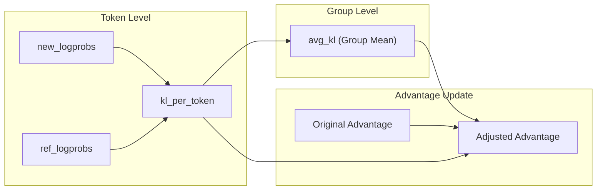

<!-- source: DeepWiki mcp.deepwiki.com · repo OpenPipe/ART · page 7.4 Custom Reward Functions · fetched 2026-10-29 -->

# Custom Reward Functions

<details>
<summary>Relevant source files</summary>

The following files were used as context for generating this wiki page:

- [dev/run_yes_no_maybe_kl_advantage_tinker.py](dev/run_yes_no_maybe_kl_advantage_tinker.py)
- [dev/yes-no-maybe-kl-advantage-tinker.py](dev/yes-no-maybe-kl-advantage-tinker.py)
- [dev/yes-no-maybe-kl-advantage.py](dev/yes-no-maybe-kl-advantage.py)
- [docs/fundamentals/ruler.mdx](docs/fundamentals/ruler.mdx)
- [examples/tic_tac_toe_self_play/game_utils.py](examples/tic_tac_toe_self_play/game_utils.py)
- [examples/tic_tac_toe_self_play/gather_trajectory_groups_by_index.py](examples/tic_tac_toe_self_play/gather_trajectory_groups_by_index.py)
- [examples/tic_tac_toe_self_play/train_o4_mini.py](examples/tic_tac_toe_self_play/train_o4_mini.py)
- [src/art/_backend_training.py](src/art/_backend_training.py)
- [src/art/batches.py](src/art/batches.py)
- [src/art/gather.py](src/art/gather.py)
- [src/art/langgraph/__init__.py](src/art/langgraph/__init__.py)
- [src/art/langgraph/llm_wrapper.py](src/art/langgraph/llm_wrapper.py)
- [src/art/langgraph/logging.py](src/art/langgraph/logging.py)
- [src/art/langgraph/message_utils.py](src/art/langgraph/message_utils.py)
- [src/art/loss.py](src/art/loss.py)
- [src/art/rewards/ruler.py](src/art/rewards/ruler.py)
- [src/art/test/test_kl_advantage.py](src/art/test/test_kl_advantage.py)
- [src/art/tinker_native/backend.py](src/art/tinker_native/backend.py)
- [tests/unit/test_langgraph_llm_wrapper.py](tests/unit/test_langgraph_llm_wrapper.py)
- [tests/unit/test_langgraph_logging.py](tests/unit/test_langgraph_logging.py)

</details>


## Purpose and Scope

This document explains how to implement custom reward functions for training agents in ART. Reward functions evaluate trajectory quality and guide the reinforcement learning process. This page covers scalar rewards, composite rewards with hard-zero gating, LLM-as-judge rewards, the RULER reward utility, group-level metrics, and how `gather_trajectory_groups` handles exceptions.

For information about how rewards are used in the training loop, see [Training Loop & GRPO Algorithm](3.1). For general concepts about rewards and trajectories, see [Core Concepts](1.2).

## Reward Function Basics

In ART, every `Trajectory` must have a `reward` field that quantifies the quality of the agent's performance. The reward value directly influences which behaviors the model learns to reproduce or avoid during training.

**Key Properties of Rewards:**

| Property | Description | Typical Range |
|----------|-------------|---------------|
| Magnitude | Higher rewards indicate better performance | 0.0 to 1.0 (normalized) or -∞ to +∞ |
| Granularity | Rewards can be binary (0/1) or continuous | Binary or continuous |
| Computation | Can be deterministic, LLM-based, or relative | Varies by implementation |
| Timing | Computed during or after trajectory completion | Post-rollout |

The `Trajectory` dataclass stores the reward along with optional metrics for tracking [src/art/trajectories.py:20-29]().

### Exception Handling in Gather
When using `gather_trajectory_groups` to collect data for training, ART provides robust exception handling. The `max_exceptions` parameter [src/art/gather.py:19-19]() controls the tolerance for rollout or reward computation failures. If an exception occurs during a rollout:
1. The exception is recorded in the `GatherContext` [src/art/gather.py:152-153]().
2. If `max_exceptions` is exceeded, the error is re-raised [src/art/gather.py:155-156]().
3. Otherwise, the failed group is filtered out of the final result set [src/art/gather.py:56-63]().

Sources: [src/art/trajectories.py:20-29](), [src/art/gather.py:14-65]()

## RULER: Relative Universal LLM-Elicited Rewards

RULER is ART's built-in system for automatic trajectory evaluation using an LLM-as-judge to rank multiple agent trajectories relative to each other [src/art/rewards/ruler.py:2-9](). It leverages the insight that relative scoring is easier for LLMs than absolute scoring, and GRPO only needs relative scores within each group to compute advantages.

### RULER Architecture

**Diagram: RULER Logic Flow**


Sources: [src/art/rewards/ruler.py:95-236]()

### Using RULER
The primary interface is `ruler_score_group`. It handles token optimization by extracting common prefixes (like system prompts) so they aren't repeated for every trajectory in the prompt sent to the judge [src/art/rewards/ruler.py:146-157]().

```python
from art.rewards import ruler_score_group

# Within a training loop
judged_group = await ruler_score_group(
    group,
    judge_model="openai/o3",
    debug=True
)
```

**Grading Rubric**: RULER uses a default rubric that prioritizes goal achievement and efficiency [src/art/rewards/ruler.py:40-47](). Users can override this by passing a `rubric` string to the function.

Sources: [src/art/rewards/ruler.py:40-47](), [src/art/rewards/ruler.py:95-140](), [docs/fundamentals/ruler.mdx:51-62]()

## Composite Rewards and Gating

For complex tasks, rewards are often composite. A common pattern in ART is **Hard-Zero Gating**, where a trajectory receives zero reward if a mandatory condition is not met (e.g., valid JSON format), regardless of how good the content is.

### Implementation Pattern: Yes-No-Maybe
The `yes-no-maybe` example demonstrates simple scalar reward assignment based on exact string matching [dev/yes-no-maybe-kl-advantage.py:38-46]():

```python
if content == "yes":
    reward = 0.5
elif content == "no":
    reward = 0.75
elif content == "maybe":
    reward = 1.0
else:
    reward = 0.0 # Hard-zero gate for invalid responses
```

Sources: [dev/yes-no-maybe-kl-advantage.py:38-46]()

## Group-Level Metrics and Advantage Adjustment

In ART's GRPO implementation, rewards are aggregated at the group level to compute advantages.

### KL-Penalized Advantages
ART supports a `kl_penalty_coef` which adjusts advantages based on how much the current policy has drifted from a reference model [src/art/loss.py:168-181]().

**Diagram: KL Advantage Adjustment**


Sources: [src/art/loss.py:168-181](), [src/art/test/test_kl_advantage.py:88-90]()

Tokens with higher KL (more drift) relative to the group average receive a penalty to their advantage, while tokens with lower drift receive a boost [src/art/loss.py:179-180](). This encourages the model to stay close to the reference distribution while still optimizing for reward.

### Training Metrics Aggregation
Metrics attached to trajectories are automatically aggregated during training. The `summarize_trajectory_groups` function [src/art/metrics_taxonomy.py:36-36]() processes the `Trajectory.metrics` dictionaries to produce step-level statistics like `reward_mean`, `reward_std`, and custom group metrics [src/art/tinker_native/backend.py:80-81]().

Sources: [src/art/loss.py:179-181](), [src/art/tinker_native/backend.py:80-82](), [src/art/metrics_taxonomy.py:36-37]()

## LLM-as-Judge Patterns

Beyond RULER, users can implement custom LLM judges using LiteLLM or direct OpenAI calls.

### Single Rollout Judge
Evaluates one trajectory in isolation. This is useful when the reward depends on subjective quality that doesn't require comparison.

```python
async def llm_judge(trajectory: Trajectory) -> float:
    response = await acompletion(
        model="openai/gpt-4o",
        messages=[...],
        response_format=MyRewardSchema
    )
    return response.score
```

### Multi-Rollout Comparison (General RM)
This pattern, used in the `tau-bench` examples, sends multiple rollouts to a judge to get relative scores [src/art/rewards/ruler.py:100-103](). RULER is the standardized implementation of this pattern in ART.

Sources: [src/art/rewards/ruler.py:100-106](), [docs/fundamentals/ruler.mdx:30-32]()

## LangGraph Reward Integration

When using the LangGraph integration, rewards are typically assigned after the entire graph execution finishes. The `wrap_rollout` utility [src/art/langgraph/llm_wrapper.py:100-112]() captures the full interaction history, which can then be passed to a reward function.

**Data Flow: LangGraph to Reward**
1. `wrap_rollout` initializes a `FileLogger` for the thread [src/art/langgraph/llm_wrapper.py:103-108]().
2. The agent executes tool calls and LLM steps, which are logged [src/art/langgraph/llm_wrapper.py:193-196]().
3. `create_messages_from_logs` converts the LangGraph messages into an ART `Trajectory` [src/art/langgraph/llm_wrapper.py:45-97]().
4. The user-defined reward function (or RULER) is applied to the resulting `Trajectory`.

Sources: [src/art/langgraph/llm_wrapper.py:45-112](), [src/art/langgraph/logging.py:4-14]()

---

