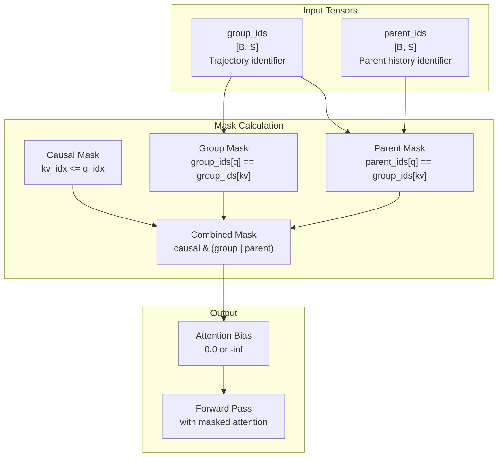
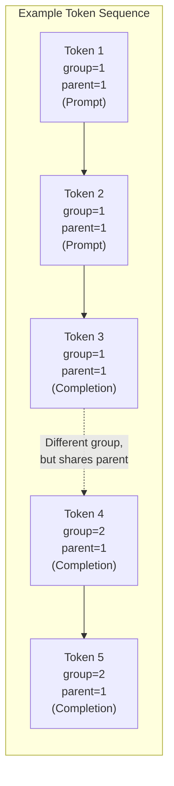
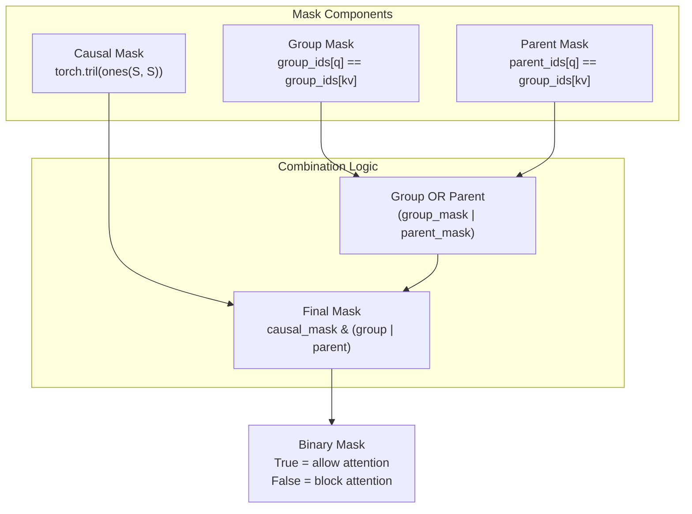
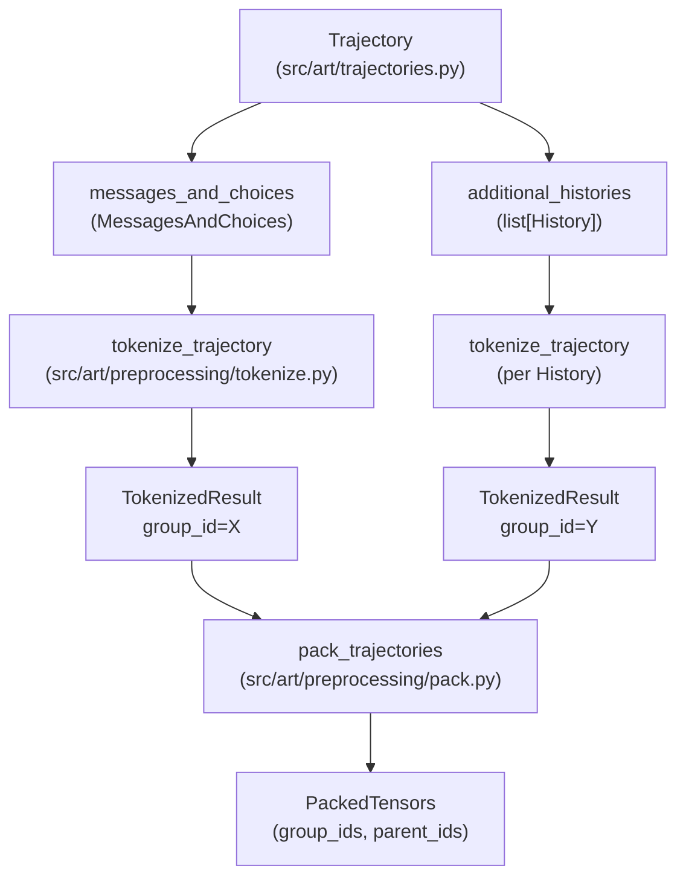

<!-- source: DeepWiki mcp.deepwiki.com · repo OpenPipe/ART · page 7.5 Attention Masking & Additional Histories · fetched 2026-10-29 -->

# Attention Masking & Additional Histories

<details>
<summary>Relevant source files</summary>

The following files were used as context for generating this wiki page:

- [docs/features/additional-histories.mdx](docs/features/additional-histories.mdx)
- [docs/features/checkpoint-forking.mdx](docs/features/checkpoint-forking.mdx)
- [docs/images/forked-run.webp](docs/images/forked-run.webp)
- [docs/resources/glossary.mdx](docs/resources/glossary.mdx)
- [docs/resources/models.mdx](docs/resources/models.mdx)
- [examples/prisoners-dilemma.ipynb](examples/prisoners-dilemma.ipynb)
- [src/art/auto_trajectory.py](src/art/auto_trajectory.py)
- [src/art/preprocessing/tokenize.py](src/art/preprocessing/tokenize.py)
- [src/art/tinker/client.py](src/art/tinker/client.py)
- [src/art/tinker/renderers.py](src/art/tinker/renderers.py)
- [src/art/tinker/server.py](src/art/tinker/server.py)
- [src/art/trajectories.py](src/art/trajectories.py)
- [src/art/utils/benchmarking/load_trajectories.py](src/art/utils/benchmarking/load_trajectories.py)
- [src/art/utils/benchmarking/pull_model_trajectories.py](src/art/utils/benchmarking/pull_model_trajectories.py)
- [src/art/utils/old_benchmarking/load_benchmarked_models.py](src/art/utils/old_benchmarking/load_benchmarked_models.py)
- [src/art/utils/trajectory_logging.py](src/art/utils/trajectory_logging.py)
- [src/art/utils/trajectory_migration.py](src/art/utils/trajectory_migration.py)
- [tests/unit/test_preprocessing_tokenize.py](tests/unit/test_preprocessing_tokenize.py)
- [tests/unit/test_trajectory_parquet.py](tests/unit/test_trajectory_parquet.py)

</details>


This document explains the attention masking mechanism used in ART's training pipeline and how it enables the `additional_histories` feature. The attention masking system uses `group_ids` and `parent_ids` to control which tokens can attend to which other tokens during training, allowing multiple separate conversation histories to be trained in a single packed batch.

For details on the data processing pipeline that creates these IDs, see [Data Processing Pipeline](#2.4).

## Purpose and Architecture

ART's attention masking system solves a key challenge in training agents: how to pack multiple independent conversation histories into a single batch while maintaining proper attention boundaries. This enables efficient training on trajectories with complex structures, including:

- Multiple rollouts from the same prompt (grouped trajectories).
- Multi-turn conversations split across separate histories.
- Sub-agent conversations nested within main agent flows.
- History compaction patterns where old messages are summarized.

The system uses two integer tensors to control attention:

Title: Attention Masking Logic


Sources: `src/art/unsloth/train.py:259-308`()

## Group IDs and Parent IDs

### Group IDs

`group_ids` is an integer tensor of shape `[batch_size, sequence_length]` where each token is assigned an ID representing which trajectory or completion it belongs to. All tokens in the same sampled trajectory share the same group ID.

**Purpose**: Prevents tokens from different trajectories from attending to each other, even when packed into the same batch.

### Parent IDs

`parent_ids` is an integer tensor of shape `[batch_size, sequence_length]` where each token is assigned the group ID of its parent history. For prompt tokens, the parent ID matches the group ID. For completion tokens, the parent ID indicates which prompt history they were generated from.

**Purpose**: Allows completion tokens to attend to their corresponding prompt tokens, even when the prompt belongs to a different history (as in `additional_histories`).

Title: Token Visibility Pattern


In this example:
- Tokens 1-3 are history 1 (`group=1`).
- Tokens 4-5 are history 2 (`group=2`) but share the same parent (`parent=1`).
- Token 4 can attend to tokens 1-2 because `parent_ids[4] == group_ids[1]`.

Sources: `src/art/unsloth/train.py:100-107`(), `src/art/torchtune/recipe.py:712-736`()

## Attention Mask Calculation

The attention mask determines which tokens can attend to which other tokens during the forward pass. ART implements this through a three-part mask combined with logical operations.

### The Core Algorithm

Title: Logical Mask Composition


### Implementation in Unsloth

The mask calculation in the Unsloth backend (found in `src/art/unsloth/train.py`):

```python
# From calculate_mask function
causal_mask = (
    torch.tril(torch.ones(seq_len, seq_len, dtype=torch.bool, device=device))
    .unsqueeze(0)
    .expand(batch_size, seq_len, seq_len)
)
group_mask = group_ids.unsqueeze(2) == group_ids.unsqueeze(1)
parent_mask = parent_ids.unsqueeze(2) == group_ids.unsqueeze(1)
mask = causal_mask & (group_mask | parent_mask)
```

**Step-by-step breakdown**:

1. **Causal Mask** `[B, S, S]`: Lower triangular matrix ensuring token `i` can only attend to tokens `≤ i`.
2. **Group Mask** `[B, S, S]`: `True` where query and key tokens share the same group ID.
3. **Parent Mask** `[B, S, S]`: `True` where query's parent ID matches key's group ID.
4. **Combined**: Causal AND (Group OR Parent).

Sources: `src/art/unsloth/train.py:286-308`()

### Conversion to Attention Bias

The binary mask is converted to an attention bias tensor that can be added to attention scores:

```python
# From calculate_attn_bias function
attn_bias = torch.where(
    mask,
    torch.tensor(0.0, dtype=dtype, device=device),
    torch.tensor(float("-inf"), dtype=dtype, device=device),
)
```

- `True` (allow attention) → `0.0` (no bias).
- `False` (block attention) → `-inf` (forces softmax to zero).

Sources: `src/art/unsloth/train.py:259-283`()

### Implementation in TorchTune

The TorchTune backend uses FlexAttention with a block mask for better performance:

```python
# From make_block_mask function in src/art/torchtune/recipe.py
def mask_mod(b, h, q_idx, kv_idx):
    causal = kv_idx <= q_idx
    same_group = group_ids[b, q_idx] == group_ids[b, kv_idx]
    prompt_link = parent_ids[b, q_idx] == group_ids[b, kv_idx]
    return causal & (same_group | prompt_link)

return create_block_mask(mask_mod, B=B, H=None, Q_LEN=S, KV_LEN=S, ...)
```

Sources: `src/art/torchtune/recipe.py:712-736`()

## Additional Histories Feature

The `additional_histories` field in the `Trajectory` class allows a single rollout to contribute multiple separate training samples.

### Data Structures

The `History` class acts as a container for conversation segments, while `Trajectory` holds the main conversation and a list of these additional segments.

| Class | Field | Type | Description |
| :--- | :--- | :--- | :--- |
| `History` | `messages_and_choices` | `MessagesAndChoices` | The conversation history and assistant completions |
| `History` | `tools` | `Tools \| None` | Tools available for this specific history |
| `Trajectory` | `additional_histories` | `list[History]` | List of secondary histories to be trained independently |

Sources: `src/art/trajectories.py:30-41`()

### Automated Capture

When using `capture_auto_trajectory`, ART automatically populates `additional_histories` if it detects multiple requests sharing the same prefix. The `AutoTrajectoryContext` handles the logic of finding the appropriate history or creating a new one when a response is intercepted.

Sources: `src/art/auto_trajectory.py:137-159`()

### Use Case: Special Token Preservation

Models like Qwen 3 remove `<think>` tokens from previous turns in multi-turn templates. Using `additional_histories` allows each turn to be treated as a separate history where the current turn's `<think>` tokens are preserved for training.

Sources: `docs/resources/models.mdx:36-38`()

### Learning Rate Adjustment

The attention masking system interacts with the learning rate through the number of unique groups. The training code adjusts the learning rate based on how many independent trajectories are being trained:

```python
# From compute_loss in src/art/unsloth/train.py
num_trajectories_learning_rate_multiplier = (
    torch.unique(inputs["group_ids"]).numel()
    - torch.unique(inputs["parent_ids"]).numel()
) ** _config.get("num_trajectories_learning_rate_multiplier_power", 0.0)
```

Sources: `src/art/unsloth/train.py:57-70`()

## Data Flow & Tokenization

Title: Trajectory to Tokenized Batch


Sources: `src/art/preprocessing/tokenize.py:149-168`(), `src/art/preprocessing/pack.py`()

## RULER Reward Limitations

The RULER reward utility (often used for reasoning-trace validation) has specific limitations when used with complex histories:

1. **Structure Sensitivity**: RULER typically expects a single continuous trace to evaluate.
2. **Additional Histories**: Because `additional_histories` are treated as independent conversation threads during training, a single RULER score applied to the parent `Trajectory` may not accurately reflect the quality of the sub-histories.

Sources: `src/art/trajectories.py:130-179`() (TrajectoryGroup handling)

## Performance Considerations

- **Memory Usage**: The attention bias tensor has shape `[batch_size, seq_len, seq_len]`. For large sequence lengths, this can cause OOM.
- **Chunking**: ART mitigates this by chunking logprob calculations. `src/art/unsloth/train.py` implements a loop over the sequence length using `logprob_calculation_chunk_size` (default 1024) to process hidden states in segments.

Sources: `src/art/unsloth/train.py:115-119`(), `src/art/unsloth/train.py:368-393`()

---

