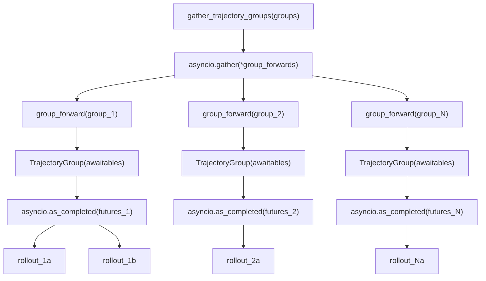
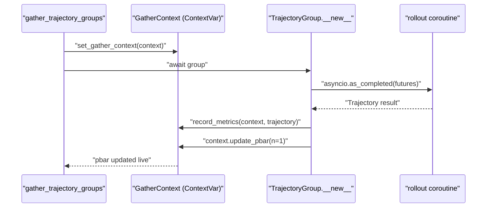
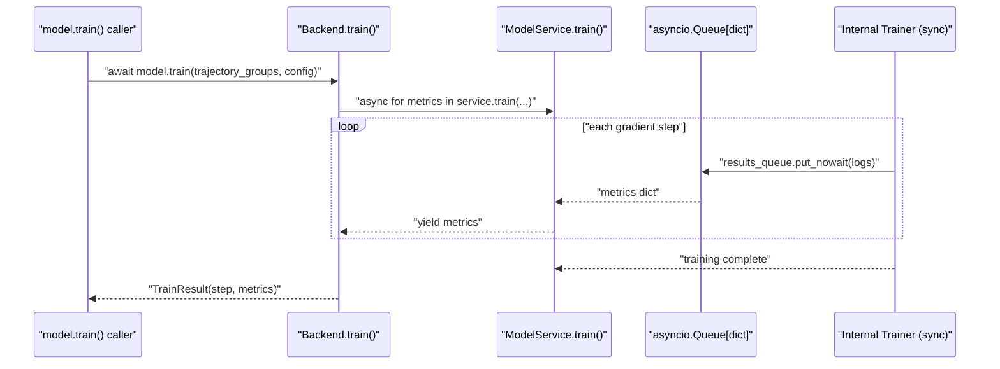
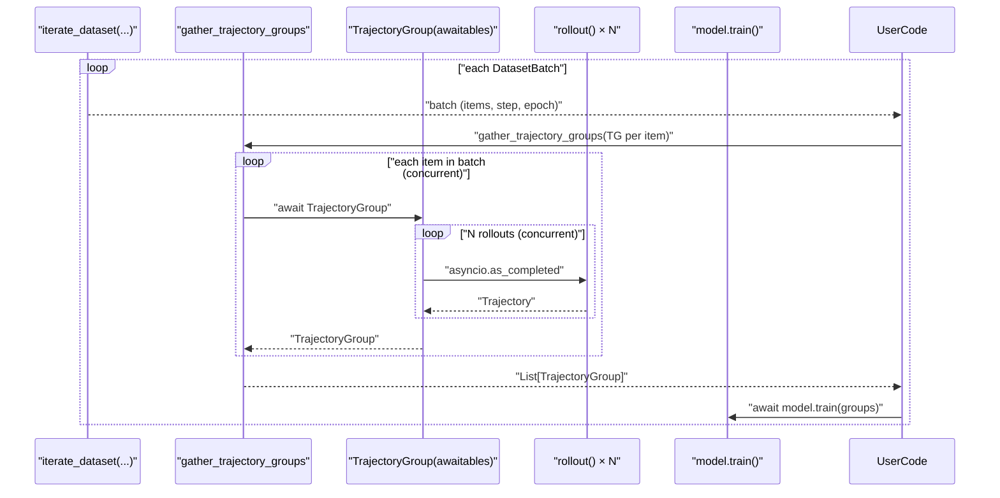

<!-- source: DeepWiki mcp.deepwiki.com · repo OpenPipe/ART · page 7.6 Async Training Patterns · fetched 2026-10-29 -->

# Async Training Patterns

<details>
<summary>Relevant source files</summary>

The following files were used as context for generating this wiki page:

- [dev/yes-no-maybe.ipynb](dev/yes-no-maybe.ipynb)
- [examples/hn_title_generator/reference_grpo_trainer.py](examples/hn_title_generator/reference_grpo_trainer.py)
- [examples/hn_title_generator/train.py](examples/hn_title_generator/train.py)
- [examples/hn_title_generator/utils.py](examples/hn_title_generator/utils.py)
- [examples/tic_tac_toe_self_play/game_utils.py](examples/tic_tac_toe_self_play/game_utils.py)
- [examples/tic_tac_toe_self_play/gather_trajectory_groups_by_index.py](examples/tic_tac_toe_self_play/gather_trajectory_groups_by_index.py)
- [examples/tic_tac_toe_self_play/train_o4_mini.py](examples/tic_tac_toe_self_play/train_o4_mini.py)
- [src/art/batches.py](src/art/batches.py)
- [src/art/gather.py](src/art/gather.py)
- [src/art/pipeline_trainer/trainer.py](src/art/pipeline_trainer/trainer.py)
- [src/art/utils/benchmark_rollout.py](src/art/utils/benchmark_rollout.py)
- [src/art/utils/format_message.py](src/art/utils/format_message.py)
- [src/art/utils/iterate_dataset.py](src/art/utils/iterate_dataset.py)
- [src/art/utils/retry.py](src/art/utils/retry.py)
- [tests/unit/test_megatron_reference_logprobs.py](tests/unit/test_megatron_reference_logprobs.py)
- [tests/unit/test_pipeline_trainer_local_backend.py](tests/unit/test_pipeline_trainer_local_backend.py)

</details>


This page documents the async concurrency primitives used in ART's training loop: how rollouts are gathered in parallel, how training result streams are consumed, and how multi-epoch dataset iteration is managed.

---

## Overview

ART's training loop has two distinct async phases:

| Phase | Async pattern | Key API |
|---|---|---|
| **Rollout** | Parallel coroutines, fan-out | `gather_trajectory_groups`, `gather_trajectories` |
| **Training** | Sequential, async iterator | `ModelService.train` → `AsyncIterator[dict]` |

These two phases alternate strictly: rollouts run in parallel while the model is serving inference, then inference is paused and training runs serially. No rollouts execute during training, and no training runs during rollouts.

---

## `gather_trajectory_groups` — Rollout Concurrency Model

**Defined in:** [src/art/gather.py:14-65]()

`gather_trajectory_groups` takes an iterable of `Awaitable[TrajectoryGroup]` objects and runs all of them concurrently using `asyncio.gather` [src/art/gather.py:47](). Each group in the iterable corresponds to one scenario or prompt; each group internally runs multiple parallel rollouts.

### Two-level parallelism

The diagram below shows the two-level concurrency structure.

**Diagram: Two-Level Parallelism in `gather_trajectory_groups`**



Sources: [src/art/gather.py:14-65](), [src/art/trajectories.py:254-319]()

**Outer level:** `gather_trajectory_groups` calls `asyncio.gather` over all group awaitables [src/art/gather.py:47]().

**Inner level:** When `TrajectoryGroup` is constructed with awaitables, its `__new__` method detects the awaitables and returns a coroutine that uses `asyncio.as_completed` to resolve individual rollout futures as they complete [src/art/trajectories.py:278]().

### Progress tracking via `GatherContext`

`gather_trajectory_groups` installs a `GatherContext` into a `contextvars.ContextVar` before launching work [src/art/gather.py:46-49](). Each inner rollout, when it completes, calls `record_metrics` and `update_pbar` on this context [src/art/gather.py:149-150](), giving real-time progress display across all concurrent rollouts.

**Diagram: `GatherContext` data flow**



Sources: [src/art/gather.py:202-257](), [src/art/trajectories.py:275-299]()

### `max_exceptions` tolerance

`gather_trajectory_groups` accepts a `max_exceptions` parameter [src/art/gather.py:19](). It can be an absolute integer or a float in (0, 1) representing a fraction of total rollouts. Exceptions below the threshold are swallowed and handled; beyond the threshold, the exception propagates [src/art/gather.py:155-156]().

### `after_each` callback

An optional `after_each` async callback can be passed to `gather_trajectory_groups` [src/art/gather.py:21-26](). It receives each `TrajectoryGroup` as it completes and can return a modified group, `None` (to drop it), or a `list[TrajectoryGroup]` (to expand it) [src/art/gather.py:42-44]().

---

## `gather_trajectories` — Flat Trajectory Gathering (SFT)

**Defined in:** [src/art/gather.py:68-137]()

`gather_trajectories` is the SFT equivalent of `gather_trajectory_groups`. Instead of grouping, it takes a flat iterable of `Awaitable[Trajectory]` and runs all concurrently via `asyncio.gather` [src/art/gather.py:132-133]().

| Feature | `gather_trajectory_groups` | `gather_trajectories` |
|---|---|---|
| Output type | `list[TrajectoryGroup]` | `list[Trajectory]` |
| Primary use | RL rollouts | SFT data collection, eval |
| Inner parallelism | `asyncio.as_completed` per group | Flat |

When `max_exceptions > 0`, `gather_trajectories` returns `list[Trajectory | BaseException]` instead of raising [src/art/gather.py:84-85]().

Sources: [src/art/gather.py:68-137](), [examples/hn_title_generator/train.py:339-355]()

---

## `PipelineTrainer` — 3-Stage Async Pipeline

**Defined in:** [src/art/pipeline_trainer/trainer.py:70-111]()

The `PipelineTrainer` implements a high-performance 3-stage pipeline (rollout, train, eval) designed to maximize hardware utilization. It manages a queue of `TrajectoryGroup` objects and processes them in stages.

### Concurrency Parameters
* `num_rollout_workers`: Number of concurrent rollout tasks [src/art/pipeline_trainer/trainer.py:83]().
* `min_batch_size`: Minimum number of groups required to trigger a training step [src/art/pipeline_trainer/trainer.py:84]().
* `max_steps_off_policy`: How many training steps a trajectory can "survive" before being discarded [src/art/pipeline_trainer/trainer.py:86]().

### Group Rollout Utility
The `make_group_rollout_fn` helper [src/art/pipeline_trainer/trainer.py:48-67]() converts a single-scenario rollout function into a group rollout by running it $N$ times in parallel using `asyncio.gather` [src/art/pipeline_trainer/trainer.py:61-64]().

Sources: [src/art/pipeline_trainer/trainer.py:1-111]()

---

## Async Training Result Iterator

Training in ART does not return a single result at the end. Instead, training calls yield intermediate metrics per gradient step as an `AsyncIterator[dict[str, float]]`.

### `ModelService.train` protocol

The `ModelService` protocol (used in `LocalBackend`) returns an `AsyncIterator`. Implementations yield one dictionary per gradient step containing metrics such as `loss` and `learning_rate`.

**Diagram: Async training metric stream**



Sources: [tests/unit/test_pipeline_trainer_local_backend.py:75-76](), [src/art/pipeline_trainer/trainer.py:36-45]()

---

## `iterate_dataset` — Epoch Management

**Defined in:** [src/art/utils/iterate_dataset.py:21-94]()

`iterate_dataset` is a generator that handles multi-epoch dataset iteration, deterministic shuffling, and training step resumption.

### `DatasetBatch` fields

**Defined in:** [src/art/utils/iterate_dataset.py:12-18]()

| Field | Type | Description |
|---|---|---|
| `items` | `List[T]` | Dataset items for this batch |
| `step` | `int` | Global step number across all epochs |
| `epoch` | `int` | Current epoch (0-indexed) |
| `epoch_step` | `int` | Step within the current epoch (0-indexed) |

### Resumption

`iterate_dataset` accepts `initial_step` to skip batches already processed. Any batch whose computed `global_step < initial_step` is skipped [src/art/utils/iterate_dataset.py:73-80]().

### Deterministic shuffling

Each epoch is shuffled with `random.Random(epoch).shuffle(indices)` [src/art/utils/iterate_dataset.py:63-65](). This ensures the same sequence is reproduced if training restarts.

Sources: [src/art/utils/iterate_dataset.py:21-94]()

---

## Building a Multi-Scenario Parallel Training Loop

The typical pattern combines these primitives into a loop.

**Diagram: Full async training loop structure**



Sources: [examples/hn_title_generator/train.py:289-334](), [dev/yes-no-maybe.ipynb:98-111]()

### Minimal loop (from `yes-no-maybe.ipynb`)

```python
openai_client = model.openai_client()
for _ in range(await model.get_step(), 1_000):
    train_groups = await art.gather_trajectory_groups(
        (
            art.TrajectoryGroup(rollout(openai_client, prompt) for _ in range(32))
            for prompt in prompts
        )
    )
    await model.train(train_groups, config=art.TrainConfig(learning_rate=1e-4))
```

Sources: [dev/yes-no-maybe.ipynb:98-111]()

---

## Summary Reference

| API | Location | Purpose |
|---|---|---|
| `gather_trajectory_groups` | [src/art/gather.py:14]() | Parallel multi-group rollout with progress tracking |
| `gather_trajectories` | [src/art/gather.py:108]() | Flat parallel rollout for SFT / eval |
| `PipelineTrainer` | [src/art/pipeline_trainer/trainer.py:70]() | 3-stage async rollout/train/eval pipeline |
| `iterate_dataset` | [src/art/utils/iterate_dataset.py:21]() | Epoch/step management with deterministic shuffle |
| `make_group_rollout_fn` | [src/art/pipeline_trainer/trainer.py:48]() | Helper to parallelize single-scenario rollouts |
| `retry` | [src/art/utils/retry.py:19]() | Decorator for exponential backoff on async/sync functions |

---

