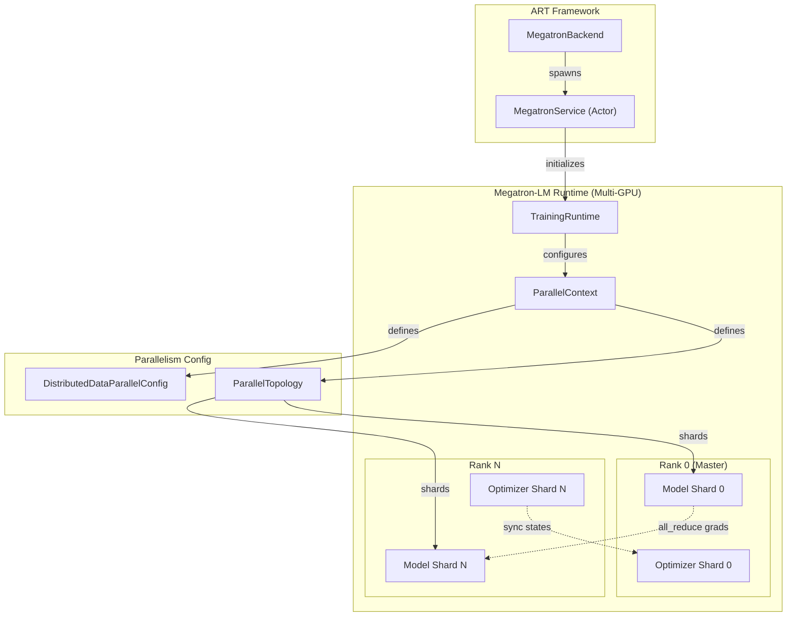
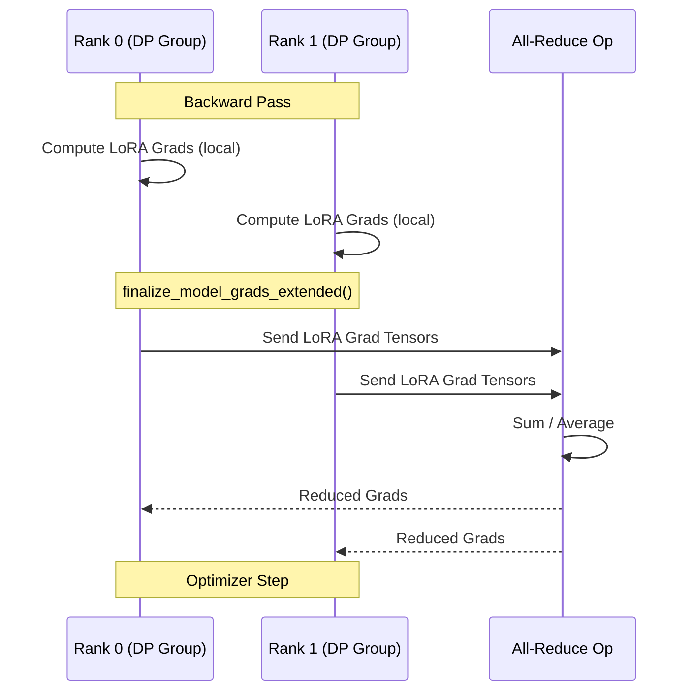

<!-- source: DeepWiki mcp.deepwiki.com · repo OpenPipe/ART · page 7.7 Distributed Training & Parallelism · fetched 2026-10-29 -->

# Distributed Training & Parallelism

Relevant source files

The following files were used as context for generating this wiki page:

- [.agents/skills/fix-art-issues/SKILL.md](.agents/skills/fix-art-issues/SKILL.md)
- [.github/workflows/build-gpu-image.yml](.github/workflows/build-gpu-image.yml)
- [dev/yes-no-maybe-fork-pipeline.sky.yaml](dev/yes-no-maybe-fork-pipeline.sky.yaml)
- [dev/yes-no-maybe-fork.sky.yaml](dev/yes-no-maybe-fork.sky.yaml)
- [docker/art-gpu.Dockerfile](docker/art-gpu.Dockerfile)
- [scripts/build-gpu-image.sh](scripts/build-gpu-image.sh)
- [scripts/setup.sh](scripts/setup.sh)
- [skypilot-config.yaml](skypilot-config.yaml)
- [src/art/megatron/backend.py](src/art/megatron/backend.py)
- [src/art/megatron/context_parallel/block_mask.py](src/art/megatron/context_parallel/block_mask.py)
- [src/art/megatron/context_parallel/core_attention.py](src/art/megatron/context_parallel/core_attention.py)
- [src/art/megatron/context_parallel/executor.py](src/art/megatron/context_parallel/executor.py)
- [src/art/megatron/context_parallel/types.py](src/art/megatron/context_parallel/types.py)
- [src/art/megatron/flex_attn/attention.py](src/art/megatron/flex_attn/attention.py)
- [src/art/megatron/lora.py](src/art/megatron/lora.py)
- [src/art/megatron/provider.py](src/art/megatron/provider.py)
- [src/art/megatron/service.py](src/art/megatron/service.py)
- [src/art/megatron/train.py](src/art/megatron/train.py)
- [src/art/megatron/training/microbatches.py](src/art/megatron/training/microbatches.py)
- [src/art/megatron/weights/lora_publish.py](src/art/megatron/weights/lora_publish.py)
- [tests/integration/megatron/model_support/oracle_harness.py](tests/integration/megatron/model_support/oracle_harness.py)
- [tests/integration/megatron/routing_replay/trace.py](tests/integration/megatron/routing_replay/trace.py)

ART supports large-scale distributed training through the `MegatronBackend`, which leverages **Megatron-LM** for tensor, pipeline, and context parallelism. This infrastructure is designed for multi-GPU and multi-node environments, specifically optimized for cloud clusters provisioned via **SkyPilot**.

## Overview

Distributed training in ART is primarily handled by the `MegatronService`, which manages a separate training process sharded across multiple GPUs using Megatron-LM's core libraries. Unlike the local `TorchtuneService`, the `MegatronBackend` is built for high-performance training of large models (e.g., Qwen 32B+) that require sharding weights and gradients across many ranks.

**Key Distributed Features:**
- **DistributedDataParallelConfig**: Configures gradient sharding and reduction [src/art/megatron/train.py:26]().
- **LoRA Gradient All-Reduce**: Custom implementation to synchronize LoRA adapter gradients across data-parallel ranks [src/art/megatron/lora.py:164-170]().
- **Parallel Topologies**: Support for Tensor Parallel (TP), Pipeline Parallel (PP), Context Parallel (CP), and Expert Parallel (EP) [src/art/megatron/context_parallel/types.py:16-17]().
- **SkyPilot Integration**: Automated cluster provisioning and environment setup for multi-node jobs [skypilot-config.yaml:1-63]().

Sources: [src/art/megatron/backend.py:15-31](), [src/art/megatron/train.py:137-170]()

## Distributed Training Architecture

The following diagram illustrates how the `MegatronBackend` bridges the ART framework with the sharded Megatron-LM runtime.

Sources: [src/art/megatron/train.py:137-170](), [src/art/megatron/service.py:188-218](), [src/art/megatron/context_parallel/types.py:12-20]()

## Parallelism Strategies

### Distributed Data Parallel (DDP)
ART uses `DistributedDataParallelConfig` to manage gradient synchronization. For LoRA training, ART implements a custom gradient finalization step that flushes parameter gradients to main gradients before the optimizer step [src/art/megatron/train.py:70-73]().

### Tensor & Pipeline Parallelism
- **Tensor Parallelism (TP)**: Splits weights within a layer across GPUs.
- **Pipeline Parallelism (PP)**: Splits layers across GPUs.
- **Expert Parallelism (EP)**: Specifically for MoE models, sharding experts across GPUs [src/art/megatron/lora.py:45-47]().

The topology is configured via `MegatronTopologyConfig` [src/art/megatron/service.py:23]().

### Context Parallelism (CP)
Context parallelism allows processing extremely long sequences by splitting the sequence dimension across GPUs. ART implements `ArtContextParallelCoreAttention` to handle attention masks across these shards [src/art/megatron/provider.py:159-164]().

Sources: [src/art/megatron/provider.py:57-67](), [src/art/megatron/context_parallel/block_mask.py:28-39]()

## LoRA Gradient Synchronization

A critical component of ART's distributed LoRA implementation is the synchronization of adapter gradients. Since LoRA layers are added dynamically to the Megatron model shards, ART must manually manage the all-reduce operations across data parallel ranks.

**Implementation Details:**
- **GradSyncDomain**: Defines whether gradients are synced across the standard TP group or the Expert TP group [src/art/megatron/lora.py:46-55]().
- **GradSyncOp**: Supports `sum` or `avg` reductions [src/art/megatron/lora.py:53-55]().
- **finalize_model_grads_extended**: The core function that iterates through sharded LoRA parameters and performs the necessary `all_reduce` calls [src/art/megatron/train.py:70-71]().

Sources: [src/art/megatron/lora.py:45-62](), [src/art/megatron/train.py:70-73]()

## SkyPilot Cluster Configuration

For multi-node training, ART utilizes **SkyPilot** to orchestrate the infrastructure. The `skypilot-config.yaml` defines the resource requirements, such as H100 or A100 GPU counts, and the setup environment.

**Key Configuration Fields:**
- `num_nodes`: Specifies the total number of nodes in the cluster [skypilot-config.yaml:30]().
- `accelerators`: Defines the GPU type (e.g., `H100:8`) [skypilot-config.yaml:63]().
- `setup`: Executes `scripts/setup.sh` to install dependencies and configure the Megatron environment [scripts/setup.sh:1-79]().

### Multi-Node Data Flow
1. **Provisioning**: SkyPilot launches the cluster based on `skypilot-config.yaml`.
2. **Environment Setup**: `scripts/setup.sh` installs `uv` and syncs the `megatron` extra [scripts/setup.sh:66-78]().
3. **Training Execution**: `MegatronBackend` triggers the training loop on the head node, which coordinates workers via Megatron's internal distributed init.
4. **Checkpoint Sync**: Trained LoRA adapters are saved to a shared directory or synced to S3 [src/art/megatron/service.py:113-116]().

Sources: [skypilot-config.yaml:1-63](), [scripts/setup.sh:74-78](), [src/art/megatron/backend.py:51-74]()

## Distributed Training Loop

The `run_megatron_worker_loop` is the entry point for each GPU rank. It handles:
1. **Runtime Initialization**: Setting up the `TrainingRuntime` with sharded models [src/art/megatron/train.py:128-130]().
2. **Micro-batching**: Using `build_micro_sample_indices` to determine which samples each rank processes [src/art/megatron/training/microbatches.py:145-170]().
3. **Gradient Accumulation**: Resolving local vs. global accumulation steps across the Data Parallel world size [src/art/megatron/training/microbatches.py:124-143]().

| Concept | Implementation |
|---------|----------------|
| **Global Grad Accumulation** | `resolve_global_grad_accumulation_sequences` [src/art/megatron/training/microbatches.py:115]() |
| **Local Grad Accumulation** | `resolve_local_grad_accumulation_sequences` [src/art/megatron/training/microbatches.py:124]() |
| **Sample Selection** | `select_micro_inputs` [src/art/megatron/training/microbatches.py:173]() |

Sources: [src/art/megatron/train.py:128-134](), [src/art/megatron/training/microbatches.py:115-170]()

---

