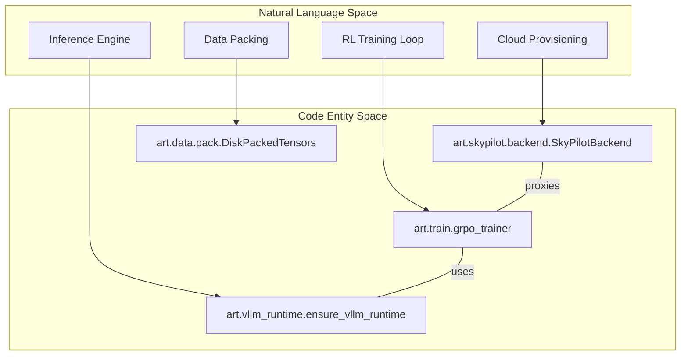
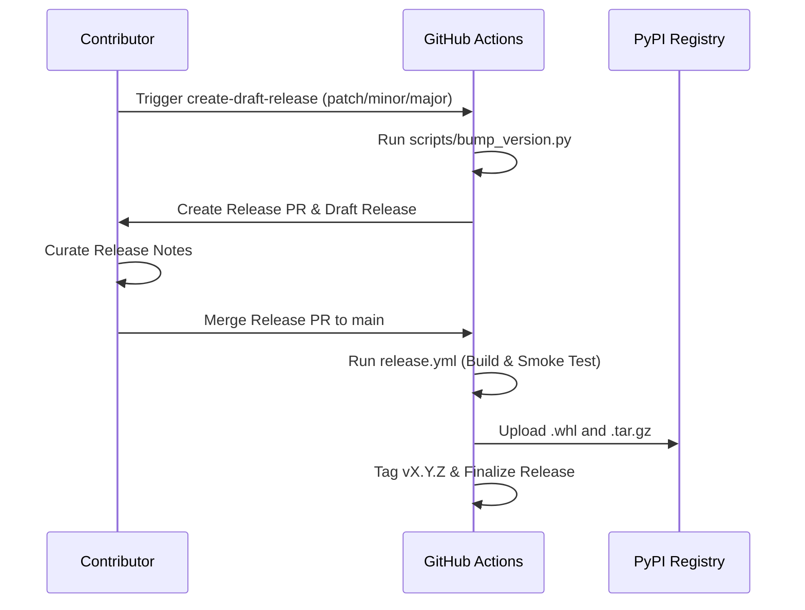

<!-- source: DeepWiki mcp.deepwiki.com · repo OpenPipe/ART · page 8 Development & Contributing · fetched 2026-10-29 -->

# Development & Contributing

Relevant source files

The following files were used as context for generating this wiki page:

- [.github/workflows/create-draft-release.yml](.github/workflows/create-draft-release.yml)
- [.github/workflows/package-install.yml](.github/workflows/package-install.yml)
- [.github/workflows/prek.yml](.github/workflows/prek.yml)
- [.github/workflows/release.yml](.github/workflows/release.yml)
- [AGENT.md](AGENT.md)
- [CONTRIBUTING.md](CONTRIBUTING.md)
- [scripts/bump_version.py](scripts/bump_version.py)
- [scripts/ci/build_and_push_uv_cache.sh](scripts/ci/build_and_push_uv_cache.sh)
- [scripts/ci/compute_uv_fingerprint.py](scripts/ci/compute_uv_fingerprint.py)

This document provides an overview of how to contribute to the ART project, covering environment setup, the repository structure, and the automated release pipeline. ART uses modern Python tooling like `uv` and `prek` to ensure high code quality and a streamlined developer experience.

---

## Development Setup

To contribute to ART, you must set up a local environment capable of running the framework's linting, type-checking, and testing suites.

### Initial Setup
1. **Clone the repository**: `git clone https://github.com/OpenPipe/ART.git` [CONTRIBUTING.md:3-8]()
2. **Install dependencies**: ART uses the `uv` package manager. Run `uv sync --group dev` to install the project and all development tools [CONTRIBUTING.md:10-14]().
3. **Configure environment**: Copy `.env.example` to `.env` to manage API keys and cloud configuration [CONTRIBUTING.md:88-91]().

### Code Quality with `prek`
The project uses [prek](https://github.com/j178/prek) to bundle checks including `ruff`, `pyright`, and `pytest`.
- **Install git hooks**: `uv run prek install` [CONTRIBUTING.md:22]()
- **Run all checks**: `uv run prek run --all-files` [CONTRIBUTING.md:25]()

For detailed instructions on GPU testing and VSCode remote setup, see **[Development Setup](#8.1)**.

**Sources:** [CONTRIBUTING.md:1-38](), [AGENT.md:1-12]()

---

## Project Structure

ART is organized to separate core framework logic from specific backend implementations and training recipes.

### Repository Layout
- `src/art/`: The primary package containing the core logic [AGENT.md:20]().
- `src/art/vllm_runtime/`: A managed sub-package for isolated vLLM inference environments [.github/workflows/release.yml:99]().
- `examples/`: End-to-end training scripts (e.g., 2048, Tau-Bench) [CONTRIBUTING.md:136-138]().
- `scripts/`: Utilities for CI, versioning, and package building [.github/workflows/release.yml:45]().

### Code Entity Map
The following diagram maps high-level system components to their specific code entities.

**System Component to Code Entity Mapping**

For a full breakdown of subdirectories like `megatron`, `tinker`, and `unsloth`, see **[Project Structure](#8.2)**.

**Sources:** [CONTRIBUTING.md:136-140](), [.github/workflows/release.yml:79-113](), [scripts/bump_version.py:1-15]()

---

## Release Process

ART follows a strictly automated release process triggered by GitHub Actions. This ensures that PyPI releases always match the repository tags and have curated changelogs.

### Release Workflow
1. **Trigger Draft**: A developer runs the `create-draft-release.yml` workflow via GitHub Actions or CLI, choosing a `patch`, `minor`, or `major` bump [CONTRIBUTING.md:63-69]().
2. **Version Bump**: The `bump_version.py` script updates `pyproject.toml` and `uv.lock` [scripts/bump_version.py:45-59]().
3. **Draft Review**: A Draft Release is created on GitHub with an auto-generated list of PRs. Developers curate these notes [CONTRIBUTING.md:71-76]().
4. **Publish**: Merging the automatically created "Release PR" triggers the final publication to PyPI and creates the git tag [.github/workflows/release.yml:24-28]().

### Automated Release Pipeline

For details on the CI cache fingerprinting and smoke testing the vLLM runtime during release, see **[Release Process](#8.3)**.

**Sources:** [CONTRIBUTING.md:54-83](), [.github/workflows/release.yml:1-58](), [.github/workflows/create-draft-release.yml:1-50](), [scripts/bump_version.py:1-42]()

---

