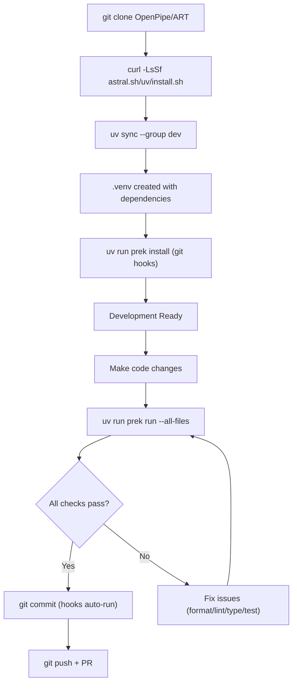
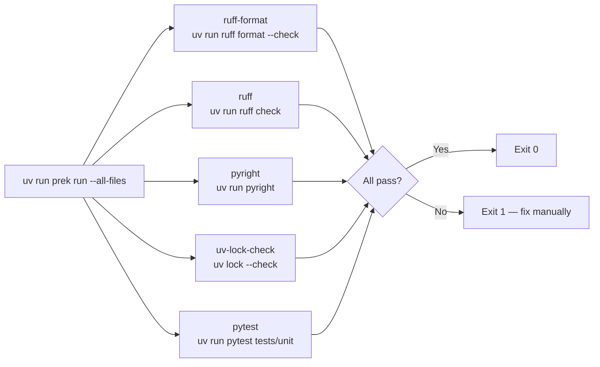
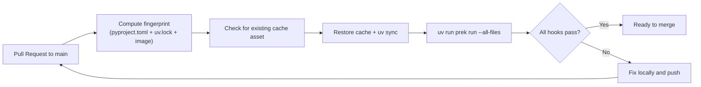

<!-- source: DeepWiki mcp.deepwiki.com · repo OpenPipe/ART · page 8.1 Development Setup · fetched 2026-10-29 -->

# Development Setup

<details>
<summary>Relevant source files</summary>

The following files were used as context for generating this wiki page:

- [.github/workflows/create-draft-release.yml](.github/workflows/create-draft-release.yml)
- [.github/workflows/package-install.yml](.github/workflows/package-install.yml)
- [.github/workflows/prek.yml](.github/workflows/prek.yml)
- [.github/workflows/release.yml](.github/workflows/release.yml)
- [AGENT.md](AGENT.md)
- [CONTRIBUTING.md](CONTRIBUTING.md)
- [pyproject.toml](pyproject.toml)
- [scripts/bump_version.py](scripts/bump_version.py)
- [scripts/ci/build_and_push_uv_cache.sh](scripts/ci/build_and_push_uv_cache.sh)
- [scripts/ci/compute_uv_fingerprint.py](scripts/ci/compute_uv_fingerprint.py)
- [src/art/dev/__init__.py](src/art/dev/__init__.py)
- [src/art/dev/get_model_config.py](src/art/dev/get_model_config.py)
- [src/art/dev/model.py](src/art/dev/model.py)
- [tests/unit/test_dedicated_config.py](tests/unit/test_dedicated_config.py)
- [uv.lock](uv.lock)

</details>


This page explains how to set up a local development environment for contributing to the ART framework. It covers repository cloning, dependency installation, code quality tools, and development workflows.

For information about project structure and organization, see page 8.2. For details on the release process, see page 8.3.

---

## Prerequisites

Before setting up the development environment, ensure you have the following installed:

- **Python 3.12+** — Required; specified in [pyproject.toml:6]()
- **Git** — For cloning the repository
- **uv ≥ 0.11.7** — Package manager used by this project; see `[tool.uv]` in [pyproject.toml:153]()
- **Linux** — Required for GPU backend testing and specific dependencies like `deep-ep` or `tilelang` [pyproject.toml:57-58]().

Sources: [CONTRIBUTING.md:1-15](), [pyproject.toml:1-16](), [pyproject.toml:153]()

---

## Repository Setup

### Cloning the Repository

Clone the ART repository from GitHub:

```bash
git clone https://github.com/OpenPipe/ART.git
cd ART
```

Sources: [CONTRIBUTING.md:3-8]()

### Installing Dependencies

ART uses `uv` as its package manager. If `uv` is not installed, install it first:

```bash
curl -LsSf https://astral.sh/uv/install.sh | sh
```

Install project dependencies including the `dev` dependency group:

```bash
uv sync --group dev
```

This reads [pyproject.toml]() and resolves from [uv.lock](), creating a virtual environment in `.venv`. The `dev` group adds development tools such as `ruff` and `pytest`.

**Installing with Optional Extras:**

The project defines several optional extras for different backend capabilities:

| Extra | Key Packages | Use Case |
|-------|-------------|----------|
| `backend` | `unsloth`, `torch`, `trl`, `wandb` | Local GPU training (Unsloth/Torchtune) |
| `megatron` | `megatron-core`, `apex`, `transformer-engine` | Large-scale distributed training |
| `langgraph` | `langchain-core`, `langgraph` | LangGraph agent integration |
| `tinker` | `tinker`, `fastapi`, `uvicorn` | TinkerBackend |
| `plotting` | `matplotlib`, `seaborn` | Visualizations |

```bash
# Install backend extras (needed for GPU training)
uv sync --group dev --extra backend

# Install all extras
uv sync --group dev --all-extras
```

Note: There are conflicts between `backend` and `megatron` extras, as well as `tinker` and `megatron` extras [pyproject.toml:154-163]().

Sources: [CONTRIBUTING.md:10-14](), [pyproject.toml:18-88](), [pyproject.toml:154-163]()

---

## Development Environment Flow

**Development setup and check workflow:**



Sources: [CONTRIBUTING.md:1-38](), [AGENT.md:1-11]()

---

## Code Quality Checks

ART uses [`prek`](https://github.com/j178/prek) to manage and run code quality hooks. These same hooks run in CI for all pull requests.

### Running Checks

```bash
# Install git hooks (recommended — hooks run automatically on commit)
uv run prek install

# Run all checks against all files
uv run prek run --all-files
```

Individual hooks can be run in isolation:

```bash
uv run prek run ruff
uv run prek run ruff-format
uv run prek run pyright
uv run prek run uv-lock-check
uv run prek run pytest
```

Sources: [CONTRIBUTING.md:16-38]()

### Check Pipeline

**`prek` hook execution flow (maps hook names to underlying commands):**



Sources: [CONTRIBUTING.md:16-38](), [.github/workflows/prek.yml:124-172]()

### Individual Check Components

| Hook Name | Purpose | Auto-fixable |
|-----------|---------|--------------|
| `ruff-format` | Code formatting | Yes (`uv run ruff format .`) |
| `ruff` | Import sorting, linting | Partial (`uv run ruff check --fix .`) |
| `pyright` | Static type analysis | No |
| `uv-lock-check` | Verifies `uv.lock` is up-to-date | Run `uv lock` |
| `pytest` | Unit tests | No |

Sources: [CONTRIBUTING.md:16-38](), [pyproject.toml:137-151]()

---

## Continuous Integration

GitHub Actions runs `prek` checks on all pull requests. The CI pipeline uses a prebuilt `uv` cache (stored as a GitHub release asset) to avoid rebuilding heavy native dependencies like `flash-attn` or `apex` on every run.

**CI `prek` workflow:**



Sources: [.github/workflows/prek.yml:23-172](), [scripts/ci/compute_uv_fingerprint.py:1-108]()

### CI Cache Refresh

After changing dependencies in `pyproject.toml` or `uv.lock`, refresh the CI cache manually if needed:

```bash
bash scripts/ci/build_and_push_uv_cache.sh
```

The fingerprint is computed using `scripts/ci/compute_uv_fingerprint.py`, which hashes `pyproject.toml`, `uv.lock`, and environment variables like `TORCH_CUDA_ARCH_LIST` [scripts/ci/compute_uv_fingerprint.py:80-104]().

Sources: [CONTRIBUTING.md:41-53](), [scripts/ci/compute_uv_fingerprint.py:80-104]()

---

## GPU Machine Connection

### Connecting to a GPU Instance

For training, a machine with at least one H100 or A100-80GB GPU is recommended [CONTRIBUTING.md:94]().

**VSCode Setup:**
1. Install **Remote-SSH** extension.
2. Add extensions to `Remote.SSH: Default Extensions`: `ms-python.python`, `ms-toolsai.jupyter`, `eamodio.gitlens`, `charliermarsh.ruff`.
3. Connect to host (e.g., `art` if using SkyPilot).
4. Open the workspace folder (usually `sky_workdir`).

Sources: [CONTRIBUTING.md:86-135]()

### Testing Backend Configuration

You can validate dedicated mode configurations (separate GPUs for training and inference) using `validate_dedicated_config` [src/art/dev/validate.py:19]().

```python
from art.dev.model import InternalModelConfig
from art.dev.validate import validate_dedicated_config

config = InternalModelConfig(
    trainer_gpu_ids=[0],
    inference_gpu_ids=[1]
)
validate_dedicated_config(config) # Raises ValueError if invalid
```

Sources: [src/art/dev/validate.py:16-20](), [tests/unit/test_dedicated_config.py:39-43]()

---

## Release Process

Releases are managed via GitHub Actions.

1. **Bump Version**: Run `python scripts/bump_version.py <patch|minor|major>` [scripts/bump_version.py:6-8]().
2. **Draft Release**: Trigger `create-draft-release.yml` via GitHub Actions or CLI:
   ```bash
   gh workflow run create-draft-release.yml --field version_type=patch
   ```
3. **Publish**: Merge the automatically created release PR. This triggers `release.yml`, which builds the package, runs a smoke test on the `vllm_runtime`, and publishes to PyPI [ .github/workflows/release.yml:23-155]().

Sources: [CONTRIBUTING.md:54-83](), [.github/workflows/release.yml:1-194](), [scripts/bump_version.py:1-91]()

---

